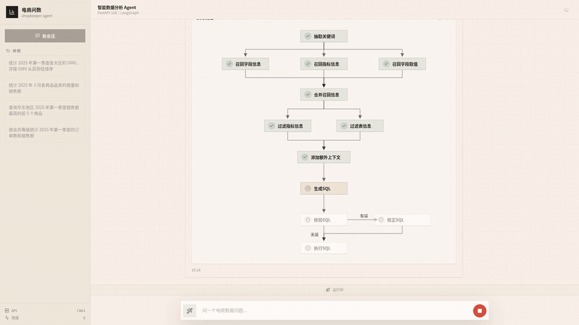

# DSWS v2 实例交付说明（LangGraph + 原版界面）

> 部署日期：2026-11-05；界面切换：2026-11-06
> 旧实例（v1）保持不动：`http://8.155.135.97:5050`
> v2 实例：`http://8.155.135.97:5051`

## 一句话

在旧实例之外新起了一套 v2：后端把自研 12 步编排换成**真实执行的 LangGraph `StateGraph`**（12 个契约节点、条件边 `validate_sql → correct_sql → validate_sql`）；前端已从教学重建版换回**原版 `shopkeeper-agent` 界面**（React 19 + Tailwind 3.4），只加了一层 SSE 展示适配，页面不再出现「教学版」「从零重建」字样。两套实例共享同一套 MySQL / Elasticsearch / Qdrant，旧实例 `:5050` 未重启、未改动。

## 访问地址与容器

| 项 | v1（旧实例） | v2（本次新增） |
|---|---|---|
| 前端 | `http://8.155.135.97:5050` | **`http://8.155.135.97:5051`** |
| 后端 | `127.0.0.1:8100` | `127.0.0.1:8101` |
| 容器 | `shopkeeper-rebuild-{frontend,backend}-1` | `dsws-v2-{frontend,backend}-1` |
| 前端镜像 | `shopkeeper-rebuild/frontend:local` | `dsws-v2/frontend-original:local`（旧重建镜像 `dsws-v2/frontend:local` 保留可回滚） |
| 状态 | 3 天前启动，healthy | 本次构建，healthy |

```text
dsws-v2-frontend-1   Up (healthy)   0.0.0.0:5051->80/tcp
dsws-v2-backend-1    Up (healthy)   127.0.0.1:8101->8100/tcp
```

v2 复用旧实例的 `shopkeeper-rebuild_default` 网络解析 `mysql` / `elasticsearch` / `qdrant`；只新建 backend / frontend 两个容器，不重建、不重启基础设施。

## 技术栈差异补齐

### 1. LangGraph（真实执行，不是只加依赖）

- 依赖：`langgraph 1.2.19`（`backend/pyproject.toml` / `uv.lock`）。
- 新增 `backend/app/agent/graph.py`：`StateGraph(AgentState)`，12 个节点 id 与 `contracts/steps.yaml` 完全一致：
  `extract_keywords, recall_column, recall_value, recall_metric, merge_retrieved_info, filter_table, filter_metric, add_extra_context, generate_sql, validate_sql, correct_sql, run_sql`。
- 边：`START → 8 个上下文节点 → generate_sql → validate_sql`；`validate_sql` 条件边 → `run_sql` / `correct_sql` / `END`；`correct_sql → validate_sql`；`run_sql → END`。
- `AgentRunner.events()` 改为执行编译后的图；SSE 事件顺序、payload、错误码、取消语义、`correct_sql` 显式 `skipped`、`INTERNAL_ERROR` 兜底保持不变。
- 运行时证据：容器内 `langgraph 1.2.19`，`AGENT_STEP_IDS` 打印 12 个节点；真实问数 SSE 的 12 个节点全部出现 `running → success/skipped`。

### 2. 原版 shopkeeper-agent 界面（含 SSE 展示适配）

- 界面来源：`A020-电商问数智能体实战教程fixed/code/shopkeeper-agent-frontend`，复制到 `deliverable/v2/original-frontend/`；技术栈为 React 19 + Tailwind 3.4 + Vite 6。
- 只改展示层，不改后端 SSE 契约：
  - `src/lib/agentApi.ts`：步骤 id → 中文节点名（`extract_keywords` → `抽取关键词` 等 12 个）；`{columns, rows}` → 原版结果表使用的行对象；错误消息追加错误码。
  - `src/types/agent.ts` / `src/components/StepRail.tsx`：支持 `skipped` 状态；`校正SQL` 未触发时显示「· 未触发」。
  - `src/App.tsx`：API 地址回退改为 `/api`，经 nginx 反代到 v2 backend。
- 构建产物：`dist/assets/index-BST44iiq.js`（252.86 kB，gzip 78.41 kB）、`dist/assets/index-DqE4c5df.css`（16.55 kB，gzip 4.46 kB）。
- 线上验证：页面标题 `电商问数 | Shopkeeper Agent`，首屏与结果页均不含「教学版」「从零重建」。
- 部署：`deploy/v2/compose.v2.yaml` 的 frontend 改为 `dsws-v2/frontend-original:local`，构建上下文 `./original-frontend`、`Dockerfile.original`；原教学重建版镜像 `dsws-v2/frontend:local` 保留可回滚。
- 重新构建：`cd deliverable/v2/original-frontend && npm install && npm run build`；`Dockerfile.original` 只把 `dist/` 拷进 nginx，不在容器里跑 npm。

## 验证记录

### 健康检查

```text
$ curl -s http://127.0.0.1:5051/api/health
{"status":"ok","stage":"S7"}

$ curl -s http://127.0.0.1:5050/api/health   # 旧实例
{"status":"ok","stage":"S7"}
```

### 界面切换验证（2026-11-06）

- `:5051` 返回原版页面：`<title>电商问数 | Shopkeeper Agent</title>`，资源 `index-BST44iiq.js` / `index-DqE4c5df.css`；容器镜像 `dsws-v2/frontend-original:local`，healthy。
- 浏览器正文检查：`contains 教学版: false`、`contains 从零重建: false`。
- `:5050` 未重启，仍是旧重建界面（`<title>电商问数智能体 · 重建 S0</title>`），healthy。
- 截图：`screenshots/v2-idle-1920x1080.png`、`v2-query-result-1920x1080.png`、`v2-product-ranking-result-1920x1080.png`、`v2-union-rejected-1920x1080.png`。
- 完整命令输出：`evidence/verification.log` 的「UI switch」段。

### 真实问数（成功路径）

问题：`统计 2025 年第一季度各大区的 GMV，并按 GMV 从高到低排序`

```text
extract_keywords running → success 2.5ms
recall_column running → success 0.5ms
recall_value running → success 0.1ms
recall_metric running → success 0.3ms
merge_retrieved_info running → success 0.0ms
filter_table running → success 0.1ms
filter_metric running → success 0.0ms
add_extra_context running → success 0.0ms
generate_sql running → success 2750.9ms
validate_sql running → success 22.4ms
correct_sql skipped
run_sql running → success 10.9ms
result: 华东 107,373 / 华南 70,202 / 华北 41,099.5 / 西南 31,528 / 华中 28,957
```

原始 SSE：`evidence/v2-query.sse`；浏览器结果页截图：`screenshots/v2-query-result-1920x1080.png`。

### 条件边（修复前的失败路径）

问题：`哪个商品品类卖得最好`（v1 里会触发校验失败）

```text
generate_sql success 4578.7ms
validate_sql error 0.9ms
correct_sql running → error 6544.1ms
error SQL_UNKNOWN_COLUMN: 列 fact_order.order_quantity 不在契约上下文里
```

这证明 **LangGraph 条件边在真实环境确实被走到**：校验失败 → 进入 `correct_sql`。但本次真实 LLM 的纠正没有成功（`correct_sql` 自身报错，最终错误仍是 `SQL_UNKNOWN_COLUMN`，`attempts: 0`），与 v1 的差距一致，**当时不宣称「纠正成功」已复现**。修复见下一节。原始 SSE：`evidence/v2-correct-path.sse`。

### 校正失败根因与修复（2026-11-06，两次）

**现象**：`哪个商品品类卖得最好` 在 `validate_sql` 报 `SQL_UNKNOWN_COLUMN`，`correct_sql` 也没有成功。

**根因**（两层，均已复现）：

1. **上下文裁剪太窄**：`卖得最好` 不是契约里的指标别名，`recall_metric` 匹配不到指标，`filter_table` 只保留了维度和外键，事实表 `fact_order` 的 `order_quantity` / `order_amount` 没有进上下文。模型生成的 `SUM(fact_order.order_quantity)` 因此被 guard 判成「列不在契约上下文里」。
2. **校正提示词没有字段列表**：`correct_sql.prompt` 只有 `table_infos` / `metric_infos`，没有 `column_infos`。真实 LLM 看不到可用字段，只能拒答：`UNKNOWN_COLUMN fact_order.order_quantity 不在可用字段契约中`。

**修复**：

- `backend/app/generate/context.py`：排名意图 + 没有命中任何指标时，把事实表的 measure 列补进上下文；只补 measure，不放开整张宽表，维表裁剪仍然保留。
- `backend/app/generate/context.py`：同一条规则下，如果问题问的是「商品/产品」实体（如「哪个商品卖得最好」）且没有命中品类/品牌等维度，补上 `dim_product.product_name`，避免只能按 `product_id` 分组、把商品答成 `P001`。
- `contracts/prompts/correct_sql.prompt` + `backend/app/agent/correct.py`：校正提示词增加 `column_infos`，模型能看到「只能使用这里列出的表与字段」。
- 新增回归测试：`test_implicit_ranking_question_exposes_fact_measures`、`test_implicit_ranking_measure_passes_guard`、`test_product_level_ranking_question_exposes_product_name`、`test_prompt_exposes_allowed_columns`。

**验证**：

- 修复后原问题**直接成功**：`generate_sql success → validate_sql success → correct_sql skipped → run_sql success → result`，结果 `手机数码 / 194771.0`（按销售额）。原始 SSE：`evidence/v2-fixed-query.sse`。
- 商品级问法**也直接成功**：`哪个商品卖得最好` → `商品名称 / 销售数量`，结果 `蒙牛纯牛奶 250ml*12 / 183`，`correct_sql skipped`。原始 SSE：`evidence/v2-product-ranking.sse`。
- 校正成功态**已复现（故障注入）**：`generate_sql` 故意返回拼错列名的 SQL → `validate_sql error` → `correct_sql success 1841.9ms`（真实 LLM）→ `validate_sql success` → `run_sql success` → `result`（`休闲零食 / 298`，真实 MySQL）。原始 SSE：`evidence/v2-correct-success.sse`。这条证据的 `generate_sql` 是故障注入，`correct_sql` 与 `run_sql` 都是真实的；不把它说成「自然问题稳定触发的失败」。

### 第二次修复：实体粒度补齐与指标命中解耦（`ac4985e`）

**剩余问题**：第一次修复只覆盖了「没有命中指标」的排名问题。像 `查询销售额最高的前5个商品` 这种命中了「销售额」指标的问题，`context.py` 的 `implicit_ranking = fact_table and not metric_candidates and has_ranking_intent` 为 False，于是不再补商品维度；上下文只剩 `fact_order.date_id` / `fact_order.order_amount`。生成器只能写 `product_id`，`validate_sql` 报 `SQL_UNKNOWN_COLUMN`，校正器看到的 `column_infos` 里也没有 `product_id`/`product_name`，只能拒答。

**修复**：

- `backend/app/generate/context.py`：把「实体粒度补齐」与 `metric_candidates` 解耦。实体词从契约推导（维表主键 + 名称列别名去掉 `ID`/`名称`/`name` 等后缀），覆盖商品、客户、地区等；只在问题确实按该实体粒度提问时补名称列，只补名称列，FK 仍只补命中实体那一对，避免把整张维表塞进上下文。
- `contracts/prompts/correct_sql.prompt`：明确 `SQL_UNKNOWN_COLUMN` / `SQL_UNKNOWN_TABLE` 且存在语义等价字段时，必须替换或补 JOIN，不得仅因原名未知拒答；安全边界不变，校正结果仍重新过 guard + policy。
- `backend/app/agent/graph.py`：把 `proposal.note` 写入 `error.detail.reason`，这样 `correct_sql error` 不再只有一块红叉，而能看到「校正被拒答 / 崩溃 / 产物不合契约」的原因。

**线上验证（2026-11-06，真实 LLM + MySQL）**：

- `查询销售额最高的前5个商品`：`generate_sql success → validate_sql success → correct_sql skipped → run_sql success`，结果 5 行（P001 iPhone 15 Pro / 71992 等）。原始 SSE：`evidence/v2-product-ranking-metric.sse`。
- `查询销售额大于平均销售额的商品`（第 1 次）：`generate_sql success → validate_sql error → correct_sql success → validate_sql success → run_sql success`，结果 5 行。**这是一次自然问数触发的校正成功，不是故障注入**。原始 SSE：`evidence/v2-natural-correct-success.sse`。
- 同题第 2 次：`correct_sql skipped`，直接成功；说明是否触发校正取决于模型是否生成可重试错误，但触发后能修好。
- 回归：品类题不额外补 `product_name`；客户/省份排名正常；利润/退货/城市仍 `LLM_REFUSAL UNSUPPORTED_INTENT`，没有为了补维度而放宽边界。完整输出见 `evidence/verification.log`。

### 自动化测试

```text
backend:  812 passed, 30 skipped, 0 failed（干净 worktree；主工作区未提交的 docs/SCHEMA-CONTRACT.md 会另带 3 个文档新鲜度失败，与本次修复无关）
frontend: 40 tests passed
frontend build: ✓ built
```

## 演示视频



`deliverable/v2/DSWS-v2-original-ui-demo.mp4`（46.27s，1920×1080 / 30fps，H.264，1.7 MB）。

- 录制方式：Playwright 驱动系统 Chrome 操作 `http://8.155.135.97:5051`，真实 SSE，无回放、无 mock；录制于 2026-11-06（界面切换 + 2SQL 修复之后）。
- 0–3.8s 片头：原版界面已恢复，后端仍是 LangGraph 12 节点；「教学版」字样已移除。
- 3.8–7.7s 首屏：原版界面、12 节点待命。
- 7.7–18.6s GMV 问数：12 节点全部 `running → success/skipped`，结果 5 行（华东 107373 / 华南 70202 / 华北 41099.5 / 西南 31528 / 华中 28957）。
- 18.6–30.2s 商品级排名：`哪个商品卖得最好`，`correct_sql skipped`，结果 1 行（本次按销售额：iPhone 15 Pro / 71992）。
- 30.2–42.4s UNION 拒绝：`validate_sql` 红，错误 `SQL_REJECTED`，页面展示错误码；`correct_sql` 保持「未触发」。
- 42.4–46.27s 片尾：汇总验证结论。
- 逐段说明与证据引用：`annotations.yaml`。

## 已知差距（不粉饰）

1. **纠正成功态已复现（自然问数 + 故障注入）**：原问题「哪个商品品类卖得最好」的根因已修复，现在直接成功（`correct_sql skipped`）。自然问数 `查询销售额大于平均销售额的商品` 已触发一次 `validate_sql error → correct_sql success → validate_sql success → run_sql success`，见 `evidence/v2-natural-correct-success.sse`；同题另一次运行直接成功，说明是否触发取决于模型是否生成可重试错误，不能保证每次复现。故障注入样本 `evidence/v2-correct-success.sse` 仍保留，用于稳定回归校正通道本身。
2. **v2 的 `uv.lock` 是云端镜像改写版**：为了在服务器上避开 `files.pythonhosted.org` 的慢速下载，云端 `/opt/dsws-v2/repo/backend/uv.lock` 用腾讯云 PyPI 镜像重新生成（版本与仓库锁文件完全一致，只改写下载 URL）。仓库内 `uv.lock` 仍保持 pypi.org 原始来源，保证可移植性。
3. **构建对国内网络做了适配**：`UV_IMAGE` 使用 `ghcr.m.daocloud.io/astral-sh/uv:0.8.22`；Dockerfile 去掉了 BuildKit cache mount 并设置 `UV_NO_CACHE=1`，规避该服务器上 uv 解包阶段卡死的问题。这些改动不影响运行时功能。
4. **商品级排名的口径随 LLM 运行而变**：同一问题「哪个商品卖得最好」在两次真实运行中分别按销售额（iPhone 15 Pro / 71992）和销售件数（蒙牛纯牛奶 250ml*12 / 183）排序，两次都直接成功。视频与存档 SSE 不是同一次运行，这是模型生成 SQL 的随机性，不是链路不稳定。

## 复现 / 重建

见 `deploy/v2/README.md`。核心步骤：

```bash
cd /opt/dsws-v2/repo
# 国内网络：先用腾讯云镜像重写锁文件（版本不变，只换 URL）
cd backend && uv lock --index-url https://mirrors.cloud.tencent.com/pypi/simple && cd ..
docker compose -f compose.v2.yaml up -d --build
```

## 文件清单

```text
deliverable/v2/
├── README-v2.md                         # 本文件
├── PRD-差异补齐.md                       # v1/v2 三项差距对照
├── DSWS-v2-original-ui-demo.mp4         # 演示视频（46.27s / 1920x1080 / 30fps）
├── annotations.yaml                     # 视频逐段标注与证据引用
├── original-frontend/                   # 原版 shopkeeper-agent 界面源码 + SSE 展示适配
│   ├── src/lib/agentApi.ts              # 步骤 id → 中文节点名、结果行转换
│   ├── src/components/StepRail.tsx      # skipped 状态、校正SQL 节点宽度
│   ├── nginx.conf                       # /api 反代 + SSE 不缓冲
│   └── Dockerfile.original              # 静态 dist + nginx
├── screenshots/
│   ├── v2-demo-preview.gif              # GitHub README 预览（13.1s / 960x540）
│   ├── v2-idle-1920x1080.png            # 原版界面首屏
│   ├── v2-query-result-1920x1080.png    # GMV 问数 5 行结果
│   ├── v2-product-ranking-result-1920x1080.png  # 商品级排名结果
│   ├── v2-union-rejected-1920x1080.png  # UNION 策略拒绝
│   └── v1-idle-1920x1080.png            # v1 首屏（对照）
└── evidence/
    ├── verification.log                 # 容器/健康/LangGraph/界面切换/步骤状态
    ├── v2-query.sse                     # 成功路径原始 SSE（修复前）
    ├── v2-correct-path.sse              # 条件边失败路径原始 SSE（修复前）
    ├── v2-fixed-query.sse               # 第一次修复后原问题直接成功
    ├── v2-product-ranking.sse           # 第一次修复后商品级问法直接成功
    ├── v2-correct-success.sse           # 校正成功（故障注入 + 真实 LLM/MySQL）
    ├── v2-product-ranking-metric.sse    # 第二次修复后「销售额最高的前5个商品」直接成功
    ├── v2-natural-correct-success.sse   # 第二次修复后自然问数触发校正成功
    └── v2-category-after-fix.sse        # 第二次修复后品类题未误加商品维度
```
