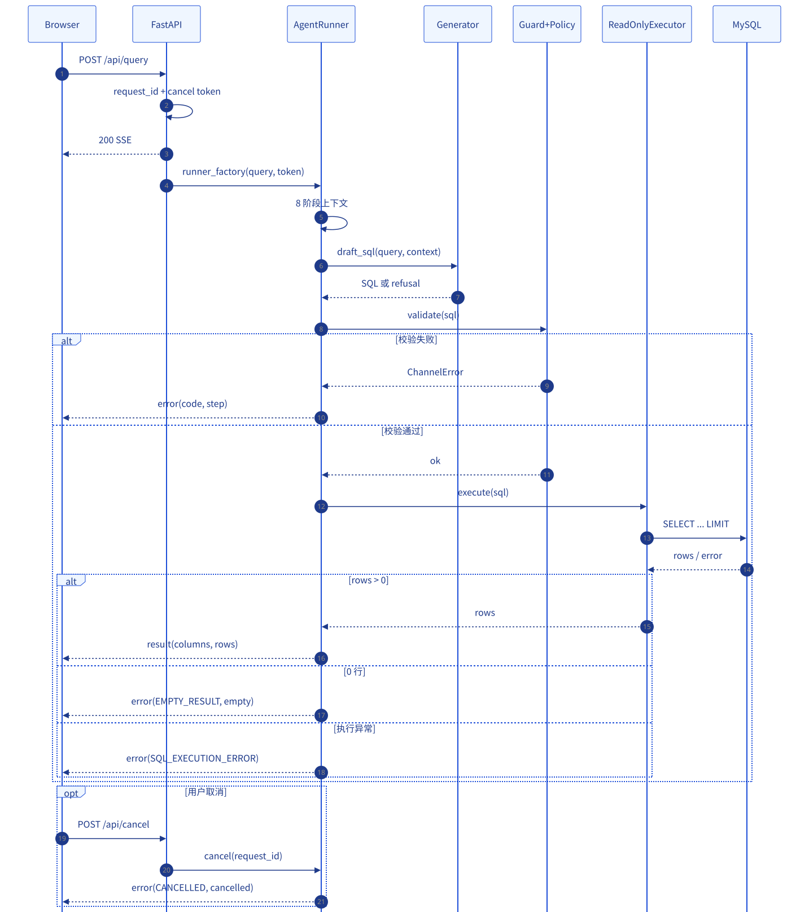
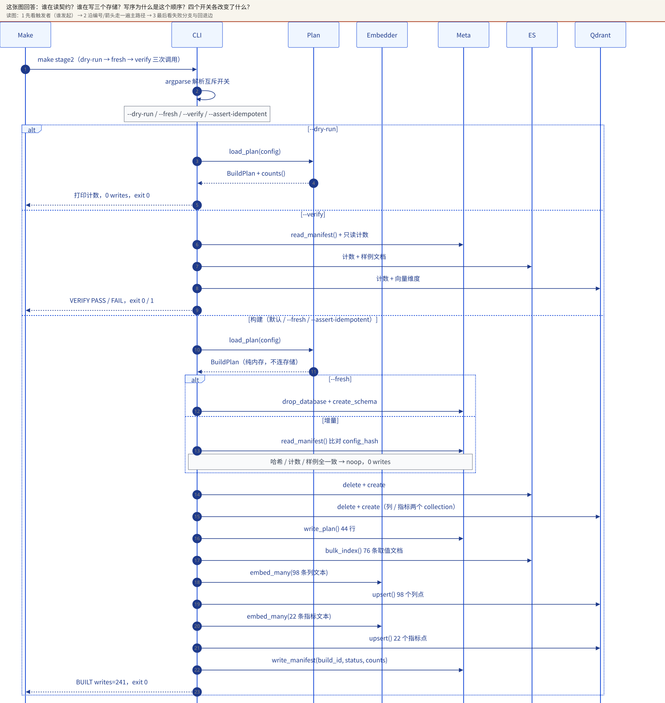
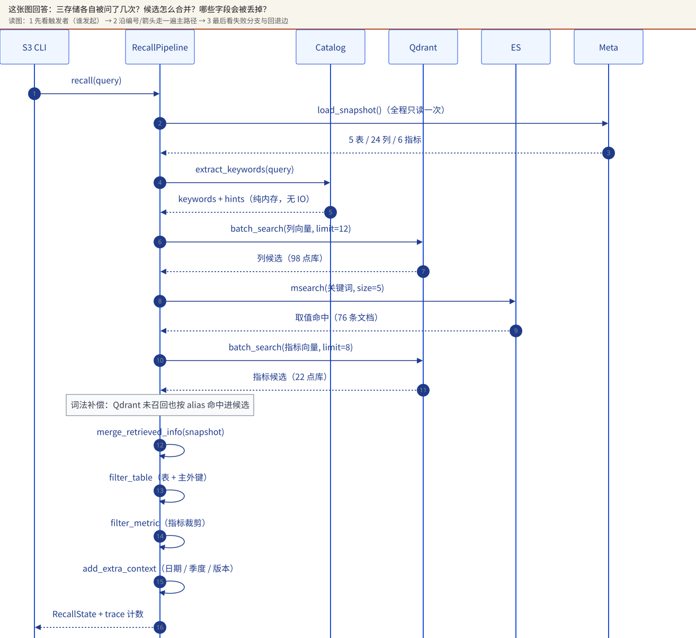
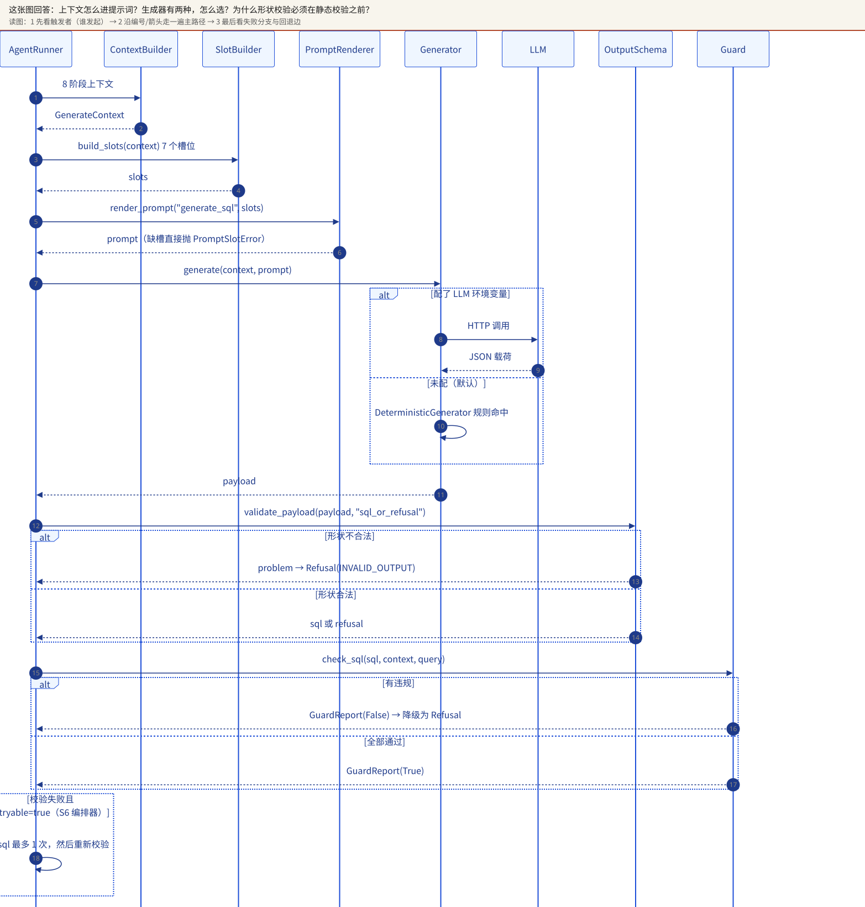

# 第二部分 · S0–S4：从骨架到生成

旧系统的「客单价」能同时算出 2427.47、448.81、5.41。2427.47 是订单金额除以订单数，448.81 是金额除以件数，5.41 是件数除以订单数；三个都叫「客单价」，三个都能在 SQL 里自圆其说。

S1 的第一件事，就是逼你回答：你说的「客单价」到底是哪一个。

口径错误通常不会报错：它只会安静地给出另一个能自洽的数字。换一个分母、换一个聚合对象，报表就换一个数，每个数看起来都对。

不过，S1 之前还有一条更基础的管道。前端不知道后端内部有几个步骤，后端发了一个前端不认识的事件，前端忽略它，页面停在半路——这是 S0 要先解决的麻烦。先把管道跑通，再谈口径。

这一部分要回答的问题可以压成一句：一条问数流水线，怎样从「前后端能对上话」走到「能生成一条可校验的 SQL，或者给出一次有名字的拒答」？两个限定词值得停一下：可校验，意味着产物要能被机器检查；有名字，意味着拒绝也要有理由，不能只留一个空白的界面。

每一个阶段都配四件东西：一份契约，说明谁和谁对齐了什么；一个可停点，说明停在这里还能演示什么；一条验收命令，说明凭什么说它成立；一份证据，说明这条结论是跑过、推导，还是没跑。四件事凑齐，一个阶段才算完成；缺一件，它就只是一个功能模块，进不了评审。

这一部分讲「一条问数流水线怎么从零长出来」。组织方式是五种不确定性，不是功能清单：S0 先让前后端对同一种事件语法达成一致；S1 把「表结构、口径、值域以谁为准」钉死；S2 把契约翻译成三种可检索的存储；S3 证明检索能在 20 个真实问题上站得住；S4 把上下文变成一条可被机器校验的 SQL 或一次有名字的拒答。每一步都留下一个可停点：停在这里，系统仍然能演示、能验收、能回退。

读这一部分时请始终带着五个问题：这个阶段消灭了哪个不确定性？实体是谁？输入是什么？输出写到哪？查询时它还在不在场？后面的每一节都按这五个问题展开，最后用「怎么证明它真的成立」收口。命令以 `Makefile` 与 `docs/SETUP-FROM-SCRATCH.md` 为准；计数以 `design/inventory/facts.md` 为准；证据标记遵守 `design/STYLEGUIDE.md` 的 ✅ / 🟡 / ⚪ 纪律。

> **读这一部分之前**
>
> 你应当已经读过第一部分，知道 DSWS 是一个单轮、单库、只读、可拒答的电商问数智能体；会写 Python，能看懂 SELECT、JOIN、GROUP BY；知道 HTTP 请求与 JSON 响应长什么样。SSE、Pydantic、AST、Qdrant、Elasticsearch 会在本章第一次出现时解释，不需要提前学过。
>
> **读完这一部分，你应当能**
>
> - 说出 S0–S4 各自消灭了哪个不确定性，以及停在该阶段时系统还能做什么；
> - 在给定故障现象时，判断该查契约、查存储、查召回还是查生成层；
> - 跑通 S0、S1、S4 的离线门禁，读懂 S2、S3 的记录输出，并说清它们为什么仍是推断或未验证；
> - 解释为什么写入总数 241 只能算公式推导，以及 S3 为什么不进生产主链路。

本章首次出现的几个词，先给一句话：SSE（Server-Sent Events）是服务器单向推送的事件流，浏览器按行读取；Pydantic 是 FastAPI 用来校验请求体的库，字段为空或超长会在进入处理函数之前被拒绝；AST（抽象语法树）是把 SQL 解析成树之后的结构，策略与校验都在这棵树上做；Qdrant 是向量库，按向量相似度找候选；Elasticsearch（下文简称 ES）是基于倒排索引的搜索引擎，按词找取值。

> **动手之前**
>
> 先按 `docs/SETUP-FROM-SCRATCH.md` 装好工具链；S0、S1、S4 不依赖外部服务，S2、S3 需要 Docker。把这一章当实验手册用时，每节按「命令 → 期望输出 → 失败先查哪里」读：验收小节给命令与输出，常见故障小节给排查顺序。没有 Docker 时，S2 用 `--dry-run` 验证计划，S3 只能读记录输出；不要把「计划通过」当成「存储通过」。

## 0. 这一部分的地图

把 S0–S4 想成盖房子：S0 先定电线和插座的标准，S1 画承重墙和房间用途，S2 把材料按三个仓库分门别类放好，S3 练习「用户说一个词，能不能找到对的材料」，S4 才真正开始砌墙。标准没定就砌墙，后面每改一次协议都要拆一次前端；材料没编号就开工，工人只能靠记忆找砖。

这个类比有用，但它有一个局限：盖房子可以返工，口径错了不会有人报警。房子塌了看得见；一条把件数当订单数的 SQL 会安静地返回一个数。所以这套流水线每个阶段都要配一份可执行的验收，类比只负责帮你记住顺序，不负责证明顺序是对的。

把五个阶段各压成一句：

- **S0 统一语言。** 前后端对有哪些步骤、事件长什么样、流怎么结束达成一致。
- **S1 统一语义。** 表、列、指标、值域以一份契约为准，口径写成可校验的断言。
- **S2 统一物化。** 把契约翻译成查询时真正能用的三种存储，并让三份表示在计数、维度与样例内容上可对账（阶段表里的「等价」即此意）。
- **S3 把召回变成可回归的验收。** 用固定问题集检查检索能否召回对的表、列、值与指标、会不会夹带噪声；它不证明开放问法的召回质量。
- **S4 收口产物。** 把上下文变成一条可静态校验的 SQL，或者一次带原因的拒答。

| 阶段 | 新增能力 | 新增不确定性 | 可停点 | 前置 |
|---|---|---|---|---|
| **S0 骨架** | 12 步步骤目录、3 种 SSE 事件、5 个 HTTP 端点、前端协议守卫 | 前后端是否真的按同一份事件契约说话 | 后端能起服务，前端能解析事件并以 `result` / `error` 收尾 | `make install` |
| **S1 契约** | 5 表 / 24 列 / 6 指标；粒度、度量、值域、别名；旧系统负向夹具 | 契约是否与 DDL、真实数据、口径一致 | `make stage1` 全绿，且旧夹具必须红 | S0 |
| **S2 元知识** | Meta / ES / Qdrant 三份可检索元知识 + manifest + 幂等 | 同一份契约翻成三种存储后是否仍然等价 | `make stage2`；`--verify` 对账；第二次 `NOOP: 0 writes` | S1 + 三存储 |
| **S3 检索** | 8 个确定性节点、批量召回、20 题黄金集、稳定 YAML | 召回质量：候选够不够、噪声多不多 | `make stage3`；只读验收，不重建 | S2 |
| **S4 生成** | 7 槽位提示词、确定性 / LLM 生成器、输出 schema、AST 静态校验 | 产物形状与语义；真实 LLM 尚不可控 | `make stage4`，完全离线可跑 | S1（S3 可选） |

S3 那一行的「召回质量」是它要处理的问题，不是它已经证明的结论；§4 会把结论收窄成「固定问题集上可回归」。

表里有个容易忽略的细节：S2 与 S3 需要三存储，S0、S1、S4 不需要。这是刻意的。能离线判定的东西不绑 Docker；必须碰真实存储的，前置条件写在 `Makefile` 注释里，不藏在某个人脑子里。

表里的「可停点」值得单独解释。停点并不意味着做到一半；它意味着停在这里仍然能演示、能验收、能回退。S0 的停点是前端能把一条流解析到 `result` 或 `error`；S1 的停点是契约与真实数据对账通过；S2 的停点是三份计数与 manifest 对得上；S3 的停点是 20 题黄金集全过；S4 的停点是基线全过、拒答按预期出现。停点之前的阶段都能独立运行，所以排障时先问「最后一条绿的验收是哪条」，比问「代码改到哪了」更快定位。

本章的证据标记分三级：已验证（本机跑过，或文件、测试记录明确存在）、推断（从代码或文档推导，未实跑）、未验证（环境不具备或未执行）。标记沿用基线，已验证不等于本轮复现，表后会注明覆盖范围；图例见 `design/STYLEGUIDE.md`。

上面那张阶段表只覆盖 S0–S4。S5 讲安全执行，S6 讲失败通道与错误码，S7 讲前端收口，S8 讲生产化边界；本部分只在必要处提它们的名字，不展开。

如果只有一节课，主线是 S0 → S1 → S4；S2 与 S3 可以课后自学，课内只保留它们留下的两条边界：三存储的分工，以及召回质量还没有被证明。



图 07 把五个阶段放回一次真实请求里看：S0 定义这条请求的语法，S1 提供上下文的事实，S2 与 S3 负责找材料，S4 负责写 SQL。图中 S3 是虚线可选路径，后面不少边界都从这条虚线来。

## 1. S0 · 先让管道跑通

S0 只保证一件事：前后端对同一件事的说法一致。SQL 写得对不对，不归它管。旧系统把 12 个步骤节点硬编码在前端，后端新增一个事件类型，前端就可能把它当成失败；条件步骤 `correct_sql` 永远灰着，用户看不出它是「没触发」还是「卡住了」。S0 的做法很朴素：把步骤目录和事件语法抽成契约文件，两端都只认这份契约。后面流水线再复杂，「谁在什么时候说了什么」至少能对上。

### 1.1 问题

没有 S0 时，最常见的故障是沉默，不是报错：后端发了一个前端不认识的事件，前端忽略它，页面停在半路；或者后端少发了一个步骤的终态，进度条永远差一格。更隐蔽的是「条件步骤」——`correct_sql` 在设计上可能不执行，如果它没有显式的 `skipped`，前端只能显示一个永远 pending 的灰块。S0 要求每一个步骤都有结论，每一条流都必须以 `result` 或 `error` 收尾。缺了这两条，前端手上就没有任何能判断的东西。

`correct_sql` 是校验失败后按错误码重写 SQL 的那一步；它是步骤目录里唯一可能不执行的步骤，所以前端不能把它画成永远 pending。它的触发条件与重试上限在 §5.4 讲。

> **关键问题**：前端并不知道后端内部有几个步骤、哪一步会失败。它凭什么判断现在该转圈、该打勾，还是该显示未触发？S0 的答案是把这份名单交给契约，让两端读同一份文件。

把这条原则说得更一般一点：协议里凡是前端需要知道的东西，都不能只存在于后端的代码里。步骤目录、事件类型、错误码都属于这一类；S0 只处理前两样，错误码要到 S6 才补齐。

### 1.2 实体与边界

S0 的实体只有四个：**步骤**（`id`、`label`、`conditional`）、**事件**（`progress` / `result` / `error`）、**请求**（`query`，长度 1–500）、**请求标识**（`request_id`，用于取消与排障）。步骤的身份由 `contracts/steps.yaml` 定义，事件的形状由 `contracts/sse.schema.json` 定义，两者都不允许在代码里另抄一份。

把 SSE 再说得具体一点：它是一条长连接，服务器不断往同一个响应里写 data: <json> 这样的行，浏览器按行解析。它没有请求—响应那种一次问、一次答的结构，所以「流什么时候算结束」必须由协议显式规定。S0 规定的结束方式只有两种：`result` 或 `error`。

S0 只管 HTTP 表面与事件语法。SQL 语义、三存储、安全策略都不在它的边界内。当前仓库的 `backend/app/main.py` 已经是 S6/S7 的真实流水线，但 S0 的验收仍然成立——`backend/tests/test_s0_contract.py` 只检查「目录下发了 12 步」「每条事件都过 schema」「流一定收尾」，并不假设流里一定是假数据。历史上的 S0 是一条永远成功的假流；现在的流可能以 `error` 收尾，契约测试接受这一点：失败也得有形状。

### 1.3 输入

| 输入 | 内容 | 计数 | 证据 |
|---|---|---:|---|
| `contracts/steps.yaml` | 12 个步骤，`correct_sql` 标为 `conditional: true` | 12 / 1 | 文件本身 |
| `contracts/sse.schema.json` | `progress` / `result` / `error` 三种事件 | 3 | JSON Schema |
| `QueryRequest` | `query` 字段，1–500 字，空白串拒绝 | — | `backend/app/main.py:QueryRequest` |
| `backend/tests/test_s0_contract.py` | 契约测试：目录、生命周期、边界、CORS | 19 条 | 测试文件 |

先把 12 步全表列出来，后面引用某一步时不再重复解释。id 是契约里的键，前端显示的是 label；只有 `correct_sql` 标了条件执行。

| 步骤 id | 前端显示 | 条件执行 |
|---|---|---|
| extract_keywords | 抽取关键词 | 否 |
| recall_column | 召回字段信息 | 否 |
| recall_value | 召回字段取值 | 否 |
| recall_metric | 召回指标信息 | 否 |
| merge_retrieved_info | 合并召回信息 | 否 |
| filter_table | 过滤表信息 | 否 |
| filter_metric | 过滤指标信息 | 否 |
| add_extra_context | 添加额外上下文 | 否 |
| generate_sql | 生成SQL | 否 |
| validate_sql | 校验SQL | 否 |
| correct_sql | 校正SQL | 是 |
| run_sql | 执行SQL | 否 |

这张表是前端读到的完整目录；本章只走到生成与静态校验，最后一步执行 SQL 属于 S5/S6。目录是渲染顺序，不是执行次数：校正后重新校验，同一个步骤 id 的结论覆盖前一次，不会多出一格。

步骤目录的顺序有实际用途：它同时是前端步骤条的渲染顺序、SSE `progress.step` 的合法值域，以及 `correct_sql` 能否跳过的依据。12 个步骤里只有 `correct_sql` 是条件步骤；这个「恰好 1 个」被测试硬断言，防止未来有人顺手把别的步骤也标成条件而不改前端。

### 1.4 动作

先安装依赖，再跑门禁：

```bash
make install
make stage0
```

`make install` 做两件事：`cd backend && uv sync --frozen` 与 `cd frontend && npm ci`。前者还原后端虚拟环境，后者按锁文件安装前端依赖；首次需要网络，装完之后 S0/S1 可以离线跑。

`make stage0` 依次做三件事：跑 `tests/test_s0_contract.py`、跑前端 `npm run test`、跑前端生产构建。真实的步骤在 `Makefile:stage0`，不是本文重写的。可选的浏览器冒烟是 `make stage0-ui`，它会自起 8101 / 5274 两个临时端口，跑完清理；没有 Chrome / Edge 时会失败，这属于环境前置，不是代码回归。

代码路径只需要记四个：

- `backend/app/main.py:create_app()`：应用工厂，HTTP 与 SSE 管道都在这里装配。
- `backend/app/main.py:get_steps()`：读取 `steps.yaml` 并下发目录；前端不再硬编码节点。
- `backend/app/main.py:_sse()`：把事件编码成 `data: <json>\n\n`，刻意不传 `default=str`。
- `backend/app/main.py:_stream()`：把同步编排器放进工作线程，事件经队列回到协程，流结束时一定收尾。

读这段代码只需要抓住三件事：主事件循环、把事件从工作线程送回主循环的函数、队列的终止信号。下面这段解释了流为什么不会卡死：

```python
def worker() -> None:
    try:
        for event in runner.events():
            loop.call_soon_threadsafe(queue.put_nowait, event)
    except Exception as exc:
        loop.call_soon_threadsafe(queue.put_nowait, error.to_event())
    finally:
        loop.call_soon_threadsafe(queue.put_nowait, None)
```

`loop.call_soon_threadsafe` 负责把事件送回主循环，`queue.put_nowait` 负责入队，`None` 负责告诉消费者流结束了。示意代码省略了 `error` 的构造：完整实现先用 `build_error()` 把异常转成 `INTERNAL_ERROR`，再调用 `error.to_event()`，见 `backend/app/main.py:_stream()`。

同步生成器里要跑数据库，直接塞进异步响应会阻塞事件循环；所以它跑在工作线程，`None` 是队列的终止信号。任何异常都会被构造成一条 `INTERNAL_ERROR` 事件，而不是让连接悄悄断掉。

这里有个容易忽略的因果：数据库驱动是同步的，同步调用会把事件循环占住；事件循环一停，SSE 就写不出去，前端看到的是卡住，而不会收到一条错误。把生成器放进工作线程、用队列把事件送回协程，等于把慢限制在一个线程里，让主循环继续有能力写出事件、处理取消。`None` 是队列的句号；没有这个句号，消费者永远等不到流结束。

### 1.5 输出

S0 的输出是一组两边共同引用的协议产物：

1. `GET /api/steps` 返回 `version` 与 12 个步骤，前端据此渲染步骤条。
2. `POST /api/query` 返回 `text/event-stream`，每条事件都能被 `contracts/sse.schema.json` 验证。
3. `GET /api/health` 返回 `{"status":"ok","stage":"S7"}`（阶段号随实现推进，形状不变）。
4. 前端得到可解析的事件类型、可显示的步骤标签、以及一个明确的终态。

查询时这些产物还在不在场？在。`steps.yaml` 在应用导入时被读入 `STEPS`，`sse.schema.json` 是前端解析与测试的共同依据；它们不是一次性构建产物，而是运行时契约。区别只在于：S0 当时只有假流，现在同一条管道里跑的是真流水线。

#### 常见误解：S0 过了，SQL 就对了

S0 通过只证明协议对上了：步骤目录一致、事件形状合法、流能收尾。它不检查 SQL 的语义，也不检查数据库能不能连。把 S0 当端到端验收，会在 S4 或 S5 第一次遇到真正的语义错误。判断一个阶段验了什么，只看它的命令碰不碰存储、碰不碰模型：`make stage0` 两样都不碰。

### 1.6 验收

```bash
make stage0
```

期望输出（`docs/SETUP-FROM-SCRATCH.md` §2.3 记录的历史结果）：

```text
19 passed
18 passed
S0 PASS
```

三段输出要分开理解：`19 passed` 是后端契约测试，`18 passed` 是当时的前端协议单测，`S0 PASS` 是 Makefile 在所有子命令退出码为 0 后打印的结论。§3 里写的「前端 40（S7 扩写后）」是后续阶段扩写后的累计数量，不是 S0 当天的数量；不要把两个口径混在一起。

失败含义也要能读出来：如果后端测试红，先看是目录数量、事件 schema 还是流收尾；如果前端测试红，先看 SSE 解析器与类型守卫；如果 `npm run build` 红，通常是类型错误或依赖没装，而不是协议本身。`make stage0` 不碰数据库，所以它红了基本可以排除 MySQL / ES / Qdrant。

本设计工作树在 2026-10-29 实跑了后端部分：

```text
19 passed, 1 warning in 2.95s
```

前端 `node_modules` 未安装，因此 `npm run test` 与构建在本轮标 ⚪，不冒充已验证。

#### 例题：`skipped` 为什么不能当成成功

**题目**：`correct_sql` 在没配置 LLM 时不会执行。后端给它发一条 `progress`，状态是 `skipped`。前端如果把它当成成功，用户会看到什么？如果当成失败，又会看到什么？

**解答**：当成成功，步骤条会给校正这一步打勾，用户以为系统尝试过校正并且成功了；实际上下一步执行用的还是原来那条 SQL。当成失败，步骤条会标红，错误卡会指向一个根本没有失败的步骤，用户会去排查一个不存在的故障。两种误读都来自同一个错误：把「条件未触发」塞进了「成功 / 失败」的二值里。

`skipped` 的语义是「这次不需要执行」，所以它既不打勾也不标红；它的耗时字段必须是空值，前端显示「未触发」，步骤条继续往下走。S0 在契约里给状态留了四个合法值，就是为了让这第四种情况有地方待，而不是被迫挤进前两种。

四个值是 running、success、error、skipped；只有 success 与 error 允许带耗时，running 与 skipped 的耗时必须是空值。这里的 error 是步骤状态；整条流的终止事件也叫 error，同名但不同层：一个是某一步的结论，一个是流的收尾。

**结论**：一个状态机如果只有成功与失败，条件步骤就一定会被误读。多出来的那个状态承载的是「这次没轮到它」这个事实，不能省。

### 1.7 常见故障

| 故障 | 先查什么 | 怎么修 |
|---|---|---|
| `make stage0` 在 `npm ci` 失败 | Node / npm 版本、网络、`frontend/package-lock.json` 是否完整 | 装当前 LTS；确认能访问 npm registry；不要手改 lock 文件 |
| 后端 19 条里目录断言失败 | `contracts/steps.yaml` 是否被改动、`GET /api/steps` 是否仍读同一文件 | 恢复 12 步与唯一的 `conditional: true`；不要在 `main.py` 里另写列表 |
| 流没有以 `result` / `error` 收尾 | `AgentRunner.events()` 的兜底、`_stream()` 的 `finally` | 保留兜底异常转 `INTERNAL_ERROR`；不要吞掉异常后直接 `return` |
| 条件步骤没有状态 | `_skip_correct()` 是否在每条提前返回路径上被调用 | 任何提前结束都要显式发 `skipped`，不能留 pending |
| 501 字没有返回 422 | Pydantic `Field(max_length=500)` 是否被绕过 | 保持 `QueryRequest` 的长度约束；空白串单独拒绝 |
| 前端 CORS 报错 | `create_app()` 的 `allow_origins` 是否只含 5273 | 开发源就是 `127.0.0.1:5273` / `localhost:5273`；不要用 `*` 掩盖问题 |
| `make stage0-ui` 起不来 | 机器上有没有 Chrome / Edge、8101 / 5274 是否被占 | 装浏览器或用 Edge；先释放临时端口，再重跑 |

表里的三个环境词先解释：422 是请求体校验失败；CORS 是浏览器的跨域限制；5273 是前端开发端口。

### 1.8 证据

| 结论 | 状态 | 证据 |
|---|---|---|
| 步骤目录 12 步、1 个条件步骤 | ✅ | `contracts/steps.yaml`；`tests/test_s0_contract.py:test_steps_catalog` |
| SSE 只有 3 种事件，且 `error` 必带 `class` / `step` | ✅ | `contracts/sse.schema.json`；schema 负例测试 |
| 后端 S0 契约测试 19 条通过 | ✅ | 2026-10-29 本工作树 `uv run pytest -q tests/test_s0_contract.py` |
| 前端协议单测 18 条、构建通过 | 🟡 | `docs/SETUP-FROM-SCRATCH.md` §2.3 历史记录；本轮未装 `node_modules`，未重跑 |
| 浏览器冒烟 | ⚪ | 本轮未执行；需要 Chrome / Edge |

### 1.9 检查清单

- [ ] `contracts/steps.yaml` 仍是 12 步，且只有 `correct_sql` 标 `conditional`。
- [ ] `GET /api/steps` 的 `version` 与 `steps` 逐字来自 YAML，没有第二份硬编码。
- [ ] 每条 SSE 事件都能被 `contracts/sse.schema.json` 验证。
- [ ] 每条流都以 `result` 或 `error` 收尾；条件步骤有 `skipped` 或终态。
- [ ] 查询长度边界是 500 通过、501 返回 422；空白串返回 422。
- [ ] 能说清楚「S0 验证的是协议，不是 SQL，也不是数据库」。

## 2. S1 · 契约是唯一事实源

S1 要消灭的是「语义不确定性」：DDL（建表语句）能告诉你 `fact_order` 有 `order_amount`，却不会告诉你它是整单金额还是单价；能告诉你 `dim_region` 有 `region_name`，却不会告诉你它是省还是大区、是不是唯一键。旧系统把这些解释写在 YAML 和提示词里，没有一行代码强制，于是 AOV 同时存在 2427.47、448.81、5.41 三种口径，三种都能「自圆其说」。S1 的做法是把这些解释变成一份可执行校验的契约，再用旧系统当负向夹具，证明检查器真的会红。

### 2.1 问题

如果没有 S1，后面每个阶段都会各自解释一遍数据：S2 可能把 `order_amount` 当单价建索引，S3 可能把 `region_name` 当省召回，S4 可能生成一条语法正确但口径错误的 SQL。这些错误不会在编译期暴露，也不会在「查询成功」时暴露；它们只会让用户拿到一个看起来合理、实际错误的数字。S1 要做的是让粒度、度量、值域从注释变成断言，多写一个 YAML 只是手段：`dim_region` 一行一个 `region_id`，`region_name` 是省的上级分组，不是唯一键；`fact_order` 一行一单，`order_quantity` 是件数，`order_amount` 是整单金额。

把三种口径并排写出来：2427.47 是金额除以订单数，448.81 是金额除以件数，5.41 是件数除以订单数。三条 SQL 都能执行，三张结果表都长得像正确答案。S1 不替业务选一个数；它把「你指的是哪一个」变成契约里一条能检查的公式，选择权还在业务，检查权归机器。

把三个数的算式写出来：279159.5 ÷ 115 ≈ 2427.47；279159.5 ÷ 622 ≈ 448.81；622 ÷ 115 ≈ 5.41。三个结果来自同一份数据，只是分母不同。5.41 是四舍五入后的值，所以 448.81 × 5.41 不会精确回到 2427.47；要复核就用 622 ÷ 115，不要用乘法反推。

### 2.2 实体与边界

S1 的实体是一套四层结构：**数据集**（`dw`，5 表、115 行、2025 Q1）→ **表**（`role`、`grain`、主键、外键、表级度量）→ **列**（类型、角色、可空、别名、值域）→ **指标**（标签、公式、依赖列、聚合方式、期望值、拒收值）。`grain` 说的是「一行代表什么」：`dim_region` 一行一个 `region_id`，`fact_order` 一行一单；写 GROUP BY 时按什么分组，用的就是这一层的粒度。此外还有 **Issue**：检查器发现的每一条问题都有代码、路径、说明，代码集合是发布门禁的一部分。

S1 的边界：它只负责「契约 ↔ DDL ↔ 数据 ↔ 旧夹具」的一致性，不负责建库、不负责写三存储、不负责生成 SQL。它可以在没有 MySQL / Docker / LLM 的机器上跑，因为它只依赖 Python 标准库 `sqlite3` 和 PyYAML。查询时检查器不在场，但契约文件在场：S2 用它建知识，S3 用它做过滤与字段保真，S4 用它裁剪上下文。

> **设计原则：检查器必须能红。**
> 一个永远返回 PASS 的检查器，比没有检查器更危险：它会让团队误以为契约已经被守住。S1 用旧系统当负向夹具，要求同一套检查在旧配置上报出固定的问题集合；如果它突然变绿，说明检查器漏检，旧系统并没有变好。这条原则后面还会以别的形式出现：S5 要求注入语料全部被拒，S6 要求失败场景逐项命中。

### 2.3 输入

| 输入 | 内容 | 计数 | 证据 |
|---|---|---:|---|
| `contracts/schema.contract.yaml` | 5 表、24 列、6 指标、9 条列—指标关系 | 5 / 24 / 6 / 9 | YAML 解析 |
| `fixtures/dw.sql` | 物理 DDL + 真实数据，装进内存 SQLite | 115 行事实 | `schema_contract.py:load_ddl()` |
| `fixtures/legacy/` | 旧系统元数据与功能清单，负向夹具 | 必须检出 8 个代码 | `EXPECTED_LEGACY_CODES` |
| `docs/SCHEMA-CONTRACT.md` | 人读版契约，由契约生成 | 必须新鲜 | `--check-doc` |

负向夹具是一份故意写错的旧配置，用来要求检查器报错；它必须红，绿了说明检查器漏检。

`dim_region.region_name` 是理解「值域」的好例子：它的 `value_domain.kind` 是 `enum`，值域写了 `[华南, 华东, 西南, 华北, 华中]`，别名是 `[地区, 区域, 大区]`。这告诉后面的阶段两件事：它可枚举、可用于精确匹配；它描述的是大区，不是省，也不是城市。`fact_order.order_amount` 则是另一种：`kind: range`，范围 30.0–9499.0，角色是 `measure`，描述明确写「整单成交金额（已含件数），不是单价」。这两个例子会在 S2 里再次出现，用来解释「为什么一个进了 ES，一个没进」。

`enum` 与 `range` 是值域的两种形状：前者是有限个可枚举的值，适合精确匹配；后者是一段连续区间，适合比较大小。这个区分会在 S2 决定要不要把值写进 ES 时再次出现，也会在 S4 决定某个取值是否合法时用到。

### 2.4 动作

```bash
make stage1
```

它内部执行三步：`python -m app.schema_contract --check` 做契约、负向夹具、文档新鲜度三合一；`--expect-legacy-red` 单独断言旧夹具按预期变红；最后跑 `tests/test_s0_contract.py` 与 `tests/test_s1_schema_contract.py`。如果要重新生成人读版契约，用：

```bash
cd backend && uv run python -m app.schema_contract --write-doc
```

代码路径集中在 `backend/app/schema_contract.py`：

- `load_contract()` / `load_ddl()`：分别读语义契约与物理 DDL。
- `check_contract()`：把九组检查串起来，返回空列表才算绿。
- `_check_table_structure()` / `_check_grain_and_measures()`：检查列集合、主键、外键、粒度与度量单位。
- `_check_value_domains()`：检查枚举、范围、ID 正则、开放值域的允许名单。
- `_check_metrics()`：检查公式、聚合方式、期望值，防止「把 GMV 公式改成 SUM(件数) 也能自洽」。
- `check_legacy()`：对旧系统夹具跑同一套检查，要求它红。
- `main()`：`--check` / `--check-legacy` / `--expect-legacy-red` / `--write-doc` / `--check-doc` 五个入口。

契约里的公式是能跑的表达式：`check_contract()` 把 `SUM(fact_order.order_amount)` 与真实 SQLite 聚合值对账，GMV 必须是 279159.5，销量必须是 622。口径写成这样，改错了就会红。

### 2.5 输出

S1 的输出有三层：**检查结论**（PASS / FAIL 与问题列表）、**人读版契约**（`docs/SCHEMA-CONTRACT.md`）、**可被下游加载的语义对象**（S2/S3/S4 的 `Catalog` 与上下文都从这份 YAML 派生）。查询时 S1 的命令不在场，但它的产物在场：没有这份契约，S2 不知道哪些列该同步值域，S4 不知道哪些表列可以出现在 SQL 里。



图 14 给出 5 张表的连接关系；图 15 则把「表 / 列 / 指标 / 值域」抽成契约模型。两张图要一起看：ER 图回答「数据怎么连」，契约模型回答「每一条边和每一个列代表什么」。



### 2.6 验收

```bash
make stage1
```

期望输出：

```text
PASS: 5 张表 / 24 列 / 115 行 / GMV=279159.5 / 销量=622
PASS: 旧系统 14 条问题 / 8 个代码（预期红）
PASS: docs/SCHEMA-CONTRACT.md 与契约一致
S1 PASS
```

前三行分别代表三种「绿」：契约与真实数据对上了；负向夹具按预期红了（检查器没有退化）；人读文档没有过期。任何一行红都意味着不同的修法：第一行红先查契约与 `dw.sql` 的差异；第二行如果打印「GREEN」，说明检查器漏检了旧系统的缺陷，比第一行红更危险；第三行红只需 `--write-doc` 重新生成并 review diff，但如果 diff 里出现语义变化，要回到契约本身确认。

第二行 PASS 背后的明细，是一份逐条列出的清单，每条都带代码、路径与原因。节选：

```text
RED: 旧系统夹具检出 14 条问题
  [AOV_COLUMN_MISMATCH] legacy.metric.AOV: 描述是金额平均，relevant_columns 却是 ['fact_order.order_quantity']
  [AOV_THREE_WAY] legacy.metric.AOV: 描述(金额平均) / 依赖列(件数) / 别名(平均单价) 三方互相矛盾；同一词可算出 2427.47、448.81、5.41 三种结果
```

第一行是总数；后两行分别说明错在哪条契约的哪个字段，以及同一词为什么会算出三种结果。

本设计工作树在 2026-10-29 实跑了 `--check`，三行全部通过；S0 + S1 的后端测试合计 59 条通过。前端不参与 S1。

#### 补充：为什么契约检查用内存 SQLite

契约检查要在没有 Docker 的机器上跑，还要能反复跑而不留下状态。`fixtures/dw.sql` 本来就是建表加插入的脚本，装进内存 SQLite 之后，检查器可以在同一个进程里建库、灌数、聚合、丢弃。代价是 SQLite 与 MySQL 在类型与函数上有差异，所以这一步只验契约与数据是否一致，不验 MySQL 上的执行计划。真正的 MySQL 行为要到 S5 的执行器才出现。

### 2.7 常见故障

| 故障 | 先查什么 | 怎么修 |
|---|---|---|
| 表 / 列数不对 | `fixtures/dw.sql` 的 DDL 与契约的 `tables` 是否同步 | 改契约或改 DDL，二者只能有一个事实源；不要在两处各改一半 |
| GMV 或销量对不上 | 契约公式、`dw.sql` 数据、SQLite 聚合是否被改 | 用 `--check` 的问题列表定位；不要用改 `expected_value` 的方式「修绿」 |
| 旧夹具显示 GREEN | `EXPECTED_LEGACY_CODES` 是否被删、`check_legacy()` 是否被短路 | 恢复 8 个代码；负向夹具变绿是检查器退化，不是好消息 |
| 文档过期 | `docs/SCHEMA-CONTRACT.md` 是否手改过 | `--write-doc` 重新生成，再 review；生成物不要手改 |
| `value_domain` 缺失 | 新列是否只写了类型、没写 kind | 主键 / 外键 / 枚举 / 范围 / 开放文本必须显式声明；开放值域只允许 `customer_name` / `product_name` |
| 别名冲突 | 列别名与指标别名是否共用了一套空间 | 改别名，不要让「销售额」同时指向列和指标；`find_alias_collisions()` 会报 |
| 指标公式被改坏 | `EXPECTED_METRIC_FORMULAS` 与契约是否一致 | 公式是口径，不是实现细节；改公式必须同时改期望值与文档 |

### 2.8 证据

| 结论 | 状态 | 证据 |
|---|---|---|
| 契约是 5 表 / 24 列 / 6 指标 / 9 条列—指标关系 | ✅ | `contracts/schema.contract.yaml`；`--dry-run` 的 `column_metrics=9` |
| DDL 与真实数据是 5 表 / 24 列 / 115 行，GMV=279159.5、销量=622 | ✅ | 2026-10-29 本工作树 `--check` 输出 |
| 旧系统夹具检出 14 条问题 / 8 个代码 | ✅ | 同上；`EXPECTED_LEGACY_CODES` 逐项列出 |
| 文档新鲜度 | ✅ | `--check` 第三段 PASS |
| S0 + S1 后端 59 条测试 | ✅ | 2026-10-29 本工作树 `pytest -q tests/test_s0_contract.py tests/test_s1_schema_contract.py` |
| 旧系统三种 AOV 的历史来源 | 🟡 | `fixtures/legacy/meta_config.yaml` 与 `schema_contract.py` 文件头注释；旧系统源码不在本仓库 |

### 2.9 检查清单

- [ ] 能说出 `dim_region` 的粒度是「一行一个 `region_id`」，`region_name` 不是唯一键。
- [ ] 能说出 `order_quantity` 是件数、`order_amount` 是整单金额，二者都不是订单数。
- [ ] 6 个指标的公式、聚合方式、期望值都有契约依据，不是口口相传。
- [ ] 新增列时同时写 `role`、`value_domain`、`aliases`，并且 `--check` 绿。
- [ ] 旧夹具仍然是红的，且 8 个代码一个不少。
- [ ] 改完契约后重新生成 `docs/SCHEMA-CONTRACT.md`，并 review diff。

## 3. S2 · 构建元知识

S2 要消灭的是「可检索性不确定性」：契约是给人读的，检索需要的是机器能查的结构。Qdrant 的 payload（随点存储的元数据）也能存 `grain`，ES 也能从字段里抽出「华北」。三种存储的分工来自失败面隔离：每类查询都有更直接的实现形态，一类存储坏掉时，另外两类仍能独立重建（查询链路是否完整是另一回事）。只用 ES 也能做 kNN（按向量找最近邻），但取值文档与语义候选的失败会混在一个引擎里；只用 Qdrant 也能用 payload 过滤，但精确对账与跨表事实查询不是它的强项。代价是运维复杂度，收益是每类查询有独立的失败面与重建路径。S2 把同一份契约翻译成三种存储：Meta 存事实、ES 存取值、Qdrant 存语义文本。翻译完之后还必须回答一个问题：三份东西真的等价吗？这就是 manifest、`--verify` 和 `--assert-idempotent` 存在的原因。

### 3.1 问题

如果只把契约文件丢给生成器，SQL 里出现「华北」时，系统没有任何东西能告诉它这是 `dim_region.region_name` 的一个合法取值；出现「销售额」时，也没有东西能告诉它这对应 GMV 的公式。S2 的目标是把「表是什么、列是什么、值有哪些、指标怎么算」变成查询时可用的三种视图，建索引只是结果。三种视图各有更顺手的查询，所以要同时存在：Meta 给你精确事实，ES 给你取值命中，Qdrant 给你文本相近的候选。

换个说法：契约回答世界上有什么，三种存储回答查询时怎么最快找到它。Meta 是档案柜，一条记录一条事实；ES 是字典，按词查到取值属于哪一列；Qdrant 是推荐员，按意思把相近的列和指标排个序。三个类比都只覆盖一个侧面：档案柜不排序，字典不懂同义，推荐员不保证精确。三种视图同时存在，是因为没有一种能在同等成本下把三类查询都做得同样直接。「按意思」是设计目标，不是当前实现：默认向量是字符片段，真正按语义理解检索要换 embedding（向量模型），这一点 §4.6 会说明。

### 3.2 实体与边界

S2 的实体是 `BuildPlan` 里的六类对象：`TablePlan`（表）、`ColumnPlan`（列）、`MetricPlan`（指标）、`ValueDoc`（取值文档）、`VectorPoint`（向量点），以及构建完成后的一份 `manifest`（这次构建的凭据）。每类对象都有确定性 ID：表用表名，列用 `table.column`，取值用 `table.column.value`，向量点用 `uuid5(kind:object_id:text)`。确定性 ID 是幂等的基础——同一对象、同一文本，第二次构建必须得到同一个 ID。

把 `uuid5(kind:object_id:text)` 读成「把这段文本哈希成一个固定 ID」：同样的 kind、对象 ID 与文本，永远得到同一个 ID，所以重复构建不会产生第二条。代价是文本改一个字，ID 就变，旧点可能留成孤儿；`--fresh` 重建会清掉。增量构建若只增不减，计数会变，`--verify` 能发现；若增删成对、计数不变，孤儿点它检不到。幂等在这里的意思是：同样的输入重复执行，结果不变，而且不产生第二份写入。

S2 最容易记错的边界是：它是一次性 CLI，不是常驻进程。`python -m app.build_meta_knowledge --fresh` 跑完就退出，查询时它不在场；查询时在场的是它写下的 Meta 表、ES 索引、Qdrant collection。manifest 也不是查询依据，它只在 `--verify`、`--assert-idempotent` 和运维排障时被读。另一个边界是隔离：所有目标都带 `_rebuild` 后缀，`--fresh` 只删 rebuild 自己的库 / 索引 / collection，不碰旧系统。

把一次性再强调一次，因为它是排障时最容易被忘掉的前提：查询时的 `/api/query` 不会调用 S2 的任何代码，S2 也不监听端口。如果查询拿到的还是旧知识，先查 manifest 与构建时间，而不是去翻 FastAPI 的日志；S2 的日志只在构建那一次存在。manifest 是这次构建的身份证：它记录配置哈希、目标、计数与状态，`--verify` 拿它和三个存储对账。

### 3.3 输入

| 输入 | 内容 | 证据 |
|---|---|---|
| `contracts/schema.contract.yaml` | 语义契约：表、列、指标、值域 | `build/pipeline.py:load_plan()` |
| `fixtures/dw.sql` | 物理类型与真实值，装进内存 SQLite | `schema_contract.py:load_ddl()` |
| 环境变量 | `REBUILD_*` 目标名、凭据、`REBUILD_VECTOR_SIZE=256` | `backend/app/build/config.py` |
| Embedding | 默认 `hash-ngram-v1`，256 维，不依赖模型下载 | `build/embedding.py` |

S2 不读旧系统的 `conf/meta_config.yaml`。旧配置只是 S1 的负向夹具；`fixtures/dw.sql` 也不需要手动导入 MySQL，S2 把它装进内存 SQLite 计算真实值、枚举、范围与样例。这个设计让 `--dry-run` 可以在没有三存储的机器上给出完整计数。

### 3.4 动作

```bash
make docker-env
docker compose up -d mysql elasticsearch qdrant
source scripts/export-docker-env.sh
make stage2
```

`make docker-env` 生成随机密码；`docker compose up -d` 只起三个存储，不要起 `backend` / `frontend`；`source scripts/export-docker-env.sh` 把 `.env` 里的值导出成宿主 CLI 能读到的 `REBUILD_*`。Compose 解析变量的顺序是「当前 shell 已 export 的值优先，再 `.env`」，所以不 `source` 时容器和 CLI 可能拿到不同密码，症状只有一句 `Access denied`。

`make stage2` 内部依次执行：

```bash
cd backend
uv run python -m app.build_meta_knowledge --dry-run
uv run python -m app.build_meta_knowledge --fresh
uv run python -m app.build_meta_knowledge --verify
uv run python -m app.build_meta_knowledge --assert-idempotent
uv run pytest -q
```

代码路径：

- `backend/app/build_meta_knowledge.py:main()`：CLI 入口，四个开关互斥。
- `backend/app/build/pipeline.py:build()`：先 `load_plan()`，再判断 noop / 修复 / `--fresh` 全量。
- `backend/app/build/plan.py:build_plan()`：纯内存生成计划，不碰网络。
- `backend/app/build/plan.py:_should_sync()`：决定哪些列的值进 ES。
- `backend/app/build/plan.py:compute_config_hash()`：把契约、目标名、embedding、值摘要压成一个哈希。
- `backend/app/build/pipeline.py:verify()` / `assert_idempotent()`：对账与幂等断言。

`--fresh` 的顺序是刻意的：先删 rebuild 的 Meta 库并建 schema，再删 ES 索引与两个 Qdrant collection，然后重建；Meta 是事实表，先写；ES / Qdrant 是可重建索引，后写；最后写 manifest。任何一步失败，都会尝试写一份 `status: failed` 的 manifest，避免「半套数据看起来像成功」。



图 08 把这条顺序画成时序：谁读契约、谁写三个存储、manifest 什么时候落盘。看图时只需确认一件事：查询时这条时序已经不在了，留下的是三个存储。

读这张时序图时，建议盯住两个时刻：`--fresh` 删除旧目标的那一刻，以及 manifest 落盘的那一刻。前者决定重建是否从干净状态开始，后者决定这次构建有没有可对账的凭据。重建问题几乎都出在起点不干净，对账问题几乎都出在终点没落凭据；记住这两个时刻，比记住箭头顺序更有用。



### 3.5 输出

S2 的输出是三种存储 + 一份 manifest。计数必须背下来，因为它们会出现在后面每一次对账里：

| 目标 | 内容 | 计数 | 含义 |
|---|---|---:|---|
| Meta `table_info` | 表 | 5 | 5 张表 |
| Meta `column_info` | 列 | 24 | 24 列 |
| Meta `metric_info` | 指标 | 6 | 6 个指标 |
| Meta `column_metric` | 列—指标关系 | 9 | 9 条 |
| ES `value_index_rebuild` | enum 取值文档 | 76 | 76 条 |
| Qdrant `column_info_rebuild` | 列检索文本 | 98 | 24 列拆成 98 条 |
| Qdrant `metric_info_rebuild` | 指标检索文本 | 22 | 6 指标拆成 22 条 |
| manifest | 构建凭据 | 1 | 构建 ID、哈希、计数、状态 |

Meta 的 5 + 24 + 6 + 9 = 44 行；加上 ES 76、Qdrant 98 + 22、manifest 1，写入总数是 44 + 76 + 98 + 22 + 1 = **241**。这五个分量单位不同：44 是 Meta 行数，76 是 ES 文档数，98 与 22 是 Qdrant 点数，1 是 manifest 份数。241 只适合当构建日志的总数；对账时要回到 (44, 76, 98, 22, 1) 这组分量，不要用一个总数掩盖某一层的偏差。这个 241 是按 `build()` 的公式推导出来的，不是 `--fresh` 实测（本机 Docker socket 无权限），所以在书里标 🟡。`--dry-run` 能直接验证 5 / 24 / 6 / 9 / 76 / 98 / 22 这七个数，2026-10-29 本工作树已实跑，标 ✅。

两个真实例子能把「为什么是 98 和 76」讲清楚。

先排除一个容易产生的误会：98 不等于 24 × 5。每列的检索文本是「列名 + 描述 + 别名」去重后的条数：24 列里有 18 列各带两个别名、4 列各带三个、2 列各带一个，加上列名与描述各一条，合计 98 条。76 也不是 24 列的平均值：只有 `_should_sync()` 判定为维度、值域是 enum 或低基数开放列、且基数不超过 1000 的列，才把每个值写成一条 ES 文档；`order_amount` 这类度量列贡献 0 条。两个例子给的是单列的形状，总数要按这两条规则逐列累加。76 的逐列来源是：客户名 20、性别 2、会员等级 4、季度 1、年份 1、品牌 15、品类 6、商品名 15、国家 1、省 6、大区 5，相加正好 76。

**例子一：`dim_region.region_name`。** 它是维度列，`value_domain.kind = enum`，真实数据里有 5 个值：华东、华中、华北、华南、西南。`_should_sync()` 看到「维度 + enum + 基数 5 ≤ 1000」，于是把 5 条 `ValueDoc` 写进 ES；同时该列的名、描述、三个别名（地区 / 区域 / 大区）去重后得到 5 条列文本，写进 Qdrant。所以你在 ES 里能精确命中「华北」，在 Qdrant 里能因「大区」这个别名召回同一列。Meta 里的 `examples` 是排序后的前 10 条，这一列只有 5 条，所以 examples 恰好等于全集；但这只是巧合，不是规律。

**例子二：`fact_order.order_amount`。** 它是度量列，`kind: range`，115 行事实里有 40 个不同金额。`_should_sync()` 第一道就把它挡掉：「只有维度列才同步值」。所以它在 ES 里有 **0 条**文档；但在 Qdrant 里仍有 5 条列文本（名、描述、三个别名），在 Meta 里 `examples` 只保留排序后的前 10 条（100.0、105.0、1198.0……），并显式带 `examples_truncated: true` / `examples_limit: 10`。这解释了两条纪律：不要因为 examples 里没有某个金额就判断数据里没有；也不要把「销售额」当成列名去 ES 查，它是 GMV 的指标别名。

两个例子合起来是一条判定规则：先看列的角色，再看值域的形状。维度列且值可枚举，才值得把每个值写进 ES；度量列的值是连续数字，写进去既贵又没用。这条规则会在图 19 的判定树里被展开，也会在 S3 的召回里反过来用：ES 命中一个值，说明它是某个可枚举列的合法取值。



图 16 画出 Meta / ES / Qdrant 各自装什么；图 18 展开 Meta 的表结构与 manifest；图 19 则解释「一个值域该进哪种索引」的判定树。三张图合起来回答同一个问题：**同一份契约，为什么必须翻成三种形态？**





### 3.6 验收

```bash
make stage2
```

先看 `--dry-run`，它的输出不连任何存储：

```text
source: contracts/schema.contract.yaml + fixtures/dw.sql (in-memory SQLite)
counts:
  Meta    tables=5 columns=24 metrics=6 column_metrics=9
  ES      values=76
  Qdrant  column_points=98 metric_points=22
DRY RUN: 0 writes（未连接 Meta/ES/Qdrant）
```

这段输出本工作树已实跑 ✅。它证明「计划」是对的，不证明「存储」是对的——后者要 `--fresh` 与 `--verify`。期望的关键输出还包括：

```text
BUILT: writes=241 ...
S2 VERIFY PASS
NOOP: 0 writes ...
S2 IDEMPOTENT PASS
S2 PASS
```

读法：`BUILT` 说明写了 241 条；`VERIFY PASS` 说明 manifest、三存储计数、维度、analyzer、样例内容全部对得上；`NOOP: 0 writes` 说明第二次构建没有写任何东西；`S2 PASS` 是 Makefile 的总结。这里有一个常见误解：`--fresh` 那一步是**重建**；同一条 `make stage2` 里的 `--assert-idempotent` 那一步才是零写入断言。

前面问过「三份东西真的等价吗」，这里的「等价」指可观察的一致性：manifest、三存储计数、维度、analyzer 与样例内容对得上。它不覆盖语义等价：`--verify` 检不到样例之外的 payload 漂移，也检不到增删成对、计数不变的孤儿点，还检不到同名 analyzer 升级后的分词差异。要往语义等价靠近，得到 S3 的黄金集上比较召回集合，而不只是对计数。

失败含义：如果 `--dry-run` 就红，问题在契约 / DDL / 计划，和 Docker 无关；如果 `--fresh` 红，先查凭据与目标是否可达；如果 `--verify` 红，看它打印的 `key: manifest=... 实际=...`，那是三存储计数或维度不一致；如果 `--assert-idempotent` 红，说明第二次构建没有 noop，通常是 manifest 哈希变了或样例内容被外部改坏。

### 3.7 常见故障

| 故障 | 先查什么 | 怎么修 |
|---|---|---|
| `Access denied` | 当前 shell 是否 `source scripts/export-docker-env.sh`；`.env` 是否被换过 | 重新 `source`；改了 `.env` 后要重新导出，必要时 `docker compose up -d` |
| `--dry-run` 计数不对 | 契约与 `dw.sql` 是否同时改了；`REBUILD_MAX_VALUE_DOCS` 是否被改 | 以 dry-run 的计划为准修契约或数据；不要手改期望计数 |
| `--verify` 报计数不一致 | 是否跑过 `--fresh`；是否有人删了索引 / collection | 重跑 `--fresh`；不要用「补一条文档」掩盖差异 |
| 第二次构建不是 noop | manifest 哈希、目标名、embedding 名 / 维度、值摘要是否变了 | 用 `--verify` 定位；配置变更本来就该触发重建，不是 bug |
| ES analyzer 不一致 | 是否装了 IK、是否回退 `standard` | 当前镜像不含 IK，S2 会自动回退 `standard`；不要手改 mapping |
| Qdrant 维度不对 | `REBUILD_VECTOR_SIZE` 与 collection 维度 | 默认 256；改维度必须 `--fresh` 重建，不能混写 |
| 目标指到旧系统 | `REBUILD_META_DB` / `REBUILD_ES_INDEX` / collection 名 | 一律用 `*_rebuild`；不要为了「借用数据」改目标 |
| Docker socket `permission denied` | 当前账号是否在 `docker` 组 | 用有权限的账号，或 `sudo usermod -aG docker "$USER"` 后重新登录；这是系统权限变更，按环境决定 |

### 3.8 证据

| 结论 | 状态 | 证据 |
|---|---|---|
| 计划计数 5 / 24 / 6 / 9 / 76 / 98 / 22 | ✅ | 2026-10-29 本工作树 `--dry-run` |
| `dim_region.region_name` 进 ES 5 条、Qdrant 5 条 | ✅ | 本工作树用 `build_plan()` 读取计划实查 |
| `fact_order.order_amount` 不进 ES、Qdrant 5 条、examples 截断为 10 | ✅ | 同上；`plan.py:_should_sync()` 与 `EXAMPLES_LIMIT` |
| 写入总数 241 | 🟡 | `build/pipeline.py:build()` 公式推导：44 + 76 + 98 + 22 + 1 |
| `--fresh` 实际写入与 `--verify` | ⚪ | 本机 Docker socket 无权限，未执行 |
| 第二次构建 `NOOP: 0 writes` | ⚪ | 依赖 `--fresh`；历史文档记录过，本轮未复现 |
| S2 测试 17 条 | 🟡 | `docs/SETUP-FROM-SCRATCH.md` §3 的阶段性计数；本轮未跑全量 |

依赖 Docker 的存储层写入与 `--verify` 仍未验证，见对应行；计划层实查与测试记录的区别见表内证据列。

### 3.9 检查清单

- [ ] 能一句话说清：S2 是一次性 CLI，查询时不在场，留下的是三个存储和一份 manifest。
- [ ] 能背出 5 / 24 / 6 / 9 / 76 / 98 / 22，并知道 241 是公式推导。
- [ ] 能解释 `region_name` 为什么进 ES，而 `order_amount` 为什么不进。
- [ ] 知道 `examples` 是截断值域，不是全集；完整值在 ES（仅同步列）。
- [ ] 知道 `make stage2` 是重建，`--assert-idempotent` 才是零写入断言。
- [ ] 所有目标都带 `_rebuild`，且 `--fresh` 不碰旧系统。

## 4. S3 · 检索

S3 要解决的是「召回不可回归」：它不证明召回质量已经好，只把召回变成一套可重复的验收。S2 把知识放进了三个存储，但「放进去」不等于「找得到」。用户问「华北销售额」，系统必须同时找到 `dim_region.region_name = 华北`、GMV 指标、`fact_order.order_amount` 与连接所需的 `region_id`；少一个，S4 就写不出正确的 SQL；多一堆噪声，S4 的上下文就会超长、跑偏。S3 用 20 题黄金集把这件事变成可重复的验收，而不是靠「试几个问题感觉还行」。

### 4.1 问题

检索层最容易犯两种错：召回不足与召回过量。召回不足时，生成器只能拒答或猜；召回过量时，模型被无关表列淹没，反而更容易写错。S3 的设计是「批量召回 + 确定性裁剪」：先用 Qdrant 找列和指标、用 ES 找取值、用 Meta 补事实，再用主外键、指标依赖、直接证据做确定性过滤。整个过程不调用 LLM，所以同一个问题在同一份索引上得到同一份 YAML（除了运行日期）。

先说边界：S3 证明的是召回流水线成立，不是召回质量；它在生产主链路里的接入状态，§4.2 会说明。

### 4.2 实体与边界

S3 的实体是 **Keyword**（关键词与提示）、**Candidate**（候选列 / 指标，带向量分与词法分）、**ValueHit**（ES 命中的取值）、**ColumnContext / TableContext / MetricContext**（合并后的事实）、**RecallState**（整次检索的状态与 trace）。trace 记录 ES / Qdrant / Meta 各往返几次、候选多少、最终保留多少。它是调试证据，不进契约。

三个存储的分工必须说清：

- **ES** 负责「值」：`value_index_rebuild` 里是 enum / 低基数开放列的取值文档。它回答「华北是不是一个真实取值，属于哪一列」。
- **Qdrant** 负责「语义文本」：`column_info_rebuild` 与 `metric_info_rebuild` 里是列 / 指标的名、描述、别名。它回答「哪些列和指标跟这个问题的文本最接近」。
- **Meta** 负责「事实」：`table_info` / `column_info` / `metric_info` / `column_metric`。它回答「这个候选的粒度、类型、公式、期望值、依赖列是什么」。

S3 的边界：只读、不写任何存储、不生成 SQL、不调用 LLM。它输出的是「候选上下文」，不是答案。另一个关键边界是：在当前生产主链路里，`/api/query` 默认走 `OfflineContextBuilder`（契约离线裁剪），S3 的真实 ES/Qdrant 召回只在 `make stage3` 与集成测试中使用，尚未接入线上问数。这一点在 README「数据与存储」里写得很明确，不能用「S3 通过」推断「前端已经能真实召回」。

### 4.3 输入

| 输入 | 内容 | 证据 |
|---|---|---|
| 用户问题 | 单轮自然语言，例如「华北销售额」 | `recall/pipeline.py:recall()` |
| S2 三存储 | Meta 快照、ES 索引、两个 Qdrant collection | `recall/clients.py:RecallStack` |
| 契约 Catalog | 表列顺序、主外键、指标依赖、值域 | `recall/catalog.py:default_catalog()` |
| 黄金集 | 20 题，含 `expected_*` 与 `must_not` | `backend/tests/recall/golden.yaml` |

黄金集不是「20 个随便的问题」。每题都写清必须出现的表、列、指标、取值，以及**必须不出现**的噪声（`must_not`）。例如 `q01`「华北销售额」要求出现 `dim_region`、`fact_order`、`region_name`、`region_id`、`order_amount`、GMV、`华北`，同时禁止 `AOV`、`销量`、`province`、`city`。这样测试既防召回不足，也防「把所有表列都塞进去」的作弊式全召回。

#### 例题：`must_not` 为什么比 `expected_*` 更难作弊

**题目**：黄金集里，`expected_*` 列出必须出现的表、列、指标与取值，`must_not` 列出必须不出现的噪声。只保留前者，测试会不会更容易通过？如果会，为什么还要保留后者？

**解答**：会，而且容易得多。只检查 `expected_*` 时，一个把所有表、所有列、所有指标都塞进上下文的实现可以拿满分：反正要的都在里面。这种实现回到线上，会把几十个无关列一起交给生成器，上下文变长、噪声变多，SQL 更容易跑偏。`expected_*` 检查召回够不够，`must_not` 检查召回准不准，两个方向缺一不可。

以 `q01`「华北销售额」为例：期望出现 `dim_region`、`fact_order`、`region_name`、`region_id`、`order_amount`、GMV 与 `华北`；同时禁止 `AOV`、`销量`、`province`、`city`。如果实现把 `province` 也召回，`expected_*` 不会红，`must_not` 会。`city` 在契约里不存在，把它列进 `must_not`，等于同时守住不要编造粒度这条线。

**结论**：`expected_*` 防召回不足，`must_not` 防召回过量；前者让系统能答，后者让系统不乱答。只做前者，测试会奖励全召回这种最省事也最没用的实现。

### 4.4 动作

```bash
source scripts/export-docker-env.sh
make stage3
```

`make stage3` 的实际步骤是：`--verify` 对账 S2；`REBUILD_INTEGRATION=1 pytest -q tests/recall` 跑 20 题黄金集与集成测试；`sh scripts/recall-demo.sh /tmp/rebuild-s3-recall.yaml` 生成演示 YAML；`head -n 40` 看前 40 行；最后跑全量后端测试。注意它**不执行** `stage2` 或 `--fresh`，S3 是只读验收，不能顺手重建索引。

手动看单题：

```bash
cd backend
uv run python -m app.scripts.recall "华北销售额"
```

stdout 是 LLM 将看到的 YAML，stderr 是检索统计。代码路径：

- `backend/app/recall/pipeline.py:recall()`：固定顺序串起 8 个节点。
- `backend/app/recall/nodes.py:extract_keywords()`：抽关键词与值 / 日期提示。
- `recall_column()` / `recall_value()` / `recall_metric()`：三个批量召回节点。
- `merge_retrieved_info()`：一次 Meta 快照，补齐事实与主外键。
- `filter_table()` / `filter_metric()`：确定性裁剪噪声。
- `add_extra_context()`：注入日期、星期、季度、数据库版本。
- `backend/app/recall/clients.py`：ES `_msearch`、Qdrant `batch_search`、Meta 批量读。

批量是硬约束，不是优化建议：20 题里每题 ES `_msearch` 不超过 2 次、Qdrant 列与指标各 1 次 batch（合计 2 次）、Meta 恰好 5 条 SQL。测试 `test_golden_roundtrips_are_batched()` 逐题断言这些上界，防止有人把循环查询写回来。

`_msearch` 是 ES 的批量搜索接口：一次请求里放多条查询，返回多条结果；`batch_search` 是 Qdrant 的批量检索，一次带上多个向量。两者解决同一个问题：别把每列查一次写成循环。往返次数是延迟的大头，批量属于能不能在可接受时间内完成一次召回的前提，不是微优化。



图 09 的读法是「一次 HTTP 里带多个关键词」：ES 用 `_msearch` 一次问多词，Qdrant 用 `batch_search` 一次查多向量，Meta 用一次连接读四张表。时序图上的每一次往返都能在 trace 里对上数字。

### 4.5 输出

S3 的输出是一份稳定 YAML + 一份 stderr 统计。YAML 的顶层包括 `query`、`contract_version`、`dataset`、`keywords`、`extra_context`、`tables`、`metrics`、`values`、`retrieval`、`examples_policy`。每个入选列都保留契约字段：`id`、`name`、`type`、`role`、`description`、`aliases`、`value_domain`、`examples`、`examples_truncated`、`examples_limit`、`matched_values`。指标保留 `formula`、`expected_value`、`relevant_columns`、`aliases`、`rejected_values`。

这些字段都有下游用途。S4 生成 SQL 时要用 `formula` 决定聚合，用 `value_domain` 判断取值是否合法，用 `rejected_values` 避免把 448.81 当成 AOV。S3 的过滤层可以裁掉不需要的 join 边，但**契约关键字段不会被裁掉**；`test_golden_yaml_preserves_contract_fields()` 就是在守这条线。

示例统计（`docs/SETUP-FROM-SCRATCH.md` §2.6）：

```text
recall stats: query='华北销售额' keywords=3 es_roundtrips=1 qdrant_roundtrips=2
(column=1 metric=1) meta_roundtrips=5 candidates[columns=12 values=1 metrics=4]
final[tables=2 columns=5 metrics=1 values=1]
```

读法：ES 1 次、Qdrant 2 次、Meta 5 条；候选 12 列 / 1 值 / 4 指标；最终保留 2 表 / 5 列 / 1 指标 / 1 值。候选到最终的数字变化，就是 `filter_table()` / `filter_metric()` 的工作量。

### 4.6 验收

```bash
make stage3
```

期望输出：

```text
38 passed
recall stats: ... es_roundtrips=1 qdrant_roundtrips=2 ... meta_roundtrips=5 ...
90 passed, 23 skipped
S3 PASS
```

这几组数字要分开看：

| 命令 | 跑哪些 | 结果 |
|---|---|---|
| `make stage3` 的集成那一步 | `tests/recall` 全量 | 38 passed |
| 全量后端（S3 阶段快照） | 全部用例；23 条 S3 集成测试被 skip | 90 passed / 23 skipped |

23 条是 38 条里需要真实三存储的那部分：默认全量把它们 skip，`make stage3` 用 `REBUILD_INTEGRATION=1` 打开后，`tests/recall` 的 38 条全过。90 是 S3 阶段全量后端的快照；作为对照，S4 阶段 `tests/generate` 的快照是 108 passed / 5 skipped。两者来自不同阶段、不同命令，108 不能和 90 直接比大小。不要把 23 条 skip 当成失败，也不要把它们当成已通过。

失败含义：如果 `--verify` 红，先回到 S2，不要在 S3 修索引；如果黄金集某题红，看是 `expected_*` 少了（召回不足）还是 `must_not` 多了（噪声过量）；如果往返次数超上界，检查是否有人把批量查询改成了循环；如果 YAML 字段缺失，查 `merge_retrieved_info()` 是否在裁剪时丢了契约字段。

#### 常见误解：黄金集全过，不代表召回质量好

黄金集是回归测试，不是质量评估。它固定了 20 个问题与期望，能防改坏了，但不能回答开放问法下召回率多高。当前向量是 `hash-ngram-v1`，256 维，靠字符片段相似而不是语义理解；换一种问法、换一批业务词，召回结果可能完全不同。把 20/20 当成召回已经解决，会在 S8 接真实问题时被现实纠正。这一章能证明的是流水线成立、批量上界成立、契约字段保真；召回质量属于后续的开放问题。

### 4.7 常见故障

| 故障 | 先查什么 | 怎么修 |
|---|---|---|
| `--verify` 失败 | S2 是否成功构建、目标是否同一组变量 | 重跑 S2；S3 与 S2 必须用同一组 `REBUILD_*` |
| 20 题里某题召回为空 | 索引是否有数据、问题关键词是否被正确抽取 | 先手工查 ES / Qdrant；再看 `extract_keywords()` 的提示 |
| `must_not` 里的列仍出现 | `filter_table()` 的直接证据阈值、主外键补齐 | 调过滤规则前先确认黄金集期望是否合理；不要为了让测试绿而删 `must_not` |
| 往返次数变多 | 是否改成了逐关键词循环；是否重复打开连接 | 恢复批量 `_msearch` / `batch_search`；Meta 用一次快照 |
| Qdrant 维度错误 | collection 维度与 `REBUILD_VECTOR_SIZE` | 用 S2 `--fresh` 重建；不要混写不同维度 |
| ES 搜不到中文 | analyzer 是否回退 `standard`、分词是否符合预期 | 当前镜像不含 IK；先接受 `standard` 的边界，再评估替换镜像 |
| YAML 字段被裁掉 | `_column_context_from_meta()` 与过滤层 | 契约字段必须保留；过滤只裁候选，不裁事实 |
| 日期上下文每天变 | `extra_context.current_date` 来自运行日 | 这是预期行为；需要固定日期时在代码里注入 `now`，CLI 暂不暴露 |

`filter_table()` 的「直接证据」指列命中了一个取值、词法分过线、向量分过线，或它是指标依赖列；阈值常量在 `recall/nodes.py` 里。向量分没到线、又没有取值、词法或依赖证据的列，会在过滤层被裁掉。

### 4.8 证据

| 结论 | 状态 | 证据 |
|---|---|---|
| 黄金集是 20 题，含 expected 与 must_not | ✅ | `backend/tests/recall/golden.yaml`；`test_golden_has_twenty_unique_questions` |
| 每题 ES ≤ 2、Qdrant 列 1 + 指标 1、Meta 5 次 | ✅ | `test_golden_roundtrips_are_batched()` |
| 单题 stats 为 es=1 / qdrant=2 / meta=5 | ✅ | `docs/SETUP-FROM-SCRATCH.md` §2.6 记录 |
| 20/20 通过、38 条集成测试 | 🟡 | 文档记录；本机无 Docker 权限，本轮未复现 |
| 全量 90 passed / 23 skipped | 🟡 | 同上；23 条 skip 是真实存储集成测试 |
| 三存储分工 | ✅ | `build/plan.py:_should_sync()`、`recall/nodes.py`、`recall/clients.py` |
| S3 不在生产主链路 | ✅ | `README.md`「数据与存储」；`main.py:default_runner_factory()` 未注入 recall |

依赖 Docker 的复现以表内证据列为准；20/20 与集成测试另标推断。

### 4.9 检查清单

- [ ] 能分别说出 ES、Qdrant、Meta 各回答什么问题，且知道不能互相替代。
- [ ] 能解释 20 题黄金集为什么同时有 `expected_*` 与 `must_not`。
- [ ] 知道一次检索的往返上界：ES ≤ 2、Qdrant 2、Meta 5。
- [ ] 知道 trace 是调试信息，不是业务契约；稳定的是 YAML 与契约字段。
- [ ] 知道 S3 通过 ≠ 前端能真实问数；生产主链路仍走离线上下文。
- [ ] 能定位「召回不足」与「召回过量」分别该看哪一层。

## 5. S4 · 生成 SQL

S4 要消灭的是「产物不确定性」：上下文再完整，最后也必须变成一条 SQL，而 SQL 可能语法错、引用不存在的列、投影常量、排名却不排序，甚至根本不是只读语句。旧系统把「只读」寄托在一句提示词上，于是 UPDATE 能过 `EXPLAIN`、多语句第二句照常执行。S4 的做法是把生成结果限制成两种形状（`sql` 或 `refusal`），再用 AST 静态校验把语义硬规则变成代码；不合格的 SQL 不会被「修一修继续用」，而是降级成有违规码的拒答。

### 5.1 问题

生成层最危险的不是「生成不出来」，而是「生成出一个看起来对的错东西」。一条 `SELECT` 可能引用了契约里不存在的表，可能把 `order_quantity` 当订单数，可能在没有 `ORDER BY` 的情况下返回「Top 3」，也可能在 SELECT 列表里塞一个常量伪装成数据。S4 的答案是两道关：先校验**形状**（必须是 `sql_or_refusal`，不能有第三种），再校验**语义**（单语句、只读、表列存在、无常量投影、排名有 ORDER BY / LIMIT）。两道关都是运行时的，不依赖模型自觉。

### 5.2 实体与边界

S4 的实体：**GenerateContext**（离线裁剪或 S3 召回得到的上下文）、**Slots**（7 个提示词槽位）、**GenerationDraft**（还没过静态校验的草稿）、**GenerationResult**（最终的 SQL 或拒答）、**Refusal**（码 + 原因）、**GuardReport**（违规列表）。`GenerationDraft` 单独存在，是为了让 S6 的校正闭环能拿到「被拒的那条 SQL」；S4 本身不需要校正。

S4 的边界：它只到「生成 + 静态校验」，**不执行 SQL**。执行是 S5 的事；失败通道（错误码、类别、校正、取消）是 S6 的事。S4 的静态校验也不是安全策略：它检查表列是否在上下文里、是否只读，但不做白名单、超时、注入语料、只读账号。把 S4 当 S5 用，会漏掉「策略重新序列化」和「执行账号权限」这两层。

AST 这个词在这里值得拆开。SQL 先被解析成一棵树：根是语句类型，子节点是选择列表、来源表、过滤条件、排序与限量；树上的每个节点都有确定的类型。策略与静态校验都在这棵树上做判断，字符串上的正则匹配做不到这一点：注释、大小写、括号和换行都能绕过字符串匹配；解析器把这句话到底在干什么固定成一棵树，这些写法就绕不过去了。

### 5.3 输入

| 输入 | 内容 | 证据 |
|---|---|---|
| 上下文 | `build_offline_context()` 或 `context_from_recall_state()` | `generate/context.py` |
| 提示词 | `contracts/prompts/generate_sql.prompt`，7 个槽位 | prompt frontmatter |
| 输出契约 | `contracts/sql.output.schema.json`，只允许 `sql_or_refusal` | JSON Schema |
| 基线 | 10 题：8 题来自黄金集，2 题越界 | `app/scripts/generate.py --baseline` |
| 生成器 | 默认确定性；可选 `HttpLlmGenerator` | `generate/provider.py` |

7 个槽位是 `query`、`table_infos`、`column_infos`、`metric_infos`、`value_infos`、`date_info`、`db_info`。槽位声明在提示词 frontmatter 里，`build_slots()` 按同一顺序渲染；少一个槽就抛 `PromptSlotError`，绝不静默补空串。所以提示词在这里是一份有输入契约的程序，改槽位等于改接口。

### 5.4 动作

```bash
make stage4
```

它做三件事：跑 10 题基线、跑 `tests/generate`、跑全量后端测试。单独看基线表格：

```bash
make baseline
```

单题：

```bash
cd backend
uv run python -m app.scripts.generate "华北销售额"
```

代码路径：

- `backend/app/generate/pipeline.py:draft_sql()`：构建上下文、渲染 7 槽、调用生成器、校验输出形状。
- `backend/app/generate/pipeline.py:validate_draft()`：静态校验，不通过降级成拒答。
- `backend/app/generate/guard.py:check_sql()`：五条硬规则。
- `backend/app/generate/provider.py:DeterministicGenerator` / `HttpLlmGenerator`：两种实现，同一输出 schema。
- `backend/app/generate/output_schema.py:validate_payload()`：形状校验。
- `backend/app/generate/intent.py`：排名意图、Top N、时间序列维度。
- `backend/app/generate/deterministic.py`：离线生成器本体。

确定性生成器 vs LLM，是 S4 最需要讲清的一组对比：

| 维度 | 确定性生成器 | `HttpLlmGenerator` |
|---|---|---|
| 默认 | 是，不需要任何配置 | 否，需三个环境变量齐全 |
| 可复现 | 同一上下文同一 SQL | 受模型与采样影响（temperature=0 仍不保证） |
| 网络 | 不需要 | 需要 OpenAI 兼容端点 |
| 输出形状 | `sql_or_refusal` | 同左，非 JSON 直接拒答 |
| 静态校验 | 必须过 | 必须过，**不放宽任何一条规则** |
| 本机状态 | ✅ 已实跑 | ⚪ 无端点 / 无 Key |

`build_slots()` 产出的 7 个槽位是两条路共用的；`validate_draft()` 也是两条路共用的。所以「换成真模型」只换生成器，不换契约、不换校验、不换输出形状。这也是为什么 S4 可以在没有 LLM 的机器上验收：它验的是「提示词 + 输出契约 + 静态校验」这条骨架，而不是某一次模型表现。

**接一个真实模型：三个变量，缺一不可。** `HttpLlmGenerator.from_env()` 只认这三个变量（`backend/app/generate/provider.py:180`）：

| 变量 | 含义 | DeepSeek 示例 |
|---|---|---|
| `REBUILD_LLM_BASE_URL` | OpenAI 兼容端点根地址 | `https://api.deepseek.com` |
| `REBUILD_LLM_API_KEY` | API Key | 从环境注入，**不写进仓库** |
| `REBUILD_LLM_MODEL` | 模型名 | `deepseek-flash`（或 `deepseek-chat`） |

三个变量必须同时非空；缺任何一个，`from_env()` 直接抛错，主程序回退确定性生成器。最常见的坑是把 Key 写成 `DEEPSEEK_API_KEY:sk-...` 这种**冒号**格式——shell 不认，变量等于没设。正确写法是 `export DEEPSEEK_API_KEY=sk-...`，再映射到 `REBUILD_LLM_API_KEY`。验证只打印模型名与 Base URL，不打印 Key：

```bash
export REBUILD_LLM_BASE_URL=https://api.deepseek.com
export REBUILD_LLM_MODEL=deepseek-flash
export REBUILD_LLM_API_KEY="$DEEPSEEK_API_KEY"
cd backend && uv run python - <<'PY'
from app.generate.provider import HttpLlmGenerator as G
g = G.from_env()
print(g.model, g.base_url)
PY
```

接上真模型之后，校正才真正有意义：没有校正器时，`correct_sql` 这一步会显式 `skipped`，不会假装能改。

静态校验的五条规则，逐条对应一个真实故障：

1. **单语句**：解析后必须恰好一条，否则 `SQL_MULTIPLE_STATEMENTS`。
2. **只读**：根节点必须是 SELECT、UNION（含 UNION ALL），或整条被括号包起来的子查询；CTE 按主查询判定。任何 DML / DDL / INTO 都拒绝，码是 `SQL_NOT_READ_ONLY`；词法层还会兜底扫写关键字，防止 AST 解析不了的 `INTO OUTFILE` 被当成「语法错误」而不是「不是只读」。
3. **表列存在**：引用的表、列必须在契约上下文里，否则 `SQL_UNKNOWN_TABLE` / `SQL_UNKNOWN_COLUMN`。
4. **无常量投影**：SELECT 列表里不得出现字面量或裸 NULL，否则 `SQL_CONSTANT_PROJECTION`；聚合表达式里的 `CAST(... AS DECIMAL(10,2))` 属于类型声明，不算常量。
5. **排名有 ORDER BY / LIMIT**：问题含排名意图却没有排序，`SQL_MISSING_ORDER_BY`；限定了名次却没有 LIMIT，`SQL_MISSING_LIMIT`。

五条都是硬规则：违规就降级成拒答，`GenerationResult.outcome` 只会是 `sql` 或 `refusal`。下游永远拿不到「一条没过校验的 SQL」。

词法层不是简单的关键字子串匹配：它先遮蔽字符串字面量与反引号标识符，再剥注释，最后按词边界扫写关键字。所以 `WHERE product_name = 'DROP'` 不会被误拒，而 `INTO OUTFILE` 会被拦下。这两个例子都实测过；词法层只是 AST 的兜底，不单独承担安全。

#### 补充：`correct_sql` 为什么是条件步骤

`correct_sql` 的条件执行值得展开，因为它是步骤目录里唯一的条件步骤，也是 S4 与 S6 的交界。`correct_sql` 在 `contracts/steps.yaml` 里标 `conditional: true`，触发条件写在 `contracts/errors.yaml` 的 `correction` 段：`max_attempts: 1`、`revalidate: true`、重新过 `guard` 与 `policy`。`AgentRunner._run()` 的循环是「校验 → 失败 → 判断是否可重试且未超次数 → 校正 → 回到校验」；`SQL_REJECTED` 永远不可重试，执行阶段的失败也不再校正。这么严有具体原因。拿被安全策略拒绝的 SQL 去问模型改一下，等于给注入开重试口子；而执行阶段的数据库错误（列不存在、超时）不是「最小必要修正」能可靠修好的，再问一次只会得到一条说不准对不对的 SQL。没有配置 LLM 时，`_build_corrector()` 返回 `None`，步骤显式标 `skipped`，这是诚实，不是缺陷。S4 本身不跑校正；校正属于 S6 的失败通道，但它的策略契约在 S4 就已经被引用。

#### 例题：为什么先静态校验，再谈执行

**题目**：SQL 最终要在数据库上跑，能不能干脆直接执行、让数据库报错，再把错误翻译成用户文案，省掉一套校验？这个方案在 S4 为什么不成立？

**解答**：执行是成本最高、副作用最大的一步。它要连库、要占连接、要扫数据；一条扫全表的语句可能拖垮实例。数据库的报错又是执行视角的：它能告诉你列不存在，却不会告诉你这条 SQL 是不是只读、是不是单语句、是不是把常量伪装成数据、排名有没有排序。把这些判断留给数据库，等于把语义是否可接受交给一个只懂语法的执行器。

S4 的顺序是：先用输出契约卡形状（只允许 `sql` 或 `refusal`），再用 AST 卡语义（单语句、只读、表列存在、无常量投影、排名有排序与限量）。两道关中任何一道不过，产物降级成带码的拒答。执行留给 S5，而且执行的是策略重新序列化后的 SQL。这样每一层只回答自己那一类问题：S4 回答这像不像一条可接受的查询，S5 回答这条查询能不能安全地跑。

**结论**：先静态校验再执行，理由在于把形状、语义、安全、执行四类判断分开；省数据库的报错只是附带效果。混在一起，错误会以数据库报错的形式出现，用户和排障者都拿不到正确的层级。



图 10 的读法是「两道关顺序不能反」：形状不对的产物根本进不到静态校验；静态校验不过的产物也进不到执行。S4 只画到校验为止，执行是下一阶段的图。

### 5.5 输出

S4 的输出只有两种形状：

```json
{"sql": "SELECT ..."}
```

```json
{"refusal": {"code": "OUT_OF_RANGE", "reason": "数据只覆盖 20250101 ~ 20250331，问题里的 2024 年超出数据边界。"}}
```

10 题基线的结果是 10/10 通过，其中 8 条 SQL、2 条拒答。两条拒答很有代表性：「2024 年销售额」超出数据覆盖范围，码是 `OUT_OF_RANGE`；「各城市销售额」需要的城市粒度在契约里不存在（`dim_region` 只到省），码是 `UNSUPPORTED_INTENT`。这两条不算失败：拒答是契约允许的输出，也是生成器在边界内能做的正确选择。

先给三行摘录，完整 10 题在生成层测试的基线 YAML 里：

| 问题 | 产物 | 判定 |
|---|---|---|
| 华北销售额 | 一条聚合 SQL（下方完整代码块） | PASS：口径来自契约，时间范围已裁 |
| 各品类销量 | 一条分组 SQL | PASS：按商品维表的 `GROUP BY dim_product.category` 分组，没有混入地区表 |
| 2024 年销售额 | 拒答 JSON | PASS：`OUT_OF_RANGE`，不是硬编 SQL |

华北销售额的完整产物（本工作树实跑）：

```sql
SELECT SUM(fact_order.order_amount) AS `销售额`
FROM fact_order
JOIN dim_region ON fact_order.region_id = dim_region.region_id
WHERE dim_region.region_name = '华北' AND fact_order.date_id BETWEEN 20250101 AND 20250331
```

这条 SQL 值得逐行看：`SUM(fact_order.order_amount)` 来自 GMV 的契约公式；`JOIN dim_region` 是为了把「华北」落到 `region_name`；`BETWEEN 20250101 AND 20250331` 是数据边界裁剪；没有 `GROUP BY`，因为问题问的是一个总数。`AS` 后面的中文名是列别名，不是常量投影；规则 4 禁止的是 SELECT 列表里出现字面量或裸 NULL（列别名不算）。「各城市销售额」被拒，是因为表的最细粒度到省（`province` 列），没有城市列；`region_name` 是省之上的大区分组。

上面那张表只写结论；判断口径要对回 SQL：有没有 `ORDER BY`、有没有把 `order_amount` 当单价、有没有对 `date_id` 做范围裁剪。这些细节才是「口径正确」的证据。

> **补充：拒答是输出，不是异常。**
> 两条拒答各自有明确的码：`OUT_OF_RANGE` 表示问题超出数据覆盖范围，`UNSUPPORTED_INTENT` 表示问题要求的粒度在契约里不存在。在当前数据与契约下，正确回答就是拒绝。把拒答改写成一条勉强能跑的 SQL，表面上是提高命中率，实际上是在制造一个没有依据的数字。

把这条放进全书的主线：S4 只负责生成层的有名字拒绝；执行层的失败（超时、0 行、取消）要到 S6 才有完整的错误码与类别。两套拒绝不要混为一谈。

### 5.6 验收

```bash
make stage4
```

期望输出（本工作树 2026-10-29 实跑）：

```text
基线：10/10 通过（拒答 2）
108 passed, 5 skipped
S4 PASS
```

`10/10` 是基线，`拒答 2` 说明两条越界题按预期拒答而不是硬编 SQL；`108 passed, 5 skipped` 是 `tests/generate` 的结果，5 条 skip 是「需要真实 LLM / 真实存储」的按需测试。全量后端测试随后还会再跑一遍，数字以终端为准；不要把 `108` 当成全量。

10/10 是构造性基线：8 题来自黄金集，2 题是人为越界；题目按生成器能处理的意图设计。它证明「在这组题上，生成器按契约产出正确形状」，不证明「开放问法的生成能力」；后者要等接入 LLM 后再评估。

失败含义：如果基线不是 10/10，先看是哪一题、是 SQL 错还是拒答码错；如果 `tests/generate` 红，看是提示词槽位、输出形状还是某条 guard 规则；如果 skip 数变了，检查环境变量是否意外启用了 LLM。S4 不需要三存储，所以它红了基本可以排除 MySQL / ES / Qdrant。

### 5.7 常见故障

| 故障 | 先查什么 | 怎么修 |
|---|---|---|
| `PromptSlotError` | 提示词 frontmatter 的 `slots` 与 `build_slots()` 的键是否一致 | 两边同改；少槽不能补空串，必须显式失败 |
| `INVALID_OUTPUT` | 模型是否返回非 JSON / 代码块 / 多余字段 | 保留剥代码块逻辑；仍不合法就拒答，不要猜 |
| `SQL_UNKNOWN_COLUMN` | 上下文是否缺列；SQL 是否用了别名或拼写错误 | 先查 S1 契约与上下文裁剪；不要把校验放宽成「未知列也放行」 |
| `SQL_MISSING_ORDER_BY` | 问题是否有排名意图（最高 / Top N / 排名） | 让生成器补 `ORDER BY`；不要删意图判断来「修绿」 |
| `SQL_NOT_READ_ONLY` | SQL 是否含 UPDATE / DROP / INTO；是否多语句 | 这是硬拒绝；不要用「只检查第一句」绕过 |
| 基线某题 SQL 变了 | 确定性生成器、契约或提示词是否被改 | 先 diff 契约与生成器；基线是可复现证据，变化必须有原因 |
| 配了 LLM 但没走真模型 | 三个环境变量是否同时非空 | `HttpLlmGenerator.from_env()` 缺一就抛错，主程序回退确定性生成器 |
| `correct_sql` 一直灰着 | 是否配置了 LLM、错误是否 `retryable` | 没配置 LLM 时显式 `skipped` 是正确行为；不要假装能校正 |

### 5.8 证据

| 结论 | 状态 | 证据 |
|---|---|---|
| 7 个提示词槽位，缺槽显式报错 | ✅ | `contracts/prompts/generate_sql.prompt`；`provider.py:build_slots()` |
| 输出只允许 `sql` / `refusal` | ✅ | `contracts/sql.output.schema.json`；`pipeline.py:draft_sql()` |
| 静态校验五条硬规则 | ✅ | `generate/guard.py:check_sql()` |
| 10 题基线 10/10、拒答 2 | ✅ | 2026-10-29 本工作树 `--baseline` |
| `tests/generate` 108 passed / 5 skipped | ✅ | 2026-10-29 本工作树 `pytest -q tests/generate` |
| 真实 LLM 生成 | ⚪ | 无端点 / 无 Key；`HttpLlmGenerator` 未对真实服务执行 |
| `correct_sql` 闭环 | ⚪ | 依赖 LLM；未配置时按设计 `skipped` |
| 执行 SQL / 安全策略 | ⚪ | 属于 S5，不在 S4 边界内 |

### 5.9 检查清单

- [ ] 能说出 S4 只到「生成 + 静态校验」，不执行 SQL。
- [ ] 能区分确定性生成器与 LLM：同接口、同 schema、同校验。
- [ ] 能背出五条 guard 规则及对应错误码。
- [ ] 知道输出只有 `sql` 与 `refusal` 两种形状，没有第三种。
- [ ] 能解释 `correct_sql` 为什么是条件步骤：只有可重试错误、最多一次、改完重新校验。
- [ ] 知道 10 题基线里 8 条 SQL、2 条拒答，以及两条拒答各自的原因。

## 6. 走到这里，系统能做什么、还不能做什么

走到 S4，系统已经有一条**可复现的离线链路**：契约能校验，三份元知识能按计划构建（计数可验证），20 题能召回出稳定上下文，上下文能生成一条 SQL 或一次有名字的拒答，SQL 能过五条 AST 静态规则。它足以教学、足以评审、足以做回归；在没有任何 MySQL、LLM、API Key 的机器上，S0、S1、S4 都能跑出确定结果。

但必须明确它**还不能**做什么，否则读者会把「生成成功」误当成「可以上线」。

**第一，不能安全执行。** S4 的 guard 只检查「表列在上下文里、语句只读、非常量投影、排名有排序」，它不做表白名单、列白名单、危险函数、集合运算、注释剥离、自动 LIMIT、执行超时、只读账号。一条过了 S4 的 SQL 仍可能扫全表、仍可能调用危险函数、仍可能因为账号权限过大而被滥用。这些是 S5 才补的：六道检查在连库之前，执行的是策略重新序列化后的 SQL，数据库账号 `dw_reader` 只有 `SELECT`，并叠加 `max_execution_time`。在 S4 停下来，你拥有的是一条「语义上像 SQL」的字符串，不是一次安全的查询。

**第二，不能表达失败。** S4 的拒答只是生成层的一种输出；它还没有 16 个错误码、3 个类别（`failure` / `empty` / `cancelled`）、`retryable` 策略、校正闭环、取消、SSE 的 `error` 收尾。执行返回 0 行时，S4 没有 `EMPTY_RESULT` 这个概念；用户取消时，也没有独立的 `CANCELLED` 状态。这些是 S6 才补的失败通道。在 S4 停下来，失败要么是拒答，要么是一个异常；它还没有「名字、位置、通道」三件套。

**第三，真实召回与真实 LLM 仍未接入主链路。** S3 的 ES/Qdrant 召回目前只在 `stage3` 与集成测试中使用，`/api/query` 默认走 `OfflineContextBuilder`；真实 LLM 需要三个环境变量齐全，且本机没有端点可验。「S3 通过」证明召回流水线成立，「S4 通过」证明生成与静态校验成立，但两者都还没有在生产请求里串起来跑真实数据。

**第四，计数与写入仍有证据缺口。** `--dry-run` 的 5 / 24 / 6 / 9 / 76 / 98 / 22 已实测；241 是公式推导；`--fresh`、`--verify`、`NOOP: 0 writes` 因 Docker 权限未在本轮复现。读者可以照着命令跑，但不要把书里的 🟡 当成 ✅。

所以 S0–S4 的准确结论是：**骨架成立、契约成立、知识计划成立、召回流水线成立、生成与静态校验成立；安全执行与失败通道尚未成立。** 这也是下一部分从 S5 开始的原因：先把「能生成」变成「能安全执行」，再把「会失败」变成「失败有名字」。

把五个阶段压成一页纸，方便在评审或排障时快速定位：

| 阶段 | 消灭的不确定性 | 留下的产物 | 查询时是否在场 | 可停点 / 验收 |
|---|---|---|---|---|
| S0 | 前后端是否说同一种事件语言 | 步骤目录、事件 schema、收尾规则 | 在：步骤目录与 schema 是运行时契约 | 前端能解析到 `result` / `error`；`make stage0` |
| S1 | 表、列、指标、值域以谁为准 | 契约、人读版契约、负向夹具结论 | 在：契约被 S2/S3/S4 读取 | 契约与真实数据对账；`make stage1` |
| S2 | 同一份契约翻成三种存储后是否等价 | Meta、ES、Qdrant、manifest | 在：三种存储就是查询时的知识 | 计数与 manifest 对上；`make stage2` |
| S3 | 检索能不能找到、会不会夹带噪声 | 候选上下文、trace、黄金集结果 | 不在主链路：当前用离线上下文 | 20 题黄金集全过；`make stage3` |
| S4 | 产物形状与语义是否可接受 | SQL 或带码拒答、静态校验结论 | 在：生成与校验就是查询时的一步 | 基线全过、拒答按预期；`make stage4` |

### 6.1 本部分小结

- S0 先让管道跑通。12 个步骤、1 个条件步骤；前端能解析 3 种 SSE 事件，才算真的跑通。
- S1 契约是唯一事实源。5 表 / 24 列 / 6 指标；旧系统的负向夹具必须红。
- S2 元知识三份存储。241 = 44 + 76 + 98 + 22 + 1，是公式推导，标 🟡。
- S3 检索要能被证伪。20 题黄金集，每题都有 `must_not`。
- S4 生成 SQL 或明确拒答。基线 10/10，拒答 2。

如果只记一句：阶段不是进度条，是可停点；没有验收命令的阶段，不算完成。

把这张表倒过来读，就是排障顺序：先确认最后一条绿的验收命令是哪条，再决定往上看哪一层。S4 红了往生成层看，S3 红了往召回与存储看，S2 红了往构建与凭据看，S1 红了往契约与数据看，S0 红了往协议与前端看。每一层都有自己的失败模式，混着查只会把时间花在错误的层。

## 7. 复习题

下面十二题分三档：易题考概念与命令，中题考机制与故障定位，难题考设计取舍。建议先闭卷做易题，再开卷做中题；难题没有唯一答案，能说清权衡即可。参考答案不放在本章。

#### 易题

1. S0 为什么要求「每条流必须以 `result` 或 `error` 收尾」？如果只要求「有事件」会漏掉什么故障？
2. `contracts/steps.yaml` 里为什么只有 `correct_sql` 是 `conditional`？如果前端把它渲染成永远 pending 的灰块，用户会误以为什么？
3. 用 `dim_region.region_name` 说明「粒度」与「值域」的区别；为什么它不能用来回答「各城市销售额」？
4. `fact_order.order_amount` 的 `role` 是 `measure`、`value_domain.kind` 是 `range`，这两点分别如何影响 S2 的 ES 同步与 Meta 的 `examples`？

易题做完后，用这四个判据自检：第 1 题看流是否以 `result` 或 `error` 收尾；第 2 题看 `conditional: true` 是否只出现在 `correct_sql`；第 3 题看 `region_name` 是不是唯一键、有没有城市粒度；第 4 题看 `role` 与值域形状是否同时满足同步条件。

#### 中等题

5. 为什么 `--fresh` 那一步是重建，不能拿它当幂等检查？同一条 `make stage2` 里，哪一步才是零写入断言？
6. S2 的 manifest 里为什么要同时存 `config_hash`、`contract_version`、`targets`、`embedding_provider` 与计数？少一个会放过哪种「计数对但内容错」？
7. ES、Qdrant、Meta 在 S3 里各自负责什么？如果只保留 Meta，20 题黄金集最可能先坏在哪一类问题上？
8. 20 题黄金集为什么要同时有 `expected_*` 与 `must_not`？只有 `expected_*` 会鼓励哪种作弊式实现？
9. S4 的输出为什么只允许 `sql` 与 `refusal` 两种形状？「模型把错误信息写成一行数据」在这个契约下为什么不可能发生？

#### 难题

10. 确定性生成器与 `HttpLlmGenerator` 共用哪三样东西？为什么「换成真模型」不会放宽任何一条硬规则？
11. `correct_sql` 的触发条件是什么？为什么 `SQL_REJECTED` 永远不可重试，而执行阶段的失败也不再校正？
12. 用一句话回答：S4 通过之后，系统还缺哪两件事才能算「能安全地问数」？它们分别由哪个阶段补？

> 复习题的参考答案不放在本章，避免读者先看答案再思考；它们会在附录或下一章的「阶段回看」里给出。
