# 第四部分 · 设计图集：三十二个角度

先读图 32。三十二张图都有 SVG，但有图不等于有证据；图 32 是证据台账：哪条结论跑过、哪条只是推导、哪条完全没验，先看它，再回头看前面的图。

这一部分按六个角度排图。每组开头先给一句「这组最容易误读什么」，再进具体图；那句话是给评审者的，先知道会读错在哪，再看图有没有把这个错挡住。

同一套系统，从三十二个角度看，会得到三十二个不同的问题。图集不求画全，每个角度只承担一段可检查的论证：看完这张图，读者能回答一个具体问题，并知道证据与边界在哪里。图在这里既不是装饰，也不替代源码，它把设计意图和可核对的事实接起来。

## 0. 怎么用这套图

每张图只服务一个主问题。图前的结论应可被反驳；图后三段说明它回答什么、由哪些元素构成、证据与边界在哪。图里找不到对应元素的话不该写；指向不了文件或命令的图只能算草图。按 `STYLEGUIDE.md` 的三类读者来读：新手看「谁把什么交给谁」，实现者顺图找文件，评审者先看证据再看结论。

本工作树的图状态不一致，且会随其他任务推进变化。截至定稿，图 01–32 均已有 SVG；但图 20–24 的条目仍写「未生成」，是旧状态。对未渲染或未生成的图，条目只写它按 `WBS.md` 应承担的论证责任，不描述看不见的画面，证据按实际状态标 ⚪；图源落地后须回填对账。

图号 01–32 全图集唯一，不按目录重排；引用统一写「图 NN · 标题」。图片路径相对本章文件，解析后落在 `design/diagrams/**`。每组开头一句总纲，组内按依赖顺序而非重要性排列。

## 1. 架构角度（图 01–06）

架构角度回答四件事：系统边界在哪、可部署单元是什么、代码模块如何分层、构建时与查询时如何切分。这一组图是全书的地基；后面运行时、数据、安全各章，都是在这张地基上放大某一处。

最容易误读的是把 `contracts/` 当成普通数据表；它是事实源，图里的箭头只表示引用关系，不表示数据流。

### 图 01 · C4-L1 系统上下文

**一句话结论**：DSWS 是一个边界很窄的系统：浏览器、FastAPI、三存储是主体，LLM 是可替换的边，旧系统只作为负向夹具存在。


**回答什么问题**：系统内外如何划分；LLM 与旧系统各处于什么位置；生产主链路读不读 ES 与 Qdrant。

**关键元素**：业务用户、浏览器 SPA；DSWS 内部的前端、FastAPI、S2 构建任务、S3 召回与 `contracts/`；MySQL、ES、Qdrant 三个存储；灰色边的 LLM 与旧系统。`contracts/` 居中，S2 与 S3 不是常驻查询路径。

**证据与边界**：它给全书划边界：S3 是阶段验收能力，不在线上主链路；LLM 默认不启用，配齐三个环境变量才切换。它不证明真实 LLM 效果，也不覆盖 S8。证据：图源 `design/diagrams/01-architecture/01-c4-context.svg`（✅）；`README.md`「核心设计」（✅）。

### 图 02 · C4-L2 容器图

**一句话结论**：DSWS 由五个长驻服务加一个一次性 `init` 组成，`init` 是后端启动的前置闸门。


**回答什么问题**：进程边界如何划分；谁依赖谁；`init` 为什么不能省；一次问数的 SSE 要经过哪些进程。

**关键元素**：`frontend`（nginx 唯一入口，`/api/` 反代）、`backend`（uvicorn 单 worker）、`init`（建库、开只读账号、校验或重建 S2）、`mysql`、`elasticsearch`、`qdrant` 与默认网络。README 的「五服务 + init」与 `facts.md` 的 6 服务是同一组进程，只是计数口径不同。

**证据与边界**：它论证交付单元可复现，把图 01 落到可 `docker compose up` 的单元：`init` 非零退出会阻止 backend 启动，所以后端能起来就说明元知识已就绪。健康检查细节归图 27。证据：`compose.yaml`（✅）；`facts.md` §7（✅）；图 ✅。

### 图 03 · 后端模块依赖图

**一句话结论**：后端按阶段分目录，`build`、`recall` 偏构建时，`generate`、`security`、`agent` 偏查询时，`main.py` 只做装配。

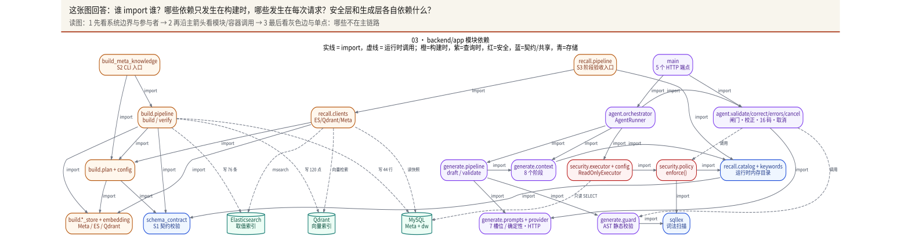

**回答什么问题**：模块允许的依赖方向是什么；查询请求会不会误入构建时代码。

**关键元素**：`main.py` 装配 HTTP/SSE；`build/` 计划、流水线与三存储客户端；`recall/` 关键词与批量召回；`generate/` 上下文、提示词、生成器、输出校验与 guard；`security/` 策略、执行器与只读账号；`agent/` 编排、校正、错误码与取消；`schema_contract.py`、`sqllex.py` 为共享底座。

**证据与边界**：它要证明「构建时/查询时」是依赖方向：`agent` 可调用 `security` 与 `generate`，反之不行；主链路不调用 `recall`。这是目录推导（🟡），不是 import 实测。证据：`backend/app/` 目录清单（✅）；各子目录的 `__init__.py` 与入口文件（✅）。

### 图 04 · 前端组件树

**一句话结论**：前端五个组件各管一件事：输入、步骤、结果、失败、伪错误，界面语义由事件类别驱动。


**回答什么问题**：SSE 事件如何变成界面状态；契约生成物放在哪里；前端为何不自己维护错误码。

**关键元素**：`Composer`（提问与取消）、`StepRail`（12 步状态）、`ResultTable`（按列类型渲染）、`ErrorCard`（真失败）、`PseudoErrorCard`（伪结果）；`src/generated/` 是机器产物，`src/lib/` 负责 SSE 解析与结果语义。

**证据与边界**：它的论证责任是证明「界面语义来自契约与事件类别，而不是前端硬编码」：错误码只有 `contracts/errors.yaml` 一份，前端复制一份就等于制造第二个事实源。它不覆盖真实设备与可访问性；本轮也没有做浏览器验收（⚪）。证据：`frontend/src/components/` 五个组件（✅）；`frontend/src/lib/result.ts`（✅）；图 ✅。

### 图 05 · 阶段演进图 S0–S8

**一句话结论**：S0–S8 是「能力 + 新增不确定性」的叠加，每个阶段都有可停点，但不是上线点。


**回答什么问题**：为什么按这个顺序施工；每加一层能力多出什么风险；停在哪一步仍然可演示、可回退。

**关键元素**：S0 契约、S1 Schema、S2 三存储、S3 召回、S4 生成、S5 安全、S6 失败通道、S7 前端收口、S8 生产化；图应与 `00-front.md` §4 逐行对应，尤其「新增不确定性」一列。

**证据与边界**：它论证阶段顺序，并给全书提供目录与评审顺序：先契约、再构建、再查询、再失败。S8 只有方向没有实现，不得画成既成事实。证据：`README.md`「当前进度」表（✅）；`design/book/chapters/00-front.md` §4（✅）；图 ✅。

### 图 06 · 构建时 vs 查询时

**一句话结论**：同一份契约，构建时写 241 条知识（🟡 公式推导），查询时只读不写；S2 退出后不参与请求。


**回答什么问题**：哪些工作只做一次；为什么没有三存储也能跑 S4–S7。

**关键元素**：构建时 CLI → `BuildPlan` → Meta 44 行 + ES 76 条 + Qdrant 98 + 22 点 + manifest；查询时 FastAPI → 8 阶段上下文 → 生成 → 校验 → 执行 → SSE。S3 召回是构建时旁支，不进查询主链路。

**证据与边界**：它论证时间切分，解释了「S0/S1/S4/S6/S7 离线」与「S2/S3 需要三存储」的差异；241 是公式推导而非实测，必须标 🟡。证据：`backend/app/build_meta_knowledge.py`、`backend/app/main.py`（✅）；`design/inventory/facts.md` §5（✅）。

## 2. 运行时角度（图 07–13）

运行时角度回答「一次构建或一次请求按什么顺序发生」。这一组图都从图 07 的主干上长出来：07 是整条链路，08–12 是各阶段的放大，13 是链路的出口如何被前端消费。

最容易误读的是把时序图的先后当成性能承诺；图只保证顺序，不保证耗时。

### 图 07 · 端到端请求生命周期

**一句话结论**：一次问数的骨架是「上下文 8 阶段 → 生成 → 校验 → 可选校正一次 → 执行 → result/error 收尾」。

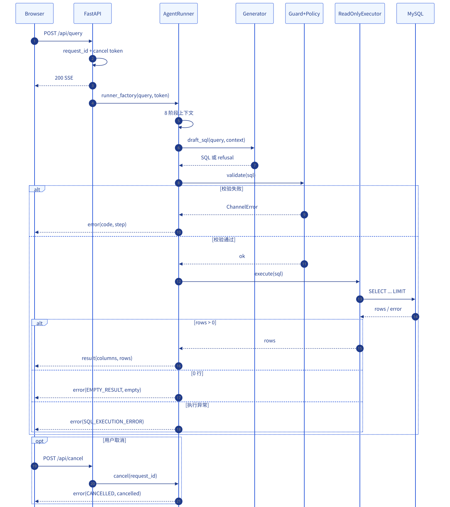

**回答什么问题**：请求从哪里进来；SSE 与工作线程如何协作；0 行、失败、取消各走哪条分支。

**关键元素**：`Browser`、`FastAPI`、`SSE`、`AgentRunner`、`ContextBuilder`、`Generator`、`Guard`、`ReadOnlyExecutor`、`MySQL`；`request_id` 与 `CANCEL_REGISTRY`；`events()` 在工作线程跑；0 行 `EMPTY_RESULT`、执行失败 `SQL_EXECUTION_ERROR`、取消 `CANCELLED`。

**证据与边界**：它是运行时主干，其余图是局部放大；要证明「流一定以 `result` 或 `error` 收尾」。它不证明真实库延迟，也不覆盖并发。证据：图源与 SVG `design/diagrams/02-runtime/07-end-to-end-request.svg`（✅）；`backend/app/main.py`、`backend/app/agent/orchestrator.py`（✅）。

### 图 08 · S2 构建流水线时序

**一句话结论**：S2 把 `make stage2` 拆成 dry-run、构建、verify 三次调用，先计划后写入，manifest 最后登记。

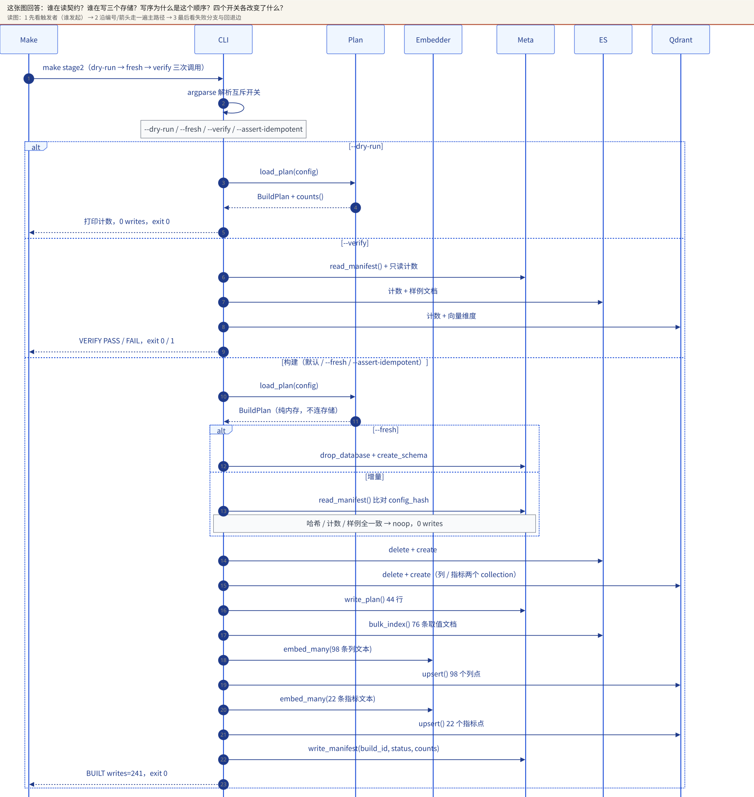

**回答什么问题**：三存储的写入顺序；`--fresh` 与增量的差别；`NOOP: 0 writes` 凭什么成立；计数从哪来。

**关键元素**：`Make`、CLI、`Plan`、`Embedder`、三存储；四个互斥开关；计划纯内存生成；写入顺序是 Meta 44 行 → ES 76 条 → Qdrant 98 + 22 点 → manifest；同配置二次构建应零写入。

**证据与边界**：它论证构建可重复，支撑第 3 部分「三存储等价」与部署章 `init` 的幂等承诺，也是 241 这个数字的出处。边界要说清：本机 Docker socket 无权限，`--fresh` 与真实写入未跑（⚪）；计数来自 `--dry-run` 与 `plan.counts()`（✅ 2026-10-27）。证据：`design/diagrams/02-runtime/08-s2-build-sequence.svg`（✅）；`backend/app/build/pipeline.py`（✅）。

### 图 09 · S3 召回流水线时序

**一句话结论**：S3 一次只读快照，四路批量召回，再合并过滤；召回为空是一个可记录的 trace，不是一次成功。

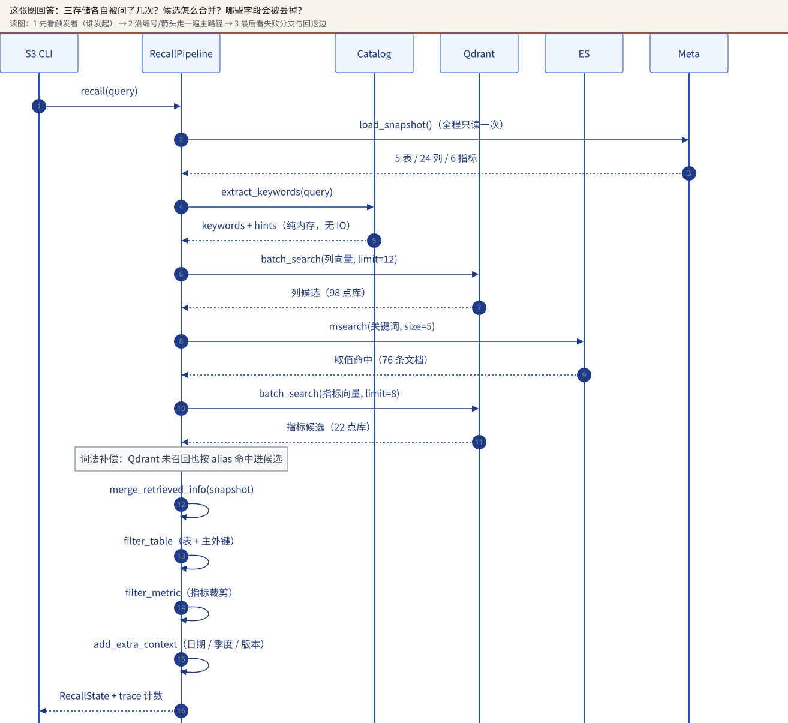

**回答什么问题**：问题如何变成候选表、列、值与指标；召回为空在哪里被看见；S3 为什么不在线上主链路。

**关键元素**：S3 CLI、`RecallPipeline`、`Catalog`、Qdrant、ES、Meta；`load_snapshot()` 只读一次；关键词纯内存；列 `limit=12`、ES `size=5`、指标 `limit=8`；Qdrant 未召回时按 alias 词法补偿；最后 merge、filter 并补日期上下文。

**证据与边界**：它承担根因二的论证：旧系统把 `[]` 当成功，新系统至少把「候选数」记进 trace，让空召回可观察。它不证明哈希向量具备语义质量，召回质量属于 S8 的开放问题。证据：`design/diagrams/02-runtime/09-s3-recall-sequence.svg`（✅）；`backend/app/recall/pipeline.py`（✅）；`make stage3` 本轮未跑（⚪）。

### 图 10 · S4 生成 SQL 流水线

**一句话结论**：S4 先用输出 Schema 约束形状，再用 AST guard 约束语义；真实 LLM 只是 provider 的替换。

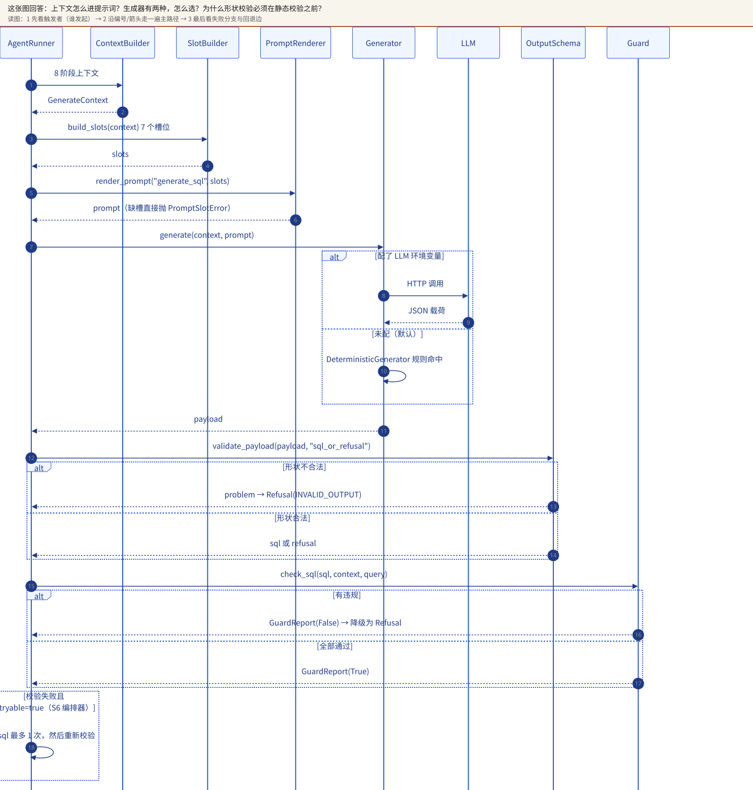

**回答什么问题**：模型输出如何被约束；形状与语义不合法分别怎么处理；为什么没有 LLM 也能跑。

**关键元素**：`AgentRunner`、`ContextBuilder`、`SlotBuilder`、`PromptRenderer`、`Generator`、LLM（可选）、`OutputSchema`、`Guard`；7 个槽位，缺槽抛 `PromptSlotError`；生成器二选一；输出只允许 `sql` 或 `refusal`；guard 不过则降级拒答。

**证据与边界**：它要证明「形状校验先于语义校验」，并解释为什么加 LLM 不改变架构：换的是 provider，不是流水线。真实模型效果、超时行为与成本不在图内。证据：`design/diagrams/02-runtime/10-s4-generate-sequence.svg`（✅）；`backend/app/generate/prompts.py`、`output_schema.py`、`guard.py`（✅）。

### 图 11 · S5 安全校验与执行

**一句话结论**：拒绝发生在连库之前，执行器只执行策略重新序列化后的那条 SQL，只读账号是最后一道门。

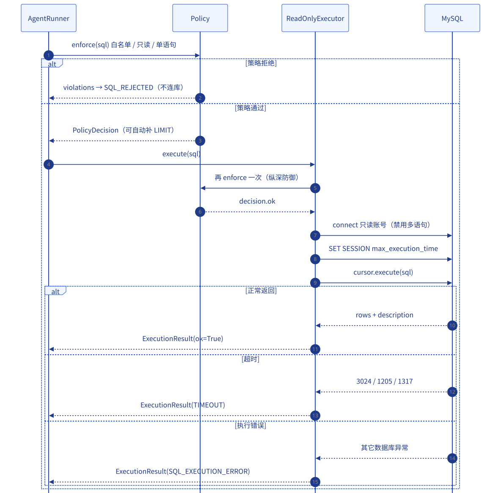

**回答什么问题**：策略何时介入；执行器是否二次校验；执行的是原文还是改写后的 SQL；超时如何分类。

**关键元素**：`AgentRunner`、`Policy`、`ReadOnlyExecutor`、MySQL；`enforce(sql)` 查白名单、只读、单语句并产出 `PolicyDecision`；执行器再 enforce 一次，连只读账号、禁多语句、设 `max_execution_time`；结果分正常、`TIMEOUT`、`SQL_EXECUTION_ERROR`。

**证据与边界**：它的论证落在两处：拒绝发生在连接之前，执行器不信任上游。离线策略可验；真实只读账号缺密码，`stage5-live` 标 ⚪。证据：`design/diagrams/02-runtime/11-s5-security-sequence.svg`（✅）；`backend/app/security/policy.py`、`executor.py`（✅）。

### 图 12 · S6 校正闭环状态机

**一句话结论**：校正只对可重试错误、最多一次；空、失败、取消是三个不同终态，不共享界面语义。


**回答什么问题**：哪些失败会进入校正；循环靠什么终止；0 行为什么不算失败。

**关键元素**：`Init`、`Ctx`、`Gen`、`Val`、`Cor`、`Run`、`Ok`、`Empty`、`Err`、`Can`；`Val → Cor` 只在 `retryable=true` 且 `attempts=0` 时发生；`Cor → Val` 重新校验；`Run → Empty` 是 0 行；`SQL_REJECTED` 永不重试；取消只在步骤边界生效。

**证据与边界**：它论证失败分类的终止性：不会无限重试，也不会把被拒绝的 SQL 再拿去问模型。它不评估校正带来的额外风险，那属于真实 LLM 的开放问题。证据：`design/diagrams/02-runtime/12-s6-correction-state.svg`（✅）；`backend/app/agent/correct.py`、`errors.py`、`orchestrator.py`（✅）。

### 图 13 · S7 SSE 事件序列

**一句话结论**：三种事件驱动三个组件；`class` 决定界面，`code` 只提供解释；未触发与等待中必须长得不一样。

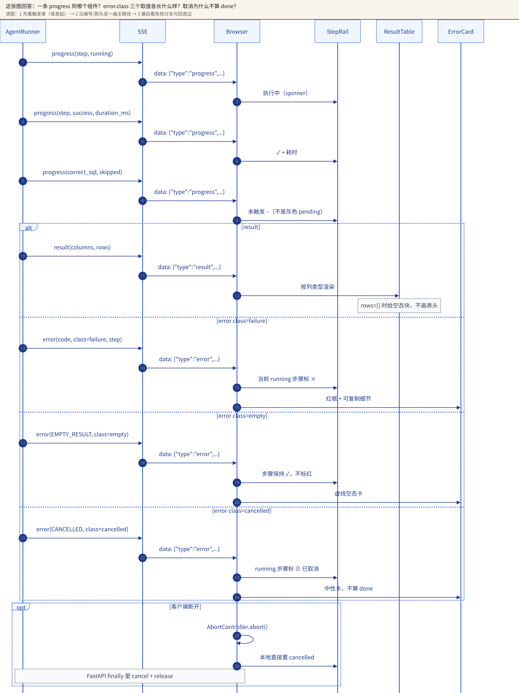

**回答什么问题**：前端如何消费协议；失败、空结果、取消分别长什么样；断连由谁负责。

**关键元素**：`AgentRunner`、`SSE`、`Browser`、`StepRail`、`ResultTable`、`ErrorCard`；`progress` 有 `running` / `success` / `skipped`；`result` 在 `rows=[]` 时给空态块；`error` 按 `failure` 红框、`empty` 虚线卡、`cancelled` 中性卡；断连由客户端 `AbortController` 与后端 `finally` 共同收尾。

**证据与边界**：它是 S7 收口的证据图，与图 24 配合证明「同一个错误码在不同 class 下界面不同」。它不证明真实浏览器下的视觉一致性，本轮未做 UI 验收（⚪）。证据：`design/diagrams/02-runtime/13-s7-sse-sequence.svg`（✅）；`frontend/src/lib/result.ts`（✅）；`fixtures/sse/` 14 条夹具（✅）。

## 3. 数据角度（图 14–19）

数据角度回答「系统以为数据长什么样」与「数据实际长什么样」之间如何对齐。契约、三存储、manifest、值域决策，都是围绕这一个对齐问题展开的。

最容易误读的是把三存储当成三份可各自修改的副本；它们必须由同一份契约生成。

### 图 14 · 数仓 ER 图

**一句话结论**：五张表、四种粒度陷阱：`order_quantity` 是件数不是订单数，`region_name` 不是唯一键，商品无价格列，日期一行一天。


**回答什么问题**：每张表一行代表什么；外键如何连；哪些列最容易被误用。

**关键元素**：`dim_region`（两级分组）、`dim_customer`、`dim_product`（无 `price`）、`dim_date`、`fact_order`（`order_id` 一单、`order_quantity` 件数、`order_amount` 整单金额）；四条逻辑外键。

**证据与边界**：它论证「语义陷阱」：订单量须 `COUNT(DISTINCT order_id)`，销量是 `SUM(order_quantity)`；平均件单价不能用 `order_amount` 除以订单数。演示数据是合成的，不证明真实分布。证据：`design/diagrams/03-data/14-er-diagram.svg`（✅）；`fixtures/dw.sql`、`contracts/schema.contract.yaml`（✅）。

### 图 15 · 契约模型

**一句话结论**：契约是「表 / 列 / 指标 / 值域 / 列—指标」五类对象的数据模型，5 表、24 列、6 指标、9 条关系，不只是给人看的文档。


**回答什么问题**：一列要被完整描述需要哪些字段；指标口径如何表达；列与指标如何关联。

**关键元素**：`SchemaContract`、`Table`（`role`、`grain`、主外键）、`Column`（类型、角色、别名、值域）、`Metric`（公式、相关列、期望值、易混反例）、`ValueDomain`（五种 `kind`）、`ColumnMetric`（9 条关系）。

**证据与边界**：它证明契约既能生成 DDL 校验，也能生成提示词上下文和三存储计划；`grain` 与 `rejected_values` 是防口径错误的两个关键字段。它不证明契约覆盖了所有业务问法，覆盖率属于开放问题。证据：`design/diagrams/03-data/15-contract-model.svg`（✅）；`contracts/schema.contract.yaml`、`backend/app/schema_contract.py`（✅）。

### 图 16 · 三存储知识布局

**一句话结论**：一份契约落到三种表示：Meta 存结构，ES 存取值，Qdrant 存可检索文本；是否写 ES 由值域类型决定。


**回答什么问题**：同一列为何出现在三个存储；哪些列没有 ES 文档；Qdrant 点数为何远大于列数。

**关键元素**：`region_name`（`enum`，5 值）写 1 行 Meta、5 篇 ES、5 个 Qdrant 点；`order_amount`（`range`）写 1 行 Meta、0 篇 ES、5 个点。24 列合计 98 个 point，因为每列拆成名称、描述与别名多条文本。

**证据与边界**：它论证「同一事实、三种投影」，并解释 ES 只索引部分列：`range` 写取值索引无意义且昂贵。三份表示是否等价由 manifest 与 verify 保证。证据：`design/diagrams/03-data/16-three-store-layout.svg`（✅）；`backend/app/build/plan.py`（✅）；`facts.md` §5（✅）。

### 图 17 · S2 数据 lineage

**一句话结论**：契约提供语义、`dw.sql` 提供物理类型与真实值，两者一致才生成计划；任一存储失败则零写入，manifest 最后登记。


**回答什么问题**：每条元知识从哪里来；契约与 DDL 不一致会怎样；manifest 如何对账；失败为何不留半套数据。

**关键元素**：契约 + `dw.sql` → `check_contract` → `BuildPlan` → 76 条 ValueDoc、98 条列点、22 条指标点 → Meta 44 行、ES 76 篇、Qdrant 两个 collection → manifest → verify。

**证据与边界**：它论证可重建，把它变成顺序：先校验、再计划、后写入、最后登记。`--fresh` 实际写入未跑（⚪）；计数来自 dry-run 与公式（✅/🟡）。证据：`design/diagrams/03-data/17-s2-lineage.svg`（✅）；`backend/app/build/pipeline.py`（✅）。

### 图 18 · Meta 表结构

**一句话结论**：Meta 用五张表描述知识，`examples` 只存前 10 条，完整值域在 ES；`build_manifest` 是构建的账本。


**回答什么问题**：五类记录分别存在哪；`examples` 能否当全集；`sync_values` 表示什么；manifest 记了什么。

**关键元素**：`table_info`、`column_info`、`metric_info`、`column_metric`、`build_manifest`；前者分别带 `examples` / `alias` / `value_domain` 与 `formula` / `rejected_values`；manifest 记 `config_hash`、七项计数、`es_analyzer` 与 `status`。

**证据与边界**：它承担「样例不是值域」的论证：拿 `examples` 当全集会让生成器漏掉合法取值，完整值域必须查 ES 或契约。它不证明 manifest 在并发构建下的行为，当前是单次 CLI。证据：`design/diagrams/03-data/18-meta-schema.svg`（✅）；`backend/app/build/meta_store.py`（✅）。

### 图 19 · 值域分类决策树

**一句话结论**：只有「维度列 + 枚举或低基数开放文本」才写 ES；主键、外键、度量、范围值一律不写。


**回答什么问题**：76 篇 ES 文档怎么算出来；哪些列召回时可能缺值；`sync_values` 为何有 0 和 1。

**关键元素**：先判 `role=dimension`，再判 `kind`：`enum` 展开；`open` 且基数在阈值内才展开；`range` / `id` / `foreign_key` 不写；写 ES 的列 `sync_values=1`；`examples` 仍只留前 10 条。

**证据与边界**：它把「76」从一个数字变成一条可复核的规则，也解释了召回为何可能漏掉度量列。它不证明阈值对所有数据集都合适，阈值是工程折中。证据：`design/diagrams/03-data/19-value-domain-decision.svg`（✅）；`backend/app/build/plan.py`（✅）；ES 实际文档数本轮未测（⚪）。

## 4. 安全角度（图 20–24）

安全角度回答「不信任从哪里开始、在哪一层被挡住、挡住之后用户看到什么」。这一组的五张图都应落在「连库之前」与「账号之后」两个硬边界上。

最容易误读的是把「拒绝」当成错误；在 S5 里，拒绝是正确结果。

### 图 20 · 信任边界与攻击面

**一句话结论**：不可信输入有三处：浏览器、模型输出、数据库返回；前两处必须在进入执行器之前被降级为契约内的形状。


**回答什么问题**：哪些输入不可信；信任边界画在哪；模型输出为何不能直接执行。

**关键元素**：浏览器/`/api/query`、提示词/模型输出、策略/执行器、只读账号/数仓四条边界；`contracts/` 与 `Policy` 在内侧，LLM 与浏览器在外侧。

**证据与边界**：它论证安全不能靠单点：任一处把模型输出当可信 SQL，后面的层只能补救。它不覆盖完整提示词注入与网络层攻击。证据：`README.md` §安全边界、`contracts/sql.policy.yaml`（✅）；图 ⚪ 未生成。

### 图 21 · 五层防御纵深

**一句话结论**：纵深的意思是五层各自能独立失效，不是同一道检查写五遍：契约白名单、AST 策略、执行器二次校验、只读账号与超时、界面错误通道。


**回答什么问题**：为什么同一件事要检查多次；哪层被绕过还有哪层；五层与「六道检查」是什么关系。

**关键元素**：契约白名单；AST 级单语句、只读、集合运算与危险函数检查；执行器再 enforce 并只执行重序列化后的 SQL；`dw_reader` 仅 `SELECT` 且带超时；界面按 `class` 区分失败与空结果。

**证据与边界**：它论证纵深防御的分层责任。WBS 标题是「五层防御纵深」，README 拆成六道，两者只是分组粒度不同。评审以 `sql.policy.yaml` 与 `policy.py` 的实际规则为准。证据：`README.md` §安全边界（✅）；`backend/app/security/policy.py`（✅）；图 ⚪ 未生成。

### 图 22 · SQL 策略判定流程

**一句话结论**：策略基于 AST 而不是正则；判定结果只有「拒绝并给码」或「放行并重序列化」两种。


**回答什么问题**：一条 SQL 依次过哪些规则；违规如何变成错误码；为何要重新序列化。

**关键元素**：解析 → 禁词 → 单语句 → 只读 → 集合运算/危险函数 → 契约白名单 → 去注释与补 `LIMIT` → `PolicyDecision`；违规产出 `SQL_REJECTED` 且不可重试。

**证据与边界**：它承担「策略可解释」的论证：每个拒绝都能指到一条规则与一个错误码，而不是「模型说不行」。它不证明策略覆盖所有方言与未来语法，策略覆盖度是持续维护项。证据：`backend/app/security/policy.py`（✅）；`contracts/sql.policy.yaml`（✅）；图 ⚪ 未生成。

### 图 23 · 只读账号权限模型

**一句话结论**：应用账号与只读账号分离，`dw_reader` 只有 `SELECT`，密码只从环境变量来，执行器再叠加超时与禁多语句。


**回答什么问题**：应用凭什么能查不能改；密码存在哪；账号权限与策略是什么关系。

**关键元素**：应用账号 `didilili`；只读账号 `dw_reader` 仅 `SELECT`；密码由 `REBUILD_DW_RO_PASSWORD` 注入；执行器禁多语句并设超时；策略拒绝在连接之前。

**证据与边界**：它证明「最后一道门不依赖应用代码」：即使策略被绕过，账号权限仍然只允许读。真实 GRANT 与两屏对比需要 MySQL 与密码，本机没有，标 ⚪；模型本身来自 `compose.yaml`、`scripts/` 与文档（🟡）。证据：`backend/app/security/account.py`（✅）；`docs/SETUP-FROM-SCRATCH.md` §4（✅）；图 ⚪ 未生成。

### 图 24 · 错误码分类与 UI 映射

**一句话结论**：16 个错误码归入 3 个类别，界面由类别决定：`failure` 红、`empty` 虚线、`cancelled` 中性。


**回答什么问题**：一个码对应哪张卡；空结果为何不标红；哪些错误可重试；前端能否自己加码。

**关键元素**：16 个码、3 个 `class`、`retryable`；`SQL_REJECTED` 不可重试；`EMPTY_RESULT` 属 `empty` 且步骤保持绿；`CANCELLED` 属 `cancelled`；前端只消费契约。

**证据与边界**：它承担根因一与根因三的汇合论证：错误不能塞进结果行，也不能被压成一句通用文案；类别决定界面，码只提供解释。它不证明 16 个码已经穷尽所有失败，穷尽性是 S6 的开放问题。证据：`contracts/errors.yaml`（✅）；`fixtures/sse/` 14 条夹具（✅）；图 ⚪ 未生成。

## 5. 部署角度（图 25–28）

部署角度回答「这套系统怎么被装成一台机器」。它把架构图里的进程变成容器、端口、健康检查与隔离边界，也是运维排障的第一入口。

最容易误读的是把 running 当成 healthy；进程在，不等于探针过。

### 图 25 · Docker Compose 拓扑

**一句话结论**：六个服务、一个默认网络、三个命名卷、一个只读绑定；`fixtures/dw.sql` 只在首次初始化时导入。


**回答什么问题**：服务之间怎么连；数据放在哪；`init` 与三存储、backend 的依赖方向；重启后什么会保留。

**关键元素**：`frontend`、`backend`、`init`、`mysql`、`elasticsearch`、`qdrant`；三个命名卷；`fixtures/dw.sql` 只读绑定；`init` 等三存储 healthy，backend 等 `init` 成功，frontend 等 backend healthy。

**证据与边界**：它承担「交付单元」的论证：一条 `make docker-up` 能复现整机，数据卷保留但可用 `make docker-reset` 显式删除。它不证明构建可离线，首次构建仍需网络。证据：图源 `design/diagrams/05-deployment/25-compose-topology.svg`（✅）；`compose.yaml`（✅）。

### 图 26 · 端口与网络暴露面

**一句话结论**：只有 `8080` 对外，其余端口默认只绑 `127.0.0.1`；前端 nginx 是唯一入口。


**回答什么问题**：哪些端口能从别的机器访问；后端 `8100` 通了为何不等于安全；本地与容器端口如何冲突。

**关键元素**：`8080 → 80` 对外；`8100`、`3306`、`9200`、`6333` 绑 `127.0.0.1`；Vite `5273`；临时验收 `8101–8103 / 5274–5276`；`FRONTEND_BIND` 默认 `0.0.0.0`。

**证据与边界**：它承担「攻击面收敛」的论证：把入口收成一个门，反向代理负责 `/api/` 与 SSE 不缓冲。它不覆盖 TLS、鉴权与公网暴露，这些不在 S0–S7。证据：`compose.yaml`、`design/inventory/facts.md` §2（✅）；图 ✅。

### 图 27 · 启动顺序与健康检查

**一句话结论**：三存储先健康，`init` 再成功，backend 才启动，frontend 最后放行；失败停在正确的位置。

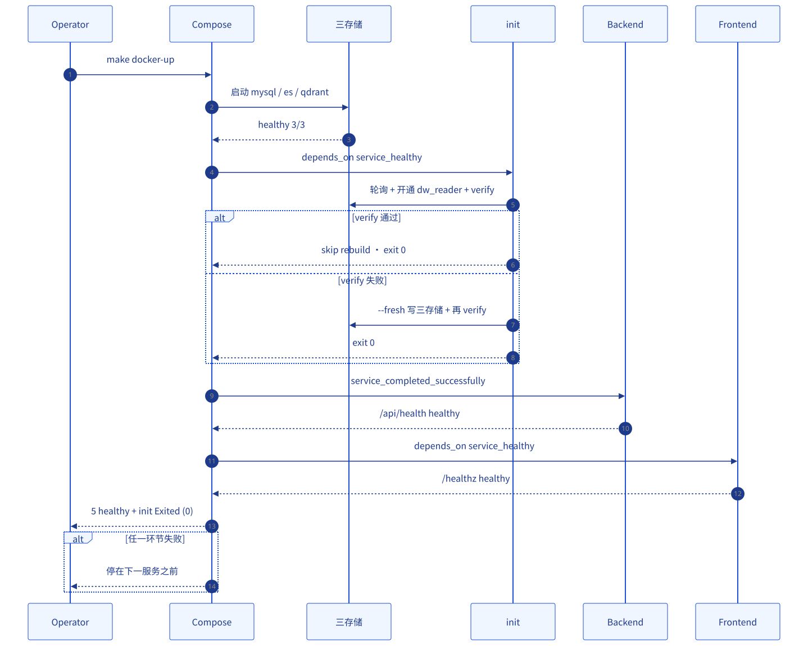

**回答什么问题**：谁等谁；`init` 失败会怎样；健康检查各查什么；为何 `restart` 不读新环境变量。

**关键元素**：MySQL `mysqladmin ping`、ES cluster health、Qdrant `/readyz`；`init` 以 `service_completed_successfully` 作为 backend 前置；backend healthy 作为 frontend 前置；改 `.env` 必须 `up -d`。

**证据与边界**：它承担「故障定位」的论证：启动失败时，看停在哪一层就知道是存储、初始化还是应用。它不证明健康检查能发现所有退化，检查项是粗粒度探针。证据：`compose.yaml` 健康检查与 `depends_on`（✅）；`docs/DOCKER-DEPLOY.md`（✅）；图 ✅。

### 图 28 · 旧系统 / rebuild 隔离

**一句话结论**：rebuild 只写 `*_rebuild` 目标，旧系统冻结为只读夹具；两套系统可以并行，但端口与数据不共享。


**回答什么问题**：重建会不会污染旧系统；旧系统还能不能跑；负向夹具从哪来。

**关键元素**：旧系统与其 `8000/5173`；rebuild 的四个 `*_rebuild` 目标；`fixtures/legacy/` 冻结配置；只有 `make docker-reset` 删除本项目卷。

**证据与边界**：它承担「可回退」的论证：重建的每一步都不碰旧系统的库与索引，旧系统仍可作为对照与故障注入来源。它不证明旧系统本身可维护，旧系统只作反例库。证据：`fixtures/legacy/`（✅）；`README.md`「必须知道的约束」（✅）；图 ✅。

## 6. 测试角度（图 29–32）

测试角度回答「凭什么说它对」。这一组图不描述功能，而描述证据如何被生产、如何被分层、如何被追溯；它们与 `inventory/facts.md` 的 ✅/🟡/⚪ 是同一套纪律。

最容易误读的是把 ✅ 当成「永远通过」；它只说明本机跑过或文件明确存在，不保证下次还过。

### 图 29 · 测试金字塔与阶段门禁

**一句话结论**：测试按依赖分层：离线单测与契约测试为主，需要三存储的集成测试被显式跳过，浏览器验收独立成层。


**回答什么问题**：哪些测试不需要外部依赖；31 条 skip 是什么；前端测试覆盖什么；哪一层最容易被误当成端到端。

**关键元素**：后端单元与契约测试；S3 真实存储集成（23 条跳过）；S4/S5 按需跳过；前端协议 26 条与结果表 14 条；2 个无头浏览器用例；S7 的 14 条断言。README 声称后端 782 passed / 31 skipped，本机未跑（🟡）。

**证据与边界**：它承担「离线可验」的论证：S0/S1/S4/S6/S7 不依赖 MySQL、LLM 或 Key，读者在干净机器上也能得到大部分证据。它不证明 skip 掉的部分已经通过。证据：`Makefile` 阶段目标（✅）；`README.md` 当前验收数据（🟡 未实跑）；图源 ✅，SVG 待渲染（⚪）。

### 图 30 · S0–S8 验收链路

**一句话结论**：每个阶段都有独立命令与硬验收，阶段通过只证明该层能力，不等于整机可上线。

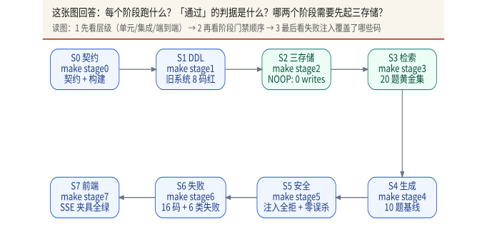

**回答什么问题**：S0–S7 各验什么；哪些阶段要三存储或浏览器；S3 通过为何不等于能真实问数。

**关键元素**：`make stage0`–`stage7`；`stage5-live` 与三个 `*-ui` 的额外依赖；S7 的生成物新鲜度、14 条夹具对账、前端契约与构建；图中把「代码级验收」与「整机验收」分成两条泳道。

**证据与边界**：它承担「验收不等于上线」的论证：S3 只说明召回流水线成立，S7 只说明协议与界面收口成立；真实召回、真实库、真实 LLM 属于 S8。证据：`docs/SETUP-FROM-SCRATCH.md` §0、§3（✅）；`Makefile`（✅）；图源 ✅，SVG 待渲染（⚪）。

### 图 31 · 失败注入矩阵

**一句话结论**：失败按矩阵注入，不靠想象：6 类失败场景、36 条注入语料、14 条 SSE 夹具、13 条 F 缺陷各自可复现。


**回答什么问题**：每类失败由什么触发；在哪个阶段注入；哪些失败有界面用例。

**关键元素**：6 类失败场景；36 条注入语料（全拒）与 11 条正常查询（零误杀）；14 条 SSE 夹具；13 条 F 缺陷（F11 拆 5xx/422）；浏览器用例覆盖 6 类失败加取消。

**证据与边界**：它承担「失败可复现」的论证：错误码不是纸面分类，每一类都有触发物与期望输出。它不证明所有组合都被覆盖，矩阵是有限集合。证据：`fixtures/failures/scenarios.yaml`、`fixtures/injection/`、`fixtures/sse/`（✅）；图源 ✅，SVG 待渲染（⚪）。

### 图 32 · 证据台账（已验证 / 未验证）

**一句话结论**：全书结论按 ✅/🟡/⚪ 三级登记，读者据此判断一句话是验收依据、设计假设还是待办。


**回答什么问题**：哪些结论本机跑过；哪些只是 README 声称；哪些完全没验；评审先补哪项。

**关键元素**：`facts.md` §9 的七行台账；✅ 基线、`--dry-run` 计数；🟡 全量测试 782、写入总数 241；⚪ `--fresh`、真实 LLM、浏览器验收、Compose 全栈。图按阶段分组，暴露空白集中处。

**证据与边界**：它承担「这本书可审计」的论证：没有这一页，前面的图与结论就无法区分事实与推断。它不替读者做环境验证，台账只记录本工作树的状态。证据：`design/inventory/facts.md` §9（✅）；`docs/SETUP-FROM-SCRATCH.md` §7（✅）；图源 ✅，SVG 待渲染（⚪）。

## 7. 图集没有回答的问题

图集覆盖结构，不覆盖效果与运营。以下七个问题，三十二张图都答不了：

1. **真实 LLM 的生成质量。** 默认走确定性生成器；`HttpLlmGenerator` 与校正器存在，但本机无端点与 Key，准确率、拒答率、延迟与成本均未测（⚪）。
2. **真实召回质量。** S3 默认用 `hash-ngram-v1`，不是语义模型；20 题黄金集只说明流水线成立，不说明开放问法下的召回率。
3. **容量与并发。** 单 MySQL、单 ES、单 Qdrant、uvicorn 单 worker；没有压测、连接池上限、队列长度与超时预算的数据，S8 只给出方向。
4. **多租户与权限体系。** 当前没有用户、租户、行级权限与审计日志；`dw_reader` 是单一只读账号，不能回答「不同用户看不同数据」。
5. **真实数据分布与 schema 演进。** 演示数据是合成的；换真实数据要替换 `fixtures/dw.sql`、同步契约并重建 S2，不是配置项。
6. **提示词注入与更广的威胁模型。** 图 20–23 覆盖的是 SQL 侧边界；模型被诱导输出合规但语义错误的 SQL、密钥泄露、供应链与网络层攻击，都不在图内。
7. **运维与高可用。** 备份恢复、升级回滚、监控告警、日志与扩容均未设计；健康检查只是启动探针。

这七条是边界，不是缺陷。图集只把想清楚的部分画到可复核，没想清楚的就留在这里——写进图里反而更不诚实。

## 8. 图集小结

- 三十二张图，每张只回答一个问题。图 32 是入口：先看证据等级，再看论证。
- 图号和图都在，但「有图」不等于「有证据」；引用前先看实际文件，再核对证据行。
- 图里的颜色只表达角色：蓝是契约，青是存储，橙是构建，紫是查询，红是安全，绿是通过，灰是边界。
- 如果一张图指不到文件或命令，它只是草图，不进结论。
