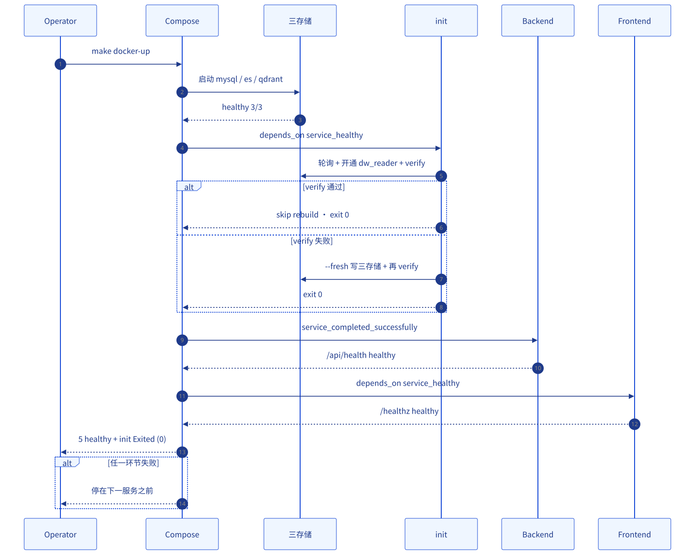
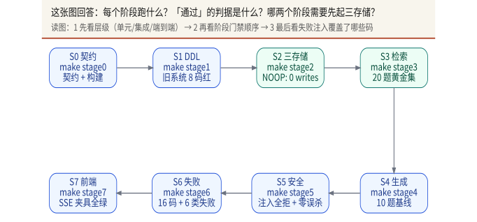

# 第五部分 · 部署、测试与故障排查

在本设计工作树里跑 Docker，得到的不是容器列表，而是一行 `permission denied ... /var/run/docker.sock`。命令没有错，Compose 文件也没有错；当前账号没有这个 socket 的访问权限。

这一部分的顺序不能反：先跑起来，再证明没坏，最后才轮到「坏了先看哪一眼」。环境没通，翻业务日志是白翻。

这一部分回答的是「代码写完之后，怎么把它跑起来、怎么证明它没坏、坏了先看哪里」。前面的章节按阶段讲每个能力怎么长出来；这一章换一个视角：把系统当成一台要交付的机器，从启动路径、容器拓扑、凭据注入、启动顺序、隔离边界、测试门禁、失败注入，一直讲到上线前的检查清单。

阅读时请记住一条纪律：本章所有命令都能在仓库的 `Makefile`、`docs/DOCKER-DEPLOY.md`、`docs/SETUP-FROM-SCRATCH.md` 或 `scripts/` 下找到出处；所有计数以 `design/inventory/facts.md` 为准。凡是本设计工作树没有实际跑过的，一律标 ⚪，不把推断写成已验证。

---

## 1. 两条启动路径：本地开发 vs Docker

DSWS 有两条互不替代的启动路径。它们跑的是同一份代码，但依赖的边界不同：本地开发把 Python、Node、三存储拆开装；Docker 把六个服务装进同一个 Compose 项目。新手最常见的错误，是把两条路径的端口混着用，尤其是 `8100`。

表 5-1 · 两条启动路径

| 维度 | 本地开发 | Docker Compose |
|---|---|---|
| 用途 | 改代码、跑单阶段验收、看日志 | 交付一套可复现的整机环境 |
| 安装 | `make install`（uv + npm） | 只需 Docker Engine 与 Compose v2 |
| 启动后端 | `make dev-backend` | `make docker-up` 中的 `backend` 服务 |
| 启动前端 | `make dev-frontend` | `make docker-up` 中的 `frontend` 服务 |
| 三存储 | 单独 `docker compose up -d mysql elasticsearch qdrant` | 同一条 `make docker-up` 一并拉起 |
| 后端端口 | `127.0.0.1:8100` | 宿主机 `127.0.0.1:8100` → 容器 `8100` |
| 前端端口 | `5273`（Vite，刻意避开旧栈 `5173`） | 宿主机 `8080` → 容器 `80` |
| 访问入口 | `http://127.0.0.1:5273` | `http://127.0.0.1:8080` |
| 前置 | Python 3.12、Node、uv、网络 | Docker、8 GB 内存、首次构建需网络 |
| 适用场景 | 开发、调试、逐阶段验收 | 演示、交接、无本机运行时 |

两条路径的第一个冲突点就是 `8100`：容器后端也映射到宿主机 `8100`，和 `make dev-backend` 完全相同。两者同时启动，后起的那个会报 `address already in use`。如果确实要并存，在 `.env` 里把 `BACKEND_HOST_PORT` 改成 `8110`；前端不受影响，因为 nginx 在容器网络里仍然按 `backend:8100` 找后端。

本地路径还有一条隐含前置：S2、S3 需要三存储，S5 的只读账号与两屏对比需要 MySQL。S0、S1、S4、S5 离线门禁、S6、S7 都不需要三存储。这一点在测试章节会再展开，因为它决定了「一台干净机器上先能跑到哪一步」。

```bash
# 本地：只起三存储，给 S2 / S3 用
make docker-env
docker compose up -d mysql elasticsearch qdrant
source scripts/export-docker-env.sh
```

`make docker-env` 只在 `.env` 不存在时生成随机密码；`source scripts/export-docker-env.sh` 把 Compose 的密码和宿主机端口导出成 `REBUILD_*`，成功时不打印任何内容。宿主 CLI 不会自动读 `.env`，漏掉这一句，S2 会在连库之前就报缺凭据。

---

## 2. Docker Compose 拓扑

`compose.yaml` 定义六个服务，项目名固定为 `shopkeeper-rebuild`。三个存储是长驻服务，`init` 是一次性任务，`backend` 与 `frontend` 是应用服务。拓扑见图 25（`design/diagrams/05-deployment/25-compose-topology.mmd`）。



表 5-2 · 六个服务

| 服务 | 镜像来源 | 作用 | 关键依赖 | 健康检查 |
|---|---|---|---|---|
| `mysql` | `MYSQL_IMAGE` | 数仓 `dw` + Meta 库 | 无 | `mysqladmin ping` |
| `elasticsearch` | `ELASTICSEARCH_IMAGE` | 取值索引 | 无 | 集群状态 green/yellow |
| `qdrant` | `QDRANT_IMAGE` | 向量索引 | 无 | `GET /readyz` 返回 200 |
| `init` | 后端镜像 | 建库、开只读账号、校验/构建 S2 | 三存储 healthy | 无，退出码即结果 |
| `backend` | 后端镜像 | FastAPI + uvicorn，单 worker | `init` completed | `GET /api/health` |
| `frontend` | nginx 镜像 | 静态资源 + `/api/` 反向代理 | `backend` healthy | `GET /healthz` |

三个存储都只绑定宿主机 `127.0.0.1`，默认端口分别是 `3306`、`9200`、`6333`。只有 `frontend` 默认监听所有网卡（`FRONTEND_BIND=0.0.0.0`），宿主机端口 `8080`。这是刻意的暴露面设计：应用入口可以给局域网，数据库和搜索引擎不对外。端口全景见图 26（`design/diagrams/05-deployment/26-port-exposure.mmd`）。



卷有三个，都是命名卷，Compose 会按项目名加前缀：

| 卷名 | 挂载点 | 存什么 |
|---|---|---|
| `mysql_data` | `/var/lib/mysql` | `dw` 与 `meta_rebuild`，含首次导入的 `fixtures/dw.sql` |
| `es_data` | `/usr/share/elasticsearch/data` | `value_index_rebuild` |
| `qdrant_data` | `/qdrant/storage` | `column_info_rebuild`、`metric_info_rebuild` |

实际卷名是 `shopkeeper-rebuild_mysql_data`、`shopkeeper-rebuild_es_data`、`shopkeeper-rebuild_qdrant_data`。`make docker-down` 只删容器和网络，保留这三个卷；只有 `make docker-reset` 会先列出卷名、要求输入 `yes`，再执行 `docker compose --project-name <项目名> down -v`。

网络只有 Compose 默认创建的一个 bridge 网络。服务之间用服务名互相访问：`mysql:3306`、`elasticsearch:9200`、`qdrant:6333`、`backend:8100`。`init` 的 `REBUILD_ES_URL` 就是 `http://elasticsearch:9200`，`backend` 的 `REBUILD_QDRANT_URL` 就是 `http://qdrant:6333`。这些名字不能改成 `localhost`，容器里的 `localhost` 指向容器自己。

健康检查的细节值得单独看，因为它们是启动顺序的唯一依据：

- MySQL：`mysqladmin ping -h 127.0.0.1 -uroot -p$$MYSQL_ROOT_PASSWORD --silent`，间隔 5 秒，重试 60 次，启动宽限 30 秒。
- Elasticsearch：`curl` 集群健康接口并 `grep` 出 `green` 或 `yellow`，间隔 10 秒，重试 30 次。
- Qdrant：镜像里没有 `curl` / `wget`，健康检查用 `bash` 的 `/dev/tcp` 手工发 `GET /readyz`，再 `grep 200`。必须显式用 `bash`，因为镜像里的 `/bin/sh` 是 dash，没有 `/dev/tcp`。
- backend：用 Python 标准库 `urllib.request.urlopen('http://127.0.0.1:8100/api/health')`，间隔 10 秒，重试 12 次。
- frontend：`wget -qO- http://127.0.0.1/healthz`。

Qdrant 的健康检查还有一个版本门槛：`/readyz` 是 v1.5.0 才有的端点。老镜像上它一直 404，容器永远不 healthy，`init` 就不会启动。默认镜像 `qdrant:v1.12.4` 满足要求。

`backend` 固定 `--workers 1` 是为了取消能用：注册表 `CANCEL_REGISTRY` 是进程内状态，多 worker 会让「取消」打到另一个进程上，取消按钮就失效了。

镜像构建也有一套边界。后端镜像用多阶段构建：`uv` 阶段装依赖，运行阶段只带 `.venv` 与 `app/`，再复制 `contracts/` 与 `fixtures/`。前端镜像在 Node 阶段跑 `npm run build`，运行阶段只把 `dist/` 交给 nginx。这解释了一个常见困惑：改了 `docker/nginx.conf`，必须重建 frontend 镜像才会生效；只 `restart` 容器不会重新拷贝配置。反过来，改了后端源码但构建命中了缓存，`docker compose up -d --build` 会重建 backend 与 init，这是正常行为，不是「没重启」。

还有一个容易误判的点：`init` 与 `backend` 用的是同一个镜像、同一份源码，但环境变量不同。`init` 拿得到 `MYSQL_PASSWORD` 与 root 密码，`backend` 只有 `dw_reader`。如果某个构建类命令在 `backend` 容器里报「表不存在」或「Access denied」，先别怀疑代码——很可能是把只读容器当构建容器用了。构建类 CLI 一律挂在 `init` 服务下，并加 `--no-deps`，前提是三存储已经在跑。

---

## 3. 环境变量与凭据

环境变量分三类：Compose 插值用的变量（`MYSQL_*`、镜像名、宿主机端口）、后端读取的 `REBUILD_*`、以及可选的 LLM 三元组。表 5-3 只列会影响启动或运行的关键项。

表 5-3 · 关键环境变量

| 变量 | 谁读 | 缺了会怎样 |
|---|---|---|
| `MYSQL_ROOT_PASSWORD` | MySQL 容器、`init` | Compose 的 `${VAR:?}` 直接拒绝启动 |
| `MYSQL_PASSWORD` | MySQL 容器、`init` | 同上 |
| `REBUILD_MYSQL_PASSWORD` | `init`、宿主 CLI | 连库前报缺凭据，不会拿错口令去试 |
| `REBUILD_MYSQL_ROOT_PASSWORD` | `init` 建库/授权 | `init` 在授权步骤失败 |
| `REBUILD_DW_RO_PASSWORD` | `init`、`backend`、`make stage5-live` | 只读账号开不了；查询以 `INTERNAL_ERROR` 收尾 |
| `REBUILD_MYSQL_HOST` / `PORT` / `USER` | 后端、CLI | 默认 `127.0.0.1:3306` / `didilili` |
| `REBUILD_META_DB` | S2 / S3 / 后端 | 默认 `meta_rebuild` |
| `REBUILD_ES_URL` / `REBUILD_ES_INDEX` | S2 / S3 | 默认 `http://127.0.0.1:9200` / `value_index_rebuild` |
| `REBUILD_QDRANT_URL` | S2 / S3 | 默认 `http://127.0.0.1:6333` |
| `REBUILD_COLUMN_COLLECTION` / `METRIC_COLLECTION` | S2 / S3 | 默认 `column_info_rebuild` / `metric_info_rebuild` |
| `REBUILD_VECTOR_SIZE` | S2 / S3 | 默认 `256`，与旧系统的 `1024` 不同 |
| `REBUILD_LLM_BASE_URL` / `API_KEY` / `MODEL` | `backend`、CLI | 三个都空则走确定性生成器，不会报错 |
| `REBUILD_LLM_TIMEOUT` | `backend` | 默认 `30` 秒 |
| `FRONTEND_BIND` / `FRONTEND_HOST_PORT` | Compose | 默认 `0.0.0.0` / `8080` |
| `BACKEND_HOST_PORT` | Compose | 默认 `8100`，与本地后端冲突时改这里 |
| `MYSQL_HOST_PORT` / `ES_HOST_PORT` / `QDRANT_HOST_PORT` | Compose | 默认 `3306` / `9200` / `6333` |

凭据纪律有三条，任何一条破了都不是「小问题」：

第一，**密码不进仓库**。`.env` 被 `.gitignore` 忽略；仓库里只有 `.env.example`，里面是 `change-me-*` 占位值。`docker-smoke.sh` 在动手之前会扫 `.env`，只要命中 `change-me` 就直接判不通过——因为 Compose 的 `${VAR:?}` 只检查「非空」，占位密码照样能让整个栈起来、验收照常通过，但那个密码是公开的。

第二，**构建凭据与应用凭据分离**。`mysql` 与 `init` 拿 `MYSQL_PASSWORD`（应用账号 `didilili`，在 `dw` 上有 ALL PRIVILEGES）和 root 密码；`backend` 只拿 `REBUILD_DW_RO_PASSWORD`，也就是 `dw_reader` 的密码。构建类 CLI 要挂在 `init` 服务下跑，不能把构建凭据给 `backend`。`didilili` 的 ALL PRIVILEGES 正是 S5 要消除的越权入口。

第三，**宿主 CLI 与容器必须读到同一个字符串**。`source scripts/export-docker-env.sh` 以 `.env` 为事实源导出 `REBUILD_*`；`MYSQL_PASSWORD` / `MYSQL_ROOT_PASSWORD` 刻意**不导出**，因为 Compose 只看得到已 export 的变量，导出后旧快照会一直挡住 `.env` 里的新值。改了 `.env` 必须重新 `source` 一次。容器那边不用管，Compose 每次都重新读 `.env`。

轮换只读密码的顺序是固定的：改 `.env` 的 `REBUILD_DW_RO_PASSWORD`，跑 `docker compose run --rm --no-deps init python -m app.scripts.security --provision-ro-account`，再 `docker compose up -d --force-recreate backend`。轮换 MySQL 密码则必须先 `make docker-reset`，因为 MySQL 只在数据卷首次初始化时用 root 密码建账号；卷还在，新密码不生效。

---

## 4. 启动顺序与失败定位

启动顺序由 Compose 的 `depends_on` 条件串成一条链，不是「谁先写完谁先起」。图 27（`design/diagrams/05-deployment/27-startup-order.mmd`）描述了整条链，这里用文字再钉一遍：



1. `docker compose up -d --build` 先构建后端与前端镜像。
2. MySQL、Elasticsearch、Qdrant 并行启动，各自跑健康检查。
3. 三个存储全部 healthy 后，`init` 才开始。
4. `init` 依次做四件事：等待三个存储（每个最多 180 秒）、开通 `dw_reader`、验证它真的只有 SELECT、对账 S2 元知识（`--verify`；失败则 `--fresh` 再 `--verify`）。
5. `init` 退出码为 0，`backend` 才启动。
6. `backend` 的 `/api/health` 通过后，`frontend` 才启动。

`depends_on` 写的是条件，不是「启动顺序建议」：`service_healthy` 会一直等健康检查变绿，`service_completed_successfully` 会等 `init` 以 0 退出。所以「栈起来了但页面 502」通常不是 nginx 的问题，而是这条链在某一环停住了。

失败会停在哪里，可以从 `docker compose ps -a` 一眼看出来：

| 停在哪 | 现象 | 先看什么 |
|---|---|---|
| 三存储 | 某个服务 `starting` 或 `unhealthy` | `docker compose logs mysql` / `elasticsearch` / `qdrant` |
| `init` | `exited 1`，backend 不存在 | `docker compose logs init` |
| `backend` | `running` 但 `unhealthy` | `docker compose logs backend`，再 `curl /api/health` |
| `frontend` | `running` 但 `unhealthy` | `docker compose logs frontend`，`nginx -T` |

`init` 是最容易被忽略的一环，因为它退出后就不在 `docker compose ps` 的默认视图里。诊断时一定要加 `-a`：`docker compose ps -a` 能看到 `init` 的 `ExitCode`。`docker-smoke.sh` 的失败处理也特意先打 `ps -a` 和 `logs --tail=60 init backend frontend`，就是怕「最可能的故障现场」消失。

`/api/health` 返回 `{"status":"ok","stage":"S7"}` 只证明 FastAPI 进程活着，不证明数据库、ES、Qdrant 真的通了。真正的数据面验证在 `make docker-smoke` 的后四步：12 个步骤、经 8080 的真实查询、只读账号、S2 对账。把健康检查当成就绪证明，是运维里最常见的假阳性。

先看哪一眼：`docker compose ps -a` 的状态列。`running` 只说明进程在，`healthy` 才说明探针过；`init` 的退出码是 0，backend 才有资格启动。

---

## 5. 隔离：旧系统 / rebuild

这套系统在旧系统旁边重建，没有原地改造。隔离是硬边界，不是建议：`--fresh` 会删东西，靠它才不至于删错。图 28（`design/diagrams/05-deployment/28-legacy-isolation.mmd`）画出了两套系统的边界。



表 5-4 · 旧系统与 rebuild 的隔离

| 维度 | 旧系统 | rebuild |
|---|---|---|
| MySQL 库 | `meta` | `meta_rebuild` |
| ES 索引 | `value_index` | `value_index_rebuild` |
| Qdrant collection | `column_info_collection` / `metric_info_collection` | `column_info_rebuild` / `metric_info_rebuild` |
| 向量维度 | 1024 | 256 |
| 前端端口 | `5173` | `5273`（本地）/ `8080`（Docker） |
| 后端端口 | `8000` | `8100` |
| 配置来源 | `fixtures/legacy/meta_config.yaml`（负向夹具） | `contracts/schema.contract.yaml`（事实源） |
| 数据 | 旧库既有数据 | `fixtures/dw.sql` 导入的 5 表 / 115 行 |
| 角色 | 只读参考，不作为实现 | 唯一构建目标 |

MySQL 这一层要注意：两套系统可能共用同一个 `3306` 实例，隔离靠的是**库名**而不是端口。所以「端口不同就是隔离」是错的；要核对的是 `--dry-run` 打出来的 `targets:`。同理，ES 和 Qdrant 也可能共用实例，隔离靠索引名与 collection 名。

`--fresh` 会 `DROP DATABASE`、删索引、删 collection。代码没有强制「目标名必须以 `_rebuild` 结尾」，所以默认值安全不等于任何配置都安全。绝对不要这样写：

```bash
# 危险：把目标指到旧系统
export REBUILD_META_DB=meta
export REBUILD_ES_INDEX=value_index
```

第一次跑 S2 前后各做一次隔离检查：旧系统计数不变，rebuild 计数符合预期。本机已验证的计数是 MySQL `5 / 24 / 6 / 9`、ES `76`、Qdrant `98` / `22`；旧系统是 `5 / 24 / 2 / 2`、`75`、`98`（1024 维）/ `8`（1024 维）。Qdrant 维度不同不是坏了，是两套独立 collection。

关于 `down -v`：任何时候都不要在没有确认的情况下执行。`make docker-reset` 会先按 Compose 的项目名优先级（环境变量 `COMPOSE_PROJECT_NAME` > `.env` 同名键 > `compose.yaml` 的 `name:`）解析出项目名，逐个列出真正要删的卷，要求输入 `yes`，然后把项目名显式交给 Compose。卷名猜错，删的就是别的东西。

还有一条容易被忽略的隔离：`fixtures/dw.sql` 通过 MySQL 的 `docker-entrypoint-initdb.d` 挂载导入，只在数据卷为空的那一次执行。改了 SQL 却不生效，不是脚本没挂上，而是卷里已经有数据。重新导入必须先 `make docker-reset`。

---

## 6. 测试金字塔与阶段门禁

DSWS 的测试按阶段分，不按「单元 / 集成」分，每个阶段回答一个具体的不确定性。图 29（`design/diagrams/06-testing/29-test-pyramid.mmd`）是金字塔，图 30（`design/diagrams/06-testing/30-stage-gates.dot`）是 S0–S7 的门禁链。



表 5-5 · 各阶段门禁与存储依赖

| 阶段 | 命令 | 需要三存储 | 核心验收 |
|---|---|:---:|---|
| S0 | `make stage0` | 否 | SSE 契约、12 步骤目录、前端解析与构建 |
| S1 | `make stage1` | 否 | 5 表 / 24 列 / 6 指标；旧系统负向夹具必须红 |
| S2 | `make stage2` | 是 | 三存储构建、manifest、计数对账、`NOOP: 0 writes` |
| S3 | `make stage3` | 是 | 四路召回 + 合并 + 过滤；20 题黄金集 |
| S4 | `make stage4` | 否 | 10 题基线 + sqlglot AST 静态校验 |
| S5 | `make stage5` | 否 | 注入语料 100% 拒绝 + 零误杀 |
| S5 实战 | `make stage5-live` | 是（只要 MySQL） | 只读账号开通 / 验证 + 两屏对比 |
| S6 | `make stage6` | 否 | 16 错误码 + 6 类失败 + 校正闭环 + 取消 |
| S7 | `make stage7` | 否 | 生成物新鲜度 + SSE 夹具对账 + 前端契约 |



这张表最重要的信息是「哪些阶段不需要三存储」。S0、S1、S4、S5、S6、S7 都能在一台只有 Python 与 Node 的机器上跑完；S2、S3 才需要三存储，S5 实战只需要 MySQL。这意味着新人可以先在干净环境里把六个阶段跑绿，再决定要不要动 Docker。它也意味着 CI 的分层可以很便宜：把不需要存储的阶段放在最前面。

从金字塔的角度看，底层是纯函数与契约测试：`tests/generate/test_guard.py` 只吃契约与 SQL 文本，`tests/security/test_policy.py` 只依赖 sqlglot，`tests/agent/test_errors.py` 只读 `contracts/errors.yaml`。这些测试没有网络、没有数据库，跑得最快，也最能定位。中间层是契约对齐：`test_s0_contract.py` 验 SSE 与步骤目录，`test_s1_schema_contract.py` 验 5 表 / 24 列 / 115 行，`tests/frontend/test_contract_gen.py` 验生成物与契约一致。顶层才是集成与场景：S2 写三存储、S3 跑 20 题黄金集、S6 跑 6 类失败、S0/S6/S7 的浏览器验收。

这个分层只为一件事：失败时知道该往哪一层查。纯函数测试红了，问题在逻辑；契约对齐红了，问题在事实源或生成物；集成测试红了，问题在存储或环境；浏览器用例红了，问题在 UI 状态机或回放夹具。如果所有测试都混在一起，一个红灯只会告诉你「有东西坏了」，不会告诉你「坏在哪一层」。

测试规模方面，仓库有 45 个后端测试文件（`find backend/tests -name 'test_*.py' | wc -l`），前端有 2 个测试文件（`frontend/src/lib/result.test.ts`、`frontend/src/lib/sse.test.ts`）。README 与 `docs/DOCKER-HANDOFF.md` 记录的全量后端结果是 **782 passed / 31 skipped**；`docs/SETUP-FROM-SCRATCH.md` 的阶段表记录的是更早一轮的分阶段数字（S0 19、S1 59、S4 108、S5 171、S6 107、S7 契约 45）。两处数字是不同时间点的快照，并不矛盾。

证据等级必须说清楚：`DOCKER-HANDOFF.md` 里的 782 是那次实测记录，标 ✅（针对那次环境）；**本设计工作树没有跑全量后端测试**，所以本章引用 782 时标 🟡。不要把「README 声称」升级成「本机已验证」。

阶段门禁另有两条经验，单独说：

第一，**门禁必须能红**。S1 的 `--expect-legacy-red` 要求旧系统夹具必须报错；S5 的注入语料要求 100% 拒绝；S6 的 6 类失败要求结局与夹具逐项吻合。一个永远通过的门禁，比没有门禁更危险。

第二，**验收脚本不能用 `assert`**。`python -O` 会把 `assert` 剥掉，脚本于是永远「通过」。`scripts/smoke_checks.py` 全部用显式返回码与中文结论；`backend/tests/test_smoke_checks.py` 还用 AST 扫描 `ast.Assert`，确保这条纪律本身不是空转。

---

## 7. 失败注入矩阵

S6 要做的是让每一种失败都有名字，不是让系统不报错。图 31（`design/diagrams/06-testing/31-failure-injection.mmd`）是失败注入矩阵，表 5-6 把它落成可查的对应关系。



表 5-6 · 失败与取消 → 错误码 → UI → 测试

| 失败 | 错误码 | class | 用户看到什么 | 主要测试文件 |
|---|---|---|---|---|
| SQL 被策略拒绝 | `SQL_REJECTED` | failure | 红框 + 失败步骤红叉 | `backend/tests/security/test_policy.py`、`test_injection_corpus.py` |
| SQL 语法错误 | `SQL_SYNTAX` | failure | 红框，提示语法不合法 | `backend/tests/generate/test_guard.py`、`agent/test_scenarios.py` |
| 引用不存在的列 | `SQL_UNKNOWN_COLUMN` | failure | 红框，指出列不在 schema | `backend/tests/generate/test_guard.py`、`agent/test_scenarios.py` |
| 查询成功但无数据 | `EMPTY_RESULT` | empty | 空态卡，**不标红** | `backend/tests/agent/test_scenarios.py`、`frontend/src/lib/result.test.ts` |
| 执行超时 | `TIMEOUT` | failure | 红框，提示已中止 | `backend/tests/security/test_executor.py`、`agent/test_scenarios.py` |
| 用户取消 | `CANCELLED` | cancelled | 取消态，不算失败也不算完成 | `backend/tests/agent/test_api.py`、`test_orchestrator.py` |
| 模型拒答 | `LLM_REFUSAL` | failure | 红框，提示现有数据无法回答 | `backend/tests/agent/test_errors.py`、`test_scenarios.py` |

这张表要看的是 `class` 的三分法，不是那六个码：`failure` 是真失败，红框；`empty` 是合法但没有数据，空态卡，不标红；`cancelled` 是用户自己停的，既不是 done 也不是失败。把空结果画成红框，是旧系统审计里的一类静默失败；取消被当成完成，是另一类。

`retryable` 决定要不要走 `correct_sql` 校正闭环。安全策略的拒绝（`SQL_REJECTED`）永远不可重试：拿被拒的 SQL 去问模型「改一下」，等于给注入开重试的口子。校正最多 1 次，校正后的 SQL 必须重新过 `guard` 与 `policy` 两道关；校正器返回写操作或 UNION 都会被挡下，执行器一次都不会被调用。

失败场景的注入点是两个外部依赖：模型与数据库。`fixtures/failures/scenarios.yaml` 用「场景:<id> <真实问题>」的写法驱动场景应用，上下文构建、提示词渲染、AST 校验、安全策略、校正闭环、SSE 序列化全是真代码。所以屏幕上的每个红叉都对应一次真实判定，不是摆拍。六类失败在浏览器里必须是**六种互不相同**的界面状态；`make stage6-ui` 就是验这一点。

---

## 8. 故障排查表

排障的顺序应该是「先分层，再定位，最后才改」。先看是环境问题、启动问题、数据问题还是应用问题；不要一上来就改代码。表 5-7 按症状组织。

表 5-7 · 常见故障

| 症状 | 先查什么 | 命令 | 修复 | 证据 |
|---|---|---|---|---|
| 镜像拉取失败 | 镜像源是否可达 | `docker compose config --quiet` | 改 `.env` 的 `*_IMAGE` 后重跑 | `docs/DOCKER-DEPLOY.md` §6 |
| `init` 退出 1 | init 日志 | `docker compose logs init` | 修凭据/存储后 `docker compose run --rm --no-deps init` | 同上 |
| `dw_reader` Access denied | init 是否跑完 | `docker compose logs init` | 重新执行 init | 同上 |
| 容器连库正常、宿主 CLI 却 Access denied | shell 与 `.env` 是否一致 | `source scripts/export-docker-env.sh` | `unset` 旧变量后重新 source | `DOCKER-DEPLOY.md` §4 |
| ES 反复退出（Linux） | `vm.max_map_count` | `sudo sysctl -w vm.max_map_count=262144` | 调大后重启 | `DOCKER-DEPLOY.md` §6 |
| 8080 被占用 | 宿主机端口冲突 | `docker compose port frontend 80` | 改 `FRONTEND_HOST_PORT` | 同上 |
| 8100 被占用 | 容器后端与 `make dev-backend` 冲突 | `docker compose ps` | 改 `BACKEND_HOST_PORT` 或停一个 | `DOCKER-DEPLOY.md` §2.1 |
| 改了 `fixtures/dw.sql` 数据没变 | 卷里已有数据 | `docker compose logs mysql` | `make docker-reset` 后重新 up | `DOCKER-DEPLOY.md` §5 |
| 改了密码栈起不来 | MySQL 只在空卷初始化密码 | `docker compose ps -a` | `make docker-reset` 后重新 up | `DOCKER-DEPLOY.md` §4 |
| npm / pip 拉包失败 | 默认源不可达 | `docker compose logs backend frontend` | 改 `NPM_REGISTRY` / `UV_INDEX_URL` | `DOCKER-DEPLOY.md` §6 |
| 页面能开但 SSE 不流式 | nginx 是否关缓冲 | `docker compose exec -T frontend nginx -T` | 确认 `proxy_buffering off`，重建 frontend | `DOCKER-DEPLOY.md` §2 |
| `S2 FAIL: unknown analyzer [ik_max_word]` | 官方 ES 没有 IK | `docker compose logs init` | 确认 S2 回退 `standard` | `DOCKER-DEPLOY.md` §6 |
| 查询一直 `INTERNAL_ERROR` | init / 只读账号 | `docker compose ps -a`、`logs init` | 重新 init 或配 `REBUILD_DW_RO_PASSWORD` | 同上 |
| `make stage3` 报 `No rule to make target` | checkout 太旧 | `git log --oneline -1` | 更新到含 S3 的提交 | `SETUP-FROM-SCRATCH.md` §6 |
| `make stage7` 报生成物过期 | 手改了 `frontend/src/generated/` | `cd backend && uv run python -m app.scripts.contracts_gen --check` | 重新生成，不手改 | `SETUP-FROM-SCRATCH.md` §6 |
| `make stage7` 报 SSE 夹具不一致 | 后端输出变了 | `cd backend && uv run python -m app.scripts.record_sse --check` | 重录并人工 review diff | 同上 |
| `make stage6-ui` 找不到 Chrome/Edge | 浏览器未装 | `echo $CHROME_PATH` | 装 Chrome/Edge 或设 `CHROME_PATH` | `SETUP-FROM-SCRATCH.md` §6 |
| UI 验收端口被占用 | 8102/5275 或 8103/5276 冲突 | `netstat -ano \| findstr :5276` | `API_PORT=... WEB_PORT=... make stageN-ui` | 同上 |

排障时有一条反直觉的原则：没有证据不等于通过。`docker-smoke.sh` 在「SSE 响应太快、分辨不出是否流式」时，不会放行，而是要求拿出 nginx 的完整生效配置来定性；拿不到配置就判不通过。诊断也一样：日志里没写错误，不等于没有错误；要主动去查那个能证伪的指标。

推荐的顺序是四步。第一步，分清「环境」与「部署」：`.env` 缺了、解释器太老、curl 没装，属于环境，不该去翻业务日志。第二步，看 `docker compose ps -a` 的状态列，确定停在哪一环。第三步，只看那一环的日志，不要 `docker compose logs` 全量刷屏；`init` 的日志通常最短也最有用。第四步，拿一个正向证据和一个反向证据：正向证据是 `/api/health` 或 `/api/steps` 返回预期结构，反向证据是故意查一个越界问题，确认它按契约报错，而不是静默返回空。

还有一个细节：`docker compose port frontend 80` 是查询前端实际发布端口的唯一权威。不要自己 `sed` `.env` 去猜端口——用户在 shell 里 export 过 `FRONTEND_HOST_PORT` 时，`.env` 里的值和 Compose 实际用的值可能不是同一个，脚本会去戳一个没人监听的端口，最后报「360 秒内 /api/health 未就绪」，真正的原因（端口不对）一个字都不提。

先看哪一眼：页面 502 先看 `docker compose ps -a`。`init` 没退出 0 就先查 init；`init` 正常、backend 和 frontend 都 healthy，才轮到 nginx 反代。

---

## 9. 本机边界与未验证清单

本设计工作树的 Docker socket 没有权限，下面这些事项没有在本机端到端跑过，一律标 ⚪。

表 5-8 · 本机边界

| 项 | 状态 | 说明 |
|---|---|---|
| `docker compose up` 全栈 | ⚪ | 当前 shell 无 Docker socket 权限，未从零起过 |
| `--fresh` 写三存储 | ⚪ | 计数来自 `--dry-run` 与代码公式，不是实测写入 |
| Docker 全栈 smoke | ⚪ | 交接文档记录过 PASS，但本工作树未复跑 |
| `make stage5-live` / `dw_reader` 实测 | ⚪ | 无运行中的 MySQL，只读账号未在本机开通 |
| 真实 LLM 生成 / 校正 | ⚪ | 无端点、无 Key；默认确定性生成器 |
| 浏览器验收（stage0-ui / 6-ui / 7-ui） | ⚪ | 本机未装 Chrome/Edge，未跑 |
| 真实召回接入 `/api/query` | ⚪ | 当前上下文由契约离线裁剪，S8 才收口 |
| `--dry-run` 计数 5/24/6/9/76/98/22 | ✅ | 2026-10-27 本机跑过 |
| 旧系统计数未变 | ✅ | 2026-10-25/26 记录，见 `facts.md` §9 |
| 后端 782 passed | 🟡 | README 与交接文档声称；本工作树未跑 |

另有三条是当前不支持，跟验证无关：backend 固定单 worker，取消注册表是进程内状态，不能多副本；ES 单节点、关闭鉴权，只适合单机，不要暴露到公网；`fixtures/dw.sql` 是当前数据源，替换真实数据不在本部署范围内。S8 之前，不要承诺「前端能真实问数」——`/api/query` 跑的是真流水线，但上下文是契约离线裁剪的，真实召回与真实数据库还没接上。

---

## 10. 上线前检查清单

下面 20 项按「环境 → 启动 → 数据 → 安全 → 验收 → 运维」排列。每一项都能在仓库里找到对应的命令或文件，不写「确认一切正常」这种无法执行的条目。

- [ ] 1. `docker compose version` 为 v2，Docker Engine 可用。
- [ ] 2. 宿主机有 GNU Make、Python 3.8+、Bash、curl；Windows 用 Git Bash。
- [ ] 3. 内存至少 8 GB，ES 堆固定 512 MB。
- [ ] 4. `.env` 已由 `make docker-env` 生成，且不含 `change-me-*` 占位密码。
- [ ] 5. `.env` 未入库（`git status` 里看不到它）。
- [ ] 6. `QDRANT_IMAGE` 为 v1.5.0 或更新，`/readyz` 可用。
- [ ] 7. 8080 / 8100 / 3306 / 9200 / 6333 无冲突；8100 未同时被 `make dev-backend` 占用。
- [ ] 8. 只在本机使用时，`FRONTEND_BIND=127.0.0.1`；要给局域网才保留 `0.0.0.0`。
- [ ] 9. `make docker-up` 后 `docker compose ps -a` 显示五服务 healthy、`init` exited 0。
- [ ] 10. `curl -fsS http://127.0.0.1:8080/api/health` 返回 `status=ok`、`stage=S7`。
- [ ] 11. `/api/steps` 返回 12 个步骤，`correct_sql` 带 `conditional: true`。
- [ ] 12. `make docker-smoke` 输出 `DOCKER SMOKE PASS`。
- [ ] 13. smoke 的第 7 步确认 `dw_reader` 只有 SELECT，写操作被拒。
- [ ] 14. smoke 的第 8 步确认 S2 元知识对账通过。
- [ ] 15. 再跑一次 `docker compose run --rm --no-deps init`，输出包含 `meta: verify passed; skip rebuild`。
- [ ] 16. nginx 生效配置里，处理 `/api/` 的 location 是 `proxy_buffering off`。
- [ ] 17. 旧系统计数未被改动（`meta` / `value_index` / 旧 collection）。
- [ ] 18. 备份策略已确认：`make docker-down` 保留卷；`make docker-reset` 会删卷。
- [ ] 19. 日志入口已确认：`make docker-logs`、`docker compose logs -f backend`。
- [ ] 20. 已知边界已写进交接：单 worker、单节点 ES、真实 LLM 与真实召回未接。

这张清单里没有「跑一遍 782 个测试」这一项，因为全量测试属于代码门禁，不属于部署门禁；部署门禁要回答的是「这台机器上的这一套栈，是不是真的能服务」。两者不能互相替代：测试全绿但 `.env` 里是公开密码，仍然不能上线；smoke 全过但没跑过全量测试，也不能证明代码没回归。

## 11. 排障小结

- 启动顺序是条件链，不是建议；`init` 退出码为 0 之前，backend 不会起。
- 健康检查只证明进程活着；数据面要跑 `make docker-smoke`。
- 本工作树的 Docker 全栈是 ⚪；命令能写，不等于这台机器能跑。
