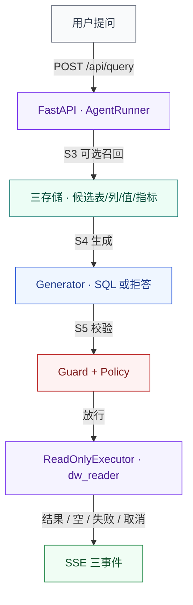

# 第一部分 · 先读这一页

先看一个旧系统的数字。`Decimal("10")` 从 MySQL 出来，经过 `default=str`，到了浏览器变成 `"10"`。表格还是那张表格，列也对齐，复制到表格软件里却再也不能求和。没有报错，也没有红框。

这本书要处理的就是这类失败：让它有名字、有位置、有证据。

## 1. 这本书是什么、不是什么

这本书是 DSWS 重建项目的使用说明、设计论证和证据台账。S0–S8 每个阶段都写清了输入、动作、输出和硬验收命令，读者可以从空目录一路走到能跑的问数流水线；32 张设计图从架构、运行时、数据、安全、部署、测试六个角度解释同一套系统，每张图只回答一个具体问题。每个结论都带证据标记：✅ 是本机跑过或文件明确存在，🟡 是从代码结构推导、尚未实跑，⚪ 是环境不具备、没有执行。读者据此判断一句话是验收依据、设计假设，还是待办。

它明确**不是**下面几样东西：

1. **不是旧系统的说明书。** 旧系统 `shopkeeper-agent` 已冻结为 `legacy`，只作为反例库和负向夹具。书里提旧系统只有一个用途：说清哪一种静默失败必须被新系统挡住。兼容旧系统不在范围内。
2. **不是 API 参考。** 接口、步骤、错误码、SQL 策略的唯一事实源是 `contracts/` 下的文件；本书只解释这些文件为什么这样写，不复制一份可能过期的接口表。
3. **不是生产运维手册。** 当前实现是单机教学规模：单 MySQL、单 ES、单 Qdrant、单后端 worker。多租户、权限体系、容量规划、高可用都不在 S0–S7 的范围内，S8 也只给出方向。
4. **不是「782 个测试全部通过」的证明。** README 声称后端 782 passed / 31 skipped，但本次设计工作没有跑全量测试，因此书中一律写作「README 声称 782，本机未跑」，并标 🟡。类似地，前端 40 passed、14 条 SSE 夹具也来自 README 与契约文件，而不是本轮的实跑输出。

读者对象有三类：第一次接触这个项目、准备按阶段重建的工程师；需要评审「设计是否成立」的架构师或评审者；线上出问题后需要快速定位的运维人员。三类人不需要从头读到尾，§6 给出三条路线。

全书的总原则一句话：契约是事实源，图是论证，阶段是施工顺序，证据是发言资格。缺一条，读者就没法复核书里的任何结论。

## 2. 一分钟看懂 DSWS

DSWS 是一个电商问数智能体：用户用自然语言问「上个月华东的销售额是多少」，系统把它变成一条只读 SQL，在数仓上执行，再把结果按列类型渲染出来。它不做对话，也不是通用 BI 平台，边界只有四个词：单轮、单库、只读、可拒答。

*图 0 · 一次问数的六个环节（详图见[图 02 · C4-L2 容器图](../../diagrams/01-architecture/02-c4-container.svg)）*

把这套系统压缩成五句话：

1. **用户问数。** 前端只做一件事：把一个自然语言问题、一个取消按钮和一条 SSE 流，组织成一次可观察的运行。它不猜 SQL，也不替后端补数据。
2. **召回。** S3 把问题拆成关键词，去 Qdrant 找列与指标、去 ES 找枚举取值、去 Meta 取详情，输出的是「候选表、候选列、候选取值、候选指标」，不是 SQL。召回为空是一个可记录的 trace，不是一次成功。
3. **生成。** S4 把候选压进 7 个提示词槽位，交给确定性生成器或真实 LLM，产出「一条 SQL」或「一次拒答」两种形状之一；输出形状先过 JSON Schema，再过 AST 静态校验。
4. **校验。** S5 在连库之前检查单语句、只读、表白名单、列白名单、常量投影、`ORDER BY` / `LIMIT`，并把注释去掉、把 `LIMIT` 补上。最终执行的是策略重新序列化后的那条 SQL，而不是模型原文。
5. **执行与回答。** 只读账号 `dw_reader` 执行，叠加 `max_execution_time`；SSE 一定以 `result` 或 `error` 收尾。0 行是 `EMPTY_RESULT`（类别 `empty`），用户取消是 `CANCELLED`（类别 `cancelled`），两者都不许伪装成「查询成功」。

五个环节里，生成 SQL 只占一环。剩下的部分大都在处理同一件事：失败怎么被看见、被命名。

## 3. 三个根因：为什么要重建

旧系统不是「架构不漂亮」才被替换，而是有三类静默失败：界面显示成功，语义已经错了；用户没有任何线索发现。重建的每一层，基本都在回答这三个根因中的一个。

### 3.1 根因一：伪 SQL 被当成数据

生成失败时，旧系统把一段错误说明塞进「一行一列」的结果里，列名像错误文案，值是一段文本。这个结构在协议上完全合法：有 `columns`、有 `rows`，前端于是按表格渲染。用户看到的是「查询成功」加一句话，而不是一次失败。

这类错误最危险：形状合法，语义完全错。下游复制、导出、再计算，拿到的都是这段文本。

新系统的三道止损：

- S5 在连库前拒绝非 `SELECT`、多语句、非白名单表列的 SQL，伪 SQL 形态拿不到执行许可；
- S6 规定失败必须走 `type:"error"`，错误码来自 `contracts/errors.yaml`，不允许把错误文案塞进结果行；
- S7 在展示层用 `looksLikePseudoError()` 做保守识别，命中则渲染 `PseudoErrorCard`，并且**刻意不编造错误码**——错误码只有契约一份，前端硬编一个等于又抄了一份契约。

对应阶段：S5 → S6 → S7。对应图：[图 24 · 错误码分类与 UI 映射](../../diagrams/04-security/24-error-taxonomy.svg)、[图 31 · 失败注入矩阵](../../diagrams/06-testing/31-failure-injection.svg)、[图 13 · S7 SSE 事件序列](../../diagrams/02-runtime/13-s7-sse-sequence.svg)。证据：`docs/S7-HANDOFF.md` §2.4 与 §4.2 的 F5、`fixtures/sse/pseudo_row.json`、`frontend/src/lib/result.ts`。

### 3.2 根因二：召回为空也算 success

旧系统把空数组 `data: []` 当成一次正常结果：表格消失，页面看起来「跑完了」，但用户既不知道是没有符合条件的数据，还是召回根本没找到东西。审计把这条记为 FP-8：**空数组是合法语义，不是失败，但也不是成功的数据**。

新系统把「空」拆成两个可观察的事实：

- 召回为空时，S3 的 trace 记录候选数；生成层拿不到足够上下文时选择拒答，而不是编造一张表；
- 执行返回 0 行时，S6 发 `EMPTY_RESULT`，类别是 `empty`：界面给虚线空态卡，执行步骤保持绿色，**不标红**；错误卡只在真正失败时出现。

所以新系统不允许用同一种界面表达三种不同的事实：没有数据、召回失败、系统失败。加一张空态卡解决不了这个问题。

对应阶段：S3（可观察的召回）→ S6（分类）→ S7（渲染）。对应图：[图 09 · S3 召回流水线时序](../../diagrams/02-runtime/09-s3-recall-sequence.svg)、[图 24 · 错误码分类与 UI 映射](../../diagrams/04-security/24-error-taxonomy.svg)、[图 13 · S7 SSE 事件序列](../../diagrams/02-runtime/13-s7-sse-sequence.svg)。证据：`contracts/errors.yaml` 中 `EMPTY_RESULT` 的注释、`docs/S7-HANDOFF.md` §1 的 FP-8 引用、`fixtures/sse/empty_rows.json`。

### 3.3 根因三：错误被吞掉

「吞掉」有四种常见形态，旧系统至少中了三种：

1. **类型被静默改写。** SSE 序列化传了 `default=str`，MySQL 的 `Decimal("10")` 悄悄变成字符串 `"10"`。界面看起来正常，复制出去的数字已经不可计算。
2. **错误没有归属。** 红框出现了，但用户不知道哪一步失败；前端把「progress / result / 其余」全当 error，后端新增一个事件类型就会制造一次莫名其妙的失败。
3. **HTTP 错误被压成一句话。** 400/422/5xx/网络不可达都显示「无法连接问数接口」，排障只能靠猜。
4. **没有依赖时编造结果。** 没有数据库就返回一份假数据，而不是诚实失败。

新系统的对策是「让失败有名字、有位置、有通道」：

- S6 用 16 个错误码、3 个类别（`failure` / `empty` / `cancelled`）和 `retryable` 描述每一种失败；`SQL_REJECTED` 永远不可重试，避免拿被拒的 SQL 去问模型「改一下」；
- S7 的 `_sse()` 不传 `default=str`，未知类型直接变成 `INTERNAL_ERROR`；HTTP 400/422/404/5xx/网络错误分级给文案；失败步骤名来自 `/api/steps`；
- 没有 MySQL 时，`/api/query` 以一条诚实的 `INTERNAL_ERROR` 收尾，而不是编一份假数据。

对应阶段：S4（输出形状）→ S5（执行错误）→ S6（错误通道）→ S7（界面映射）。对应图：[图 24 · 错误码分类与 UI 映射](../../diagrams/04-security/24-error-taxonomy.svg)、[图 32 · 证据台账](../../diagrams/06-testing/32-evidence-ledger.svg)、[图 13 · S7 SSE 事件序列](../../diagrams/02-runtime/13-s7-sse-sequence.svg)。证据：`docs/S7-HANDOFF.md` §2.1 与 §2.4、`backend/app/main.py` 的 `_sse()`、`contracts/errors.yaml` 文件头注释。

### 3.4 根因与阶段的对应关系

| 根因 | 旧系统的可见症状 | 新系统主要由谁承担 | 图号 |
|---|---|---|---|
| 伪 SQL 被当成数据 | 一行一列的错误文案被渲染成成功表格 | S5 拒绝 → S6 错误事件 → S7 展示层止损 | 13、24、31 |
| 召回为空也算 success | `data: []` 后表格消失，无任何说明 | S3 trace → S6 `EMPTY_RESULT` → S7 空态卡 | 09、13、24 |
| 错误被吞掉 | 类型被改写、错误无步骤、HTTP 一句话、假数据 | S4 形状 → S5 执行 → S6 分类 → S7 映射 | 13、24、32 |

## 4. S0–S8 地图

S0–S7 是已经实现的八个阶段，S8 是后续的生产化方向。每个阶段引入一种新的不确定性，也留一个可停点：到这里为止，系统仍然可演示、可验收、可回退。图号与 `WBS.md` 的 32 张图一一对应。

| 阶段 | 新增能力 | 新增的不确定性 | 可停点 | 对应图号 |
|---|---|---|---|---|
| **S0 骨架** | 12 步 SSE 契约、5 个 HTTP 端点、前端协议守卫 | 前后端能否对同一份事件契约保持一致 | 后端能起服务，前端能解析/回放事件 | 01、02、04、05、07、13、29、30 |
| **S1 Schema 契约** | 5 表 / 24 列 / 6 指标；DDL 与真实值校验；旧系统负向夹具 | 契约是否与真实数据一致（粒度、值域、口径） | `make stage1` 全绿；旧夹具必须红 | 14、15、30 |
| **S2 元知识** | Meta / ES / Qdrant 三份可检索知识 + manifest + 幂等 | 同一份契约翻成三种存储后是否仍然等价 | `make stage2`；`--verify` 对账；第二次构建 `NOOP: 0 writes` | 06、08、16、17、19、30 |
| **S3 检索** | 20 题黄金集；ES 1 次 `_msearch`、Qdrant 2 次批量、Meta 5 条 SQL | 召回质量：哈希向量不是语义模型，候选可能不足 | `make stage3`；只读验收，不做 `--fresh` | 09、16、19、30 |
| **S4 生成 SQL** | 7 槽位提示词、确定性生成器、JSON Schema 输出校验、AST 静态校验 | 模型输出形状与语义；真实 LLM 尚未验证 | `make stage4`，完全离线也能跑 | 10、15、21、30、31 |
| **S5 安全边界** | 六道 SQL 检查、只读执行器、36 条注入语料、11 条零误杀 | 策略覆盖度（新语法、新函数）与真实账号权限 | `make stage5`；接 MySQL 用 `stage5-live` | 11、20、21、22、23、30、31 |
| **S6 失败通道** | 16 个错误码 / 3 类失败、校正闭环最多 1 次、取消 | 失败分类是否穷尽；校正是否引入新风险 | `make stage6`；浏览器用 `stage6-ui` | 07、12、13、24、30、31 |
| **S7 前端收口** | 契约生成物、14 条 SSE 夹具、13 条 F 缺陷闭环 | 真实召回与真实模型下，界面语义是否仍成立 | `make stage7`；浏览器用 `stage7-ui` | 04、13、24、30、31、32 |
| **S8 性能与生产化** | 真召回接主链路、真库、真 LLM、并发/超时/缓存/可观测 | 容量、并发、真实数据分布、多租户 | 尚未实现；本书只保留设计与边界 | 05、25、26、27、28、29、32 |

这张表有两处容易读错。阶段不是功能清单，是不确定性清单：每加一层能力，就多一个可能出错的地方，所以每层都要有硬验收。可停点也不等于可上线：S3 通过只说明召回流水线成立，不说明前端能真实问数；S7 通过只说明协议、契约和界面收口成立，真实召回、真实数据库与真实 LLM 仍属于 S8。

## 5. 证据等级：✅ / 🟡 / ⚪

证据标记在这本书里是要兑现的：标 ✅ 得能指到命令或行号，标 🟡 得写清推导链，标 ⚪ 得说明缺什么。

| 标记 | 含义 | 读者可以怎么用 |
|---|---|---|
| ✅ 已验证 | 本机命令跑过、退出码为 0，或文件明确存在且可逐行引用 | 可以作为验收依据；仍要注意环境差异 |
| 🟡 推断 | 从代码、契约或配置推导出来，但没有实跑 | 可以作为设计假设，不能当作已验收 |
| ⚪ 未验证 | 环境不具备或本轮没有执行 | 只能作为待办或风险，不能作为结论 |

读者常把 🟡 当 ✅ 用：照着做失败时，会误以为是自己的环境错了；评审时会把「代码里应该有」当成「系统确实做过」。把推断写成已验证，风险就转给了读者。反过来，把 ✅ 写成 ⚪ 会浪费已有的证据，让读者重跑一遍。

本机的三条硬边界，必须在读任何结论前知道：

1. **Docker socket 无权限。** 本设计工作树没有跑 `docker compose up`，也没有跑 S2 的 `--fresh` 写三存储。S2 的计数来自 `--dry-run` 与 `plan.counts()`；写入总数 241 是按代码公式推导（44 行 Meta + 76 ES + 98 + 22 Qdrant + 1 manifest），标 🟡，不是实测。
2. **`dw_reader` 密码不在仓库里。** 只读账号密码由 `REBUILD_DW_RO_PASSWORD` 提供，没有默认值。没有这个变量，`make stage5-live` 不会跑；只读账号的 GRANT 与执行器行为来自代码、脚本和假连接测试，标 🟡。
3. **没有 LLM 端点与 Key。** 生成默认走确定性生成器，`correct_sql` 在未配置 LLM 时显示「未触发」。`HttpLlmGenerator` / `LlmCorrector` 的接口、提示词与校验都在，但没有对着真实端点跑过，标 ⚪。

另外两条本轮边界：全量后端测试没有跑，README 声称 782 passed / 31 skipped（🟡）；前端浏览器验收本轮没有跑，`stage0-ui` / `stage6-ui` / `stage7-ui` 的历史结论来自文档（🟡），本轮状态为 ⚪。

## 6. 怎么读这本书

**路线一：新手照着做。** 先读本章 §1–§2，建立「问数五环节」的心智模型；然后读 `10-s0-s4.md` 与 `20-s5-s8.md`，按阶段执行 `make stage0` 到 `make stage7`。每跑完一个阶段，回到 `30-atlas.md` 找对应图号，确认自己刚才跑的东西在整条链路里的位置。遇到需要三存储的阶段（S2/S3/S5-live），先读 `40-ops.md` 的启动顺序，不要在没有 `source scripts/export-docker-env.sh` 的情况下直接跑 CLI。S8 只读设计，不照着做。

**路线二：评审看设计。** 先读本章 §3–§4，知道三个根因与九个阶段；再读 `30-atlas.md` 的架构角度（图 01–06）与数据/安全角度（图 14–24），核对「契约是否真的贯穿构建时与查询时」「安全是否真的在连库之前」；最后读图集 §7「图集没有回答的问题」，把 ⚪ 项列入评审待办。评审时看每张图的「证据与边界」有没有指到文件或命令，图漂不漂亮不作数。

**路线三：运维查故障。** 直接读 `40-ops.md`，再按症状查图：[图 25 · Docker Compose 拓扑](../../diagrams/05-deployment/25-compose-topology.svg) 看服务依赖，[图 26 · 端口与网络暴露面](../../diagrams/05-deployment/26-port-exposure.svg) 看为什么 8080 通而 8100 不通，[图 27 · 启动顺序与健康检查](../../diagrams/05-deployment/27-startup-order.svg) 看 `init` 卡住会停在哪，[图 24 · 错误码分类与 UI 映射](../../diagrams/04-security/24-error-taxonomy.svg) 看用户看到的那句话对应哪个码，[图 31 · 失败注入矩阵](../../diagrams/06-testing/31-failure-injection.svg) 看这个码能不能被稳定复现，[图 32 · 证据台账](../../diagrams/06-testing/32-evidence-ledger.svg) 看这条结论到底验没验过。命令层面的排障步骤以 `docs/SETUP-FROM-SCRATCH.md` §6 为准。

三条路线共用一条纪律：先看证据标记，再看结论。一个 ⚪ 的结论不值得你花半小时复现；一个 ✅ 的结论，也仍要确认自己的端口、目录和依赖版本与书中一致。

## 7. 本书的约定

**命令。** 所有 `make` 命令都在源码仓库根执行；设计工作树的命令会先写 `cd design`。代码块里不写提示符，直接给可复制的命令。需要环境变量的命令会显式写出变量名，例如 `REBUILD_DW_RO_PASSWORD=... make stage5-live`，不暗示仓库里有默认密码。

**路径。** 源码路径相对仓库根，例如 `backend/app/main.py`、`contracts/steps.yaml`、`fixtures/dw.sql`。设计产物路径相对 `design/`，例如 `diagrams/02-runtime/08-s2-build-sequence.svg`、`inventory/facts.md`。章节里的图片路径相对章节文件本身（`design/book/chapters/`），所以统一写成 `../../diagrams/<角度>/<编号>-<短名>.svg`，解析后落在 `design/diagrams/**`。

**端口。** 后端 `8100`，Vite `5273`，前端容器 `8080 → 80`，MySQL `3306`，Elasticsearch `9200`，Qdrant `6333`。临时验收端口：S0 用 `8101/5274`，S6 用 `8102/5275`，S7 用 `8103/5276`，刻意避开旧系统的 `8000/5173`。除 `8080` 外，其余端口默认只绑 `127.0.0.1`。

**计数。** 契约 5 表 / 24 列 / 6 指标 / 9 条列—指标关系；12 个步骤；16 个错误码、3 个类别；3 种 SSE 事件；5 个 HTTP 端点。S2 三存储：Meta 5/24/6/9（合计 44 行）、ES 76 条取值文档、Qdrant 98 条列文本 + 22 条指标文本、manifest 1 条；写入总数 241 是公式推导（🟡）。代码规模：后端 60 个 Python 文件、45 个测试文件，前端 2 个测试文件。测试数一律写「README 声称 782 passed / 31 skipped，本机未跑」，不写成已验证。

**图号。** 图号 `01`–`32` 在全图集内唯一，不按目录重排。正文首次提到某图时给「图 NN · 标题」并链接；完整说明集中在第四部分 `30-atlas.md`。图题在图下方，表题在表上方；表号用「表 2-1」这种「章-序」格式，只在需要交叉引用时编号。

**证据标记。** ✅ / 🟡 / ⚪ 只出现在证据句或证据表里，不用来修饰产品能力。一个段落如果同时包含事实与推断，会分开写，不把两种语气混在一句话里。

**术语。** 「构建时」指 S2 一次性 CLI 任务，退出后不参与查询；「查询时」指 `/api/query` 触发的 FastAPI + AgentRunner 链路。「召回」专指 S3 的候选生成，不指最终 SQL。「伪 SQL」指形状像结果、内容是错误文案的载荷。「空结果」专指执行成功但 0 行，不等于召回为空。「失败通道」专指 S6 的错误码、类别、校正与取消机制。术语首次出现时给英文标识符，之后用中文；英文标识符保留原文，不改写。

### 7.1 如果只记三件事

- 契约是事实源。`contracts/` 里的表结构、步骤、错误码改一个字，代码和前端都得跟着对账。
- 证据分三级。✅ 是本机跑过或文件明确存在，🟡 是推导，⚪ 是没跑；别把 🟡 说成 ✅。
- 失败要有名字。`contracts/errors.yaml` 里的错误码决定用户看到什么，也决定能不能重试。
