# 第三部分 · S5–S8：从能跑到敢用

旧系统会把错误文案当成数据发回来。模型生成的 SQL 是 `SELECT '无法生成SQL…' AS error_message`，它通过了 `EXPLAIN`；后端把这一行当成正常结果，前端渲染成 1 行 1 列的表。屏幕上没有红色，用户以为查到了数据。

先停一秒，问一个看起来矛盾的问题：`EXPLAIN` 都通过了，这条 SQL 为什么还是不该执行？

`EXPLAIN` 回答的是「数据库能不能解析并给出执行计划」，它不评价这句话该不该说出口。`SELECT '无法生成SQL…' AS error_message` 是一条完全合法的查询：不写库、不越权、不拖垮服务，数据库没有理由拒绝它。问题出在语义层：它把「模型放弃了」这件事伪装成了一行数据。按 S4 的规则，这条 SQL 属于常量投影，本该在生成质量那一层被拦下；旧系统把校验写成了 `explain {sql}` 的字符串拼接，既不检查投影，也不检查语句条数。于是它一路走到执行器，带着一句道歉变成了结果。

S5–S8 要解决的就是这种「看起来成功」的失败：拒绝要可判定，错误要有名字，类型要保真，部署边界要说清。

S0–S4 解决的是「系统能不能产出一条看起来像样的 SQL」。S5 开始，问题换了：这条 SQL 凭什么可以碰数据库？出错时用户能不能知道发生了什么？界面会不会把失败画成成功？把它装进容器以后，还有哪些事没有证明？四个问题分别对应 S5 安全边界、S6 失败通道、S7 前端收口、S8 生产化，也是把「能跑」变成「敢用」的四次交接。

这一部分每节的结构一样：先说上一阶段留下了什么风险，再说本阶段新增了什么不确定性，最后用一条可复现的命令证明这个不确定性已经被压住。凡是本设计工作树没有实际执行的，一律标 ⚪；凡是只有文档声称、没有本机输出的，一律标 🟡；凡是 2026-10-29 在本工作树跑过、输出可对照，或文件明确存在且可逐行引用的，才标 ✅。

#### 学习目标

读完这一部分，你应该能：

- 说出 S4 静态校验与 S5 安全策略各自回答的问题，并解释为什么前者不能替代后者；
- 沿着一条 SQL 走完 S5 的判定链，指出哪一步保证「执行的就是判定过的那条」；
- 用一张表说明 S6 的三种 `class` 如何决定界面，并解释空结果与取消为什么都不算失败；
- 从一段 SSE 字节流还原出前端的状态迁移，指出未知事件与未知步骤的处理为什么相反；
- 画出 S8 的启动依赖链，说明 `service_started` 为什么不够，并列出「换一台机器」的检查顺序；
- 分清已验证、推断与未验证，知道这一部分哪些结论还缺证据。

#### 读之前需要什么

你应当读过上一章（S0–S4），知道系统能生成 SQL、能做静态校验；会 Python、SQL 与 HTTP/JSON；对容器、镜像、端口、卷有基本概念。AST 策略、SSE 解析细节、MySQL 权限模型、nginx 缓冲这四件事，本章不假设你会，首次出现时会拆开讲。

#### 术语约定

本章反复用几个词：**契约**指仓库 `contracts` 目录下的事实源；**生成物**指由契约生成、不能手改的前端文件；**夹具**指录下来供逐字比对的真实事件流；**门禁**指 `make stage5` 这类可重复的验收命令；**语料**指注入测试用的 SQL 样本；**通道码**是暴露给前端的错误码，**原因码**是策略内部的具体违规码。

#### 这一部分在全书的位置

S0–S4 证明系统「能生成」；S5–S8 证明它「敢用」。但「敢用」有边界：本章只讲到离线门禁与证据边界，不把 S8 写成已经上线。S8 之后的容量、可观测性、身份与传输安全属于后续工作，本章只标出缺口。

#### 四道交接，一句话各自管什么

- **S5 管入口**：执行前判定，拒绝时不连库。
- **S6 管失败**：每种失败有名字、有类别、有步骤、有能否重试的结论。
- **S7 管呈现**：后端的契约直接变成前端的类型、步骤与界面状态。
- **S8 管交付**：把本机能跑变成换一台机器也能起，并把没证明的部分标出来。

四次交接问的是同一个句式：上一阶段留下了什么风险，这一阶段新增了什么不确定性，用什么命令证明它被压住。

---

## 0. 这一部分的地图

表 3-1 · S5–S8 的阶段地图

| 阶段 | 新增能力 | 新增的不确定性 | 可停点 | 前置 |
|---|---|---|---|---|
| S5 安全边界 | SQL 在连库前过 AST 策略；只读账号执行 | 生成出来的 SQL 可能带写操作、多语句、越权表列或外带构造 | `make stage5`：36 条注入全拒、11 条正常查询零误杀；`make stage5-live`：只读账号写不了 | S4 能产出 SQL；`contracts/schema.contract.yaml` 与 `sql.policy.yaml` 可读 |
| S6 失败通道 | 16 个错误码、3 个 class、校正闭环、取消 | 失败可能没有名字、被归错类、被无限重试，或者取消被当成完成 | `make stage6`：6 类失败逐条对上码 / 类 / 步骤；`make stage6-ui`：界面状态互不相同 | S5 的拒绝已经是一个可判定的结论 |
| S7 前端收口 | 契约生成物、SSE 三事件消费、StepRail / ErrorCard / 类型保真 | 前端可能按旧契约渲染、把未知事件当失败、把 Decimal 悄悄降级成字符串 | `make stage7`：生成物新鲜度、14 条夹具逐字对账、前端契约测试与构建；`make stage7-ui`：13 条 F 缺陷 | S6 的错误已经带 `code` / `class` / `step` |
| S8 生产化 | Compose 六服务、健康检查、端口收敛、非 root 镜像 | 本机能跑不等于换一台机器能起；单 worker、无鉴权、无 TLS、无指标都是边界 | 目前没有已完成的 S8 性能门禁；Docker 全栈在本工作树标 ⚪ | S5–S7 的离线门禁与契约 |

可停点的意思是「这一类不确定性有了可重复的判据」，不是「功能做完」。S5 的判据是 36/36 与 11/11；S6 的判据是 16 个码和 6 类失败；S7 的判据是 14 条夹具逐字一致；S8 之所以还不能算完成，正是因为它还没有这样一条判据。

读这张表时，把「可停点」和「证据等级」分开看。可停点回答「这一类不确定性有没有判据」，证据等级回答「这条判据在本工作树跑没跑过」。S5 的判据写在表里，也真的在本机跑出了 36/36；S8 连判据都还没有成形，所以它的停点是空的。这两件事不能合并成一句「做完了」或「没做完」。

表里的标记只描述本工作树 2026-10-29 的状态，不描述设计质量。一个标为未验证的条目可能是设计正确、只是环境不具备；一个标为已验证的条目也可能只证明了一条窄路径。读后续各节时，先看结论后面的证据，再看结论本身。

表 3-1a · 四道交接的一页纸

| 交接 | 上一阶段留下的风险 | 这一阶段压住的不确定性 | 判据长什么样 |
|---|---|---|---|
| S4 → S5 | SQL 看起来对，但可能写库、越权、拖垮服务 | 生成文本能否在执行前被判定为安全 | 注入全拒、正常查询零误杀 |
| S5 → S6 | 拒绝是一个结论，但用户看不到结论 | 失败能否变成有名字、有类别的事件 | 每类失败对上码、类、步骤 |
| S6 → S7 | 事件有名字，但界面可能不认 | 契约能否直接约束类型、步骤与渲染 | 生成物与夹具逐字一致 |
| S7 → S8 | 开发机上能跑、能失败、能展示 | 同一套文件能否在另一台机器上起来 | 启动链与验收脚本 |

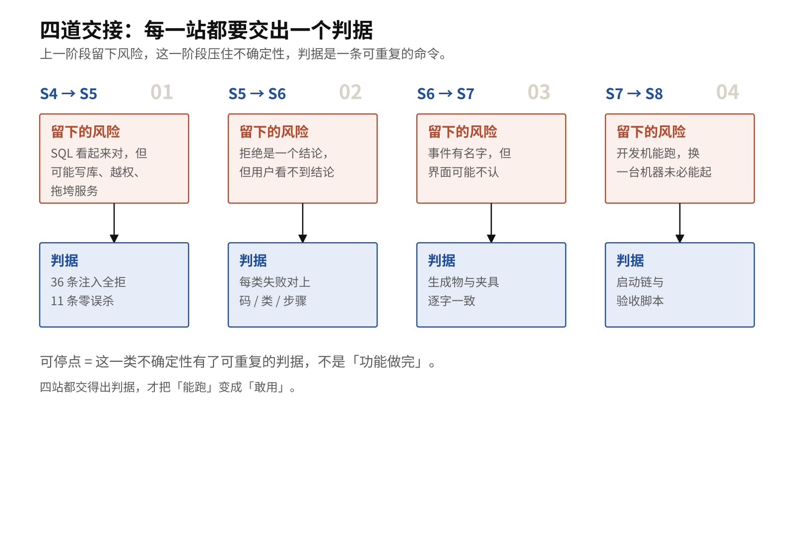

图 0b 与表 3-1a 同源：每一站都写清「留下的风险 / 压住的不确定性 / 判据」，四站都交得出判据，才把「能跑」变成「敢用」。

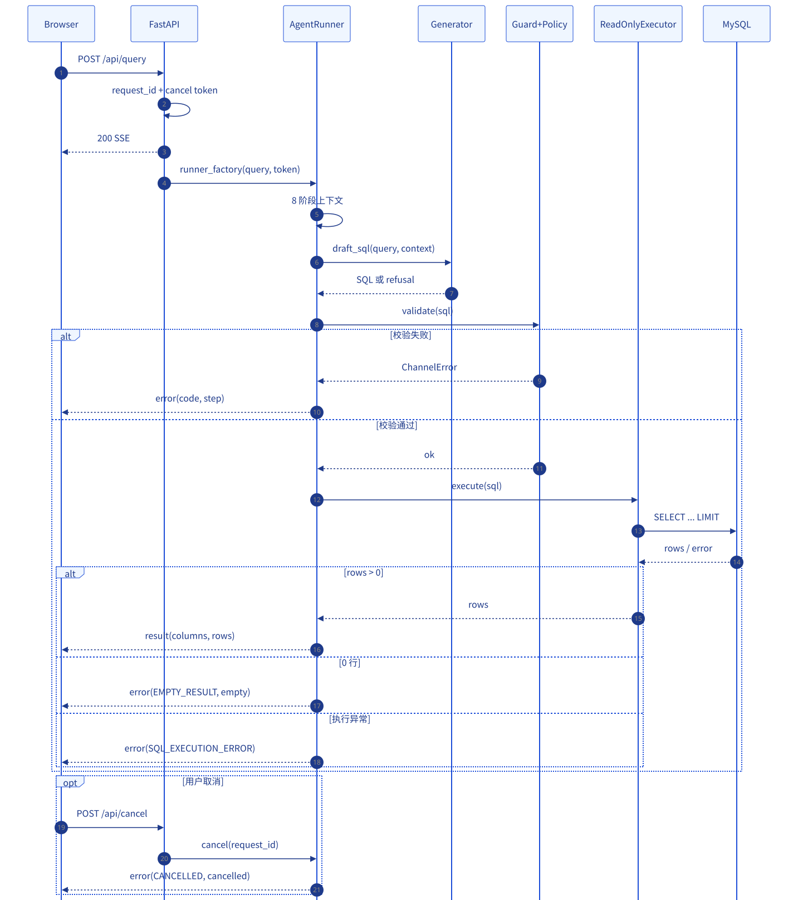

图 07 把 S5–S7 放进同一条请求：S5 负责执行前的闸，S6 负责失败怎么变成事件，S7 负责事件怎么变成界面。三者共用一条 SSE 管道，任何一层的契约漂移都会在下一层显形。

---

## 1. S5 · 安全边界

### 1.1 问题：为什么 S4 的 SQL 不能直接执行

S4 结束时，系统已经能生成 SQL，也能做 AST 静态校验。但 S4 的校验回答的是「这条 SQL 像不像这个问题的答案」，不是「这条 SQL 有没有资格碰数据库」。这两件事必须分开，因为它们的输入不同、失败后果也不同。

把两件事混在一起，最常见的写法就是「先 `EXPLAIN` 一下，能过就执行」。这条路径有三个盲点。`EXPLAIN` 只编译第一句，多语句里的第二句不进入计划；它不检查账号有没有写权限，只检查语法与对象是否存在；它也不关心投影出来的是不是一行伪装成数据的错误文案。换句话说，`EXPLAIN` 证明的是「数据库看得懂」，不是「这句话该被执行」。

旧系统的教训写在 `fixtures/injection/sql-injection.yaml` 的文件头里：旧 `validate()` 做的是 `f"explain {sql}"`，只给第一句加 `EXPLAIN` 前缀，不检查语句条数。MySQL 对 DDL 自动提交，所以下面这条语句在旧系统里会真的把 `fact_order` 删掉：

```sql
SELECT 1 AS a FROM fact_order LIMIT 1; DROP TABLE fact_order
```

问题出在校验和执行不是同一条语句，跟模型偶尔胡说无关。`EXPLAIN` 只看第一句，第二句照原样执行；只要生成器被诱导一次，整张事实表就没了。这条语句之所以能过旧校验，是因为 `EXPLAIN` 与执行分属两次调用：校验时把整段文本加上前缀交给数据库，执行时又把原始文本原样交给驱动，两次调用之间没有任何东西保证它们是同一条语句。S5 的核心不变式就从这里来：**执行的文本必须由被判定过的那棵 AST 生成**，不能是「同一段字符串再拼一次」。

S4 的静态校验能挡住一部分「生成质量问题」，但它不是执行安全层：它不知道数据库账号有没有写权限，也不负责把「校验通过的那条 SQL」和「真正执行的那条 SQL」钉成同一条。

所以 S5 的问题可以写成一句话：**在打开数据库连接之前，如何把「一条 SQL 文本」变成一个可解释的放行 / 拒绝结论，并保证执行的就是被判定过的那条 SQL？**

这句话里有三个词要兑现。「可解释」意味着拒绝要带原因码，不能只说不行；「放行 / 拒绝」意味着结论只有两类，执行错误是放行之后的另一件事；「执行的就是被判定过的那条」意味着判定必须产出可执行的 SQL，不能只产出一个布尔值。

### 1.2 实体与边界：策略、执行器、账号

S5 有四个实体，边界清楚才不会互相冒充。

第一是**策略**。`backend/app/security/policy.py` 的 `enforce()` 是纯函数式的判定器：输入 SQL 文本、白名单、策略配置，输出 `PolicyDecision`。它不连库，不抛「拒绝异常」，而是把违规收进 `violations`，让调用方决定怎么降级。拒绝因此是一个结论，不是一次崩溃。

第二是**执行器**。`backend/app/security/executor.py` 的 `ReadOnlyExecutor` 负责连接、会话超时、执行和取行。它在 `execute()` 的第一行先调用 `enforce()`；策略不通过时直接返回 `SQL_REJECTED`，**连连接都不打开**。这一条是 S5 的硬边界：没有数据库往返，就没有「校验过了但跑的是另一条」的机会。

第三是**账号**。执行器只使用 `dw_reader` 连接 `dw`，这个账号在 `dw` 上只有 `SELECT`。策略是代码，账号是数据库；两者独立生效。旧系统的 `didilili` 是 `GRANT ALL PRIVILEGES ON dw.*`，这正是 D6 能发生的根本原因。新系统不复用它，只把 `didilili` 留给构建与初始化，把查询路径收窄到 `dw_reader`。

第四是**白名单**。哪些表、哪些列可以出现，不在 `sql.policy.yaml` 里再抄一遍，而是从 `contracts/schema.contract.yaml` 派生。`SqlWhitelist.from_catalog()` 把契约里的 5 张表、24 个列变成执行期的集合，避免「契约改了、白名单没改」的漂移。

四个实体各守一条边：策略管「文本能不能执行」，执行器管「这条路径必须先问策略」，账号管「即使绕过程序也写不了」，白名单管「哪些表列算数」。任意一条单独拿出来都不够。策略写对了但执行器先连库，连接已经发生在判定之前；执行器顺序对了但账号仍有写权限，一次漏判就是一次真实写入；账号收窄了但白名单靠手写，契约一改就会漂移。

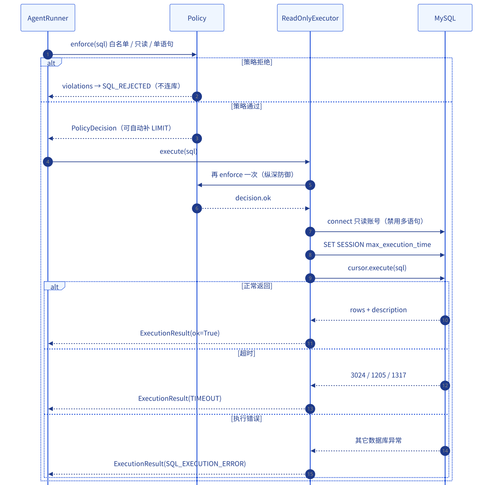

图 11 的时序值得逐段读：`AgentRunner` 先问 `Policy`，拒绝就返回 `SQL_REJECTED`，根本不进入 `MySQL`；放行才把 `PolicyDecision.sql` 交给 `ReadOnlyExecutor`。执行器在连库前**又**跑一次 `enforce()`，这是纵深防御，不是重复劳动：自定义执行器、校正后的 SQL、未来新增的调用方，都可能绕过第一道调用点。


图 14 是白名单的现实依据。`dw` 里只有 `dim_region`、`dim_customer`、`dim_product`、`dim_date`、`fact_order` 五张表；`fact_order` 的 `order_quantity` 是单内件数，`order_amount` 是整单金额。策略拒绝 `information_schema.tables`，理由是 `information_schema` 这个库不在 `dw` 白名单里，跟名字可不可疑无关；策略拒绝 `secret_table`，是因为契约里根本没有这张表。每条拒绝都能落回一张真实的表或一个真实的列。

### 1.3 输入：SQL 文本 + 契约 + 策略

S5 的离线判定只需要三样输入，都不依赖数据库：

1. **SQL 文本**：来自 S4 的生成结果，或校正闭环给出的候选 SQL。
2. **策略契约**：`contracts/sql.policy.yaml`。它声明单语句、根节点只允许 `Select`、禁止集合运算、禁止可执行注释、写操作禁词、危险函数禁词、`default_limit: 1000`、`max_limit: 1000`、`max_execution_time_ms: 5000`、只读账号 `dw_reader`，以及对外通道码 `SQL_REJECTED`。
3. **Schema 契约**：`contracts/schema.contract.yaml`。它提供表白名单与列白名单；库名 `dw` 也来自策略契约，不在代码里再写一遍。

这三样都是仓库里的文件，所以 `make stage5` 在任何一台有 Python 依赖的机器上都能给出同样的结果。这也是为什么 S5 的离线门禁不需要 MySQL：策略判定不查库，只查契约。

需要数据库的是「只读账号真的写不了」这一条，拆在 `make stage5-live`。它需要 `REBUILD_DW_RO_PASSWORD`，密码不在仓库里，由部署环境提供。这个拆分是刻意的：**策略的正确性**可以离线证明，**账号的权限**必须在线证明，两者不能互相代替。

所以 `make stage5` 通过只证明判定器，不证明账号；两者都过，才叫「恶意 SQL 进不来」。

### 1.4 动作：AST 解析 → 策略判定 → 只读执行

`enforce()` 的判定顺序是排过的：

1. 可执行注释 `/*! ... */`：服务端会执行，解析器会忽略，必须在解析前先抓。
2. 解析：`sqlglot.parse(text, read="mysql")`。解析失败时，先看词法禁词，再退到 `SQL_SYNTAX`。
3. 单语句：过滤掉 `None` 与 `Semicolon` 后，如果多于一条，直接 `SQL_MULTIPLE_STATEMENTS`。
4. 集合运算：`Union` / `Except` / `Intersect` 一律拒绝，原因码 `SQL_FORBIDDEN_CONSTRUCT`。
5. 根节点：只允许 `Select`；`Update`、`Delete`、`Drop` 等根节点给 `SQL_NOT_READ_ONLY`。
6. 任意位置的写节点：再遍历一次 AST，防止写操作藏在子查询或 CTE 里。
7. 危险函数：`SLEEP`、`BENCHMARK`、`LOAD_FILE`、`GET_LOCK`、`EXTRACTVALUE`、`UPDATEXML`。
8. 词法兜底：AST 看不见的 `INTO OUTFILE` 之类，交给 `scan_keywords()`。
9. 表白名单：库名必须是 `dw`，表名必须在契约的 5 张表里。
10. 列白名单：限定列按别名解析到真实表；无限定列允许命中投影别名（例如 `ORDER BY 销售额`）。
11. LIMIT：没有就补 `default_limit`，超过 `max_limit` 就截断。
12. 重新序列化：剥掉注释，生成最终 SQL。

把这十二步当成一条流水线，而不是一张检查清单：每一步只回答一个问题，多数步骤一旦给出确定结论就短路返回。第 2 步解析失败、第 3、4 步命中时直接返回；第 1、5、6、7、8、9、10 步把违规记进 `violations`，最后统一拒绝。短路的方向也排过：先抓服务端会执行、解析器会忽略的可执行注释，再解析；解析失败时先看词法禁词，再退到语法错；集合运算先于根节点判定，因为 `Union` 的根节点本身是只读的，但它是外带数据的载体，原因码必须说「构造不允许」；写节点再遍历一次，是因为写操作可以藏在子查询或 CTE 里；词法兜底放在 AST 之后，是为了让原因码更准——`SELECT 1; DROP TABLE t` 应该说「不是单条语句」，而不是「出现了 DROP」。

也有些步骤先记账、最后一起返回：可执行注释与白名单违规会累积进 `violations`，等所有检查跑完再统一拒绝。两种写法都保证同一个结果：只要 `violations` 非空，就没有执行路径。

#### 例题：一条正常查询走完判定链

拿一条正常查询走一遍。输入 `SELECT SUM(fact_order.order_amount) AS gmv FROM fact_order`：第 1 步没有可执行注释；第 2 步解析出一条 `Select`；第 3 步的单语句检查通过；第 4 步没有集合运算；第 5 步根节点是 `Select`；第 6 步遍历不到写节点；第 7 步没有危险函数；第 8 步词法兜底不触发；第 9 步库名缺省，表 `fact_order` 在契约的五张表里；第 10 步限定列 `order_amount` 解析到 `fact_order`，在二十四列之内；第 11 步没有 LIMIT，补上默认上限；第 12 步剥掉注释、重新序列化，得到可执行文本。每一步只做一个判断，判定链结束时以 `violations` 是否为空收口。

第 12 步最关键：策略返回的 `decision.sql` 是 AST 重新序列化后的产物，不是原始文本。执行器只执行这个产物。这样「校验的那条」和「跑的那条」在结构上就是同一条；否则 D6 的漏洞只是换了一个地方复发。

关键代码不长，第 3 步的判定可以对照 `backend/app/security/policy.py:enforce` 读：

```python
statements = sqlglot.parse(text, read=dialect)
meaningful = [
    statement for statement in statements
    if statement is not None and not isinstance(statement, exp.Semicolon)
]
if cfg.single_statement and len(meaningful) > 1:
    violations.append(PolicyViolation(
        "SQL_MULTIPLE_STATEMENTS",
        f"SQL 必须只有一条语句，实际解析出 {len(meaningful)} 条",
    ))
    return _reject(original, violations)

tree = meaningful[0]
```

最后两步决定了这条流水线的产物，同样可以在同一个函数末尾读到：

```python
    existing = _existing_limit(tree)
    if existing is None:
        tree = tree.limit(cfg.default_limit)
        applied_limit = cfg.default_limit
    elif existing > cfg.max_limit:
        tree = tree.limit(cfg.max_limit)
        applied_limit = cfg.max_limit
    else:
        applied_limit = existing

    final_sql = _strip_comments(tree).sql(dialect=dialect)
```

`decision.sql` 是这棵 AST 重新序列化的结果，不是原始文本。原文里的注释、大小写、空白都不保证保留；不变式要求的是「执行文本由这棵 AST 生成」，不是「字节不变」。基线那句话在这里落地：**执行的就是判定过的那条**。这条不变式还有一个推论：策略可以改写 SQL，而且改写是显式的。补 LIMIT、截 LIMIT、剥注释都会改变用户看到的文本，但不会改变语义边界。

AST 与词法兜底的分工，可以压成一句话：AST 负责「我认得的结构」，词法负责「我认得但解析器看不见的写法」。`INTO OUTFILE` 这类构造经常让解析器直接失败，此时 AST 什么都给不了，只能靠 `scan_keywords()` 在文本里找禁词；可执行注释则相反，解析器会把它当普通注释丢掉，必须在解析前用 `has_executable_comment()` 抓住。解析前抓可执行注释，解析失败后与 AST 判定后各扫一次词法禁词；三层各管一段，不互相替代。

执行器这一侧有四道闸，代码在 `backend/app/security/executor.py:ReadOnlyExecutor`：

```python
decision = enforce(sql, whitelist=self.whitelist, config=self.config)
if not decision.ok:
    return ExecutionResult(ok=False, sql="", error=ExecutionError(
        code=self.config.channel_code,
        message=first.message,
        reason_code=first.code,
    ))
return self._run(decision)
```

`_run()` 里再设置 `SET SESSION max_execution_time = 5000`，并用 `CLIENT.CAPABILITIES & ~CLIENT.MULTI_STATEMENTS` 显式去掉多语句标志。注意最后这一句：即使策略被绕过，连接本身也只可能跑一条语句。这是「代码」和「驱动」两层独立生效，不是同一道检查写两遍。

「先连库再判定」是一个值得走一遍的反事实。假设执行器把顺序倒过来：先连库，再跑 `enforce()`。功能上它仍然会拒绝，测试也可能全绿，但风险结构变了。判定之前就消耗了一次数据库连接与一次会话初始化，恶意请求可以用合法形状的 SQL 让每一次拒绝都先付一次连接成本。更麻烦的是，一旦某个调用方在判定与执行之间插入自己的逻辑，判定结果与执行文本就可能分叉，D6 的漏洞换一个地方复发。连接建立后如果先做会话设置，那段语句也发生在判定之前，等于让未判定的请求先影响了数据库会话。S5 把 `enforce()` 放在 `execute()` 的第一行，就是为了让「拒绝」与「没连过」成为同一件事。

### 1.5 输出：放行 / 拒绝 / 执行错误

S5 有三类输出，不能混成一句「失败了」。

**放行**：`PolicyDecision(ok=True, sql=..., applied_limit=1000)`。`sql` 是去掉注释、补过 LIMIT 的最终文本。比如 `SELECT SUM(fact_order.order_amount) AS gmv FROM fact_order` 会被改写成带 `LIMIT 1000` 的版本；聚合查询本来只返回一行，但策略仍然按统一规则补上上限。

**拒绝**：`ok=False`，`violations` 至少一条，`reason_code` 是第一条违规的原因码。对外通道码统一是 `SQL_REJECTED`，细粒度原因放在 `reason_code`。这是刻意的：如果「多语句」「写语句」「非白名单表」各自变成一个对外通道码，下游就要为每种拒绝写一套分支，失败又会长得不一样。原因码保留在 `detail.reason_code` 里，机器仍然能判定，人也能读懂。

**执行错误**：策略通过后，数据库仍可能报错。`ExecutionResult.error` 用 `code` 表示通道码，用 `reason_code` 表示数据库类别。MySQL 错误码的映射写在 `_ERROR_CODE_MAP` 里：`1064` → `SQL_SYNTAX`，`1146` → `SQL_UNKNOWN_TABLE`，`1054` → `SQL_UNKNOWN_COLUMN`，`3024` / `1205` / `1317` → `TIMEOUT`，其余 → `SQL_EXECUTION_ERROR`；客户端侧的 `2006` / `2013` 也按超时处理。这是实现层的归类，不是对错误本质的判断：2006 / 2013 本质是连接中断，文案写成超时会把排查带偏。

三类输出互斥：`ok=True` 只有一种，`ok=False` 只有一种，执行错误只在 `ok=True` 之后出现。把它们混成「失败了」会让下游失去判断依据——策略拒绝可以教育用户改问题，执行错误应该重试或报障，两者的处置完全不同。

这里有一个容易混淆的点：`SQL_TABLE_NOT_ALLOWED`、`SQL_COLUMN_NOT_ALLOWED`、`SQL_FORBIDDEN_CONSTRUCT`、`SQL_COMMENT_OBFUSCATION` 是**策略原因码**，不是 `contracts/errors.yaml` 里的 16 个通道码。对外只出现 `SQL_REJECTED`，原因码在 `detail` 里。S6 的错误码表不会为这四种原因各开一个通道；它只要求「拒绝」这件事有一个稳定的名字。

这条分层在验收里也能看见：注入语料核对的是 `reason_code`，通道码只出现一次。原因码是给人看的诊断，通道码是给机器看的分支。把原因码提升成通道码，等于让每种攻击手法各占一个对外分支，攻击面越宽，下游越不稳。

### 1.6 验收：注入语料 100% 拒绝、零误杀、只读账号写不了

离线门禁的命令来自 `Makefile` 的 `stage5`：

```bash
make stage5
```

它依次做四件事：

```bash
cd backend && uv run python -m app.scripts.security --check
cd backend && uv run python -m app.scripts.security --corpus
cd backend && uv run python -m pytest -q tests/security
cd backend && uv run pytest -q
```

`uv` 是 Python 的包与环境管理器；它按锁文件准备环境再执行，避免「本机装了什么就跑什么」。

四条命令各证明一层：`--check` 证明语料与原因码，`--corpus` 证明注入/放行两组语料的整体判定，安全测试证明边界，全量测试证明这次改动没有碰坏别处。任何一条单独绿都不够；四条一起绿，才叫「离线门禁通过」。

2026-10-29 在本工作树执行 `--check`，输出如下（✅）：

```text
== 1/3 注入语料（必须 100% 拒绝） ==
  注入语料：36/36 条按预期拒绝
== 2/3 零误杀语料（必须全部放行） ==
  零误杀语料：11/11 条放行
== 3/3 S4 基线零误杀 ==
  S4 基线：8/8 条 SQL 通过策略
S5 PASS
```

「36 条全拒」不够，还要「原因码精确匹配」。否则把所有东西都拒掉也能得到 36/36，但正常问题会被误杀。所以 `_check_corpus()` 同时核对 `decision.reason_code == case.reason_code`；`_check_allow()` 再跑 11 条「长得像正常查询」的语料，必须全部放行。

表 3-2 · 五条真实注入 SQL 与本机判定结果（✅ 2026-10-29）

| 语料 id | SQL | 判定 | 原因码 | 为什么被拒 |
|---|---|---|---|---|
| `multi_statement_drop` | `SELECT 1 AS a FROM fact_order LIMIT 1; DROP TABLE fact_order` | 拒绝 | `SQL_MULTIPLE_STATEMENTS` | `sqlglot.parse` 解析出 2 条语句；策略在单语句检查处直接返回，第二句没有机会执行 |
| `update_statement` | `UPDATE fact_order SET order_amount = 0 WHERE 1 = 0` | 拒绝 | `SQL_NOT_READ_ONLY` | 根节点是 `Update`，不在 `allowed_roots`；同时遍历到写节点 `Update`，给同一条原因码 |
| `union_exfiltration` | `SELECT order_amount FROM fact_order UNION SELECT customer_id FROM dim_customer` | 拒绝 | `SQL_FORBIDDEN_CONSTRUCT` | `Union` 是集合运算，可能把别的表的数据并进结果；策略在根节点判定前先拒绝它 |
| `executable_comment_drop` | `SELECT 1 FROM fact_order; /*! DROP TABLE fact_order */` | 拒绝 | `SQL_COMMENT_OBFUSCATION` | `/*! ... */` 是 MySQL 可执行注释：服务端会执行，解析器会忽略；第 1 步就抓 |
| `information_schema_tables` | `SELECT table_name FROM information_schema.tables` | 拒绝 | `SQL_TABLE_NOT_ALLOWED` | 库 `information_schema` 不在白名单（只允许 `dw`）；列 `table_name` 也不在契约 24 列里 |

对应的本机 CLI 输出可以逐条复现：

```bash
cd backend
uv run python -m app.scripts.security --policy "SELECT 1 FROM fact_order; DROP TABLE fact_order"
# 判定：拒绝（原因码 SQL_MULTIPLE_STATEMENTS）
#   - SQL_MULTIPLE_STATEMENTS：SQL 必须只有一条语句，实际解析出 2 条
```

```bash
cd backend
uv run python -m app.scripts.security --policy "SELECT order_amount FROM fact_order UNION SELECT customer_id FROM dim_customer"
# 判定：拒绝（原因码 SQL_FORBIDDEN_CONSTRUCT）
#   - SQL_FORBIDDEN_CONSTRUCT：出现集合运算 Union
```

零误杀也要能举出一条真实的放行结果。`simple_aggregate` 的输入是：

```sql
SELECT SUM(fact_order.order_amount) AS gmv FROM fact_order
```

本机判定是「放行（自动 LIMIT = 1000）」，可执行 SQL 变成：

```sql
SELECT SUM(fact_order.order_amount) AS gmv FROM fact_order LIMIT 1000
```

这就是 S5 的「改写后执行」：用户看到的 SQL 和执行器跑的 SQL 可以不同，但差异只有注释与 LIMIT，且这个差异是策略显式做出的。

只读账号的验收是另一条命令，来自 `Makefile` 的 `stage5-live`：

```bash
source scripts/export-docker-env.sh
make stage5-live
```

它做三件事：

```bash
cd backend && uv run python -m app.scripts.security --provision-ro-account
cd backend && uv run python -m app.scripts.security --verify-ro-account
cd backend && uv run python -m app.scripts.security --demo
```

`--provision-ro-account` 用 `DROP USER IF EXISTS` + `CREATE USER` + `GRANT SELECT ON dw.*` 开通 `dw_reader`，权限集合恰好是策略声明的那一项。`--verify-ro-account` 读 `SHOW GRANTS`，并且**真的去写一次**：执行 `UPDATE ... WHERE 1 = 0`，匹配不到任何行，但数据库仍会先检查 `UPDATE` 权限；如果账号只有 `SELECT`，这一步会被拒绝。`--demo` 是两屏对比：同一段 payload，旧系统 `explain {sql}` 校验通过并执行了第二句的 `DROP`，新系统在连库之前就拒绝。

本工作树没有 `REBUILD_DW_RO_PASSWORD`、也没有启动 MySQL，所以 `make stage5-live` 标 ⚪。策略验过了，账号在线行为没验，两者分开记账。

### 1.7 常见故障

**故障一：`make stage5` 报缺少只读密码。** 不会。`make stage5` 是离线门禁，不连库；报缺 `REBUILD_DW_RO_PASSWORD` 的通常是 `stage5-live`，或者你在本地起了后端却没有配只读账号。后端的执行步骤会以 `INTERNAL_ERROR` 收尾，而不是编一份假数据；这是 S6 定义的「诚实的失败」。

**故障二：把 `SELECT 1` 当成「策略漏了」。** `SELECT 1` 在注入语料的 `allow` 段里，策略确实放行它。原因是常量投影归 S4 的生成质量校验（`SQL_CONSTANT_PROJECTION`），不归 S5 的执行安全。S5 只回答「这条 SQL 会不会写库、越权、拖垮服务」；`SELECT 1` 不写库、不越权，所以策略放行。真正的问数链路上，S4 的 guard 会先把它拦下；S5 是执行前的最后一道，不是唯一一道。

这条 SQL 值得多停一步：它在 S5 是放行的，在 S4 是拒绝的。两个结论都正确，因为它们回答的问题不同。S4 的 guard 管「这条 SQL 像不像这个问题的答案」，常量投影意味着模型没有真的查数据，只是拿一个常量占位；S5 管「这条 SQL 会不会写库、越权、拖垮服务」，`SELECT 1` 三样都不占。真正的问数链路上，S4 先跑，`SELECT 1` 到不了执行器；S5 的放行只说明「如果它到了这里，也不会造成危害」。把两层当成一层，才会得出「策略漏了」的错觉。

**故障三：列白名单误杀 `ORDER BY 销售额`。** `销售额` 不是物理列，是投影别名。`_projection_aliases()` 会把 `exp.Alias` 的名字收集起来，无限定列命中别名时放行。这条规则由 `group_by_with_cn_alias` 与 `order_by_alias` 两条 allow 语料钉住；如果改坏了，零误杀会立刻变红。

**故障四：可执行注释漏过。** 检查顺序里第 1 步就是 `has_executable_comment()`，不是等 AST 解析。原因是 `/*! ... */` 在 MySQL 里是「注释形式，但服务端执行」；解析器会把它当注释忽略，等你看到 AST 时已经晚了。语料 `executable_comment_union` 与 `executable_comment_drop` 就是为这条准备的。

**故障五：执行器超时没生效。** `_prepare_session()` 执行 `SET SESSION max_execution_time = 5000`，失败会显式抛出，不静默降级。客户端还有 `read_timeout=10` 作为兜底。`max_execution_time` 只对 `SELECT` 生效，这也是为什么「只允许单条 SELECT」和「超时」要一起看。

**故障六：以为「策略拒绝」等于「数据库没连」。** 在 `ReadOnlyExecutor.execute()` 里确实如此：`enforce()` 不通过就直接返回，不进 `_run()`。但如果你绕过执行器，直接拿 `decision.sql` 去连库，那就是另一个调用方的问题。S5 的保证是「执行器这条路径」；新增入口必须复用 `enforce()`。

### 1.8 证据

- `contracts/sql.policy.yaml`：单语句、根节点、集合运算、可执行注释、写词、危险函数、LIMIT、超时、账号、通道码与原因码（✅ 文件存在，逐项可读）。
- `contracts/schema.contract.yaml`：5 表 / 24 列 / 6 指标，白名单的唯一来源（✅）。
- `backend/app/security/policy.py:enforce`：12 步判定与重新序列化（✅ 文件存在）。
- `backend/app/security/executor.py:ReadOnlyExecutor`：四道闸、错误码映射、会话超时（✅）。
- `fixtures/injection/sql-injection.yaml`：36 条 reject + 11 条 allow（✅ 文件存在；本机 `--check` 输出 36/36 与 11/11）。
- `make stage5` 的 `--check` 输出（✅ 2026-10-29 本工作树）。
- `make stage5-live`：只读账号开通、验证、两屏对比（⚪ 本工作树无 MySQL / 无 `REBUILD_DW_RO_PASSWORD`）。

### 1.9 检查清单

- [ ] 我能说出 S4 静态校验和 S5 安全策略各自回答什么问题。
- [ ] 我能解释为什么策略拒绝时执行器不连库。
- [ ] 我能背出至少三条注入 SQL 及其原因码。
- [ ] 我知道 `SQL_REJECTED` 是通道码，`SQL_MULTIPLE_STATEMENTS` 是原因码。
- [ ] 我知道白名单来自 `schema.contract.yaml`，不是手写在策略里。
- [ ] 我知道执行的是 `decision.sql`，不是用户输入的原文。
- [ ] 我知道 `make stage5` 与 `make stage5-live` 的依赖不同。
- [ ] 我知道只读账号的密码来自 `REBUILD_DW_RO_PASSWORD`，不在仓库里。

---

## 2. S6 · 失败通道

### 2.1 问题：S5 留下了什么风险

S5 让「拒绝」变得可判定，但它只解决了执行前的那一半。剩下的一半是：**拒绝之后，用户看到什么？** 旧系统在这里有三个更深的缺陷：

第一，后端一次都没发过 `type=error`。模型编出 `SELECT '无法生成SQL…' AS error_message`，这条 SQL 能过 `EXPLAIN`，于是后端把它当成一行正常数据发回来，前端渲染成一张 1 行 1 列的表，全屏没有一处红色。用户以为「查到了 1 条数据」。

第二，空结果被当成失败，或者失败被当成空结果。审计 FP-8 的结论是：`[]` 是合法语义，查询成功但没有数据，不应该标红。旧系统没有 `empty` 这个类别，所以「没有数据」和「查询炸了」只能挤在同一套红框里。

第三，取消被当成完成。旧前端写的是 `status: isAbort ? "done" : "error"`：用户点了停止，界面显示「已停止」，状态却是 `done`——一次被掐断的查询和一次成功返回 20 行的查询长得一样。

三个缺陷有一个共同点：失败没有被建模。问题不在错误码的数量，而在失败的形状不确定——有时是一行数据，有时是一个空数组，有时是一个被改写的状态字符串。形状不确定，界面就只能猜；猜错的代价由用户承担。

所以 S6 要解决的是：如何让每一种失败都有名字、有类别、有界面、有是否可重试的结论，并且保证流一定以 `result` 或 `error` 收尾。多写几个错误码解决不了这件事。

### 2.2 实体与边界：错误表、通道错误、编排器、校正器、取消开关

S6 的中心是一张表：`contracts/errors.yaml`。它只回答三个问题：这个失败叫什么（`code` + `label`）、用户该看到什么（`class` + `message`）、能不能自动校正一次（`retryable`）。运行时的 `ErrorTable` 会严格加载它：少一个键、多一个键、`class` 不在 `classes` 里、`retryable` 不是布尔值、`max_attempts < 1`，都会抛 `ErrorTableError`。这一层不放过「差不多能用」的配置。

错误表的严格加载值得多看一眼。契约是运行时的事实源，一个拼错的键在开发期被放过，到了线上就变成一次 `INTERNAL_ERROR`；而 `INTERNAL_ERROR` 恰恰是最难排查的那一类，因为它只说明「别处坏了」。加载期就炸，至少能指到是哪一行。

第二个实体是 `ChannelError`。它是所有失败的唯一形状：`code` / `message` / `step` / `detail`。S4 的拒答、S5 的策略拒绝、数据库执行错误、校正失败、取消，全部变成它。`ChannelError.to_event()` 只保留 `contracts/sse.schema.json` 允许的 `detail` 键，避免把内部对象泄漏到线上。

第三个实体是 `AgentRunner`。它把上下文 8 阶段、生成、校验、校正、执行接成一条会发事件的流水线。它的三条不变式写在文件头：每一步都有真事、每一种失败都有名字、流必须以 `result` 或 `error` 收尾。任何未捕获异常都会被 `events()` 兜住，变成 `INTERNAL_ERROR`，绝不静默结束。

第四个实体是校正器。`propose_correction()` 只在错误可重试、有校正器、契约允许时才会动手；最多一次。校正后的 SQL 必须先回到 `validate_sql` 重新过 guard 与 policy，不能直接执行。

第五个实体是取消开关。`CancelRegistry` 维护 `request_id → CancelToken`，生命周期跟着 SSE 流走：流开始登记，结束注销。取消是**一个状态**，不是 `done`，也不是 `error`。


图 12 把这条路径画成了状态机：`Gen → Val`，可重试且 `attempts=0` 才进 `Cor`，`Cor → Val` 重新校验；不可重试或次数用尽直接进 `Err`；`Run` 有行进 `Ok`，0 行进 `Empty`，执行错误进 `Err`，执行中被取消进 `Can`。注意 `Empty` 用的是绿色类，不是红色：空结果不是失败。

后文用四个缩写：`Gen` = `generate_sql`，`Val` = `validate_sql`，`Cor` = `correct_sql`，`Run` = `run_sql`；`Ok` / `Empty` / `Err` / `Can` 分别是成功、空结果、失败、取消。`attempts` 数的是已用掉的校正次数，首次校验失败时为 0。

把这台状态机当成一个证明来看：状态有限，正常路径的终止状态恰好四个——`Ok`、`Empty`、`Err`、`Can`，从 `Gen` 出发的每条路径都必须在其中一个停下。`Gen → Val` 之后，校验通过进 `Run`；不通过时，可重试且次数未用尽进 `Cor`，其余进 `Err`。`Cor → Val` 只有回边，没有直达 `Run` 的边，这一条边就保证了校正结果一定重新校验。`Run` 之后按「有行 / 零行 / 执行错误」三分，取消则在步骤边界与执行成功之后各检查一次。最后还有一层兜底：`events()` 把任何未捕获异常收成 `INTERNAL_ERROR`。四类终止状态加上这层兜底，就是「流一定以 `result` 或 `error` 收尾」的完整论证。

### 2.3 输入：内部码、异常、取消信号

S6 的输入有四类：

1. **S4 的拒答码**：`OUT_OF_RANGE`、`UNSUPPORTED_INTENT` 等。它们不是失败类别，是模型的判断。`channel_code_for_refusal()` 的规则只有一条：在错误码表里就是它自己，不在就是 `LLM_REFUSAL`；原码留在 `detail.reason_code`。
2. **S4 的静态校验违规码**：9 个 `SQL_*` 违规码，包括 `SQL_EMPTY`、`SQL_MULTIPLE_STATEMENTS`、`SQL_NOT_READ_ONLY`、`SQL_UNKNOWN_TABLE`、`SQL_CONSTANT_PROJECTION`、`SQL_MISSING_ORDER_BY`、`SQL_MISSING_LIMIT`、`SQL_UNKNOWN_COLUMN`、`SQL_SYNTAX`。
3. **S5 的执行错误**：`SQL_REJECTED`、`SQL_SYNTAX`、`SQL_UNKNOWN_TABLE`、`SQL_UNKNOWN_COLUMN`、`SQL_EXECUTION_ERROR`、`TIMEOUT`。
4. **取消信号**：`CancelToken.cancelled`，在每个步骤边界检查；客户端断开时 `_stream` 的 `finally` 也会调用 `CANCEL_REGISTRY.cancel()`。

另外还有两个兜底：编排器自身异常 → `INTERNAL_ERROR`；执行器返回了表里没有的码 → `INTERNAL_ERROR`，并把原码放进 `reason_code`。这条规则很重要：**失败必须有名字，不能因为码不认识就悄悄消失**。

四类输入是四种不同的信号，没有统一的错误对象形状。拒答码是模型的判断，违规码是静态检查的结论，执行错误是数据库的回应，取消是用户的动作。把它们压成同一种异常，就会丢掉「谁说的」这个信息；`ChannelError` 保留 `step`，正是为了记住「在哪一步、由谁给出」。

### 2.4 动作：映射 → 分类 → 校正一次 → 收尾

S6 的动作可以拆成五步。

**第一步，映射成通道码。** 所有内部码先过 `channel_code_for_refusal()` 或 `_execution_error()`。在表里就保留，不在表里就归到 `LLM_REFUSAL` 或 `INTERNAL_ERROR`。这样下游永远只需要面对 16 个码。

**第二步，由 `class` 决定界面。** `failure` 是真失败：红框 + 失败步骤红叉。`empty` 是合法但没有数据：虚线空态卡，不标红，执行步骤保持绿色。`cancelled` 是用户取消：中性卡，正在跑的步骤标「已取消」，既不是 `done` 也不是失败。最容易写反的是把判断换成 `code`：同一个码换个 `class`，界面就该跟着换，这是 S6 里最容易错的一处。

**第三步，由 `retryable` 决定要不要校正。** 只有校验阶段、`retryable: true` 的错误才进 `correct_sql`，且最多一次（`correction.max_attempts: 1`）。`SQL_REJECTED` 永远不可重试：拿一条被安全策略拒掉的 SQL 去问模型「改一下」，等于给注入开了重试的口子。`TIMEOUT`、`SQL_EXECUTION_ERROR`、`SQL_NOT_READ_ONLY`、`SQL_MULTIPLE_STATEMENTS`、`SQL_EMPTY`、`LLM_REFUSAL`、`CANCELLED`、`INTERNAL_ERROR` 也都不可重试。

**第四步，校正后重新校验。** `correction.revalidate: true`，`revalidate_with: [guard, policy]`。校正器给出的候选 SQL 先过 `validate_payload()` 的形状校验，再回到 `validate_sql` 跑 S4 的 guard 与 S5 的 policy。校正不是绕过安全检查的后门；如果校正结果带写操作或 UNION，策略照样拒绝，最后的错误仍然是 `SQL_REJECTED`。

**第五步，收尾。** 流必须以 `result` 或 `error` 收尾。有行 → `result`；0 行 → `EMPTY_RESULT`（`class: empty`）；执行失败 → 对应错误；取消 → `CANCELLED`（`class: cancelled`）。`AgentRunner._skip_correct()` 还会在流提前结束时补一条 `correct_sql: skipped`，避免条件步骤永远是一块灰的 pending。

#### 例题：被拒绝的 SQL 与被校正的 SQL

**一条被拒绝的 SQL 走完整条链。** 假设模型生成了一条带 `UNION` 的查询。生成阶段发出 `progress(generate_sql, running)`，成功后在步骤边界检查取消；校验阶段 `validate_sql` 先过 S4 的 guard，再问 S5 的 policy；策略返回 `SQL_FORBIDDEN_CONSTRUCT`，校验把通道码统一成 `SQL_REJECTED`，原因码放进 `detail.reason_code`。编排器查错误表：`class` 是 `failure`，`retryable` 是「否」，于是不进校正，直接发 `error` 事件并结束。前端的步骤条把 `validate_sql` 标红，`correct_sql` 显式发一条 `skipped`，卡片显示「SQL 被安全策略拒绝」。整条链上没有任何一步重试，也没有任何一步把原因码当成通道码。

**一条可校正的 SQL 走完一次回边。** 模型第一次给出语法错误的 SQL，`validate_sql` 失败，错误码 `SQL_SYNTAX`，`retryable` 为「是」，`attempts` 一直没动，于是进入 `correct_sql`。校正器返回候选 SQL，`propose_correction()` 先做形状校验，通过后把候选交回循环顶部；`validate_sql` 重新跑 guard 与 policy，通过后进入 `run_sql`，有行则发 `result`。步骤条上 `validate_sql` 先红后绿，`correct_sql` 从 running 到 success。回边只允许一次：第二次校验如果仍失败，次数已用尽，直接进 `Err`，不再问模型。

取消的实现有一个必须讲清楚的边界：编排器在**步骤边界**检查取消开关，不能中断已经发给 MySQL 的查询。取消发生在执行期间时，`ReadOnlyExecutor` 仍会把这条 SQL 跑完；编排器在执行返回后丢弃结果并发 `CANCELLED`。所以「取消」的语义是「用户说了停，系统不再推进」，不是「数据库查询被瞬间杀死」。

收尾那一段代码把「取消」写成了控制流，可以对照读：

```python
            if execution.ok:
                if self._cancelled():
                    # 取消发生在执行期间：这次问数不算成功——用户已经说了
                    # 「停」。结果照常丢弃，换成一条 CANCELLED。
                    yield from self._skip_correct()
                    yield self._error_event(self._cancel_error())
                    return
```

注意 `if execution.ok` 这一层：取消的检查发生在执行成功之后、结果发出之前。执行失败走的是另一条分支，不会被这条取消逻辑改写。

> **关键问题**：零行算不算失败？答案取决于「查询是否成功」，不取决于「用户是否满意」。成功但零行是 `empty`；查询本身出错才是 `failure`。

#### 常见误解：错误码越多，失败就管得越好

错误码是失败的名字，不是失败的分类。名字回答「发生了什么」，类别回答「界面该怎么表现」，步骤回答「在哪一步发生」，可重试回答「要不要再试一次」。四件事任意一件缺失，下游都只能猜。把码从十几个加到几十个，如果类别仍然是「全都红」，界面还是一句话；反过来，码不多但四件事齐备，用户至少知道该做什么。这一节所有的表与代码，都在补这四个维度，而不是在扩充码表。

### 2.5 输出：16 个错误码、3 个 class

表 3-3 · `contracts/errors.yaml` 的 16 个错误码（class / retryable 与契约逐项一致）

| code | class | retryable | UI 表现 |
|---|---|---|---|
| `SQL_REJECTED` | failure | 否 | 红框 + `validate_sql` 红叉；显示「SQL 被安全策略拒绝」，`detail.reason_code` 给出细粒度原因；不可校正 |
| `SQL_SYNTAX` | failure | 是 | 红框 + `validate_sql` 红叉；若校正器给出候选 SQL，先 `correct_sql` 再重新校验；校正失败仍显示原错误 |
| `SQL_UNKNOWN_COLUMN` | failure | 是 | 红框 + `validate_sql` 红叉；可进入一次校正，校正后必须重新过 guard 与 policy |
| `EMPTY_RESULT` | empty | 否 | 虚线空态卡，不标红；`run_sql` 保持绿色；文案「查询成功但没有数据」 |
| `LLM_REFUSAL` | failure | 否 | 红框 + `generate_sql` 红叉；`detail.reason_code` 保留 `OUT_OF_RANGE` 等原码 |
| `TIMEOUT` | failure | 否 | 红框 + `run_sql` 红叉；文案「SQL 执行超时，已中止」；不校正 |
| `CANCELLED` | cancelled | 否 | 中性卡；正在跑的步骤标「已取消」；状态是「已取消」，不是「完成」 |
| `SQL_UNKNOWN_TABLE` | failure | 是 | 红框 + `validate_sql` 红叉；可校正一次，重新校验 |
| `SQL_NOT_READ_ONLY` | failure | 否 | 红框 + `validate_sql` 红叉；不可校正，杜绝「改一下就能写」 |
| `SQL_MULTIPLE_STATEMENTS` | failure | 否 | 红框 + `validate_sql` 红叉；不可校正，避免多语句再次出现 |
| `SQL_CONSTANT_PROJECTION` | failure | 是 | 红框 + `validate_sql` 红叉；可校正一次，常用于「模型拿常量占位」 |
| `SQL_MISSING_ORDER_BY` | failure | 是 | 红框 + `validate_sql` 红叉；可校正一次，补排序 |
| `SQL_MISSING_LIMIT` | failure | 是 | 红框 + `validate_sql` 红叉；可校正一次，补 LIMIT |
| `SQL_EMPTY` | failure | 否 | 红框 + `validate_sql` 红叉；生成结果是空串，校正没有意义 |
| `SQL_EXECUTION_ERROR` | failure | 否 | 红框 + `run_sql` 红叉；数据库执行出错，不校正 |
| `INTERNAL_ERROR` | failure | 否 | 红框；多为配置 / 连接 / 未预期异常；`detail.request_id` 便于排查 |

表 3-3 的步骤列写的是最常见产生点；`SQL_SYNTAX` / `SQL_UNKNOWN_TABLE` / `SQL_UNKNOWN_COLUMN` 也可能在执行期出现，此时步骤是 `run_sql`，且不再校正。

十六个码不是随手列的：它覆盖生成拒答、静态校验的九类违规、执行期的语法 / 表 / 列 / 超时 / 其他错误、空结果、取消与内部错误。三类 `class` 也不是装饰：`failure` 要红，`empty` 要中性，`cancelled` 要另一种中性。路线图点名的那几个码必须在表里，这是错误表加载期的检查；新增码可以加，但必须同时给出类别、是否可重试与文案，否则表加载不通过。

三个 class 的界面差异可以再压成一张小表：

表 3-4 · class 决定界面，不是 code 决定界面

| class | 步骤条 | 卡片 | 状态文案 | 典型码 |
|---|---|---|---|---|
| `failure` | 当前 running 步骤标 `×` | 红框，可复制错误 | 失败 | `SQL_REJECTED`、`TIMEOUT`、`INTERNAL_ERROR` |
| `empty` | 执行步骤保持 `✓` | 虚线空态卡，不标红 | 无数据 | `EMPTY_RESULT` |
| `cancelled` | running 步骤标 `⊘` | 中性卡 | 已取消 | `CANCELLED` |

把 `表 3-4` 读成一张真值表：三行互斥且穷尽，输入是 `class`，输出是步骤条标记、卡片样式、状态文案三件事。`failure` 的三个输出都是「坏」；`empty` 的三个输出都是「中性偏绿」；`cancelled` 的三个输出都是「中性」。判断依据只有 `class`，`code` 不参与。为什么？因为同一个码可以换类别——`EMPTY_RESULT` 今天是 `empty`，如果业务改口说「零行也算失败」，改的是契约里的 `class`，界面应当跟着变，而不是去改前端的一串 `if code === ...`。这就是把分类放在契约里、把渲染放在组件里的理由。

`empty` 不是失败，这条规则值得单独说清楚，因为它最容易被写反。`[]` 是合法语义：查询成功，库里就是没有这批数据。用户需要知道「没有」，不需要看到红色。把它归成 `failure` 会带来三个错误：步骤条把 `run_sql` 标成红叉，卡片给出一句道歉，用户会去改问题、重试，甚至怀疑权限。归类为 `empty` 之后，界面说「查询成功但没有数据」，步骤保持绿色，重试与否由用户决定。判断依据只有一个：执行成功且行数为零。

`error` 事件的形状必须符合 `contracts/sse.schema.json#/$defs/error`：

```json
{
  "type": "error",
  "code": "EMPTY_RESULT",
  "class": "empty",
  "message": "查询执行成功，但没有符合条件的数据。",
  "step": "run_sql",
  "detail": {
    "sql": "SELECT ... LIMIT 1000",
    "rows": 0,
    "request_id": "8f0c..."
  }
}
```

`detail` 有白名单：`reason_code`、`reason`、`sql`、`original_sql`、`corrected_sql`、`attempts`、`rows`、`request_id` 这八个键以外，`ChannelError.to_event()` 会过滤掉。这样前端拿到的永远是契约允许的字段，不会因为后端多塞一个内部对象而崩。

### 2.6 验收：6 类失败、16 个码、校正只一次、取消不是 done

离线门禁来自 `Makefile` 的 `stage6`：

```bash
make stage6
```

它跑：

```bash
cd backend && uv run python -m app.scripts.failures --check
cd backend && uv run python -m app.scripts.failures --table
cd backend && uv run python -m app.scripts.failures --scenarios
cd backend && uv run pytest -q tests/agent
cd frontend && npm run test
cd frontend && npm run build
cd backend && uv run pytest -q
```

2026-10-29 在本工作树执行 `--check` 与 `--table`，输出（✅）：

```text
== 1/2 失败场景（每类都必须演出它声称的结局） ==
  happy                期望 result               实际 result
  sql_rejected         期望 SQL_REJECTED         实际 SQL_REJECTED
  sql_syntax           期望 SQL_SYNTAX           实际 SQL_SYNTAX
  sql_unknown_column   期望 SQL_UNKNOWN_COLUMN   实际 SQL_UNKNOWN_COLUMN
  empty_result         期望 EMPTY_RESULT         实际 EMPTY_RESULT
  llm_refusal          期望 LLM_REFUSAL          实际 LLM_REFUSAL
  timeout              期望 TIMEOUT              实际 TIMEOUT
  slow                 期望 result               实际 result
  corrected            期望 result               实际 result
== 2/2 错误码表（路线图点名的 7 个码必须都在） ==
  错误码表：16 个码，路线图要求的 7 个全在
S6 PASS
```

标题的「6 类」指六个失败剧本（含空结果）；输出里的 9 行另有 happy / slow / corrected 三个非失败场景。

`--check` 不只比对错误码，还比对 `class` 与失败步骤。比如 `sql_rejected` 必须是 `SQL_REJECTED` / `failure` / `validate_sql`，`empty_result` 必须是 `EMPTY_RESULT` / `empty` / `run_sql`。如果只比错误码，`empty` 被写成 `failure` 也能过，界面就会把空结果标红——这正是 S6 要消灭的缺陷。

6 类失败的剧本由 `fixtures/failures/scenarios.yaml` 驱动。场景应用 `backend/app/scenarios/app.py` 起的是**同一个** `create_app`，只把模型与数据库换成夹具替身；上下文、提示词、静态校验、安全策略、校正闭环、SSE 序列化全是真代码，所以每个红叉都对应一次真实判定。

浏览器验收是另一条命令：

```bash
make stage6-ui
```

它自起场景应用（默认 8102）与前端（5275），跑正常路径、6 类失败各一个用例、以及取消。本工作树没有 Chrome / Edge，也没有执行它，所以标 ⚪。`stage6` 与 `stage6-ui` 的关系和 S5 的 `stage5` / `stage5-live` 一样：一个证明后端判定，一个证明界面表现，不能互相代替。

校正闭环的验收要点是三个负例：

1. 校正器返回一条带写操作的 SQL → 重新校验必须给 `SQL_REJECTED`，不能因为「这是校正结果」就放行。
2. 校正器返回一条 UNION → 同样必须拒绝，原因码 `SQL_FORBIDDEN_CONSTRUCT`。
3. 校正器拒答或产物不合契约 → 旧错误仍然是根因，不能把旧错误清掉、换成「校正成功」。

这三条在 `tests/agent/test_orchestrator.py` 里有对应负例。正例则是 `corrected` 场景：模型第一次给出语法错误的 SQL，校正器给出最小修正，重新校验通过，最后 `result` 成功；步骤条上 `validate_sql` 会先红后绿，`correct_sql` 从 running 到 success。

取消的验收要看三件事：状态文案是「已取消」而不是「已完成」；正在跑的步骤标 `⊘`，不是 `×`；结果表不出现。旧系统的 `status: isAbort ? "done" : "error"` 在这里被拆成了 `cancelled` 与 `failure` 两条路径。

### 2.7 常见故障

**故障一：`error.code` 不在表里。** `build_error()` 会直接抛 `ErrorTableError`；`_execution_error()` 则把它降级成 `INTERNAL_ERROR`，并把原码放进 `reason_code`。两种处理看起来不一致，但原则一致：**码必须有名字**。前者是开发期错误，越早炸越好；后者是运行期，不能让一次未知码把整个流吞掉。

**故障二：把 `SQL_REJECTED` 设成可重试。** 这是最危险的一条。策略拒绝意味着 SQL 已经越过了安全边界；再问模型「改一下」，等于给注入一次重试机会。契约里 `SQL_REJECTED.retryable: false`，`propose_correction()` 也会在 `if not error.retryable` 处直接返回 `attempted=False`。两处都拦，不靠单点。

**故障三：校正成功但没有重新校验。** `propose_correction()` 返回的 `sql` 只是**候选**，不是最终 SQL。编排器拿到候选后 `continue` 回到循环顶部，重新跑 `validate_sql`。如果跳过这一步，模型改出来的写操作就会直接执行；这正是旧系统 `correct_sql` 的三个问题之一。

**故障四：校正失败后旧错误被清空。** `CorrectionProposal(ok=False)` 会带着原来的 `error` 返回；编排器用 `proposal.error or failure` 收尾。根因没变，错误就不该变。旧系统 `except` 之后 `raise`，但 `state["error"]` 还留着上一轮的旧错误，界面会同时显示「已校正」和「校验失败」；新系统只保留一个根因。

**故障五：空结果被标红。** 执行成功且 `rows == 0` 时，编排器发的是 `EMPTY_RESULT`，`class` 是 `empty`；前端 `App.tsx` 收到 `event.class === "empty"` 时只把状态设为 `empty`，不调用 `markRunning(..., "error")`。如果这里写错，步骤条会把 `run_sql` 标成红叉，用户会以为查询失败了。

**故障六：前端自己发明错误码。** `App.tsx` 在流没有 terminal 事件时，会伪造一个 `STREAM_INCOMPLETE`；网络异常时伪造 `NETWORK_ERROR`。这两个码**不在** `contracts/errors.yaml` 里，它们是前端本地状态，不是后端通道码。`PseudoErrorCard` 也刻意不编造错误码，只显示「这一行不是查询结果」。前端硬编一个契约码，等于又抄了一份契约。

**故障七：多 worker 下取消失效。** `CANCEL_REGISTRY` 是进程内状态。`compose.yaml` 的 backend 固定 `--workers 1`，为的是让「取消」打到同一个进程，省资源只是顺带。如果改成多 worker，取消请求可能落到另一个进程，`cancel()` 返回 `False`，用户点了停止但查询继续跑。

这条限制的根源在状态放在哪里。取消需要「同一个请求 id 打到同一个进程」，进程内字典是最直接的实现；要跨进程，就得引入共享存储或消息通道，那是另一个量级的工程。当前的选择是单 worker，把限制写在部署里，而不是假装可以水平扩展。

### 2.8 证据

- `contracts/errors.yaml`：16 个码、3 个 class、`correction.max_attempts: 1`、`revalidate_with: [guard, policy]`（✅ 文件存在）。
- `backend/app/agent/errors.py:parse_error_table`：严格键校验、class 校验、retryable 布尔校验、路线图 7 码校验（✅）。
- `backend/app/agent/correct.py:propose_correction`：不可重试直接返回、最多一次、产物形状校验（✅）。
- `backend/app/agent/orchestrator.py:AgentRunner`：校验 → 校正 → 重新校验 → 执行；取消在步骤边界；流必收尾（✅）。
- `backend/app/agent/cancel.py:CancelRegistry`：`request_id → CancelToken`，流结束注销（✅）。
- `backend/app/scenarios/app.py`：生产/场景共用 `create_app`，只换模型与数据库（✅）。
- `make stage6` 的 `--check` / `--table` 输出（✅ 2026-10-29 本工作树）。
- `make stage6-ui`：6 类失败 + 取消的浏览器用例（⚪ 本工作树无 Chrome / Edge）。

### 2.9 检查清单

- [ ] 我能说出 `failure` / `empty` / `cancelled` 三种界面差在哪里。
- [ ] 我能背出 16 个错误码，并说出哪些是可重试的。
- [ ] 我知道 `SQL_REJECTED` 永远不可重试，以及为什么。
- [ ] 我知道校正最多一次，且校正后必须重新过 guard 与 policy。
- [ ] 我知道执行阶段的失败**不**进入校正。
- [ ] 我知道空结果不是失败，`run_sql` 保持绿色。
- [ ] 我知道取消是 `cancelled`，不是 `done`，也不是 `failure`。
- [ ] 我知道取消只在步骤边界生效，不能中断已经发出的数据库查询。

---

## 3. S7 · 前端收口

### 3.1 问题：S6 留下了什么风险

S6 让后端有了名字，但名字要到用户眼前才算数。S6 结束时，后端能发 `progress` / `result` / `error`，错误带 `code` / `class` / `step`；但前端仍可能把它压扁成三种老问题：

第一，**前端硬编码步骤**。旧前端写死 12 个节点，`correct_sql` 永远灰着；后端新增一个步骤，前端不认，界面就少一块。S6 的 `skipped` 事件如果没有对应的渲染，条件步骤会永远停在灰色 pending。

第二，**未知事件被当成失败**。旧 `App.tsx` 的兜底分支把任何未知 `type` 当成 `error`；后端将来加一个 `type:"meta"`，用户就会看到一次莫名的红框，而且 `message` 还是 `undefined`。契约长了一条腿，不该变成一次报错。

第三，**类型被悄悄改写**。旧系统 `json.dumps(..., default=str)` 把 `Decimal` 降级成字符串，同一行里出现 `{"销量": "10", "销售额": 62190.0}`。屏幕上看不出差别，复制出去才是 `"10"`，下游做数值计算会踩坑。审计把这条记成 B4。

第三个问题最隐蔽：类型被改写之后，界面完全正常。用户看不出 `"10"` 与 `10` 的差别，只有把结果复制到表格里做求和，才会发现一列数字里混着字符串。这类缺陷不制造红色，也不制造空态，它制造的是「看起来对」。

所以 S7 的问题：**如何让后端的契约直接变成前端的类型、步骤、错误文案和界面状态，而不是靠人再抄一遍？** 换句话说，S6 解决的是「失败有没有名字」，S7 解决的是「名字有没有被正确地翻译成界面」。

### 3.2 实体与边界：契约、生成物、组件、解析器

S7 的实体分三层。

**事实源层**：`contracts/sse.schema.json`、`contracts/steps.yaml`、`contracts/errors.yaml`。它们是唯一事实源；前端不硬编码事件字段、步骤列表、错误码含义。

**生成物层**：`frontend/src/generated/` 下三个文件——`sse.schema.json`、`sse.ts`、`contract.json`。它们由 `backend/app/scripts/contracts_gen.py` 从契约生成，文件头明确写着「不要手改」。`sse.ts` 生成判别联合 `AgentEvent = ProgressEvent | ResultEvent | ErrorEvent`，以及从联合派生的别名 `ProgressStatus`、`ErrorClass`、`ColumnType`、`CellValue`。派生而不是重抄，是为了让「一个事实源」在类型层也成立。

**运行时层**：`frontend/src/lib/api.ts` 的 `SseParser` 与 `parseAgentEvent`，`frontend/src/lib/json-schema.ts` 的通用校验器，`frontend/src/App.tsx` 的事件 switch，`StepRail` / `ErrorCard` / `PseudoErrorCard` / `ResultTable` 四个组件。`/api/steps` 与 `/api/errors` 在启动时拉取，前端不写死步骤与错误文案。

三层之间是单向依赖：事实源生成生成物，生成物约束运行时，运行时不再回头改事实源。手改生成物等于在运行时层伪造了一个事实源，下一次生成就会覆盖它，而 `--check` 会在覆盖之前先报错。正确顺序永远是「改契约 → 重新生成 → 再跑门禁」。

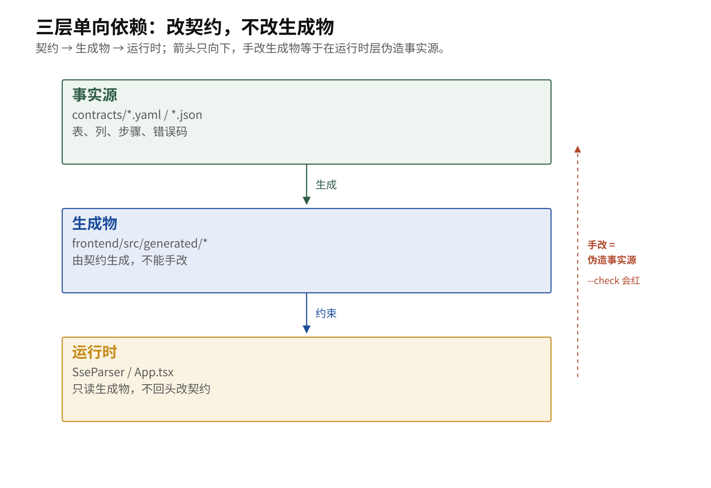

图 3-2a 把三层的方向画死：契约生成生成物，生成物约束运行时；手改生成物等于在运行时层伪造事实源。

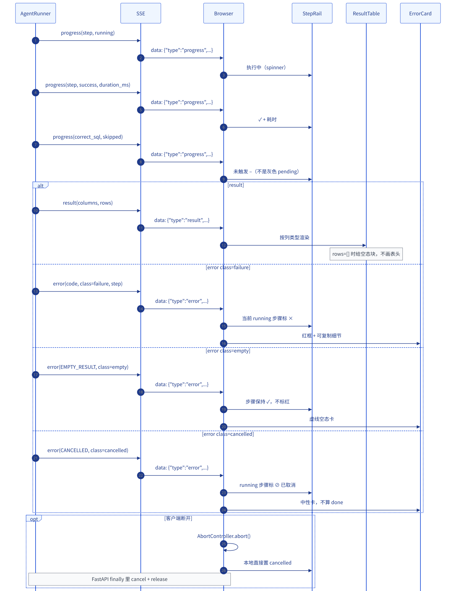

图 13 把「事件 → 组件」画得很清楚：`progress` 进 `StepRail`，`result` 进 `ResultTable`，`error` 按 `class` 分到红框 / 空态 / 中性卡。`correct_sql` 的 `skipped` 也在图里：它是「未触发 –」，不是灰色 pending。


图 15 解释了 S7 生成物的底气：契约是有结构、有计数、有类型约束的模型，不只是给人看的文档。`SchemaContract` 声明 5 张表、6 个指标；`Table` 拥有 24 个 `Column`；每个 `Column` 有 `ValueDomain`。S7 的 `sse.schema.json` 和它一样，是可以被机器校验的结构，不是一段散文。

### 3.3 输入：SSE 字节流 + 契约 + 生成物

S7 的输入是网络上的字节流，不是后端内存里的事件对象。这一点决定了前端必须自己校验：代理可能改写、后端可能回滚到旧版本、前端可能连上别的服务。旧系统就是在这里崩的——它信任了「后端会发对」，然后把未知类型当失败。

SSE 的帧以空行分隔，帧内每行是 `field: value`；前端只取 `data:` 行拼成 JSON，event 行和以 `:` 开头的心跳行不参与。

一个合法的 SSE 帧长这样：

```text
data: {"type":"progress","step":"run_sql","status":"running","duration_ms":null}

```

前端按空行切帧，接受 `\n\n` 与 `\r\n\r\n`；多条 `data:` 行按规范用 `\n` 拼接；跨 chunk 的半帧留在 buffer；流结束时 flush 尾帧。这四点看起来是解析细节，实际上每一点都对应一种丢帧方式：只认一种换行、跨 chunk 丢帧、多行截断、尾帧丢失。`SseParser` 把这四点都修了。

把解析器想成一个只有两个字段的状态机：`buffer` 与「当前帧是否完整」。输入是任意切分的字节块，输出是若干个完整帧。四条规则对应四个转移：

- **换行**：帧分隔符接受 `\n\n` 与 `\r\n\r\n` 两种，一条正则同时覆盖。只认一种换行的实现，在另一种代理后面会把整条流当成一帧。
- **跨 chunk**：每次 `feed()` 把新块拼到 `buffer` 尾部，按分隔符切分，最后一段可能是不完整的帧，留在 `buffer` 里等下一次。切完就丢 buffer 的实现会丢帧。
- **多 data 行**：一帧里可以有多条 `data:` 行，规范要求用换行拼接。只取第一行的实现会截断 JSON。
- **尾帧**：流结束时 buffer 里可能还剩最后一帧，没有空行结尾。`flush()` 负责把它交出去；不 flush 就会丢掉最后一条事件，而最后一条往往正是 `result` 或 `error`。

真实实现只有两个方法：

```ts
  feed(chunk: string): void {
    this.buffer += chunk;
    const frames = this.buffer.split(/\r?\n\r?\n/);
    this.buffer = frames.pop() ?? "";
    for (const frame of frames) this.dispatch(frame);
  }

  flush(): void {
    const rest = this.buffer.trim();
    this.buffer = "";
    if (rest) this.dispatch(rest);
  }
```

`feed()` 里的 `pop()` 就是「半帧留在 buffer」：切出来的最后一段永远不派发，等下一次拼接。`flush()` 是尾帧的唯一出口，调用方在流结束时必须显式调用它。

解析出来以后，`parseAgentEvent()` 先看 `type` 是否在 `EVENT_TYPES` 里。不在，返回 `unknown_type`，调用 `onUnknownType` 记一笔，**忽略**，不报错。在，则用 `sse.schema.json` 做运行时校验；字段不合法返回 `invalid`，抛 `PROTOCOL_ERROR`。三种结局，不是两种：合法、未知类型、契约破坏。这是 F3 的落点。

### 3.4 动作：校验 → 状态迁移 → 渲染

`App.tsx` 的 `ask()` 是一个显式状态机。开始请求时先把状态设为 `running`，清空 `states`、`result`、`error`；收到事件后按 `type` 分派：

- `progress`：先确认 `event.step` 在 `/api/steps` 返回的步骤列表里；不在就抛 `UNKNOWN_STEP`。在就更新 `states[step]`，`StepRail` 据此渲染 running / success / error / skipped。
- `result`：`terminal = true`，设置结果，状态 `done`。
- `error`：`terminal = true`，设置错误；`class === "empty"` → 状态 `empty`，不动步骤；`class === "cancelled"` → 状态 `cancelled`，把 running 步骤标 `cancelled`；其余 → 状态 `error`，把 running 步骤标 `error`，并把 `event.step` 也标红。

流结束后如果 `terminal` 仍是 `false`，前端伪造 `STREAM_INCOMPLETE`，状态 `error`。这是契约要求的兜底：静默结束等于失败，不能当成成功。捕获到 `AbortError` 时，状态是 `cancelled`，不是 `done`；这是旧系统 `isAbort ? "done" : "error"` 的直接修正。

#### 例题：一条 progress 事件从字节到 DOM

拿一条 `progress` 走一遍，从字节到像素：

1. 网络层交来一段字符串，可能是半个帧，也可能是一帧半。`feed()` 把它接到 `buffer` 后面。
2. 切分后，完整帧进入 `dispatch()`；半帧留在 `buffer`。
3. `dispatch()` 只取 `data:` 开头的行，去掉前缀与一个可选空格，用换行拼接。
4. `JSON.parse` 得到对象；失败抛 `PROTOCOL_ERROR`，这次问数结束。
5. `parseAgentEvent()` 先看 `type`。不在 `EVENT_TYPES` 里，交给 `onUnknownType` 记一笔并忽略。
6. 在，则用 `sse.schema.json` 校验字段；不合法抛 `PROTOCOL_ERROR`，错误信息带路径。
7. 合法事件回到 `ask()` 的 switch：`progress` 先查步骤白名单，不在抛 `UNKNOWN_STEP`，在就更新 `states[step]`。
8. `StepRail` 按状态渲染：running 是 spinner，success 是 ✓ 加耗时，skipped 是「未触发 –」。

这条路径上有三处「停下来」：JSON 不合法、字段不合契约、步骤不在白名单。三处都抛错，因为契约已经被破坏，继续渲染只会把错误藏得更深。未知事件类型是唯一的例外，它选择继续。

状态迁移可以写成表：

表 3-5 · 前端运行状态迁移

| 当前状态 | 触发 | 下一状态 | 步骤条变化 |
|---|---|---|---|
| `idle` | 提交问题 | `running` | 全部 pending，随后按 `progress` 推进 |
| `running` | `progress(status=running)` | `running` | 该步骤 spinner |
| `running` | `progress(status=success)` | `running` | 该步骤 ✓ + 耗时 |
| `running` | `progress(status=skipped)` | `running` | 该步骤「未触发 –」 |
| `running` | `result` | `done` | 已完成步骤保持绿色 |
| `running` | `error(class=failure)` | `error` | 当前 running 步骤 ×，`event.step` 也 × |
| `running` | `error(class=empty)` | `empty` | 执行步骤保持 ✓，不标红 |
| `running` | `error(class=cancelled)` | `cancelled` | 当前 running 步骤 ⊘ |
| `running` | 用户点停止 / `AbortError` | `cancelled` | 当前 running 步骤 ⊘ |
| `running` | 流结束但没有 terminal | `error` | 当前 running 步骤 ×（`STREAM_INCOMPLETE`） |
| 任意 | 新的提交 | `running` | 清空上一次的状态 |

`StepRail` 的 `STATUS_TEXT` 有六个值：`pending` 等待、`running` 执行中、`success` 完成、`error` 失败、`skipped` 未触发、`cancelled` 已取消。六个值对应六种标记：数字、spinner、✓、×、–、⊘。`skipped` 不是 `pending`：pending 是「还没轮到」，skipped 是「这一步这次不会跑」；`correct_sql` 在没有可重试错误时必须显式 `skipped`，否则它会永远灰着。

六个状态值不是装饰，它们把「没轮到」「正在跑」「跑完了」「没触发」「失败」「取消」分成互不相同的六件事。最容易混淆的是 `pending` 与 `skipped`：前者是时间上的「还没到」，后者是逻辑上的「这次不会到」。条件步骤如果没有显式的 `skipped`，就会永远停在 `pending`，用户无法区分「系统卡住了」与「这一步本来就不需要」。

`ErrorCard` 的三种长相由 `class` 决定，不是由 `code` 决定：

- `failure`：红框，标题来自 `/api/errors` 的 `label`（`SQL_REJECTED` → 「SQL 被安全策略拒绝」），显示错误码、失败步骤中文名、原因码、消息；有 `original_sql` / `corrected_sql` 时给可展开的 SQL 细节；有 `attempts > 0` 时显示「已校正 N 次」。整段文本可一键复制。
- `empty`：虚线空态卡，标题「查询成功但没有数据」，不标红；步骤条保持绿色。
- `cancelled`：中性卡，标题「用户取消」，状态「已取消」；不算 done，也不算失败。

`PseudoErrorCard` 是第四种，但它不是错误码驱动的：它是前端止损。判据刻意保守——单行 + 单列 + 列名像错误文案（`error|错误|失败|异常|message|状态|reason|无法|不支持`）+ 值是文本，才判定为伪数据行。宁可漏判，也不要把一张真的 1 行 1 列表误判成失败。它不编造错误码，只显示「这一行不是查询结果，是失败信息」。

### 3.5 输出：三种 SSE 事件与类型保真

`progress` 的样例：

```text
data: {"type":"progress","step":"run_sql","status":"running","duration_ms":null}

```

`result` 的样例：

```text
data: {"type":"result","data":{"columns":[{"name":"地区","type":"string"},{"name":"销售额","type":"number"}],"rows":[["华北",128400.0]]}}

```

`error` 的样例（`class: empty`）：

```text
data: {"type":"error","code":"EMPTY_RESULT","class":"empty","message":"查询执行成功，但没有符合条件的数据。","step":"run_sql","detail":{"sql":"SELECT ... LIMIT 1000","rows":0,"request_id":"8f0c..."}}

```

三条事件都受 `contracts/sse.schema.json` 约束：`progress.duration_ms` 在 running / skipped 时必须为 `null`，在 success / error 时必须是数字；`result.data.rows` 是二维数组，不是对象数组；`error.detail` 只允许八个键。前端收到的如果不符合，`parseAgentEvent()` 会给带路径的错误，例如 `$.duration_ms 缺少必填字段`，而不是一句「解析失败」。

`result.data.rows` 是二维数组而不是对象数组，这个选择让「列顺序」由 `columns` 单独声明，行只负责值。对象数组会把列名重复写进每一行，列顺序还要靠键的插入顺序猜；二维数组把「有哪些列」与「每行有哪些值」分开，校验器可以分别检查列数、类型与值。

类型保真的规则写在 `backend/app/agent/values.py`：

表 3-6 · 单元格值的归一化

| 数据库类型 | 归一化后 | JSON 结果 | 列类型 |
|---|---|---|---|
| `DECIMAL("10")` | `int` | `10` | `number` |
| `DECIMAL("10.5")` | `float` | `10.5` | `number` |
| `DATE` / `DATETIME` | ISO 8601 字符串 | `"2025-03-01"` | `date` |
| 未知类型 | 抛 `TypeError` | 变成 `INTERNAL_ERROR` | — |

`Decimal("10")` 走 `int` 而不是 `10.0`：`SUM(INT)` 在 MySQL 里是 DECIMAL，但用户心里的「10 件」应该显示成 `10`。`Decimal("10")` 走 `int` 是刻意的取舍；反过来，真正带小数的金额走 `float`，会引入浮点误差，这是 JSON 数字类型的固有限制。归一化模块选择「整数走整数、非整数走浮点」，并在列类型上统一标成 `number`，让前端按数字渲染。

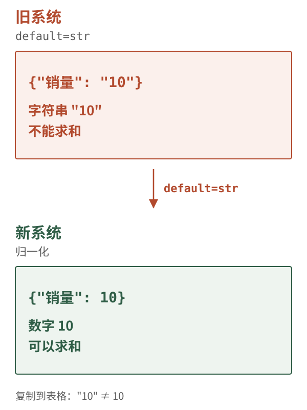

`_sse()` 也刻意不传 `default=str`，万一还有漏网的类型，就让它炸成 `INTERNAL_ERROR`，不要悄悄把数字改成字符串。`default=str` 会把任何没归一化的类型悄悄变成字符串，屏幕上看起来正常，复制出去才发现 `"10"`。归一化模块遇到未知类型直接抛 `TypeError`，调用方把它变成 `INTERNAL_ERROR`，用户看到一次诚实的失败，而不是一份被改过类型的数据。

前端 `ResultTable` 再按契约列类型渲染：`number` 走 `Intl.NumberFormat`，整列 NULL 加「无数据」标记，数字样式的字符串加类型不匹配标记，复制输出 JSON 而不是 TSV。

### 3.6 验收：生成物新鲜、夹具逐字对账、13 条 F 缺陷

离线门禁来自 `Makefile` 的 `stage7`：

```bash
make stage7
```

它跑：

```bash
cd backend && uv run python -m app.scripts.contracts_gen --check
cd backend && uv run python -m app.scripts.record_sse --check
cd backend && uv run pytest -q tests/frontend
cd frontend && npm run test
cd frontend && npm run build
cd backend && uv run pytest -q
```

2026-10-29 在本工作树执行前两条，输出（✅）：

```text
S7 CONTRACT GEN PASS（3 个文件与契约一致）
S7 SSE RECORD PASS（14 个夹具与真实输出一致）
```

`contracts_gen --check` 检查 `frontend/src/generated/` 三个文件是否与 `contracts/sse.schema.json` 一致。手改生成物会立刻变红：`--check` 不重新生成覆盖，而是生成到内存、逐字比对，不一致就报错。`record_sse --check` 重新跑一遍场景应用，把后端吐出的字节流与 `fixtures/sse/*.json` 逐字比对，只归一化 `duration_ms` 与 `request_id` 两处。14 条夹具里 10 条是录制的真实 SSE，4 条是手写的（`pseudo_row` / `unknown_event` / `empty_rows` / `null_column`），因为新后端已经产生不了伪 SQL 行、未知事件、空数组和全 NULL 列。所以 `--check` 的「一致」指与夹具逐字一致，不指这 4 条由后端重新生成。

`contracts_gen --check` 与「重新生成再覆盖」的区别也值得说清楚：前者生成到内存、逐字比对，不一致就报错；后者会掩盖漂移，让手改生成物的错误看起来像一次正常更新。门禁要的是发现漂移，不是消除证据。

前端契约测试 `pytest -q tests/frontend` 计划 45 条，覆盖生成器 / 夹具 / 类型保真；`npm run test` 计划 40 条，覆盖 SSE 解析与结果表语义；`npm run build` 包含 `tsc --noEmit`。这三条本工作树没有执行，标 🟡（文档声称 45 / 40 / 零错误）。

浏览器验收是：

```bash
make stage7-ui
```

它自起回放服务器（默认 8103）与隔离前端（5276），跑 14 条断言，覆盖 F1–F13（F11 拆成 5xx / 422 两例）。端口冲突时：

```bash
API_PORT=8203 WEB_PORT=5376 make stage7-ui
```

本工作树没有 Chrome / Edge，标 ⚪。回放而不是真后端的原因很实际：有些界面行为真系统产生不了——旧系统的伪 SQL 行、契约之外的事件、`data:[]` 空数组。回放服务器按生产协议提供 `/api/health`、`/api/steps`、`/api/errors`、`/api/query`、`/api/cancel`，问题写成「场景:<夹具 id> <真实问题>」；`场景:http_500` / `场景:http_422` 直接返回对应 HTTP 状态，用来验收 F11。

表 3-7 · 几条代表性的 F 缺陷与修法

| 编号 | 旧缺陷 | 新行为 | 证据 |
|---|---|---|---|
| F1 | 取消被算成「完成」 | 状态「已取消」，且不出现结果表 | `App.tsx:stop` / `isAbortError` |
| F3 | 未知事件类型被当成错误 | 忽略 + 提示条，界面正常出结果 | `lib/api.ts:parseAgentEvent` |
| F4 | 空数组导致表格消失 | 空态块，文案「没有数据」，不画表头 | `ResultTable` |
| F5 | 伪 SQL 行被当成功 | `PseudoErrorCard` 止损卡，不画表 | `lib/result.ts:looksLikePseudoError` |
| F9 | 条件步骤永远灰着 | `skipped` → 「未触发 –」 | `StepRail` |
| F11 | 4xx/5xx 一律同一句话 | 422「问题格式不对」、5xx「服务异常」 | `lib/api.ts:httpError` |
| F13 | 复制把 `"10"` 原样复制 | 数字就是数字，复制输出 JSON | `values.py` + `buildCopyPayload` |

F13 是这条链的终点：复制出去的 `"10"` 不是显示问题，是数据问题。修法不在剪贴板，而在源头——归一化保证数字是数字，列类型保证前端按数字渲染，复制输出 JSON 保证下游拿到的是类型而不是字符串。三处任何一处退回旧写法，缺陷都会复发。

### 3.7 常见故障

**故障一：改了契约但忘了重新生成。** 症状是 `make stage7` 在 `contracts_gen --check` 处变红，提示运行 `cd backend && uv run python -m app.scripts.contracts_gen`。不要手改 `frontend/src/generated/`；手改的下一秒就会被 `--check` 抓住。改契约 → 重新生成 → 再跑 `make stage7`，这是唯一顺序。

**故障二：SSE 夹具对不上。** `record_sse --check` 会逐字比对，只归一化 `duration_ms` 与 `request_id`。如果后端改了事件顺序、字段名、默认文案，或者前端场景前缀解析变了，夹具就会红。正确做法是先判断哪边是事实源：契约变了就重新录制；代码坏了就修代码。改夹具让它过只是把证据擦掉——夹具是证据，不是橡皮擦。

**故障三：未知步骤导致整次失败。** `App.tsx` 对 `progress.step` 做白名单校验，不在 `/api/steps` 里就抛 `UNKNOWN_STEP`。这是刻意的：步骤 id 是契约的一部分，后端发了一个前端不认识的步骤，说明契约不一致，应该报错而不是悄悄忽略。注意这和「未知事件类型」不同：事件类型未知可以忽略（契约长了一条腿），步骤 id 未知是契约内部矛盾。

两种处理的差别在于「谁应该被修」。未知事件类型是后端向前扩展，前端必须容忍；未知步骤 id 是两端版本不一致，容忍只会把错误藏起来。一条流里如果步骤 id 出错，后面的 `states` 更新会落在不存在的键上，界面看起来「什么都没发生」，这比一次明确的报错更难查。

**故障四：`duration_ms` 在 running 时不是 null。** `sse.schema.json` 用 `allOf` + `if/then/else` 约束：success / error 必须是数字，running / skipped 必须是 null。前端校验器支持 `if/then/else`，所以这条会在运行时被抓。后端 `_progress()` 默认 `duration_ms=None`，success / error 才传数字；改事件构造时不要顺手给 running 也塞一个 0。

**故障五：流没有 terminal 事件。** 前端会伪造 `STREAM_INCOMPLETE`，状态 `error`。这个码不在契约里，是前端本地状态；它不应该出现在后端事件里，也不应该被当成契约码去 `/api/errors` 查文案。它存在的意义是「静默结束等于失败」，而不是新增一种业务失败。

**故障六：Decimal 又变成字符串。** 检查 `_sse()` 是否被加上了 `default=str`，检查 `to_result_payload()` 是否走了 `normalize_cell()`，检查 `ResultTable` 是否对 `number` 列做了类型校验。三处任何一处退回旧写法，F13 就会复发；前端会在数字列上标出「数字样式的字符串」，让问题可见，而不是安安静静地显示。

**故障七：空结果被画成空表。** `EMPTY_RESULT` 的 `class` 是 `empty`，前端状态是 `empty`；`ResultTable` 对 `rows.length === 0` 走空态块，不画表头。后端把空结果发成 `result` 且 `rows: []` 时前端也有兜底（F4 的 `empty_rows` 夹具），但正确路径仍然是 `EMPTY_RESULT` 事件。

### 3.8 证据

- `contracts/sse.schema.json`：3 种事件、`progress` 的 `duration_ms` 条件约束、`result` 的二维 rows、`error` 的 3 个 class（✅）。
- `contracts/steps.yaml`：12 步，`correct_sql` 标 `conditional: true`（✅）。
- `contracts/errors.yaml`：16 码 / 3 class（✅）。
- `frontend/src/generated/sse.ts`、`sse.schema.json`、`contract.json`：机器生成物（✅ 文件存在；`contracts_gen --check` 本机 PASS）。
- `frontend/src/lib/api.ts`：`SseParser`、`parseAgentEvent`、`httpError`（✅）。
- `frontend/src/lib/json-schema.ts`：通用校验器，支持 `$ref` / `oneOf` / `allOf` / `if-then-else`（✅）。
- `frontend/src/App.tsx`：事件 switch、状态迁移、取消、`STREAM_INCOMPLETE`（✅）。
- `frontend/src/components/StepRail.tsx`、`ErrorCard.tsx`、`PseudoErrorCard.tsx`、`ResultTable.tsx`（✅）。
- `fixtures/sse/` 14 条夹具（✅ 文件存在；`record_sse --check` 本机 PASS）。
- `make stage7-ui` 的 14 条断言（⚪ 本工作树无 Chrome / Edge）。

### 3.9 检查清单

- [ ] 我能说出 `frontend/src/generated/` 三个文件分别是什么，以及为什么不能手改。
- [ ] 我能背出 SSE 的三种事件，并各写一条合法样例。
- [ ] 我知道未知事件类型应该忽略，未知步骤 id 应该报错，为什么不同。
- [ ] 我知道 `skipped` 和 `pending` 的区别，以及 `correct_sql` 为什么必须显式 skipped。
- [ ] 我知道 `ErrorCard` 的三种长相由 `class` 决定，不是由 `code` 决定。
- [ ] 我知道 `DECIMAL("10")` 为什么是 `10` 而不是 `"10"` 或 `10.0`。
- [ ] 我知道 `_sse()` 为什么不传 `default=str`。
- [ ] 我知道 `STREAM_INCOMPLETE` / `NETWORK_ERROR` 是前端本地码，不在契约里。

---

## 4. S8 · 生产化（边界与下一步）

### 4.1 问题：S7 留下了什么风险

S7 结束时，系统在开发机上「能跑、能失败、能展示」。但「能跑」和「敢用」之间还隔着一层：换一台机器、换一个网络、换一个用户，系统还成不成立？

S7 留下的风险至少有六个：

1. **部署没有端到端证据**。`compose.yaml` 写得很完整，但本工作树没有 Docker socket 权限，`make docker-up` 与 `make docker-smoke` 都没跑过。拓扑是「设计上应该成立」，不是「本机已经成立」。
2. **没有身份与传输安全**。`/api/query` 没有鉴权，前端默认 `0.0.0.0:8080`，没有 TLS。它适合教学与内网演示，不适合直接暴露到公网。
3. **取消是进程内状态**。`CANCEL_REGISTRY` 只在一个进程里有效，backend 固定单 worker。这是正确的取舍，但也意味着它不是一个可水平扩展的服务。
4. **没有可观测性**。有 `/api/health`、`request_id`、Docker healthcheck、nginx access log，但没有 metrics、tracing、结构化日志聚合、告警。
5. **没有容量基线**。`default_limit: 1000`、`max_execution_time_ms: 5000`、LLM 超时 30 秒是保护阈值，不是容量结论。P50 / P95、并发数、连接池、慢查询分布都没有测。
6. **测试总数只有文档声称**。README 写「782 passed / 31 skipped」，`docs/SETUP-FROM-SCRATCH.md` §3 另一处写「665 passed / 31 skipped」；本工作树没有跑全量 pytest。这个数字只能标 🟡，不能当已验证事实。

这六条风险有一个共同形状：它们在开发机上都不显形。端口冲突、密码轮换、健康检查、SSE 缓冲，只有换一台机器、换一个网络、换一个用户才会暴露。S8 的工作因此是把「本机成立」改写成「条件成立」——每条结论都带上它依赖的条件。

所以 S8 要做的是把「本机可运行」变成「可交付、可观测、可恢复」，并把没证明的部分标出来。这不是再加一个功能。这三个词各自对应一类证据：可交付的证据是「另一台机器起得来」，可观测的证据是「出了问题能定位到哪一环」，可恢复的证据是「卷坏了、密码换了，能按顺序救回来」。S8 目前只完成了第一类的设计部分，后两类只有清单。

### 4.2 实体与边界：六服务、镜像、端口、卷

`compose.yaml` 定义六个服务，项目名 `shopkeeper-rebuild`：

| 服务 | 作用 | 关键依赖 | 健康检查 |
|---|---|---|---|
| `mysql` | 数仓 `dw` + Meta 库 | 无 | `mysqladmin ping` |
| `elasticsearch` | 取值索引 | 无 | 集群状态 green / yellow |
| `qdrant` | 向量索引 | 无 | `GET /readyz` 返回 200 |
| `init` | 建库、开只读账号、校验/构建 S2 | 三存储 healthy | 无，退出码即结果 |
| `backend` | FastAPI + uvicorn，单 worker | `init` completed | `GET /api/health` |
| `frontend` | nginx + 静态资源 | `backend` healthy | `GET /healthz` |

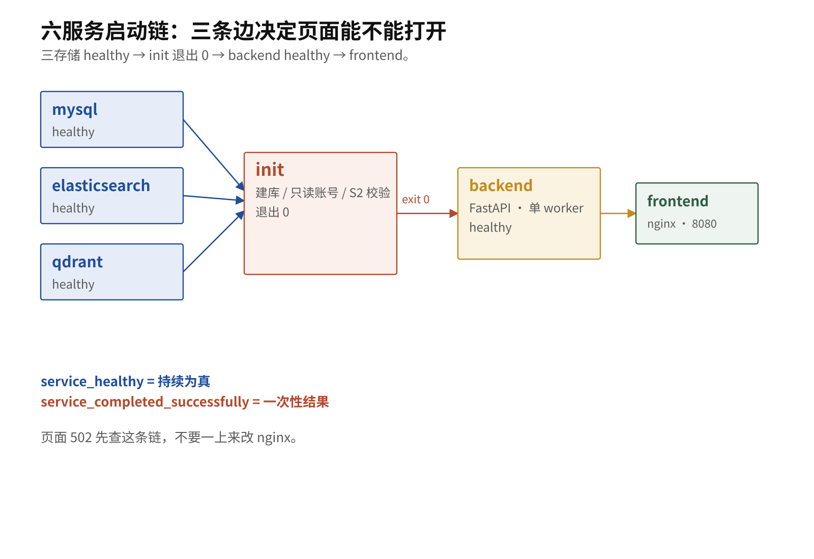

图 4-2a 只画三条边：三存储 healthy → `init` 退出 0 → `backend` healthy → `frontend`；图 25 负责六个盒子的拓扑，这张图负责启动顺序。


图 25 的重点是三条依赖边，六个盒子只是背景：三存储 healthy → `init` 开始；`init` 退出 0 → `backend` 开始；`backend` healthy → `frontend` 开始。`depends_on` 写的是条件，不是「启动顺序建议」：`service_healthy` 会一直等健康检查变绿，`service_completed_successfully` 会等 `init` 以 0 退出。所以「栈起来了但页面 502」通常意味着这条链在某一环停住了，nginx 本身多半没问题。

把这三条边连起来，启动链是一张有向无环图：三存储是三个源点，`init` 是汇合点，`backend` 依赖 `init` 的退出码，`frontend` 依赖 `backend` 的健康状态。图上有两种不同性质的边：`service_healthy` 等的是「持续为真」的状态，`service_completed_successfully` 等的是「一次性事件的结果」。这两者不能互换。

`service_started` 为什么不够？它只说明容器进程起来了，不说明里面的服务能接受连接。MySQL 启动后还要初始化数据目录、建库、建账号；这段时间里端口可能已经监听，但查询会失败。如果 `init` 只等 `service_started`，它会在数据库还没准备好的时候尝试建表、开账号，结果要么失败退出，要么写下一半状态；而 `backend` 又依赖 `init` 的退出码，整条链会把一次「等得不够久」放大成「栈起不来」。健康检查等的是「服务真的可用」，不是「进程真的存在」。

`service_completed_successfully` 同理：它等的是 `init` 以 0 退出，而不是「`init` 启动过」。`init` 是一次性任务，没有长期健康状态可等；它的结果就是退出码。把条件改成 `service_started`，`backend` 可能在 `init` 还在建库时就启动，连上一个半成品。

镜像边界也值得说清楚。后端镜像是多阶段构建：`uv` 阶段装依赖，`python:3.12-slim` 运行阶段只带 `.venv`、`backend/app`、`contracts`、`fixtures`，不含测试；非 root，uid 10001；`uvicorn` 单 worker。前端镜像是 `node:20-alpine` 构建 → `nginx:1.27-alpine` 托管 `dist`；`/api/` 关闭 `proxy_buffering`，否则 SSE 会被 nginx 攒起来一次性发。`init` 与 `backend` 用同一个镜像、同一份源码，但环境变量不同：`init` 拿构建凭据与 root 密码，`backend` 只拿 `REBUILD_DW_RO_PASSWORD`。

共用镜像让「初始化用的代码」与「运行时用的代码」不可能版本不一致，也省了一次构建；代价是镜像里同时带着构建依赖与运行依赖，在一次性任务面前可以接受。

nginx 那一侧只有一行是关键：`/api/` 关闭 `proxy_buffering`。开着缓冲时，nginx 会把后端的 SSE 响应攒够一批再发，浏览器看到的是「一次性到达」；流式语义在代理这一层被悄悄取消，而后端与前端都以为一切正常。`gzip off` 同理：压缩需要攒数据，攒数据就破坏实时性。

### 4.3 输入：环境变量、镜像、端口、卷

S8 的输入主要是四类：

1. **环境变量**：`.env` 里的 `MYSQL_ROOT_PASSWORD`、`MYSQL_PASSWORD`、`REBUILD_DW_RO_PASSWORD`、镜像名、宿主机端口、可选的 LLM 三元组。`.env` 不入库；`.env.example` 里是 `change-me-*` 占位值。
2. **镜像**：MySQL 8.0、Elasticsearch 8.15.3、Qdrant v1.12.4、Python 3.12-slim、Node 20-alpine、nginx 1.27-alpine。Qdrant 必须 ≥ v1.5.0，因为健康检查打的是 `/readyz`。
3. **端口**：前端 `0.0.0.0:8080 → 80`；后端、MySQL、ES、Qdrant 都只绑 `127.0.0.1`，分别是 `8100`、`3306`、`9200`、`6333`。只有前端是唯一对外入口。
4. **卷**：`mysql_data`、`es_data`、`qdrant_data` 三个命名卷；`fixtures/dw.sql` 以只读方式挂到 MySQL 初始化目录，首次启动导入。

端口收敛也遵循同一条原则：只有 `frontend` 绑 `0.0.0.0`，其余全部绑 `127.0.0.1`。后端、MySQL、ES、Qdrant 都需要被容器网络里的服务访问，但不需要被宿主机以外的机器访问。把「谁能访问」写成端口绑定，比写在文档里可靠。

还有一条容易忽略的边界：构建凭据与应用凭据分离。`mysql` 与 `init` 拿 `MYSQL_PASSWORD`（应用账号 `didilili`，在 `dw` 上有 ALL PRIVILEGES）和 root 密码；`backend` 只拿 `REBUILD_DW_RO_PASSWORD`，也就是 `dw_reader` 的密码。`didilili` 的 ALL PRIVILEGES 正是 S5 要消除的越权入口，不能因为「容器里方便」就把它给 backend。

构建凭据与运行凭据的分离，是 S5 的账号边界在部署层的投影。`init` 需要 root 与 `didilili`：它要建库、开只读账号、写元知识。`backend` 只需要 `REBUILD_DW_RO_PASSWORD`：它执行的每一条 SQL 都该走 `dw_reader`。如果为了「容器里方便」把 `MYSQL_PASSWORD` 也给 `backend`，S5 在代码层收窄的权限，会在环境变量层被重新放宽；一次策略漏判就又有了写库的能力。凭据的最小化不是运维偏好，是安全边界的一部分。

### 4.4 动作：生成 .env → 构建 → 等健康 → 验收

首次部署的命令来自 `README.md` 与 `docs/DOCKER-DEPLOY.md`：

```bash
make docker-env       # 生成 .env（随机密码；已存在则跳过）
make docker-up        # docker compose up -d --build
curl http://127.0.0.1:8080/api/health
make docker-smoke     # 8 步验收，输出 DOCKER SMOKE PASS
```

启动链是：

1. MySQL / Elasticsearch / Qdrant 并行启动，各自跑健康检查。
2. 三存储全部 healthy 后，`init` 开始。
3. `init` 等待三存储（每个最多 180 秒），开通 `dw_reader`，验证它真的只有 SELECT，对账 S2 元知识（`--verify`；失败则 `--fresh` 再 `--verify`）。
4. `init` 退出 0，`backend` 才启动。
5. `backend` 的 `/api/health` 通过后，`frontend` 才启动。

换一台机器时，按依赖顺序检查，而不是按报错顺序：

1. `.env` 是否存在、密码是否与卷匹配。`make docker-env` 只在缺失时生成；卷还在而密码换了，栈会一直不健康。
2. `docker compose ps -a` 看 `init` 的退出码。非零就先看 `docker compose logs init`，不要先动 `backend`。
3. 三存储是否 healthy。Qdrant 的健康检查打 `/readyz`，老镜像会一直 404。
4. `backend` 的 `/api/health` 是否返回 `ok`。这一步通过，才说明 `init` 的产物可用。
5. 最后才看前端：健康检查与一条真实查询。页面 502 先查上游某一环，nginx 本身通常没问题。

`make docker-smoke` 检查五服务运行、12 个步骤、经 8080 的真实查询、只读账号、S2 对账，并再次运行 `init` 证明「跳过重建」。真实查询那一步看的是 SSE **是不是边生成边发**：用裸 socket 记录每个分片的到达时刻，首尾分片几乎同时到达就说明代理把响应攒起来了。判定分三档：首尾时间差 ≥ 50 毫秒 → 流式；整个响应 < 200 毫秒 → 太快，分辨不出来，重试几次；其余 → 攒完了一次性到达，失败，并提示查 `docker/nginx.conf` 的 `proxy_buffering off`。这条判据防的是验收脚本最要命的失效：报了 PASS，可它验的东西根本没验。它是一条启发式：50 / 200 毫秒是经验阈值，不是统计结论；它能抓住「一次性到达」，不能证明「每一帧都单独到达」。

分片个数为什么不能当证据？因为一个攒起来一次性发送的响应，照样会在传输层被拆成好几个分片；数分片只能证明「网络把它切开了」，不能证明「后端边生成边发」。所以判据看的是到达时刻的分布：首尾几乎同时到达，说明中间被攒过；首尾拉开足够间隔，才说明每一段都是现发的。整个响应太快时也分辨不出来，脚本选择重试而不是宣布通过，这是同一原则的另一面：判据不确定时，不给绿灯。

### 4.5 输出：健康、日志、验收结论

S8 的输出是四类可核对的证据，不是「页面能打开」：

- **健康检查**：`curl http://127.0.0.1:8100/api/health` 返回 `{"status":"ok","stage":"S7"}`（`stage` 是后端声明的已完成阶段）；Compose 的 backend healthcheck 用 Python 标准库 `urllib.request.urlopen` 打同一个接口；frontend 用 `wget -qO- http://127.0.0.1/healthz`。
- **启动状态**：`docker compose ps -a` 能看到 `init` 是 `Exited (0)`，backend / frontend 是 `healthy`。
- **验收结论**：`make docker-smoke` 输出 `DOCKER SMOKE PASS`；`init` 第二次运行显示 `NOOP: 0 writes`。
- **日志**：`make docker-logs` 跟踪全部日志，`docker compose logs -f backend` 只看后端；nginx 的 `/api/` 关闭了 `proxy_buffering`，SSE 才能实时到达。

但本工作树没有这些输出。Docker socket 无权限，`make docker-env` / `make docker-up` / `make docker-smoke` 都没有执行。所以 S8 的部署结论只能是「按文件推导成立」，标 ⚪；不能写成「已验证」。

### 4.6 验收：哪些已验证、哪些没有

表 3-8 · S8 相关的证据状态

| 结论 | 状态 | 依据 / 缺口 |
|---|---|---|
| `compose.yaml` 定义 6 个服务、3 个卷、1 个默认网络 | ✅ | 文件可逐项核对 |
| 只有 frontend 默认监听 `0.0.0.0`，其余绑 `127.0.0.1` | ✅ | `compose.yaml` 的 `ports` 段 |
| backend 非 root（uid 10001）、单 worker | ✅ | `docker/backend.Dockerfile`、`compose.yaml` 的 `--workers 1` |
| nginx `/api/` 关闭缓冲、读超时 3600s | ✅ | `docker/nginx.conf` |
| Docker 全栈本机跑通 | ⚪ | 本工作树无 Docker socket 权限，未执行 `make docker-up` / `make docker-smoke` |
| 真实 MySQL 上 `dw_reader` 写不了 | ⚪ | 无 `REBUILD_DW_RO_PASSWORD`、未执行 `make stage5-live` |
| 真实 LLM 生成 | ⚪ | 无端点 / 无 Key |
| 浏览器 UI 验收 | ⚪ | 本工作树无 Chrome / Edge |
| 后端 782 passed / 31 skipped | 🟡 | `README.md` 声称；`docs/SETUP-FROM-SCRATCH.md` §3 另有 665 的版本；本工作树未跑全量 |
| S8 性能基线（P50 / P95、并发、容量） | ⚪ | `README.md` 进度表写「S8 性能 待做」 |

这张表是 S8 最重要的产出：哪些结论能拿去做验收，哪些只能当设计意图。评审时该问的是「没跑通的那部分，凭什么说它成立」，而不是「你跑通了吗」。

这张表的用法是「先看状态，再看结论」。标为未验证的条目不是「设计错了」，是「本工作树没有条件验证」；标为推断的条目不是「假的」，是「有文档声称、没有本机输出」。所以「按文件推导成立」只能算一个待验证的命题，不能算一条验收结论。

### 4.7 常见故障

**故障一：容器后端和 `make dev-backend` 抢 8100。** 两者都映射 `127.0.0.1:8100`，后起的那个报 `address already in use`。要么只用 Docker，要么只用本机开发；要并存就把 `.env` 的 `BACKEND_HOST_PORT` 改成 `8110`。前端不受影响，因为 nginx 在容器网络里仍按 `backend:8100` 找后端。

**故障二：改了 `.env` 但密码没生效。** `docker compose restart` 不会重新读取环境变量；必须 `docker compose up -d`。换 MySQL 密码更麻烦：MySQL 只在**首次**初始化 `mysql_data` 时用 `MYSQL_ROOT_PASSWORD` 建账号；卷还在的话，容器里的密码仍是旧的，新密码不生效，健康检查会一直失败。正确顺序是 `make docker-reset` → `python scripts/generate_docker_env.py --rotate-secrets` → `source scripts/export-docker-env.sh` → `make docker-up`。

**故障三：`make docker-env` 覆盖了正在用的 `.env`。** 默认不覆盖；`--force` 保留已有密码与配置，`--rotate-secrets` 才换密码。不要手动删 `.env` 再生成：数据卷里的账号还是旧密码，栈会起不来。

故障二与故障三指向同一件事：`.env` 是输入，不是缓存。`docker compose restart` 不会重新读取它；改密码而不删卷，数据库里的账号还是旧的。把「配置变更」当成「重启一下」，是这一类故障的共同根因。

**故障四：Qdrant 永远不 healthy。** 健康检查打 `/readyz`，这个端点 v1.5.0 才有；老镜像上它一直 404，`init` 就不会启动。默认 `QDRANT_IMAGE` 是 v1.12.4，满足要求；如果你在 `.env` 里换了老版本，先换回来。

**故障五：`init` 失败导致 backend 不启动。** `init` 非零退出会阻止 backend（`service_completed_successfully`）。先看 `docker compose logs init`：常见原因是三存储没 healthy、`REBUILD_DW_RO_PASSWORD` 缺失、S2 对账失败。不要用「把 depends_on 删掉」来绕过；那只会让 backend 带着坏数据启动。

**故障六：页面 502。** 先看 `docker compose ps -a` 的 backend 是否 healthy，再看 `docker compose logs backend`；backend 没起来查 `init`，backend healthy 但 502 查 nginx 反代。不要一上来就改 nginx 配置。

**故障七：SSE 看起来「一次性到达」。** 查 `docker/nginx.conf` 的 `/api/` location 是否 `proxy_buffering off`、`proxy_cache off`、`gzip off`，以及 `proxy_read_timeout` 是否足够长。`make docker-smoke` 的裸 socket 判据就是为这条准备的；如果它说「攒完了一次性到达」，不要用「分片个数」反驳——攒起来一次发的响应照样会被拆成好几个分片。

**故障八：在 backend 容器里跑构建 CLI。** backend 只有 `dw_reader`，读不了 `meta_rebuild`；构建类 CLI 要挂在 `init` 服务下，并加 `--no-deps`，前提是三存储已经在跑：

```bash
docker compose run --rm --no-deps init python -m app.build_meta_knowledge --verify
```

### 4.8 证据

- `compose.yaml`：6 服务、健康检查、`depends_on` 条件、端口绑定、卷（✅ 文件存在）。
- `docker/backend.Dockerfile`：多阶段、非 root uid 10001、只带运行所需文件（✅）。
- `docker/frontend.Dockerfile`、`docker/nginx.conf`：nginx 托管、`/api/` 反代、SSE 关闭缓冲（✅）。
- `docs/DOCKER-DEPLOY.md`：启动顺序、密钥轮换、`docker-smoke` 判据（✅ 文档存在）。
- `README.md`：Docker 表、端口、`make docker-*` 命令（✅ 文档存在）。
- `design/inventory/facts.md` §7、§9：服务清单与「Docker Compose 全栈未跑」的记录（✅）。
- `make docker-up` / `make docker-smoke` 的实际输出（⚪ 本工作树未执行）。
- `README.md` 的 782 passed / 31 skipped（🟡 文档声称，未在本工作树复跑）。

### 4.9 检查清单

- [ ] 我能说出六个服务、三个卷、唯一对外端口。
- [ ] 我知道 `init` 为什么是 `service_completed_successfully`，不是 `service_started`。
- [ ] 我知道构建凭据与应用凭据为什么要分开。
- [ ] 我知道改 `.env` 为什么必须 `up -d`，`restart` 为什么不行。
- [ ] 我知道换 MySQL 密码为什么必须先删卷。
- [ ] 我知道 SSE 在 nginx 上要关哪些开关。
- [ ] 我知道 Docker 全栈在本工作树是 ⚪，不是 ✅。
- [ ] 我知道 782 是 README 声称，标 🟡，不能写成已验证。

---

## 5. 走到这里，系统能做什么、还不能做什么

把 S5–S8 放在一起看，系统已经从「能生成 SQL」走到「能拒绝、能解释、能展示、能装进容器」。但「能」和「敢」之间还有一段距离。下面这张表把话说死：哪些是本次真的跑过的，哪些是代码推导，哪些是环境缺口。

表 3-9 · 能力与证据状态

| 能力 | 状态 | 证据 / 缺口 |
|---|---|---|
| 36 条注入语料 100% 拒绝，原因码精确匹配 | ✅ | 2026-10-29 `security --check`：36/36 |
| 11 条正常查询零误杀 | ✅ | 同一次输出：11/11 |
| S4 基线 SQL 通过策略 | ✅ | 同一次输出：8/8 |
| 16 个错误码 / 3 个 class / 7 个路线图通道码 | ✅ | 2026-10-29 `failures --table` / `--check` |
| 6 类失败场景逐条对上码 / 类 / 步骤 | ✅ | 同一次 `failures --check`：9 个场景全 PASS |
| 前端生成物与契约一致 | ✅ | 2026-10-29 `contracts_gen --check`：3 个文件一致 |
| 14 条 SSE 夹具逐字对账 | ✅ | 2026-10-29 `record_sse --check`：14 条一致 |
| 只读账号 `dw_reader` 真的写不了 | ⚪ | 无 MySQL / 无 `REBUILD_DW_RO_PASSWORD`，`stage5-live` 未跑 |
| 浏览器里 6 类失败 + 取消各有各的样子 | ⚪ | 无 Chrome / Edge，`stage6-ui` 未跑 |
| 浏览器里 13 条 F 缺陷闭环 | ⚪ | 无 Chrome / Edge，`stage7-ui` 未跑 |
| 真实 LLM 生成并过策略 | ⚪ | 无端点 / 无 Key |
| Docker 全栈本机跑通 | ⚪ | 无 Docker socket 权限，`docker-up` / `docker-smoke` 未跑 |
| 后端 782 passed / 31 skipped | 🟡 | README 声称；SETUP §3 另有 665 的数字；本工作树未跑全量 |
| 前端 40 passed、`tsc` 零错误 | 🟡 | README / SETUP 声称；本工作树未跑 `npm run test` / `npm run build` |
| S8 性能基线（P50 / P95、并发、容量） | ⚪ | README 进度表写「待做」 |

这张表直接回答两个问题。

**系统能做什么？** 它能在离线环境证明「恶意 SQL 进不来、正常 SQL 不被误杀、失败有名字、前端契约不漂移」。这四件事都有可复现的命令，不依赖真实模型或数据库。

**系统还不能做什么？** 它还没有证明「换一台机器、用真实 MySQL、接真实 LLM、在浏览器里点一遍」也成立。证据链缺了四段：`stage5-live`、`stage6-ui`、`stage7-ui`、`docker-smoke`。下一步是补证据，不是加功能，顺序就是上面这四段；没有真实执行，性能数字没有意义。

能力表与证据表要一起读。能力回答「系统会做什么」，证据回答「这件事被证明到什么程度」。一条能力可以在表里，但证据是空的；一条证据可以很硬，但只覆盖一条窄路径。把两列并排看，才不会把「代码里有」当成「线上成立」。

#### 倒读排障顺序

正向读，四节是「设计 → 证明」；排障时反过来读更快：从用户看到的现象出发，往上游找最近一个该成立却没成立的不变量。

1. 页面显示成功、但表格只有一行像错误文案的数据 → 先查 S7 的 `PseudoErrorCard` 是否触发，再查后端是否把失败发成了 `result`。
2. 页面红框、码是 `SQL_REJECTED` → 看 `detail.reason_code`，再回到 S5 的对应步骤。
3. 页面一直转圈、最后报 `STREAM_INCOMPLETE` → 流没有收尾，查 S6 的终止状态与代理缓冲。
4. 页面 502 → 查 S8 的启动链：`init` 退出码、`backend` 健康、nginx 反代，顺序不能反。
5. 同一条查询在另一台机器上失败 → 查 `.env` 与卷，再查镜像与端口绑定。

倒读的价值在于：它把「四道交接」变成四条定位路径，每条路径的终点都是一个可执行的命令，而不是一句「再看看」。

### 5.1 本部分小结

- S5 像闸机：刷卡不过，门不开，连库都不连。36/36 注入全拒，11/11 正常查询零误杀。
- S6 像病历：每种失败都有码、有类别、有步骤。16 个错误码 / 3 个 class；`SQL_REJECTED` 永远不可重试。
- S7 像收据：后端说 `10`，前端不能写成 `"10"`。14 条 SSE 夹具逐字对账；13 条 F 缺陷都有浏览器用例，但本工作树没跑（⚪）。
- S8 像搬家：本机收拾得再好，换一台机器能不能起，是另一回事。这一步目前是 ⚪：只有清单，没有整机实跑。

回到本章开头那个问题：一条能生成 SQL 的流水线，怎样证明它「敢用」？这一部分的回答是四句话：恶意 SQL 在连库前被判定（S5），失败有名字、有类别、有位置（S6），契约直接约束界面而不是靠人再抄一遍（S7），交付边界被写清楚、没证明的部分被标出来（S8）。四件事合起来，才是「敢用」的证据链；缺任何一环，链上就有一段只能靠相信。

证据等级划出了这条链的边界。标为已验证的条目说明本工作树跑过，标为推断的说明只有文档声称，标为未验证的说明环境不具备。读到这里，你应该能对着表 3-9 说出：哪些结论可以直接拿去做验收，哪些只能当设计意图，下一步该补哪条命令。

---

## 6. 复习题

十四道题按难度分三档：易题考「能不能复述一条规则」，中等题考「能不能解释一个选择」，难题考「能不能推演一个反事实」。每题后面给一条自检线索，只指方向，不给完整答案。

1. 【易】S4 的 `validate_sql` 已经做了 AST 静态校验，为什么还需要 S5 的 `enforce()`？两层各自回答什么问题？
   自检线索：一层管「像不像答案」，一层管「能不能碰库」；输入不同，失败后果也不同。
2. 【中】为什么 `ReadOnlyExecutor.execute()` 在策略拒绝时连数据库连接都不打开？如果先连库再判定，会多出什么风险？
   自检线索：判定与连接谁先谁后，决定「拒绝」是否等价于「没发生过」。
3. 【中】`SQL_REJECTED` 是通道码，`SQL_MULTIPLE_STATEMENTS` 是原因码。为什么要这样分层？如果反过来，下游会遇到什么问题？
   自检线索：通道码是下游分支的全集，原因码是诊断信息；想想每种攻击各占一个分支的代价。
4. 【易】为什么 `UNION` 被归到 `SQL_FORBIDDEN_CONSTRUCT`，而不是 `SQL_NOT_READ_ONLY`？这两条原因码在语义上差在哪里？
   自检线索：`Union` 的根节点本身是只读的，问题在它能带出什么。
5. 【中】策略返回的 `decision.sql` 和用户输入的原始 SQL 可能不一样（去注释、补 LIMIT）。为什么执行器必须执行前者？这和旧系统 D6 的漏洞有什么关系？
   自检线索：D6 的漏洞是「校验的文本」与「执行的文本」分叉；重新序列化把两者钉成一个对象。
6. 【中】16 个错误码里哪些是可重试的？为什么 `SQL_REJECTED` 永远不可重试？如果把它设成可重试，攻击面会怎么变化？
   自检线索：可重试意味着「再问一次模型」，而被策略拒绝的 SQL 已经越过边界。
7. 【中】校正闭环为什么最多只重试一次？校正后的 SQL 为什么必须重新过 guard 与 policy？如果只过 guard 不过 policy，会漏掉什么？
   自检线索：一次是成本，重新校验是边界；只过 guard 不过 policy，漏掉的是执行安全。
8. 【易】`EMPTY_RESULT` 的 `class` 是 `empty`，不是 `failure`。这个分类对前端步骤条、错误卡片、用户心理分别有什么影响？
   自检线索：分别看步骤条、卡片、用户心理三处的变化。
9. 【难】取消为什么是 `cancelled`，不是 `done`，也不是 `failure`？编排器在哪个粒度检查取消？为什么不能中断已经发给 MySQL 的查询？
   自检线索：取消的语义是「不再推进」，不是「杀死数据库里的查询」；再想步骤边界在哪。
10. 【易】`frontend/src/generated/` 三个文件为什么不能手改？`contracts_gen --check` 与「重新生成再覆盖」有什么区别？
    自检线索：生成物是派生物；`--check` 做的是比对，不是覆盖。
11. 【难】前端遇到未知事件类型和未知步骤 id 的处理为什么不同？这两种「未知」分别代表什么契约状态？
    自检线索：一个是「契约多了一条腿」，一个是「契约自相矛盾」；容忍与报错分别对应哪种。
12. 【中】`DECIMAL("10")` 归一化成 `int`，`DECIMAL("10.5")` 归一化成 `float`。为什么不用统一 `float`？`_sse()` 为什么不传 `default=str`？
    自检线索：`int` 与 `float` 的选择服务的是「用户看到什么」，`default=str` 服务的是「不要报错」。
13. 【难】Docker Compose 里 `init` 为什么用 `service_completed_successfully`，而不是 `service_started`？如果改成后者，backend 可能在什么状态下启动？
    自检线索：一个是「进程起来了」，一个是「初始化成功退出」；`init` 是一次性任务。
14. 【难】为什么本工作树把 Docker 全栈标 ⚪、把 782 tests 标 🟡？这两个标记分别缺什么证据？如果你要补，第一步跑哪条命令？
    自检线索：一个缺环境，一个缺复跑；补证据的第一步是让缺的那条命令真的跑起来。

难题不要求你同意本章的取舍，只要求你指出取舍的代价。比如第 6 题与第 9 题都可以反问：如果业务要求「取消立刻释放数据库连接」，当前设计要改哪一层？能问出这个问题，说明你已经把四道交接看成了四条可以单独修改的边界，而不是一个笼统的「系统」。
