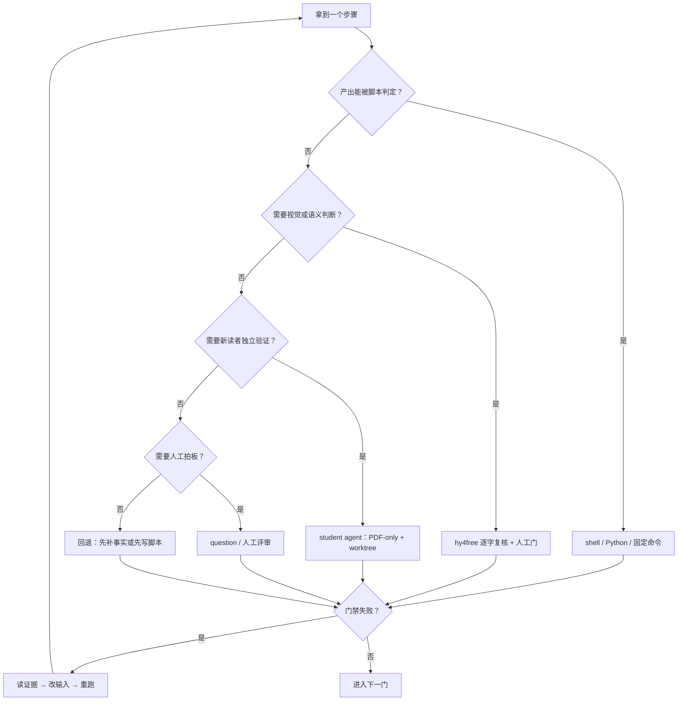

# DSWS 教材：补插图、校正错误、学生验收

## 1. 目标

把 `design/book/chapters/` 的 6 章原稿做成一本 **03-editorial 风格、可被低思考强度学生独立执行** 的开发教材。

验收标准不是「图好看」，而是：

1. 图能降低理解成本，且事实可回溯到 `file:line` 或命令输出；
2. 教材里的命令、路径、契约码、阶段映射能跑通；
3. 一个只拿 PDF、思考强度 medium/low 的学生 agent 能按书完成一个具体开发任务；
4. 学生卡住时，能区分是 **教材缺前提**、**环境问题**，还是 **学生能力问题**。

## 2. 非目标 / 边界

- 不重建旧书 `design/book/book.html` 与 `design/book/pdf/dsws-design-atlas.pdf`。
- 既有 32 张技术架构图本轮不重绘；技术图保持 Mermaid/Graphviz/SVG，不强行漫画化。
- 试点期不 commit；所有改动可回退。
- 不把「模型生成」当作事实源；事实必须回到代码、契约、文档或命令输出。

## 3. 核心原则

> **能被脚本判定的，绝不用模型；需要“看懂/读懂/新读者验证”的，才上 agent；事实必须回到 `file:line` 或命令输出。**

三条硬规则：

1. **确定性优先**：生成、门禁、构建、页码、交叉引用，全部脚本化。
2. **模型只做复核**：hy4free 逐字复核、学生 agent 验收，都不替代事实核对。
3. **新读者验证**：作者自己测不算；学生 agent 必须只拿 PDF，不能看作者审计与答案。

## 4. 主流程

| 阶段 | 输入 | 动作 | 工具 | 通过条件 |
|---|---|---|---|---|
| 0 选条目 | 目录 / 章节 / 审计 | 选补图、校正或学生任务 | 人工 + `Read/Grep` | 条目有明确产出与验收点 |
| 1 事实 | 原稿 / 代码 / 契约 | 找 `file:line`、跑命令 | `Grep/Read` + shell | 每条事实有出处 |
| 2 图型 | 条目类型 | 解释性图 vs 技术图 | 人工判断 | 解释性才漫画化 |
| 3 内容设计 | 事实 + 类比 | 写 content JSON | 人工 + `write` | 3–5 条事实、画面文案、读图路径齐全 |
| 4 生成 | content JSON | SVG → PNG | `make_figure.sh` | 一条命令可重跑 |
| 5 自动门禁 | PNG/SVG/JSON | 拼写/字号/色板/重叠/越界 | `check_figure.py` | 全 PASS |
| 6 视觉复核 | PNG | 逐字 + 5 秒/删图门 | `review_image.sh` + 人工 | N/N 字符串命中 |
| 7 入书 | 图 + 章节 | 插图引用 → HTML | `Edit` + `build_book.py` | 图在正确位置 |
| 8 版面 | HTML | PDF + 页图 | `build_pdf.py` + `pdftotext/pdftoppm` | 图注同页、不溢出 |
| 9 学生验收 | PDF | 独立执行任务 | student agent（worktree） | 能完成并留下反馈 |
| 10 校正回归 | 反馈/错误 | 改文/改图/改命令 | `Edit` + 重建 | 同一任务复测通过 |
| 11 终审 | 全书 | 页码/交叉引用/`git status` | 人工 + shell | 可交付，未 commit |

主流程图见 `02-flow-main.mmd`。

## 5. 工具选择决策树

决策树源文件见 `02-flow-tools.mmd`。

判断规则：

| 判断 | 用什么 | 为什么 |
|---|---|---|
| 结果可脚本判定 | shell / Python / 固定命令 | 可重复、可回归、不烧额度 |
| 需要看懂图/读懂语义 | hy4free + 人工 | 模型只做复核，不做事实源 |
| 需要新读者能否学会 | student agent | 作者自己测不算 |
| 需要审美/取舍 | 人工 / `question` | 没有唯一正确答案 |
| 事实不确定 | `Grep/Read` 到 `file:line`，或先跑命令 | 不能靠模型记忆 |
| 长任务且独立 | background subagent / Orca worker | 不阻塞主流程 |
| 短任务且确定 | 本地 shell | 避免调度开销 |

## 6. 学生 agent 验收

学生验收的详细流程见 `02-flow-student.mmd`。关键约束：

- **只给 PDF**：学生只能读 `design/book-editorial/pdf/dev-book.pdf`，不得读 `design/book/chapters/`、`figures/*.md`、审计 JSON。
- **独立 worktree**：学生命令在单独 worktree 里执行，避免污染主工作区。
- **低思考强度**：优先 CodeBuddy + Hy3，`--effort low`；再跑一次 `--effort medium` 做对照。
- **任务可判定**：任务必须来自 PDF 的目录/章节，有明确完成标志和可复现命令。
- **反馈模板**：任务、步骤、命令、期望/实际、卡点、歧义页码、缺失前提、建议修法、完成状态、置信度、轮次/用时。
- **失败归因**：先判断是教材、环境还是学生；只有教材问题才改书，环境问题修环境，学生问题换学生/换模型复测。

候选首个学生任务（待确认）：

1. 按第 5 部分完成本地三存储健康检查；
2. 按 S5 规则拒绝一条多语句 SQL；
3. 按失败注入矩阵跑一个最小失败用例。

## 7. 门禁清单

- 图：尺寸、拼写清单、字号、色板、文本重叠、越界、PNG 非空、文件大小、唯一性。
- 视觉：hy4free 逐字 N/N；人工 5 秒读懂；删图门（删掉图是否明显更难理解）。
- 版面：图与图注同页；不压正文/不溢出；分页合理。
- 内容：每条事实有 `file:line` / 命令输出；改前/改后记录；复测命令。
- 学生：PDF-only、medium/low effort、能独立完成、反馈可归因。
- 终审：全书页码、交叉引用、`git status`；试点期不 commit。

## 8. 当前试点状态

- 图 3-0 已改为餐厅三幕漫画：纸条当菜、空盘上齐、糊菜指不到灶台。
- 自动门禁全过；hy4free 逐字复核 **31/31**。
- 新书 PDF **207 页**；§3 标题和图 3-0 同在第 **7** 页；改前/改后页已导出。
- **student agent 验收尚未运行**，这是下一步唯一未验证的门。

## 9. 待确认的三个分叉

1. **图型分叉**：解释性插图走「生活类比 + 人物漫画」；技术架构图保持现有图，不强行漫画化。
2. **学生验收分叉**：学生 agent 只拿 PDF + 独立 worktree，不能看作者审计和答案；Hy3 low 为基线，medium 为对照。
3. **校正分叉**：所有错误内容必须带 `file:line` / 命令输出 / before-after；不能凭印象改。

另外请确认首个学生任务选哪一个（三存储健康检查 / S5 多语句拒绝 / 失败注入最小用例）。
