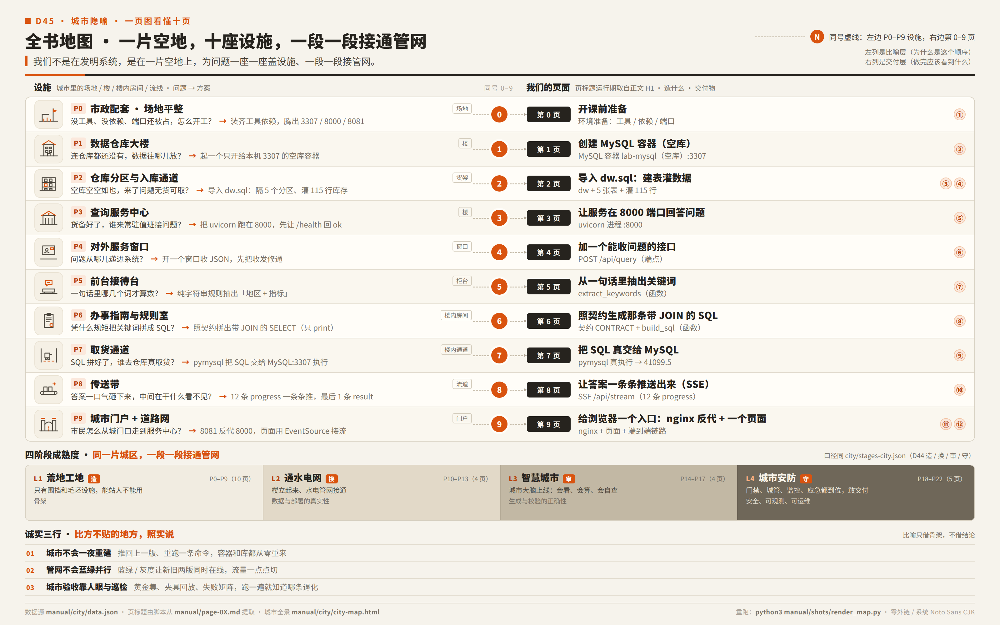

# 全书地图 · 一片空地，十座设施，一段一段接通管网

**一句话**：我们不是在发明系统，是在一片空地上，为问题一座一座盖设施、一段一段接管网。

**范围**：L1 十页 = 造；L2/L3/L4 共 13 页 = 换/审/守，已在 page-10…page-22 交付；L5 装 1 页 = 体验层（page-23）。

- **答辩/概览用 AON**：[L1 旧图](images/flow-aon.png) + [L2–L5 合并图与读图口径](aon/README.md)——节点 = 每级一页的核心动作、边 = 判据依赖；L2–L5 工期为估算值，不是验收时限。

> 城市版的 L1 全景见 [`city/city-map.html`](city/city-map.html)（四区 / 十设施 / 十二件交付物，单源 [`city/data.json`](city/data.json)）；本页把 L1 十页并排成一条城建流水线。

**页标题与页码由生成脚本从 `page-0X.md` 的 H1 提取并同步**：下表只写页码、设施、问题、方案、造什么和交付物编号，不手写页标题；改页标题只改正文，重跑 `python3 manual/shots/render_map.py` 即可。

## 十行对照（L1 的十页）

| 页码 | 设施（城市名） | 问题 | 方案 | 这一页在软件里造什么 | 交付物 |
|:--:|---|---|---|---|:--:|
| page-00 | P0 市政配套 · 场地平整 | 没工具、没依赖、端口还被占，怎么开工？ | 装齐工具依赖，腾出 3307 / 8000 / 8081 | 环境准备：工具 / 依赖 / 端口 | ① |
| page-01 | P1 数据仓库大楼 | 连仓库都还没有，数据往哪儿放？ | 起一个只开给本机 3307 的空库容器 | MySQL 容器 lab-mysql（空库）:3307 | ② |
| page-02 | P2 仓库分区与入库通道 | 空库空空如也，来了问题无货可取？ | 导入 dw.sql：隔 5 个分区、灌 115 行库存 | dw + 5 张表 + 灌 115 行 | ③④ |
| page-03 | P3 查询服务中心 | 货备好了，谁来常驻值班接问题？ | 把 uvicorn 跑在 8000，先让 /health 回 ok | uvicorn 进程 :8000 | ⑤ |
| page-04 | P4 对外服务窗口 | 问题从哪儿递进系统？ | 开一个窗口收 JSON，先把收发修通 | POST /api/query（端点） | ⑥ |
| page-05 | P5 前台接待台 | 一句话里哪几个词才算数？ | 纯字符串规则抽出「地区 + 指标」 | extract_keywords（函数） | ⑦ |
| page-06 | P6 办事指南与规则室 | 凭什么规矩把关键词拼成 SQL？ | 照契约拼出带 JOIN 的 SELECT（只 print） | 契约 CONTRACT + build_sql（函数） | ⑧ |
| page-07 | P7 取货通道 | SQL 拼好了，谁去仓库真取货？ | pymysql 把 SQL 交给 MySQL:3307 执行 | pymysql 真执行 → 41099.5 | ⑨ |
| page-08 | P8 传送带 | 答案一口气砸下来，中间在干什么看不见？ | 12 条 progress 一条条推，最后 1 条 result | SSE /api/stream（12 条 progress） | ⑩ |
| page-09 | P9 城市门户 + 道路网 | 市民怎么从城门口走到服务中心？ | 8081 反代 8000，页面用 EventSource 接流 | nginx + 页面 + 端到端链路 | ⑪⑫ |

城市口径按 GLOSSARY 钉死：全市 **3 座楼（P1/P3/P9）+ 1 块场地（P0）**；P2 是 P1 楼里的货架，P4–P7 是 P3 楼里的窗口 / 柜台 / 房间 / 通道，P8 是从 P3 穿出的传送带——都不是独立建筑。

## 四阶段成熟度：同一片城区，一段一段接通管网

> 口径同 `humen-desicions/09-ablation-course.md` **D44**：四级 = 造 / 换 / 审 / 守，10+4+4+5+1=24 页（前四个数 = D44 的四级 23 页，末位 +1 = **D50** 追加的 L5「装」体验层，page-23）。城市版四阶段的阶段名 / 一句话 / 横切系统与单源 [`city/stages-city.json`](city/stages-city.json) 逐字同源（[城市四阶段图](images/city-4stages.png) 与表同源）；改口径时 JSON 与本表四行要一起改，改完重跑 `python3 manual/shots/render_map.py` 做逐字校验。

| 级 | 城市阶段 | 城市里长什么样 | 软件里对应（横切系统） | 学生动作 | 页 |
|:--:|---|---|---|---|---|
| L1 | 荒地工地 | 只有围挡和毛坯设施，能站人不能用 | 骨架 | 造 | P0–P9（10 页） |
| L2 | 通水电网 | 楼立起来、水电管网接通 | 数据与部署的真实性 | 换 | P10–P13（4 页） |
| L3 | 智慧城市 | 城市大脑上线：会看、会算、会自查 | 生成与校验的正确性 | 审 | P14–P17（4 页） |
| L4 | 城市安防 | 门禁、城管、监控、应急都到位，敢交付 | 安全、可观测、可运维 | 守 | P18–P22（5 页） |

**L2–L4 的十三页对应城市四阶段的后三级，页段 P10–P13 / P14–P17 / P18–P22**；上方十行对照只覆盖 L1 的 P0–P9。

**L5「装」不在这张四阶段表里**：它是第五个横切系统、体验层，只有一页（page-23）——只换前端入口（17 行 HTML → React 构建版），接口、契约与城市都不动，所以四阶段表不因它加行；装修不改变承重墙。

## 诚实三行：比喻不贴的地方

| # | 城市里不成立的说法 | 软件里能 |
|:--:|---|---|
| 01 | 城市不会一夜重建 | 推回上一版、重跑一条命令，容器和库都从零重来 |
| 02 | 管网不会蓝绿并行 | 蓝绿 / 灰度让新旧两版同时在线，流量一点点切 |
| 03 | 城市验收靠人眼与巡检 | 黄金集、夹具回放、失败矩阵，跑一遍就知道哪条退化 |

## 怎么读

- **先左后右**：左边回答「为什么是这十座设施、按这个顺序」，右边回答「这一页做完手里有什么」。
- **同号对齐**：中间 0–9 的编号就是页码，第 N 页永远对 P N 编号的设施。
- **四阶段看底部**：L1 十页不是十个孤立设施，而是同一片城区从荒地工地到城市安防的四个版本；L2–L4 十三页是后三级的横切系统，已在 page-10…page-22 交付；L5 装一页（page-23）只是换入口，不对应城市阶段；比喻只借骨架，不借结论。
