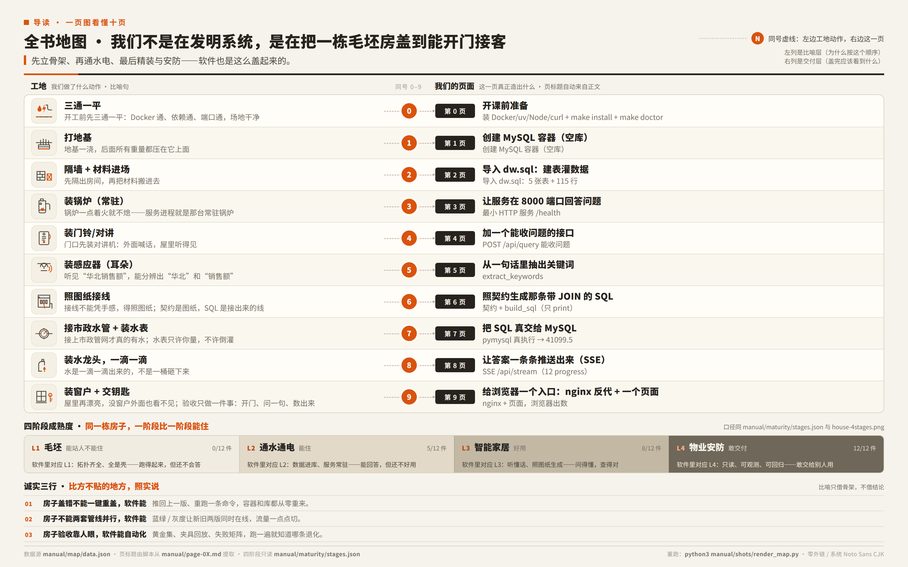

# 全书地图

**全书地图 · 我们不是在发明系统，是在把一栋毛坯房盖到能开门接客**

> 先立骨架、再通水电、最后精装与安防——软件也是这么盖起来的。

这张图把十页并排放成一条工地流水线：左边是工地上的一个动作（比喻层，回答「为什么按这个顺序」），右边是我们这一页真正造出来的东西（交付层，回答「盖完应该看到什么」），中间同号的 0–9 虚线把两层钉在一起。

**页标题与页码由生成脚本从 `page-0X.md` 的 H1 提取并同步**：下表只写页码、工地动作、比喻句和「这一页造什么」摘要，不另设页标题列；改页标题只改正文，重跑 `python3 manual/shots/render_map.py` 即可。

## 十行对照

| 页 | 工地动作 | 比喻句 | 这一页造什么 |
|:--:|---|---|---|
| page-00 | 三通一平 | 开工前先三通一平：Docker 通、依赖通、端口通，场地干净 | 装 Docker/uv/Node/curl + make install + make doctor |
| page-01 | 打地基 | 地基一浇，后面所有重量都压在它上面 | 创建 MySQL 容器（空库） |
| page-02 | 隔墙 + 材料进场 | 先隔出房间，再把材料搬进去 | 导入 dw.sql：5 张表 + 115 行 |
| page-03 | 装锅炉（常驻） | 锅炉一点着火就不熄——服务进程就是那台常驻锅炉 | 最小 HTTP 服务 /health |
| page-04 | 装门铃/对讲 | 门口先装对讲机：外面喊话，屋里听得见 | POST /api/query 能收问题 |
| page-05 | 装感应器（耳朵） | 听见“华北销售额”，能分辨出“华北”和“销售额” | extract_keywords |
| page-06 | 照图纸接线 | 接线不能凭手感，得照图纸；契约是图纸，SQL 是接出来的线 | 契约 + build_sql（只 print） |
| page-07 | 接市政水管 + 装水表 | 接上市政管网才真的有水；水表只许你量，不许倒灌 | pymysql 真执行 → 41099.5 |
| page-08 | 装水龙头，一滴一滴 | 水是一滴一滴出来的，不是一桶砸下来 | SSE /api/stream（12 progress） |
| page-09 | 装窗户 + 交钥匙 | 屋里再漂亮，没窗户外面也看不见；验收只做一件事：开门、问一句、数出来 | nginx + 页面，浏览器出数 |

## 四阶段成熟度：同一栋房子的四个版本

口径同 [`maturity/stages.json`](maturity/stages.json) 与 [`maturity/house-4stages.png`](maturity/house-4stages.png)：

| 阶段 | 住得怎么样 | 软件里对应 |
|:--:|---|---|
| L1 毛坯 | 能站人不能住 | 软件里对应 L1：拓扑齐全、全是壳——跑得起来，但还不会答 |
| L2 通水通电 | 能住 | 软件里对应 L2：数据进库、服务常驻——能回答，但还不好用 |
| L3 智能家居 | 好用 | 软件里对应 L3：听懂话、照图纸生成——问得懂，查得对 |
| L4 物业安防 | 敢交付 | 软件里对应 L4：只读、可观测、可回归——敢交给别人用 |

## 诚实三行：比方不贴的地方

1. **房子盖错不能一键重盖，软件能**：推回上一版、重跑一条命令，容器和库都从零重来。
2. **房子不能两套管线并行，软件能**：蓝绿 / 灰度让新旧两版同时在线，流量一点点切。
3. **房子验收靠人眼，软件能自动化**：黄金集、夹具回放、失败矩阵，跑一遍就知道哪条退化。

## 怎么读

- **先左后右**：左边回答「为什么是这十步」，右边回答「这一步做完手里有什么」。
- **同号对齐**：中间 0–9 的编号就是页码，第 N 页永远对第 N 个工地动作。
- **四阶段看底部**：十页不是十个孤立动作，而是同一栋房子从毛坯到能交付的四个版本；比喻只借骨架，不借结论。
