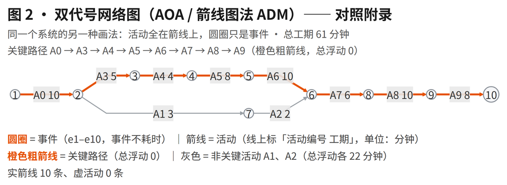

# 全书地图 · 24 页 / 五级（造 → 换 → 审 → 守 → 装）

> 配套参考书：仓库根 `design/book-editorial/pdf/dev-book.pdf`（162 页完整版，查字典用；本手册是主线）；设计图集见 `design/design-doc.pdf`。

这本练本让你**亲手构建一个电商问数系统**：从空的 MySQL 容器开始，一路做到浏览器里问一句、看到 `41099.5`。全书 **24 页 = 五级工程动作**（口径见 [`humen-desicions/09-ablation-course.md`](../humen-desicions/09-ablation-course.md) **D44** 四级 23 页 + **D50** 追加 L5：10+4+4+5+1 = 24 页）：

- **L1 造（page-00 – page-09，10 页）**：一件一件把骨架造出来——每页造一个零件，看到它能跑。
- **L2 换（page-10 – page-13，4 页）**：把实验室替身换成真件——数据 / 契约 / 执行器 / 部署各换一处。
- **L3 审（page-14 – page-17，4 页）**：机器输出不确定，先预注册判据，再让错误发生，看判据抓没抓住。
- **L4 守（page-18 – page-22，5 页）**：制造故障与越权，证明防线有效；兜不住时知道红在哪一层。
- **L5 装（page-23，1 页）**：把第 9 页那 17 行 HTML 的入口换成真前端（React 构建版，由 compose 的 `frontend` 服务提供），接口、契约与判据都不动——体验是第五个横切系统，装修不改变承重墙。
- **附录（不进 24 页）**：[LLM 端点配置](appendix/llm-endpoint.md)——真模型是可选支线；主线不配 key 也能全绿。

每页的「你应该看到」就是该页的**完成判据**——看到它才算做完；L2–L5 每级最后一页的「拆一刀」升级为**级考核**（L1 无拆一刀，另用建成证明海报对账）。验证不单独成页。

图源 [`flow.mmd`](flow.mmd)，PNG 由 [`shots/render_flow.py`](shots/render_flow.py) 用 mermaid 渲染；练本总览页与答辩共用同一份源文件——改图只改 `flow.mmd`，再跑一次脚本。

L2–L5（换 → 审 → 守 → 装）的判据依赖合并成一张图：[aon-l2-l5.png](images/aon-l2-l5.png)（源 `manual/flow-l2-l5.mmd`；旧的 L2–L4 三张分图退役，历史版本见 git；读图规则见 [AON 索引](aon/README.md)）。

## 关键路径与总工期（L1 十页）

> **这是 L1 十页的关键路径（61 分钟）**；L2–L5 按级推进，每级末尾有级考核。

关键路径是 **A0 → A3 → A4 → A5 → A6 → A7 → A8 → A9**，总工期 **61 分钟**。数据层支线 A0 → A1 → A2 → A7 上，A1、A2 各有 **22 分钟总浮动**：晚做不影响总工期，但 A7 要等 A2 的数据和 A6 的 SQL 都就位。

L2–L5 十四页不在这张网络里（L2 换 → L3 审 → L4 守 → L5 装）；L3 的“审”依赖 L2 换出来的真契约 / 真数据（D46）。

## CPM 计算表（L1 十页，单位：分钟）

| 编号 | 活动 | 工期 | ES | EF | LS | LF | 浮动 | 关键 |
|:--:|---|---:|---:|---:|---:|---:|---:|:--:|
| A0 | 环境准备（装工具 + make install） | 10 | 0 | 10 | 0 | 10 | 0 | ★ |
| A1 | 创建 MySQL 容器（空库） | 3 | 10 | 13 | 32 | 35 | 22 | |
| A2 | 导入 dw.sql（建表灌数据） | 2 | 13 | 15 | 35 | 37 | 22 | |
| A3 | 最小 HTTP 服务（/health） | 5 | 10 | 15 | 10 | 15 | 0 | ★ |
| A4 | POST /api/query（硬编码） | 4 | 15 | 19 | 15 | 19 | 0 | ★ |
| A5 | 关键词抽取 | 8 | 19 | 27 | 19 | 27 | 0 | ★ |
| A6 | 契约 + 生成 SQL | 10 | 27 | 37 | 27 | 37 | 0 | ★ |
| A7 | 真执行 SQL | 6 | 37 | 43 | 37 | 43 | 0 | ★ |
| A8 | SSE 流式（/api/stream） | 10 | 43 | 53 | 43 | 53 | 0 | ★ |
| A9 | nginx 反代 + 页面 | 8 | 53 | 61 | 53 | 61 | 0 | ★ |

正推取紧前 EF 的最大值；逆推从总工期 61 倒扣；浮动 = LS − ES = LF − EF。A0 是关键起点。

## 怎么读

- **先把 L1 顺序读完**：按 A0 → A9 一页一页做。每页先写下「猜一猜」的答案，再动手，最后用「你应该看到」对账。L1 是第 61 分钟收尾的骨架版，L2 的四页都以它留下的 `lab/app.py`、演示库和手动起的服务为起点。
- **L1 内数据层可以先做，但不建议并行**：A0 之后，数据层（A1 → A2）与服务层（A3 → … → A6）互不依赖，理论上可以两线并行；A7 必须等两边都完成。并行只省时间，代价是同时盯两个终端，容易乱。
- **L2 → L3 → L4 → L5 按级推进**：每级读完最后一页的级考核再进下一级。L3 从第 14 页起要用 L2 第 13 页起好的整栈当“审”的现场；L4 的越权与回归判据（第 18、22 页）也落在同一套整栈上；L5 的装前端（第 23 页）也在这套整栈上；其余页可离线跑（见各页前置）。
- **验收全书**：读完每一页用 [ACCEPTANCE.md](ACCEPTANCE.md) 按级对账（每级一条级考核 + 24 页结构审计）。

## 全部页面（page-00 – page-23）

- 全书在盖什么：**先看 [全书地图 · 一页图](OVERVIEW.md)**（[PNG](images/map-city-vs-pages.png)）——把「城市十设施 ↔ L1 十页」十行对照、24 页五级口径、四阶段成熟度和诚实三行收在一页，10 分钟看懂整本；城市 L1 全景见 [城市地图](city/city-map.html)（四区 / 十设施 / 十二件交付物，单源 [city/data.json](city/data.json)）。

### L1 造（page-00 – page-09，10 页）

| 页 | 构建活动 | 完成判据 |
|---|---|---|
| [第 0 页 · 开课前准备](page-00.md) | A0 环境准备 | `make doctor` 12/12 通过（工具 6 + 依赖 3 + 端口 3） |
| [第 1 页](page-01.md) | A1 创建 MySQL 容器 | 容器 running、`SELECT VERSION()` 有输出、`SHOW DATABASES` 看不到 `dw` |
| [第 2 页](page-02.md) | A2 导入 dw.sql | `SHOW TABLES` 5 行、`COUNT(*)` = 115 |
| [第 3 页](page-03.md) | A3 最小 HTTP 服务 | `curl /health` → `{"ok":true}` |
| [第 4 页](page-04.md) | A4 POST /api/query | 返回固定 JSON |
| [第 5 页](page-05.md) | A5 关键词抽取 | `["华北","销售额"]` |
| [第 6 页](page-06.md) | A6 契约 + 生成 SQL | 打印出带 JOIN 的 SELECT |
| [第 7 页](page-07.md) | A7 真执行 SQL | `rows[0].sales = 41099.5` |
| [第 8 页](page-08.md) | A8 SSE 流式 | 12 条 progress + 1 条 result |
| [第 9 页](page-09.md) | A9 nginx 反代 + 页面 | 浏览器出 `41099.5` |

### L2 换（page-10 – page-13，4 页）

> 换的是**替身**：把 L1 的演示数据、内联契约、裸 `pymysql`、手动 `docker run` 换成真件；判据全部来自各页正文的真实输出。

| 页 | 主题 | 判据（可执行命令 / 输出摘要） |
|---|---|---|
| [第 10 页 · 换真数据：把演示数据换成甲方数据](page-10.md) | 数据 | `docker exec -i lab-mysql mysql -uroot -plabpass --default-character-set=utf8mb4 < fixtures/dw-real.checks.sql` → 清洗后 `405` 行 / `1136341.10`，naive `1144735.50`（差 8,394.40）；换数据后 `schema_contract --check` 仍 `S1 PASS`（门禁只读 `fixtures/dw.sql` 快照，不读运行库） |
| [第 11 页 · 换真契约：让 SQL 从契约文件长出来](page-11.md) | 契约 | `backend/.venv/bin/python -m lab.app` 打出 5 行 SQL，`WHERE dim_region.region_name = '华北'` 与第 6 页逐字一致；`(cd backend && .venv/bin/python -m app.schema_contract --check)` → `S1 PASS` |
| [第 12 页 · 换真执行器：给临时通道装上四道闸](page-12.md) | 执行器 | `backend/.venv/bin/python -m lab.db` → `金额行 dict {'sales': Decimal('1144735.50')}`、`上限 1000 行`、非 SELECT 抛 `PermissionError`、慢查询抛 `OperationalError`（读超时 5 秒）；`run_sql('SELECT * FROM dim_date')` 回 `1000` |
| [第 13 页 · 换真部署：一条命令起整座城，一条命令验收](page-13.md) | 部署 | `make docker-up` → `docker compose ps` 5 个长驻服务 `healthy`、`ps -a` 多一行 `init Exited (0)`；`make docker-smoke` → `DOCKER SMOKE PASS`（8 步 + init 幂等） |

> 级考核在第 13 页（拆编排）：删掉 `compose.yaml` 的 `init` 段后 `make docker-smoke` 在第 3/8 步红（`init 没有成功退出` / `DOCKER SMOKE FAIL`），五座长驻服务仍 `healthy`——「起得来」不等于部署好。

### L3 审（page-14 – page-17，4 页）

> 审的是**不确定的机器输出**：先预注册判据，再故意打坏，看判据抓没抓住；判据全部来自各页正文的真实输出。

| 页 | 主题 | 判据（可执行命令 / 输出摘要） |
|---|---|---|
| [第 14 页 · 审检索：召回空了的答案，你凭什么信](page-14.md) | 检索 | `make stage3` → `S3 PASS`；离线 `backend/.venv/bin/python -m pytest backend/tests/recall -q` → `18 passed, 23 skipped`；停 `elasticsearch` 后 `POST /api/query` 仍回 `41099.5`，而真检索黄金集 `18 passed, 23 errors` |
| [第 15 页 · 审生成：同一把尺子，量模板也量模型](page-15.md) | 生成 | `make stage4` → 基线 `10/10 通过（拒答 2）` + `S4 PASS`；离线 `pytest backend/tests/generate -q` → `122 passed, 5 skipped` |
| [第 16 页 · 审校验：错单要在执行前被拦下](page-16.md) | 校验 | `pytest backend/tests/generate/test_guard.py -q` → `26 passed`；`(cd backend && .venv/bin/python -m app.scripts.failures --check)` → `S6 PASS`；`eval/probe_correction.py` 末行 → `{"total": 20, "mismatch": 0}` |
| [第 17 页 · 审纠错：一次重试能修好什么、修不好什么](page-17.md) | 纠错 | `pytest backend/tests/agent/test_correct.py -q` → `14 passed`；`failures --check` → `S6 PASS`；`probe_correction.py` → `{"total": 20, "mismatch": 0}`；语料统计 `11 "retryable": true` / `9 "retryable": false` |

> 级考核在第 17 页：关掉 `correct.py` 的校正入口后，`test_correct.py` 5 条红、失败矩阵只红 `corrected` 一格、20 条语料 `mismatch: 0` 照绿——哪条判据抓到了、哪条没抓到，本页要能说清。

### L4 守（page-18 – page-22，5 页）

> 守的是**事故与越权**：制造故障证明防线有效，兜不住时知道红在哪一层；判据全部来自各页正文的真实输出。

| 页 | 主题 | 判据（可执行命令 / 输出摘要） |
|---|---|---|
| [第 18 页 · 守账号：只读账号真的写不了吗](page-18.md) | 只读账号 | `(cd backend && .venv/bin/python -m app.scripts.security --verify-ro-account)` → 写操作被拒 `(1142, "UPDATE command denied…")` + `PASS: 该账号在 dw 上只有 SELECT`；可选 `make stage5-live` → `S5 LIVE PASS` |
| [第 19 页 · 守策略：36 条注入全拒、11 条正常零误杀](page-19.md) | 策略 | `(cd backend && .venv/bin/python -m app.scripts.security --check)` → `36/36 拒绝 + 11/11 放行 + 8/8 基线` + `S5 PASS`；`--corpus` → `语料：47 条，失败 0 条` |
| [第 20 页 · 守取消：点了停止，系统真的停了吗](page-20.md) | 取消 | `(cd backend && .venv/bin/python -m pytest tests/agent -q -k cancel)` → `6 passed, 108 deselected`；`record_sse --check` → `S7 SSE RECORD PASS（14 个夹具与真实输出一致）`；取消夹具 2 帧：先 `skipped` 后 `CANCELLED` |
| [第 21 页 · 守可观测：12 条进度 + 14 条夹具能证明什么](page-21.md) | 可观测 | `/api/steps = 12`（条件步骤 `correct_sql`）、`/api/errors = 16`（3 类）；`record_sse --check` → `S7 SSE RECORD PASS`；夹具合契约 `30 passed`；`(cd frontend && npm test)` → `40 passed (40)` |
| [第 22 页 · 守回归：一套门禁能不能替你值班](page-22.md) | 回归 | `(cd backend && .venv/bin/python -m pytest -q)` → 无 `failed`（第 22 页实测 `813 passed, 30 skipped`，数字会漂）；`(cd frontend && npm test)` → `40 passed (40)`；`make docker-smoke` → `DOCKER SMOKE PASS` |

> 级考核在第 22 页（拆只读账号）：抢在一次性 `init` 退出后、smoke 第 7 步前给 `dw_reader` 注入 `GRANT ALL`，看 8 步里是不是只有第 7 步红（1–6 步照绿、第 8 步不跑）；还原账号后回到 `DOCKER SMOKE PASS`。

### L5 装（page-23，1 页）

> 装的是**体验**：第 9 页那 17 行 HTML 只是入口原型；L5 换成真前端（React 构建版，由 compose 的 `frontend` 服务提供），接口、契约、判据、城市都不动——装修不改变承重墙。只此一页，因为体验是第五个横切系统，且它不新增交付物。

| 页 | 主题 | 判据（可执行命令 / 输出摘要） |
|---|---|---|
| [第 23 页 · 装前端：从 17 行 HTML 到真前端](page-23.md) | 体验 | `make docker-up` → 浏览器 `http://127.0.0.1:8080` 问一句 → `41099.5`；`(cd frontend && npm test)` → `40 passed (40)`；真前端 = React 构建版，由 compose `frontend` 服务提供 |

> 级考核在 page-23（拆一刀）：停 `frontend`，用真前端镜像的 nginx 占 8080 挂第 9 页同款简陋页（`p23-html/index.html`，只补 3 处接线、进 compose 网络），同一问题仍出 `41099.5`；还原 `docker compose up -d frontend`。

- [建成证明海报 · 物料清单 + 检验单](completeness/poster-answer.png)：**12 件交付物 × 24 个检验点**，勾满一行 = 这件东西建成、12 行全满 = 系统完备；空白打印版 [poster-blank.png](completeness/poster-blank.png)。判据全部取自第 0–9 页「你应该看到」，渲染 `python3 manual/shots/render_completeness.py`。
- **范围**：v2 物料清单覆盖 **L1 的 12 件交付物**；L2–L5 的验收由各级「拆一刀」+ 失败矩阵 / 黄金集 / 门禁覆盖（见各页），不在这张 12 行海报里。
- 单源数据 [`completeness/v2/data.json`](completeness/v2/data.json)：海报与交互页共用同一份（v1「行=架构节点的四层矩阵」已按 D43 归档到 [`completeness/archive-v1/`](completeness/archive-v1/README.md)，仅作历史证据）。
- [建成证明 · 可交互原型](completeness/explorer.html)：一个文件两个视图「物料清单 / 城市地图」，默认「物料清单」——行=交付物，检验点级三态 ▢/◧/■ 可编辑、行状态由检验点派生、空白/答案态实时判定；切「城市地图」——左列按 4 区分组的十设施（城市名 + 问题句，楼内房间标「楼内 · 属于 P1/P3」）、右列十页页卡（页标题运行期取自正文 H1，「长出」徽章=该页交付物编号、`../page-0X.md` 相对链接离线可开）、底部城市四阶段 D44 只读，点设施↔页卡双向高亮（单文件离线；数据源 [`completeness/v2/data.json`](completeness/v2/data.json) + [`city/data.json`](city/data.json) + [`city/stages-city.json`](city/stages-city.json)，生成 `python3 manual/shots/build_explorer.py`）。

## 附录：换成双代号（AOA）会怎样（L1 十页）

AOA 把**活动画在箭线上**（线上标活动编号 + 工期），**节点只是事件**（里程碑，不消耗时间）。本网络 **10 个事件 e1–e10、10 条实箭线、0 条虚活动**——因为它是串并联形状（汇聚点 e6 同时收 A2 与 A6），没撞上「两个活动共享同一对起止事件」「一个活动只依赖汇聚点上的部分活动」这两种必须加虚活动的情形。代价是事件要先编号、跨多列的依赖只能拉成一条长箭线（A2 从 e7 直连 e6）、CPM 的 ES/EF 要算在箭线（活动）上而不是节点上——所以主线仍用单代号（AON），AOA 只作对照。

图源 [`flow-aoa.mmd`](flow-aoa.mmd)，PNG 由 [`shots/render_aoa.py`](shots/render_aoa.py) 用 mermaid 渲染；跑法：`python3 manual/shots/render_aoa.py`。
