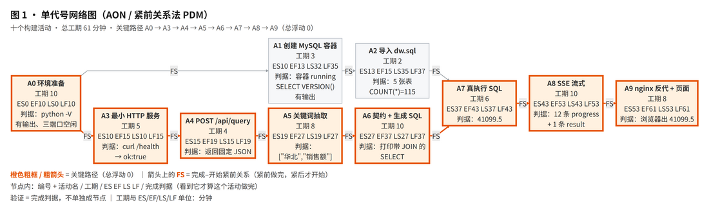

# 全书地图 · 十个构建活动

> 配套参考书：dev-book.pdf（162 页完整版，查字典用；本手册是主线）。

这本练本让你**亲手构建一个电商问数系统**：从空的 MySQL 容器开始，一路做到浏览器里问一句、看到 `41099.5`。全书十个**构建活动**（A0–A9），每个活动都留下一件可验收的产物；每页的「你应该看到」就是该活动的**完成判据**——看到它才算做完。验证不单独成页。

图源 [`flow.mmd`](flow.mmd)，PNG 由 [`shots/render_flow.py`](shots/render_flow.py) 用 mermaid 渲染；练本总览页与答辩共用同一份源文件——改图只改 `flow.mmd`，再跑一次脚本。

## 关键路径与总工期

关键路径是 **A0 → A3 → A4 → A5 → A6 → A7 → A8 → A9**，总工期 **61 分钟**。数据层支线 A0 → A1 → A2 → A7 上，A1、A2 各有 **22 分钟总浮动**：晚做不影响总工期，但 A7 要等 A2 的数据和 A6 的 SQL 都就位。

## CPM 计算表（单位：分钟）

| 编号 | 活动 | 工期 | ES | EF | LS | LF | 浮动 | 关键 |
|:--:|---|---:|---:|---:|---:|---:|---:|:--:|
| A0 | 环境准备（装工具 + make install） | 10 | 0 | 10 | 0 | 10 | 0 | ★ |
| A1 | 创建 MySQL 容器（空库） | 3 | 10 | 13 | 32 | 35 | 22 | |
| A2 | 导入 dw.sql（建表灌数据） | 2 | 13 | 15 | 35 | 37 | 22 | |
| A3 | 最小 HTTP 服务（/health） | 5 | 10 | 15 | 10 | 15 | 0 | ★ |
| A4 | POST /api/query（硬编码） | 4 | 15 | 19 | 15 | 19 | 0 | ★ |
| A5 | 关键词抽取 | 8 | 19 | 27 | 19 | 27 | 0 | ★ |
| A6 | 契约 + 生成 SQL | 10 | 27 | 37 | 27 | 37 | 0 | ★ |
| A7 | 真执行 SQL | 6 | 37 | 43 | 37 | 43 | 0 | ★ |
| A8 | SSE 流式（/api/stream） | 10 | 43 | 53 | 43 | 53 | 0 | ★ |
| A9 | nginx 反代 + 页面 | 8 | 53 | 61 | 53 | 61 | 0 | ★ |

正推取紧前 EF 的最大值；逆推从总工期 61 倒扣；浮动 = LS − ES = LF − EF。A0 是关键起点。

## 怎么读

- **顺序读（推荐）**：按 A0 → A9 一页一页做。每页先写下「猜一猜」的答案，再动手，最后用「你应该看到」对账。
- **数据层可以先做，但不建议并行**：A0 之后，数据层（A1 → A2）与服务层（A3 → … → A6）互不依赖，理论上可以两线并行；A7 必须等两边都完成。并行只省时间，代价是同时盯两个终端，容易乱。

## 全部页面（page-00 – page-09）

| 页 | 构建活动 | 完成判据 |
|---|---|---|
| [第 0 页 · 开课前准备](page-00.md) | A0 环境准备 | `make doctor` 12/12 通过（工具 6 + 依赖 3 + 端口 3） |
| [第 1 页](page-01.md) | A1 创建 MySQL 容器 | 容器 running、`SELECT VERSION()` 有输出 |
| [第 2 页](page-02.md) | A2 导入 dw.sql | `SHOW TABLES` 5 行、`COUNT(*)` = 115 |
| [第 3 页](page-03.md) | A3 最小 HTTP 服务 | `curl /health` → `{"ok":true}` |
| [第 4 页](page-04.md) | A4 POST /api/query | 返回固定 JSON |
| [第 5 页](page-05.md) | A5 关键词抽取 | `["华北","销售额"]` |
| [第 6 页](page-06.md) | A6 契约 + 生成 SQL | 打印出带 JOIN 的 SELECT |
| [第 7 页](page-07.md) | A7 真执行 SQL | `rows[0].sales = 41099.5` |
| [第 8 页](page-08.md) | A8 SSE 流式 | 12 条 progress + 1 条 result |
| [第 9 页](page-09.md) | A9 nginx 反代 + 页面 | 浏览器出 `41099.5` |

- [完备性证明海报](completeness/poster.md)：四层责任×证据矩阵，补齐即完备
- [建成证明 · 可交互原型](completeness/explorer.html)：中分视图 + 多卡矩阵 + 空白/答案态实时判定（单文件离线；数据源 [`completeness/data.json`](completeness/data.json)，生成 `python3 manual/shots/build_explorer.py`）

## 附录：换成双代号（AOA）会怎样

AOA 把**活动画在箭线上**（线上标活动编号 + 工期），**节点只是事件**（里程碑，不消耗时间）。本网络 **10 个事件 e1–e10、10 条实箭线、0 条虚活动**——因为它是串并联形状（汇聚点 e6 同时收 A2 与 A6），没撞上「两个活动共享同一对起止事件」「一个活动只依赖汇聚点上的部分活动」这两种必须加虚活动的情形。代价是事件要先编号、跨多列的依赖只能拉成一条长箭线（A2 从 e7 直连 e6）、CPM 的 ES/EF 要算在箭线（活动）上而不是节点上——所以主线仍用单代号（AON），AOA 只作对照。

图源 [`flow-aoa.mmd`](flow-aoa.mmd)，PNG 由 [`shots/render_aoa.py`](shots/render_aoa.py) 用 mermaid 渲染；跑法：`python3 manual/shots/render_aoa.py`。
