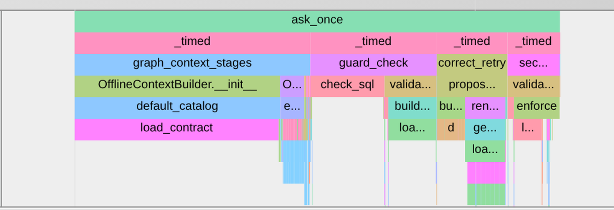
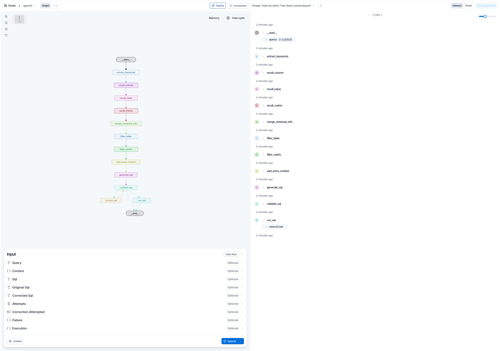
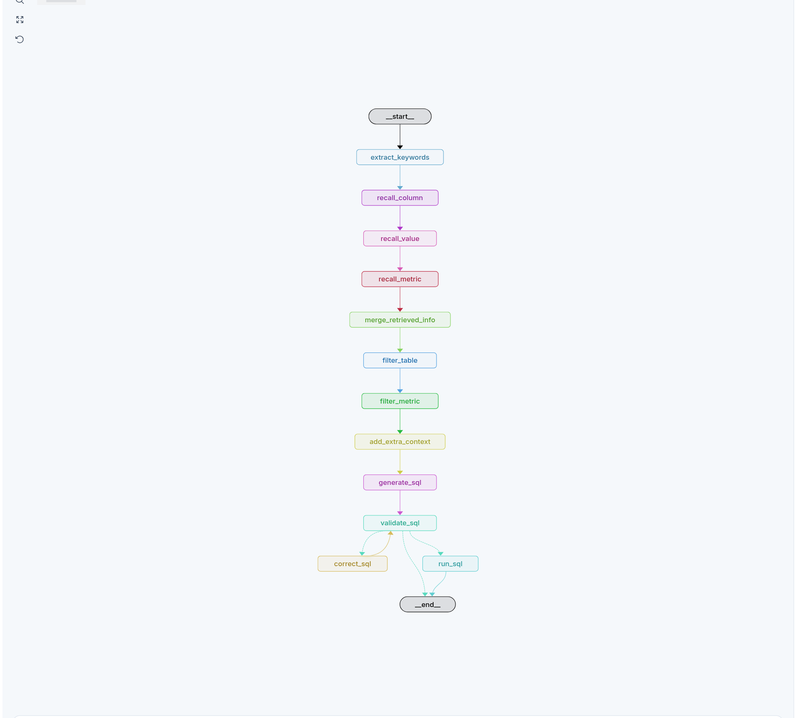

# 附录 · 工具卡：装一次、一条命令、浏览器里点开（不算 24 页）

> **附录，不算 24 页。** 主线判据仍是各页命令与 `ACCEPTANCE.md`；本附录只解决「换一个项目，我怎么用同一套工具看清它在跑什么」。每张卡四行：**安装 / 一条命令 / 浏览器里看什么 / 换项目改哪个参数**。
>
> **安装前提**：下面 viztracer / py-spy / scalene / LangGraph Studio 四张卡的安装行用 `pipx`。没装 pipx 先任选一条：`uv tool install pipx`（本课程已装 uv，推荐；装完 `pipx --version` 有输出即可），或 `python3 -m pip install --user pipx && python3 -m pipx ensurepath`。不想装 pipx 也行：`uv tool install <包名>` 直接装（如 `uv tool install viztracer`），或建临时 venv（`uv venv /tmp/tools` 后 `uv pip install --python /tmp/tools/bin/python <包名>`）。

## 选工具三问

动手前先问自己三句，答案决定用哪张卡：

1. **能一条命令吗？** 能——先找原子工具（`viztracer`、`py-spy`、`scalene`、`pdb`、`curl`、`pytest`），不为一次观察写脚本。
2. **要写代码吗？** 要——说明你还没找到入口：绝大多数「看执行/看帧/看变量」都有现成 CLI 或 GUI。
3. **输出能浏览器点开吗？** 能——优先浏览器（时间线条带、火焰图、逐行表、SSE 帧）；不能——退回终端输出（pdb、pytest、curl）。

> 项目脚本（`manual/shots/*.py`）是教师/CI 夹具，只作证据来源，不是学生入口；学生只用「原子工具 + 项目一层命令」。

## viztracer · 函数级时间线（本仓库已实测）

- **安装**：`pipx install viztracer`（隔离装，不污染项目 venv）；要 trace 项目自己的 pytest 时，装进该项目 venv：`uv pip install --python backend/.venv/bin/python viztracer`。
- **一条命令**：`viztracer --open your_script.py`；本仓库实测：`backend/.venv/bin/python -m viztracer --open --min_duration 1ms -m pytest backend/tests/agent/test_correct.py -q`。
- **浏览器里看什么**：跑完自动弹出时间线；横条 = 一次函数调用，越宽越久，上下叠着是「谁调了谁」；点任意条带看 Title / Start / Wall Duration / Self Time。
- **换项目改哪个参数**：换成 `viztracer --open your_script.py`；已在跑的进程用 `viztracer --attach <pid>`；`--min_duration 1ms` 约留 ≥1ms 的调用（收尾事件仍可能 <1ms，属正常）；不加它会写满环形缓冲、丢早期数据（本仓库一次 pytest trace 实测约 170 MB，浏览器打不开），必要时用 `--tracer_entries` 调缓冲。

## py-spy · 不重启进程采样

- **安装**：`pipx install py-spy`（Rust 二进制，无 Python 依赖）。
- **一条命令**：运行中的进程：`py-spy record -p <pid> -o /tmp/p.json -f speedscope`；没在跑的脚本：`py-spy record -o /tmp/p.json -f speedscope -- python your_script.py`（`--` 后面必须跟**解释器命令**；直接写 `-- your_script.py` 会报 `Permission denied`——普通 `.py` 没有 shebang / 执行位，不是可执行程序。系统里没有 `python` 就写 `python3`，或写解释器全路径如 `backend/.venv/bin/python`）。
- **浏览器里看什么**：把 `/tmp/p.json` 拖进 <https://www.speedscope.app>（浏览器 GUI，不用安装），看火焰图/调用堆栈。
- **换项目改哪个参数**：换 `<pid>` 或脚本；容器里要 `--cap-add SYS_PTRACE`，且采样用户要对进程有权限。

## scalene · CPU / 内存逐行

- **安装**：`pipx install scalene`（隔离装，2.x 本仓库实测 2.4.0）；要装进项目 venv 就用 `uv pip install --python backend/.venv/bin/python scalene`，之后命令写 `backend/.venv/bin/scalene`（或 `uv run scalene`），**别敲裸 `scalene`**（PATH 里可能是 pipx 装的那个，和项目解释器不是一套）。
- **一条命令**：2.x（实测 2.4.0）：`scalene run -o /tmp/s.json your_script.py`，再 `scalene view --standalone /tmp/s.json`——`--standalone` 生成自包含单文件 `scalene-profile.html`（落在当前目录，约 1.7 MB、大小随 profile 数据变，双击就能看）；`scalene view --html` 只生成引用 jquery / bootstrap / prism 等外部资源的 HTML，那些资源不写出来，双击白页，别用。1.x 旧版（实测 1.5.51）写法：`scalene --html --outfile /tmp/s.html your_script.py`——直接出单文件，但实测仍引 CDN 的 jquery / bootstrap / prism，离线打开不完整，**非自包含**。
- **浏览器里看什么**：`scalene view` 打开逐行 CPU/内存表；`--standalone` 出的 HTML 用浏览器双击打开；只想看终端表加 `--cli`。
- **换项目改哪个参数**：换脚本与 `-o` 输出路径；只想看 CPU 加 `--cpu-only`（快）。

## pdb · 源码级断点（Python 自带）

- **安装**：不用装，`python -m pdb` 就是。
- **一条命令**：`backend/.venv/bin/python -m pdb -m pytest backend/tests/agent/test_correct.py -q -s -k "proposes_a_new_sql"`（`-s` 不能省：pytest 默认接管 stdin，pdb 会报 `OSError`）。
- **浏览器里看什么**：不看浏览器；终端出现 `(Pdb)` 提示符，敲 `p 变量名` 看值。
- **换项目改哪个参数**：换测试路径与 `-k`；进 pdb 后 `b backend/app/agent/correct.py:183`（从仓库根写全路径）、`c` 继续、`p policy.max_attempts`、`q` 退出。

## curl · 看 SSE 原始帧

- **安装**：系统自带（第 0 页已列）。
- **一条命令**：`curl -sN -X POST http://127.0.0.1:8080/api/query -H 'content-type: application/json' -d '{"query":"华北销售额"}'`。
- **浏览器里看什么**：不看浏览器；终端一行一帧 `data: {...}`（`-N` 关缓冲，帧才逐条出）。
- **换项目改哪个参数**：换 URL、`-d` 里的请求体、`-H` 头；要留证据就接 `| tee /tmp/sse.txt`。

## pytest · 判据入口

- **安装**：走项目依赖（`make install` 会 `uv sync`），不用单独装。
- **一条命令**：`backend/.venv/bin/python -m pytest backend/tests/agent/test_correct.py -q`。
- **浏览器里看什么**：不看浏览器；看末行汇总（`14 passed` / `5 failed, 9 passed`）。
- **换项目改哪个参数**：换测试路径；`-k "名字"` 只跑匹配的用例，`-s` 放开 stdout。

## Chrome DevTools · 前端网络 / 流式帧

- **安装**：Chrome 自带（F12）。
- **一条命令**：不用命令——浏览器打开 `http://127.0.0.1:8080`，按 F12。
- **浏览器里看什么**：**Network** → 过滤 `query` → 点请求 → **EventStream** 标签，每行一条 `data: {...}`；取消能看到 `CANCELLED` 错误事件。
- **换项目改哪个参数**：换地址与过滤词；SSE 找 EventStream，普通请求看 Response。

## LangGraph Studio · 节点级图（本仓库已实测，需联网）

- **安装**：`pipx install "langgraph-cli[inmem]"`；本仓库的 `langgraph.json` 把依赖指到 `backend`，图会 import `sqlglot` / `pymysql` / `jsonschema` / `pyyaml`——pipx 隔离环境里没有，直接跑会报 `ModuleNotFoundError: No module named 'sqlglot'`，先 `pipx inject langgraph-cli pyyaml sqlglot pymysql jsonschema` 把项目依赖装进同一个环境。
- **一条命令**：本仓库在 `manual/review/langgraph-studio/` 里跑：`(cd manual/review/langgraph-studio && langgraph dev --no-browser --port 2024)`（只发 API，界面在远程 LangSmith Studio；`--no-browser` 免得在没浏览器的机器上报错）；换项目就把这个目录换成带 `langgraph.json` 的那层，依赖换成你项目的。
- **浏览器里看什么**：终端打印的 Studio URL（`https://smith.langchain.com/studio/?baseUrl=http://127.0.0.1:2024`）→ 节点图 + run 时间轴 + state。
- **换项目改哪个参数**：换 `langgraph.json` 所在目录与端口；国内代理变量会让本地 API 起不来，先 `env -u HTTP_PROXY -u HTTPS_PROXY -u ALL_PROXY …`。

## Zed · 源码级 GUI 断点（配置样例，未实拍）

- **安装**：从 <https://zed.dev> 下载桌面版。
- **一条命令**：`zed .`（在仓库根打开项目）。
- **浏览器里看什么**：不是浏览器；左侧 Debug 面板看断点、变量、调用栈。
- **换项目改哪个参数**：新建 `.zed/debug.json`（仓库里没有这个文件，样例在 [`review/zed-debug/debug.json`](../review/zed-debug/debug.json)，复制一份到 `.zed/debug.json`），把 `program` / `python` 换成你的入口脚本与解释器；调试端口由 Zed 的 debugpy adapter 自己管，不用手填。样例 `program` 仍指教师夹具 `manual/shots/pdb_step_demo.py`，换你项目时换成自己的入口脚本/测试。

## 已实测证据链

- 证据目录：[`review/viztracer/`](../review/viztracer/)（trace 原始文件 + runbook）、[`review/langgraph-studio/`](../review/langgraph-studio/)（启动日志 + thread/state）、[`review/zed-debug/`](../review/zed-debug/)（debug.json + debugpy 冒烟日志）。
- 生成这些证据的仓库脚本（`manual/shots/trace_viztracer.py`、`record_sse`、`render_*.py`）是教师/CI 夹具：学生入口只用上面卡片里的原子命令。

## 诚实边界

- **VizTracer 是观测，会放大耗时**：每个函数进出都记一笔，同一次问数不追踪约 43 ms、追踪后约 61 ms；看相对比例与层级，别当绝对性能。
- **离线夹具 ≠ 真模型**：假模型返回固定 JSON、假执行器不连 MySQL；trace 说明「路径与层级」，不代表真 LLM 的延迟分布。
- **LangGraph Studio 不是通用工具**：只有用 LangGraph 的项目能用；Zed 只有配置样例、本机无窗口实拍，别当教程照抄。
