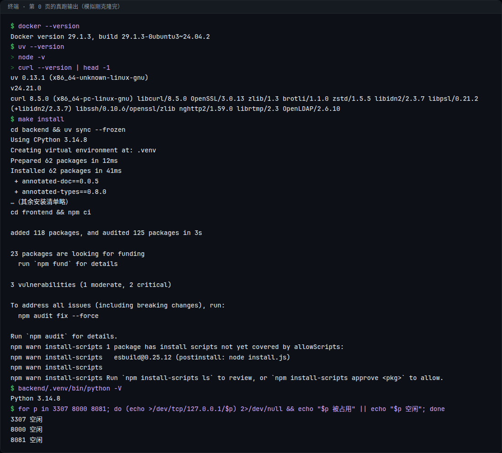

# 第 0 页 · 开课前准备

## 这一页构建什么

把克隆下来的仓库变成「能开始第 1 页」的状态：工具装齐、依赖装好、三个端口空着。这一页没有代码，也不讲业务概念，只补克隆后缺的东西。

## 提前说明

先确认你已经克隆好仓库，终端停在**仓库根目录**（`ls` 能看到 `Makefile`、`backend/`、`fixtures/` 的那一层），并且用的是 **bash**（Windows 用 Git Bash 或 WSL；macOS 默认是 zsh，先敲一下 `bash`）。以下命令都在这一层敲。

**安装**好五样（安装方法见官方安装页）：**Docker**（https://docs.docker.com/get-docker/ ；装完要让它**运行**起来，口语常说“跑起来”）、**uv**（https://docs.astral.sh/uv/ ）、**Node.js LTS + npm**（https://nodejs.org/ ）、**GNU Make**（装好就是 `make` 命令）、**curl**（第 3–9 页全靠它，多数系统自带）。

`.env`、`backend/.venv`、`frontend/node_modules` 都被 `.gitignore` 忽略，克隆下来没有：`.env` 不用你建（第 1 页会从 `.env.example` 读），后两个由 `make install` 生成，**别手动 pip 装**。

## 动手

**第 1 条 · 装依赖（必须在仓库根目录；第一次下载，再跑只要几秒，能重复跑）。**

```bash
make install
```

**第 2 条 · 一条命令判完环境（工具、依赖、端口三件事；末行全过才算这一页做完）。**

```bash
make doctor
```

`make doctor` 把这一页要你分头检查的三件事（工具、依赖、端口）收成一条命令，每项打 `✓` 或 `✗`，末行给总判定。想看它到底查了什么、拿什么当判据，敲 `make doctor-v`（`-v` 会被 make 吃掉，所以是 `doctor-v`）。

## 你应该看到

第 1 条最长，真跑输出是（中间 62 行 `+ 包名==版本` 太长，只留两行）：

```text
cd backend && uv sync --frozen
Using CPython 3.14.8
Creating virtual environment at: .venv
Prepared 62 packages in 12ms
Installed 62 packages in 41ms
 + annotated-doc==0.0.5
 + annotated-types==0.8.0
…（其余安装清单略）
cd frontend && npm ci
added 118 packages, and audited 125 packages in 3s
```

第 2 条真跑输出是这四行——**末行 `12/12 通过` 就是结论**：

```text
工具  ✓ docker 29.1.3  ✓ daemon  ✓ uv 0.13.1  ✓ node v24.21.0  ✓ make 4.3  ✓ curl 8.5.0
依赖  ✓ Python 3.14.8（要求 ≥3.12）  ✓ uv 62 个包全兼容  ✓ npm 依赖无缺失
端口  ✓ 3307  ✓ 8000  ✓ 8081
12/12 通过
```



版本号、包数量、耗时每次不同，看到同类的行就算对上。`✓` 变成 `✗` 时不用猜：`make doctor` 会在下面单独列出没过的那项和修法。尾部出现 `npm warn ...`、`vulnerabilities` 是提醒不是失败；再跑一遍 `make install` 会变成 `Checked 62 packages in 0.55ms` 这种一行，照样算成功。

## 卡住了看这里

`make doctor` 的每一项都对应一句修法，先按它给的提示改；改完**再跑一次** `make doctor`，`12/12 通过` 出现才算完。

- `✗ docker`：Docker 没装，回「提前说明」装完。
- `✗ daemon`：装了但没跑起来——Docker Desktop 打开窗口；Linux 用 `sudo systemctl start docker`。注意 `docker --version` 有输出**不代表** daemon 在跑。
- `✗ uv` / `✗ node` / `✗ make` / `✗ curl`：对应工具没装，装完**重开一个终端**再试（老终端认不到新装的命令）。
- `✗ Python`：`backend/.venv` 没造出来，多半是第 1 条失败了——先修 `make install`（网络问题重跑一次；还不行就分开跑 `cd backend && uv sync --frozen` 和 `cd frontend && npm ci`，看哪段先红）。
- `✗ uv 62 个包全兼容`：有包装不上或互相冲突，`cd backend && uv sync --frozen` 会打印第一段红字，照它说缺什么。
- `✗ npm 依赖无缺失`：跑 `cd frontend && npm ci`（**不要**用 `npm install`，它会改写锁文件，后面的人装出来和你不一样）。
- `✗ 端口`：`ss -tlnp | grep -E ':(3307|8000|8081) '` 列出占用者，把 PID 那列找出来停掉；看不到 PID 说明是 root 的进程（比如系统自带的 MySQL），加 `sudo` 再看：`sudo ss -tlnp | grep -E ':(3307|8000|8081) '`。第 1 页写死 3307、第 3 页写死 8000、第 9 页写死 8081，改端口要连带改后面命令。
- 拿到 PID 后停掉它：`kill -15 <PID>`（先发 SIGTERM 让它自己收尾）；还不退再 `kill -9 <PID>`。
- 第 1 条 `uv sync` 卡在下载 Python：机器上没有 3.12+ 时 uv 会联网拉解释器，网络受限就会卡；先 `uv python list` 看本机有没有可用的 3.12+。

> **你现在拥有**：一台装齐 Docker、uv、Node、curl，依赖也装好、3307/8000/8081 三个端口都空着的开发机；它是后面九页每个容器、每项服务的地基。

## 自己改一下

把 8000 占住，再跑一次 `make doctor`，看它怎么报错（这就是"判据可被第三方复核"的意思——不用作者在场，输出自己会说话）：

```bash
backend/.venv/bin/python -m http.server 8000 &
make doctor
kill %1
```

你应该看到端口那行变成 `✗ 8000`，下面多出一条修法提示，末行从 `12/12 通过` 变成 `11/12 通过（1 项没过）`。做完记得把后台进程停掉。

（顺带解释：`make doctor` 的端口检查里，3307 是刻意选的——本机自带的 MySQL 常占着 3306，所以第 1 页用 3307。）

## 重来一遍（回到起点）
一轮做完会留下 `lab-mysql`、`lab-nginx` 两个容器、仓库根目录的 `lab/`、终端 1 里的 uvicorn；先按 `Ctrl+C` 停终端 1，再敲（别用 `docker system prune`——会误删本机别的栈）：

```bash
docker rm -f lab-nginx lab-mysql   # 数据随容器消失；重跑第 1 页起容器、再跑第 2 页重新导入 fixtures/dw.sql
rm -rf lab
docker ps -a --format '{{.Names}}' | grep '^lab-' || echo "容器干净"   # 验证 1
ss -tln | grep -E ':(3307|8000|8081) ' || echo "端口全空"              # 验证 2
```

你应该看到最后两条的真实输出：`容器干净`、`端口全空`；`docker rm` 会先打印 `lab-nginx`、`lab-mysql` 两个名字。

| 想回到 | 删掉 | 保留 |
|---|---|---|
| 第 3 页 | `lab-nginx`、整个 `lab/` | `lab-mysql`（数据不用重新导入） |
| 第 7 页 | `lab-nginx`，并把 `lab/app.py` 退回第 6 页的版本 | `lab-mysql`、`lab/` |
| 只重第 9 页 | 只删 `lab-nginx` | `lab-mysql`、`lab/`（配置和页面直接重用） |
