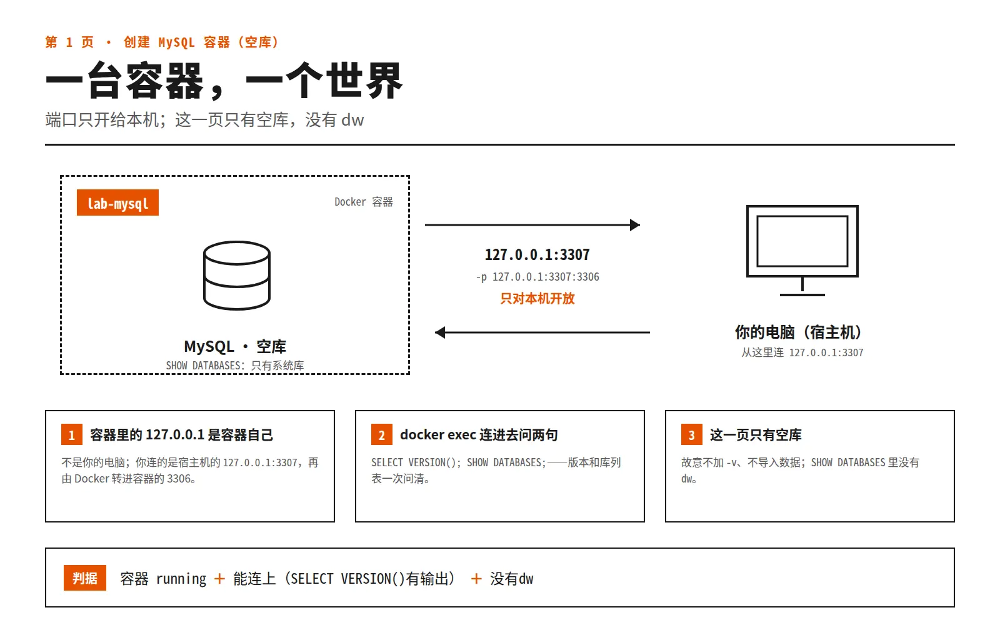
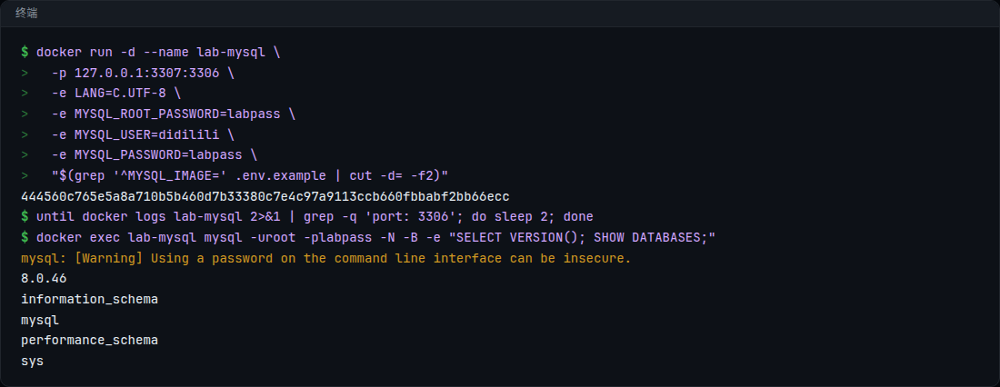

# 第 1 页 · 创建 MySQL 容器（空库）

> **城市坐标 · P1 数据仓库大楼（交付物 ②）**｜城里第一座楼立起来，但里面是空的——只有一张空库，还没有 `dw`。

## 这一页构建什么

**创建并启动**一个叫 `lab-mysql` 的 MySQL 容器，端口只开给本机 `127.0.0.1:3307`，再用 `docker exec` 连进去问两句（口语常说“起一个容器”）。这一页只做容器本身，不导入任何数据。



## 猜一猜

先写下答案，再动手。

容器起来、能连上之后，`SHOW DATABASES` 会列出哪些库？

- A. 有 `dw`（MySQL 启动时自动建好了）
- B. 只有 MySQL 自带的系统库，没有 `dw`
- C. 一个库都没有

## 动手

以下命令都在**仓库根目录**执行（有 `fixtures/`、`backend/` 的那一层）。

**第 1 条：创建并启动容器。**

```bash
docker run -d --name lab-mysql \
  -p 127.0.0.1:3307:3306 \
  -e LANG=C.UTF-8 \
  -e MYSQL_ROOT_PASSWORD=labpass \
  -e MYSQL_USER=didilili \
  -e MYSQL_PASSWORD=labpass \
  "$(grep '^MYSQL_IMAGE=' .env.example | cut -d= -f2)"
```

它会打印一长串容器 ID，看到它就说明容器起来了。这一长串参数你只要记住这几处：

- `-p 127.0.0.1:3307:3306`：冒号左边是宿主机端口，右边是容器内端口。3306 常被本机已装的 MySQL 占着，所以这一课统一用 3307；3307 若也被占，换一个没被占的端口（比如 3308），后面写 3307 的页跟着改。
- 这一页**故意不加 `-v`**：没有脚本挂载（mount）进容器的 `/docker-entrypoint-initdb.d/`，容器第一次启动时没有脚本自动执行，`dw` 库不会被建出来——空库就是这一页的产物。
- `MYSQL_ROOT_PASSWORD=labpass`：设 root 账号的密码，后面所有 `mysql -uroot -plabpass` 都用它。
- `MYSQL_USER` / `MYSQL_PASSWORD`：官方 mysql 镜像启动时会用这两个变量建 `didilili` 这个用户（并设好密码）。
    - **补权限**：第 2 页导入的 `dw.sql` 里那句 `GRANT ALL PRIVILEGES ON dw.* TO 'didilili'@'%'` 只是**补 `dw` 库的权限**（镜像建出来的用户默认没有库权限），用户不存在时 GRANT 会报错中断——所以这两个变量不能省。
- `LANG=C.UTF-8`：让容器里的 `mysql` 认 UTF-8，少了它，第 2 页按中文筛数据会一条也筛不到。
- 最后一行不手抄镜像名，从仓库自带的 `.env.example` 里读 `MYSQL_IMAGE`（`.env` 是你本地的密钥配置，被 `.gitignore` 忽略，克隆下来没有）。这行一旦被改名或删除，命令会**静默传空**、拉不到镜像——所以别删它。

**顺带把第 2 页要用的输入重定向认下来。** 第 2 页导入 `dw.sql` 的命令是 `docker exec -i lab-mysql mysql -uroot -plabpass < fixtures/dw.sql`。

**输入重定向**：`<` 是**宿主机** shell 的重定向：在你的终端里打开 `fixtures/dw.sql`，把内容接到 `docker exec` 的标准输入；`-i` 让容器的标准输入保持打开，这些内容才能递进容器里的 `mysql`。

**少了 `-i`，`mysql` 读到的是空输入：命令不建表、不报错，退出码还是 0**——“没报错”不等于“执行了”。

**第 2 条：等它启动就绪。它一行输出都没有，是在等。**

```bash
until docker logs lab-mysql 2>&1 | grep -q 'port: 3306'; do sleep 2; done
```

正常 10 秒左右光标才回来（机器慢会到 20–30 秒）。超过 1 分钟还没回来，按 `Ctrl-C`，回看第 1 条有没有报错。

**第 3 条：连上它，问两件事。**

```bash
docker exec lab-mysql mysql -uroot -plabpass -N -B -e "SELECT VERSION(); SHOW DATABASES;"
```

**参数**：`-N -B` 让输出只留值、一条一行，方便逐行对；`-e` 后面是一段 SQL，写几条都行，用分号隔开。

**不是错误**：终端里还会多一行 `mysql: [Warning] Using a password on the command line interface can be insecure.`——那是提醒你密码写在命令行上了，不是错误。

## 你应该看到

第 1 条回一长串容器 ID；第 2 条没有输出；第 3 条 5 行：第一行是 MySQL 版本号，后四行是它自带的 4 个库：

```text
8.0.46
information_schema
mysql
performance_schema
sys
```

版本号是 `8.0.` 开头的一串数字，你的机器上可能不是 `8.0.46`；后四行固定。`dw` 不在里面——这一页只起容器，没有建库。



## 对账

- 猜 A（有 `dw`）：错。第 1 条没有挂载 `dw.sql`，`/docker-entrypoint-initdb.d/` 是空的，容器第一次启动时没有脚本可自动执行；`dw` 要等第 2 页导入。
- 猜 C（一个库都没有）：也不对。那 4 个系统库是 MySQL 自己建的，删不掉也不该删；你看到的库 = 系统库 + 你自己建的库。
- 猜 B（只有系统库）：对。这一页的完成判据不是“有表”，而是“能连上、能读出 `SELECT VERSION()`”。
- 这也是第 2 页为什么用 `docker exec -i` 手动导入：导入一次就是一次，看得见、查得到、能重跑。
    - **自动执行的盲区**：自动执行只在容器第一次启动时发生一次，脚本出没出错你没有现场。

> **你现在拥有**：一个连得上、能跑 SQL 的 MySQL 容器；它是后面所有数字的唯一来源。

## 自己改一下

1. 去掉第 3 条里的 `-N` 再跑一次：会多出什么？（参考：`VERSION()`、`Database` 两行表头，值照旧。）
2. 在第 3 条的 `mysql` 后面加上库名 `dw`（`... -N -B dw -e "SHOW TABLES;"`）：会报什么错？（参考：`ERROR 1049 (42000): Unknown database 'dw'`，退出码 1——这一页只起容器，还没有库。）
