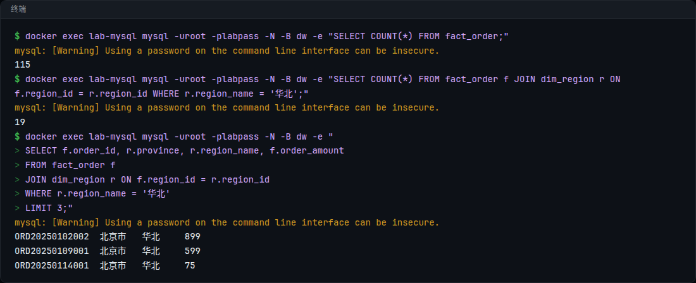

# 第 2 页 · 证明数据真的在，而且能连起来

## 这一页造什么

一行数据都不写，用三条只读查询给第 1 页的库验货：`fact_order` 里有 115 行；华北区有 19 单；一条 JOIN 能把订单连到区域表。

## 猜一猜

第 1 页你只做了三件事：起容器、等它初始化、`SHOW TABLES`。你没有手动 `INSERT` 过任何一行。

先写下你的答案：`SELECT COUNT(*) FROM fact_order` 会返回几？（0 / 115 / 其他数字）

## 动手

第 1 页的 `lab-mysql` 要先在运行；报 `No such container: lab-mysql` 就回第 1 页重跑。三条命令全是 `SELECT`，只读，不改库。

**第 1 条：数总行数。**

```bash
docker exec lab-mysql mysql -uroot -plabpass -N -B dw -e "SELECT COUNT(*) FROM fact_order;"
```

**第 2 条：数华北的订单。** `fact_order` 里只存了 `region_id`，没有"华北"这两个字，得 JOIN 到区域表才筛得出来。

```bash
docker exec lab-mysql mysql -uroot -plabpass -N -B dw -e "SELECT COUNT(*) FROM fact_order f JOIN dim_region r ON f.region_id = r.region_id WHERE r.region_name = '华北';"
```

**第 3 条：看华北订单长什么样。** 一条 SQL，分行只为好读。

```bash
docker exec lab-mysql mysql -uroot -plabpass -N -B dw -e "
SELECT f.order_id, r.province, r.region_name, f.order_amount
FROM fact_order f
JOIN dim_region r ON f.region_id = r.region_id
WHERE r.region_name = '华北'
LIMIT 3;"
```

`-N -B` 的含义同第 1 页；那行 `Warning` 照样忽略。

## 你应该看到

第 1 条回一个数，第 2 条回一个数，第 3 条回三行（列之间是 Tab）：

```text
115
19
ORD20250102002	北京市	华北	899
ORD20250109001	北京市	华北	599
ORD20250114001	北京市	华北	75
```




## 对账

- 你写 0：打脸的地方在这里——115 行没人 `INSERT`，是第 1 页挂进去的 `dw.sql` 在容器第一次初始化时被 MySQL 自动执行灌进来的。建表和灌数据是同一份脚本干的。
- 你写 115：对。总行数由 `dw.sql` 里的 `INSERT` 决定；这 115 行里华北（`region_id` 为 `R004`）有 19 单。
- 第 3 条能出现"华北"两个字，靠的是 `JOIN dim_region r ON f.region_id = r.region_id`：订单里只有编号 `R004`，"华北"是从区域表连过去取到的。JOIN 条件写错，你会看到一行都没有。

命令 3 只出 3 行，不是华北只有 3 单——`LIMIT 3` 只是先看前 3 单，下一段你就把它改掉。

## 自己改一下

1. 把第 3 条的 `LIMIT 3` 改成 `LIMIT 100`，数一下：华北正好 19 行。
2. 把 `'华北'` 换成 `'华南'`：订单号、省份、金额全换一批。
3. 换成 `'东北'`：一行都没有——`dim_region` 里没有"东北"，0 行也是正确答案。
