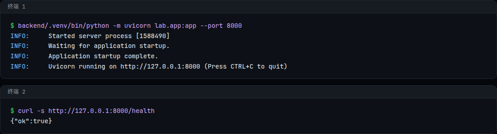

# 第 3 页 · 让服务在 8000 端口回答问题

## 这一页构建什么

一个你自己的 HTTP 服务：跑在 `8000` 端口，只有一个接口 `GET /health`。用 `curl` 一问，它回 `{"ok":true}`。
这是整套系统第一次对外说话。

## 猜一猜

动手前把答案写在纸上（猜错很正常，后面要对着真实输出对账）：敲完启动命令，这个终端会**退回**给你继续敲字，还是**一直卡住**？再另开一个终端敲 `curl -s http://127.0.0.1:8000/health`，屏幕上会出现哪一行？

## 动手

没有 `backend/.venv` 的话先回第 0 页跑 `make install`。
所有命令都在**仓库根目录**敲（`ls` 能看到 `backend`、`fixtures` 的那一层）。
Python 用仓库里现成的 `backend/.venv/bin/python`，它已经装好 fastapi 和 uvicorn，**不要再用 pip 装新东西**。

1. 在仓库根目录新建文件夹 `lab`，在 `lab` 里新建文件 `app.py`，把下面整段**粘贴**进去（口语常说“粘进去”）、保存：

```python
# lab/app.py —— 你的第一个 HTTP 服务
from fastapi import FastAPI

app = FastAPI()


@app.get("/health")
def health():
    return {"ok": True}
```

2. 在终端 1 敲：

```bash
backend/.venv/bin/python -m uvicorn lab.app:app --port 8000
```

3. 终端 1 别关。另开一个终端（终端 2；在 VS Code 里点终端面板右上角的 `+`），敲：

```bash
curl -s http://127.0.0.1:8000/health
```

## 你应该看到

终端 1：

```
INFO:     Started server process [55698]
INFO:     Waiting for application startup.
INFO:     Application startup complete.
INFO:     Uvicorn running on http://127.0.0.1:8000 (Press CTRL+C to quit)
```

终端 2：

```
{"ok":true}
```

`Waiting for application startup.` 这行在有些版本里出现、有些版本里不出现，出现也不影响结果；方括号里的 `55698` 是进程号，每次都不一样。只需确认最后一行以 `Uvicorn running on http://127.0.0.1:8000` 开头，并且终端 2 出 `{"ok":true}`。收工就在终端 1 按 Ctrl+C。




## 对账

- 你猜终端会退回吗？不会。到 `Uvicorn running on ...` 这行就不动了——它在**值班**等请求，直到你按 Ctrl+C。这就是“服务”和“跑完就退的脚本”的区别。
- 你猜 curl 会看到什么？`{"ok":true}` 是服务端返回的 **JSON**，不是网页。`ok` 这个字段名、`/health` 这个路径都是你在代码里自己起的，没有标准答案；只要代码里的路径和 curl 里的路径一致，它就能通。
- 如果 curl 报 `Connection refused`：服务没起来（= 没**启动**，口语常说“起服务”），或者你敲的端口不是 `8000`。如果启动命令报 `No module named lab.app`：你没站在仓库根目录，或者文件建成了 `lab/app.py.py`。

## 自己改一下

把 `@app.get("/health")` 改成 `@app.get("/healthz")`，Ctrl+C 重启服务，再 `curl -s http://127.0.0.1:8000/healthz`。
旧的 `/health` 现在通吗？（会回一行 `{"detail":"Not Found"}`）
