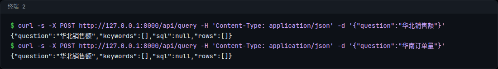

# 第 4 页 · 加一个能收问题的接口

> 前置：第 0 页备好环境；本页接第 3 页留下的 lab/app.py 与 8000 端口的服务。

## 这一页造什么

在同一个服务里加 `POST /api/query`：你发过去一个 JSON `{"question": "..."}`，它回给你一个 JSON。
注意：这一页它**不查库、不拼 SQL**，回的内容是写死的。先把“收发 JSON”这条路修通。

## 猜一猜

动手前写下答案：把 `-d` 里的问题写成 `{"question": "华南订单量"}` 发过去，
返回 JSON 里的 `"question"` 会是 `"华南订单量"`，还是 `"华北销售额"`？`"sql"`、`"rows"` 里又是什么？

## 动手

1. 把 `lab/app.py` **整个替换**成下面这段（第 3 页的代码全部删掉，不要留）：

```python
# lab/app.py —— 加一个能“收问题”的接口
from fastapi import FastAPI
from pydantic import BaseModel

app = FastAPI()


class Query(BaseModel):
    question: str


@app.get("/health")
def health():
    return {"ok": True}


@app.post("/api/query")
def query(q: Query):
    return {
        "question": "华北销售额",
        "keywords": [],
        "sql": None,
        "rows": [],
    }
```

2. 回终端 1 按 Ctrl+C 停掉旧服务，再用第 3 页那条命令原样重启：

```bash
backend/.venv/bin/python -m uvicorn lab.app:app --port 8000
```

3. 在终端 2 连着发两个请求，第二个故意换个问题：

```bash
curl -s -X POST http://127.0.0.1:8000/api/query -H 'Content-Type: application/json' -d '{"question":"华北销售额"}'
curl -s -X POST http://127.0.0.1:8000/api/query -H 'Content-Type: application/json' -d '{"question":"华南订单量"}'
```

## 你应该看到

```
{"question":"华北销售额","keywords":[],"sql":null,"rows":[]}
{"question":"华北销售额","keywords":[],"sql":null,"rows":[]}
```

两次输出**一字不差**。




## 对账

- 你猜 `question` 会跟着输入变吗？不会。代码里把它写死成了 `"华北销售额"`，你发什么进去都不影响返回值。
- `keywords`、`sql`、`rows` 也是空壳：`[]` 是空列表，`null` 是 Python 的 `None` 写进 JSON 的样子（不是字符串 `"null"`）。
- 这一页能验收的只有一件事：接口通了、JSON 能收能发。你发的问题确实进了 `q.question`，只是这一页没有用它。
- 记住这四个字段：`question` 是问题、`keywords` 是关键词、`sql` 要执行的 SQL、`rows` 查出来的行。第 5 页填 `keywords`，第 7 页填 `sql` 和 `rows`。

## 自己改一下

把返回里的 `"sql": None` 改成 `"sql": "SELECT 1"`，重启服务，再发第一条 curl，看 `"sql"` 从 `null` 变成了什么。
