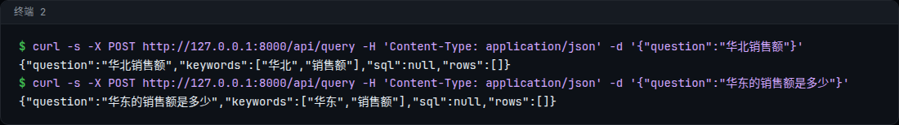

# 第 5 页 · 从一句话里抽出关键词

> 前置：第 0 页备好环境；本页接第 4 页留下的 lab/app.py 与 8000 端口的服务。

## 这一页造什么

一个纯函数 `extract_keywords(question)`：把问题当普通字符串，在你自己写的两张词表（地区、指标）里查“问题里出现了哪个词”，抽成一个列表。
不调 AI、不分析语法，只做“包含判断”。抽出的 `["华北","销售额"]` 就是第 6 页拼 SQL 的原料。

## 猜一猜

动手前写下答案：把问题换成 `{"question": "华东的销售额是多少"}`，`keywords` 里会有几个词？分别是哪几个？
`"的"`、`"多少"` 会出现在列表里吗？

## 动手

1. 把 `lab/app.py` **整个替换**成下面这段：

```python
# lab/app.py —— 从问题里抽关键词（纯字符串规则，不用 AI）
from fastapi import FastAPI
from pydantic import BaseModel

app = FastAPI()

REGIONS = ["华北", "华东", "华南", "西南", "华中"]
METRICS = ["销售额", "订单量"]


class Query(BaseModel):
    question: str


def extract_keywords(question: str) -> list[str]:
    keywords = []
    for word in REGIONS + METRICS:
        if word in question:
            keywords.append(word)
    return keywords


@app.get("/health")
def health():
    return {"ok": True}


@app.post("/api/query")
def query(q: Query):
    keywords = extract_keywords(q.question)
    return {
        "question": q.question,
        "keywords": keywords,
        "sql": None,
        "rows": [],
    }
```

2. 回终端 1 按 Ctrl+C 停掉，再用第 3 页那条命令原样重启：

```bash
backend/.venv/bin/python -m uvicorn lab.app:app --port 8000
```

3. 在终端 2 发两个请求：一个短的，一个更长的（带一些跟查询无关的字）：

```bash
curl -s -X POST http://127.0.0.1:8000/api/query -H 'Content-Type: application/json' -d '{"question":"华北销售额"}'
curl -s -X POST http://127.0.0.1:8000/api/query -H 'Content-Type: application/json' -d '{"question":"华东的销售额是多少"}'
```

## 你应该看到

```
{"question":"华北销售额","keywords":["华北","销售额"],"sql":null,"rows":[]}
{"question":"华东的销售额是多少","keywords":["华东","销售额"],"sql":null,"rows":[]}
```




## 对账

- 你猜对了吗？两个词：`华东`、`销售额`。`的`、`多少` 没进去——它们不在词表里，`if word in question` 对它们不成立。
- `in` 是**子串包含**：只要那句话里出现了“销售额”这三个字就算命中，前后多几个字不影响结果。所以“华东的销售额是多少”和“华北销售额”抽出来的指标是同一个。
- 再看顺序：代码按 `REGIONS + METRICS` 的顺序扫，地区永远排在指标前面，跟你问题里谁先出现无关。
- 规则很笨，但可预测：同一个问题永远抽同一组词，你能对着输出逐字核对。这一页不用 AI，就是为了让“抽词”这一步能被你验算。

## 自己改一下

把问题换成 `{"question": "昨天天气怎么样"}` 发一次，看 `keywords` 是不是 `[]`。
再把 `METRICS` 里两个词对调位置，重启，发 `{"question": "华北销售额和订单量"}`——列表里两个指标的顺序变了吗？
