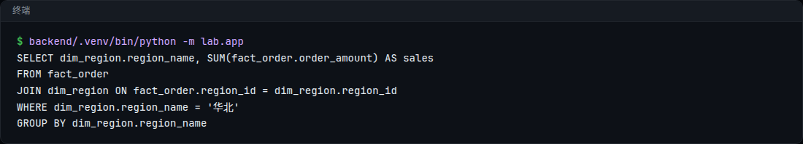

# 第 6 页 · 照契约生成那条带 JOIN 的 SQL

> 前置：第 0 页备好环境；本页接第 5 页留下的 lab/app.py 与 8000 端口的服务。

## 这一页构建什么

两样东西：一张**契约字典** `CONTRACT`（把第 1、2 页 MySQL 里的表、列、指标口径写成 Python 字典），和函数 `build_sql(keywords)`——它照着契约，把第 5 页抽出的 `["华北","销售额"]` 拼成一条带 `JOIN` 的 `SELECT`。
这一页**只 print，不执行**。

## 猜一猜

动手前写下答案：拼出来的 SQL 会 `JOIN` 哪两张表？`WHERE` 用的是 `dim_region` 的哪一列？`WHERE` 那行等号的右边会是什么？

## 动手

要改的文件是 `lab/app.py`。在 `extract_keywords` 函数下面、`@app.get("/health")` 上面，插入这 24 行：

```python
CONTRACT = {
    "tables": {
        "fact_order": ["region_id", "order_amount", "order_id"],
        "dim_region": ["region_id", "region_name"],
    },
    "metrics": {"销售额": "SUM(fact_order.order_amount)",
                "订单量": "COUNT(DISTINCT fact_order.order_id)"},
    "region_values": ["华北", "华东", "华南", "西南", "华中"],
}


def build_sql(keywords: list[str]) -> str:
    region = next(k for k in keywords if k in CONTRACT["region_values"])
    metric = next(k for k in keywords if k in CONTRACT["metrics"])
    sql = f"""SELECT dim_region.region_name, {CONTRACT['metrics'][metric]} AS sales
FROM fact_order
JOIN dim_region ON fact_order.region_id = dim_region.region_id
WHERE dim_region.region_name = '{region}'
GROUP BY dim_region.region_name"""
    return sql


if __name__ == "__main__":
    print(build_sql(extract_keywords("华北销售额")))
```

然后在仓库根目录跑（**不用起服务**，终端 1 那个服务开着也不影响）：

```bash
backend/.venv/bin/python -m lab.app
```

`CONTRACT` 是 `contracts/schema.contract.yaml` 的浓缩版，你可以打开原文件对照：`fact_order.region_id` 指向 `dim_region.region_id`（外键），`销售额` 的口径是 `SUM(fact_order.order_amount)`，`华北` 是 `dim_region.region_name` 的一个取值。

## 你应该看到

```
SELECT dim_region.region_name, SUM(fact_order.order_amount) AS sales
FROM fact_order
JOIN dim_region ON fact_order.region_id = dim_region.region_id
WHERE dim_region.region_name = '华北'
GROUP BY dim_region.region_name
```




## 对账

- 为什么 JOIN 这两张表？金额 `order_amount` 在 `fact_order`，地区名 `region_name` 在 `dim_region`，而“华北”这个值只存在后者。要把“华北的金额”加出来，必须靠 `region_id` 把两张表连起来，否则 `WHERE dim_region.region_name = '华北'` 无从下手。
- `WHERE` 用 `dim_region.region_name`，不是 `province`：`province` 里存的是“北京市”，而“华北”是大区名，在 `region_name` 列。用错列，查出来会是空的。等号右边 `'华北'` 就是 `build_sql` 里 `region` 变量的值，来自第 5 页抽出的关键词。
- SQL 是**照契约拼**的，不是让 AI 直接写的：表名、列名、指标公式都能在 `CONTRACT` 里逐字对上，错了你能查出来。`print` 出来说明拼接成功；这条 SQL 到第 7 页才交给数据库执行。
- 服务没起也正常：`print` 在 `if __name__ == "__main__":` 里，只有命令行直接运行这个文件时才执行；uvicorn 导入 `lab.app` 时不会执行它。

## 自己改一下

把最后一行里的 `"华北销售额"` 换成 `"华东销售额"`，再跑一次，看 5 行里哪一行变了。
再换成 `"华南订单量"`：`SELECT` 那行里的 `SUM(fact_order.order_amount)` 变成了什么？
