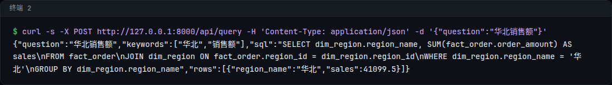

# 第 7 页 · 把 SQL 真交给 MySQL

> 前置：第 0 页备好环境；本页接第 6 页留下的 lab/app.py 与 8000 端口的服务。

## 这一页构建什么

把第 6 页 `print` 出来的那条 5 行 SELECT 交给 `pymysql` 真执行，结果填进 `/api/query` 响应里一直空着的 `"sql"` 和 `"rows"`。
这一页结束时，你 `curl` 一次，输出里出现 `41099.5`：华北销售额第一次是从数据库里算出来的，不是你写死的。

## 猜一猜

动手前写下答案：
`/api/query` 回来的 JSON 里，`rows` 里的 `sales` 是数字 `41099.5`，还是带引号的字符串 `"41099.5"`？
再想一步：如果 `lab-mysql` 容器没起，`curl` 会照样回 `41099.5`，还是回一句报错？

## 动手

要改的文件还是 `lab/app.py`，三处。改完先按 **Ctrl+S 保存**，再回终端 1 重启；不保存就重启，服务跑的还是第 6 页的旧代码（症状见「对账」）。`pymysql` 已经在 `backend/.venv` 里（第 0 页 `make install` 装好的），不用再 `pip install`。

1. 在文件开头的 import 区加一行，放在 `from fastapi import FastAPI` 上面：

```python
import pymysql
```

2. 在 `build_sql` 和 `@app.get("/health")` 之间，插入执行函数 `run_sql`：

```python
def run_sql(sql: str) -> list[dict]:
    conn = pymysql.connect(host="127.0.0.1", port=3307, user="root",
                           password="labpass", database="dw",
                           cursorclass=pymysql.cursors.DictCursor)
    try:
        with conn.cursor() as cur:
            cur.execute(sql)
            return list(cur.fetchall())
    finally:
        conn.close()
```

`127.0.0.1:3307` 里的 3307 和第 2 条代码里的 `port=3307` 都是**占位**：填你第 1 页 `-p 127.0.0.1:3307:3306` 里冒号左边那个宿主机端口（默认 3307；若第 1 页换过，比如换成 3308，这两处一起跟着改，照抄会连到别人的库）。`root` 和 `labpass` 就是第 1 页 `MYSQL_ROOT_PASSWORD=labpass` 那个账号和它的密码。`DictCursor` 让每一行变成 `{"列名": 值}` 的字典，正好塞进第 4 页定下的 `rows` 列表。

3. 把整个 `query()` 函数（**连 `@app.post("/api/query")` 和 `def query(q: Query):` 两行一起**）替换成下面这段（第 6 页它只回 `"sql": None`、`"rows": []`）：

```python
@app.post("/api/query")
def query(q: Query):
    keywords = extract_keywords(q.question)
    sql = build_sql(keywords)
    return {"question": q.question, "keywords": keywords,
            "sql": sql, "rows": run_sql(sql)}
```

回终端 1，按 Ctrl+C 停掉，再用**你第 3 页实际用的那条启动命令**重启（端口按你实际改过的；默认 `--port 8000`，下面 `curl` 里的 8000 也换成你的端口）：

```bash
backend/.venv/bin/python -m uvicorn lab.app:app --port 8000
```

然后在终端 2 发一次请求：

```bash
curl -s -X POST http://127.0.0.1:8000/api/query -H 'Content-Type: application/json' -d '{"question":"华北销售额"}'
```

## 你应该看到

```
{"question":"华北销售额","keywords":["华北","销售额"],"sql":"SELECT dim_region.region_name, SUM(fact_order.order_amount) AS sales\nFROM fact_order\nJOIN dim_region ON fact_order.region_id = dim_region.region_id\nWHERE dim_region.region_name = '华北'\nGROUP BY dim_region.region_name","rows":[{"region_name":"华北","sales":41099.5}]}
```

这一行很长：`sql` 里那 5 行真换行被 JSON 表示成了 `\n`。你只核对最后一段 `rows`：`region_name` 是 `华北`，`sales` 是 `41099.5`。另外它没有结尾换行：`curl -s` 不补换行，终端提示符可能紧贴在最后的 `}` 后面，内容对就行。




## 对账

- 你猜数字还是字符串？`41099.5` 两边没有引号，是 JSON 数字；`rows` 是列表，里面一条字典 `{"region_name": "华北", "sales": 41099.5}`。第 4 页空着的 `"rows": []` 现在被真实数据填上了。
- 这个数不是写死的：41099.5 是库里 19 条华北订单的 `order_amount` 相加。第 2 页你用 `LIMIT 3` 看到的那 3 条（899、599、75）只是其中前 3 条，剩下 16 条也在这个和里。
- 你猜 MySQL 没起会怎样？`curl` 只回一句 `Internal Server Error`，终端 1 的日志里是 `"POST /api/query HTTP/1.1" 500 Internal Server Error`，**下面**才是 pymysql 的 traceback，而且比那行晚一两秒才落盘。HTTP 只把错误翻成状态码 500，具体原因在服务端日志里——以后看到 500，先看终端 1。**500 不止这一种原因**：关键词一个都没抽到时（第 5 页「自己改一下」里的“昨天天气”就是），`build_sql` 里的 `next()` 会抛 `StopIteration`，同样是 500；两种 500 的响应体一模一样（都是 `Internal Server Error`），要去终端 1 的 traceback 最后一行区分——`pymysql.err.OperationalError` 是连不上库，`RuntimeError: coroutine raised StopIteration` 是一个词都没抽到。
- 为什么改完要 `Ctrl+S` 再 `Ctrl+C` 重启：uvicorn 启动时把 `lab/app.py` 读进内存，不重启跑的还是旧代码；文件没保存就重启，读进内存的仍是旧文件——`curl` 回的是第 6 页的 `"sql":null,"rows":[]`，不是 `41099.5`。
- 为什么第 3 步要连装饰器和 `def` 一起换：只换函数体内那 4 行的话，`@app.post("/api/query")` 和 `def query` 还留在原处，粘进去的 `def` 就成了函数里再套一个函数——要么 `POST /api/query` 静默回 `null`，要么直接 `IndentationError: expected an indented block`、uvicorn 起不来。整个函数一起替换，才是一份完整的路径 + 函数定义 + 函数体。
- 为什么拼和执行分成两个函数：`build_sql` 只拼字符串、不碰数据库，`run_sql` 只执行、不拼；错了能分开查。第 6 页敢只 `print`，就是因为执行是这一页的事。

> **你现在拥有**：一条把 SQL 真交给 MySQL、再把结果填进 `rows` 的执行链路；它是整条问答链路里唯一碰数据库的地方，`41099.5` 从这里开始是真的。

## 自己改一下

把 `-d` 里的问题换成 `{"question":"华东销售额"}` 再发一次：`rows` 里的 `sales` 变成多少？SQL 里 `WHERE` 那一行跟着变了吗？（参考：`sales` 是 `107373.0`，`WHERE` 那行变成 `dim_region.region_name = '华东'`。）
再换成 `{"question":"华南订单量"}`：`SELECT` 那行里的 `SUM(...)` 变成了什么？`sales` 这个字段名没变，可它的值变成什么了？（参考：`SELECT` 行变成 `COUNT(DISTINCT fact_order.order_id) AS sales`；字段名还是 `sales`，值变成 `26`。）
