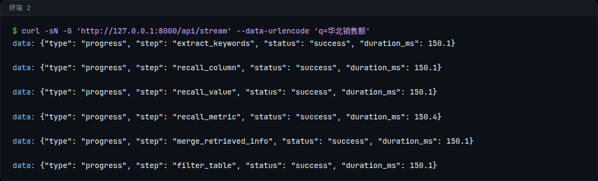
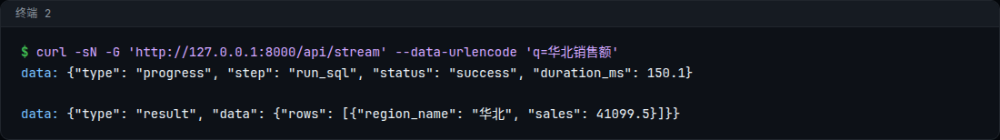
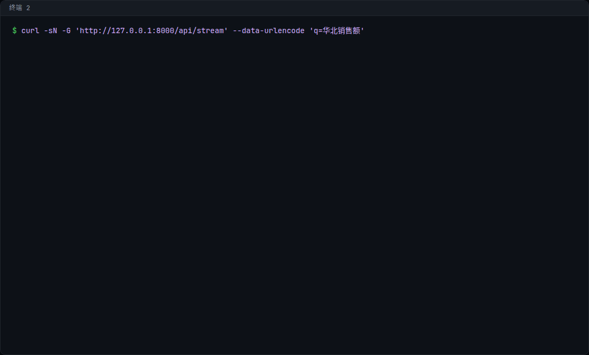

# 第 8 页 · 让答案一条条推送出来（SSE）

> 前置：第 0 页备好环境；本页接第 7 页留下的 lab/app.py 与 8000 端口的服务。

## 这一页构建什么

在同一个服务里再加一条流式通道 `GET /api/stream?q=...`：把一次查询拆成 12 条 `progress` 事件（每个步骤一条），最后再发 1 条 `result`，内容类型是 `text/event-stream`。
第 7 页的 `POST /api/query` 保留不动——一个“憋到最后一次给”，一个“干一步报一步”，你正好对照。
这 12 个步骤名不是现编的：`contracts/steps.yaml` 里就声明了这 12 个节点。

## 猜一猜

动手前写下答案：
用 `curl` 打这条流，12 条 `progress` 会**一起**冒出来，还是**隔一小段**冒一条（这里“冒”就是服务端**逐条推送**，SSE）？
从第一条到最后那条 `result`，整条流大概要几秒？最后 `result` 里的 `sales` 还是 `41099.5` 吗？

## 动手

还是改 `lab/app.py`，两处。改完先按 **Ctrl+S 保存**再重启；不保存就重启，`/api/stream` 还是第 7 页的旧代码（症状见「对账」）。

1. 在文件开头的 import 区加三行：

```python
import json
import time
from fastapi.responses import StreamingResponse
```

2. 把下面这段接在 `@app.post("/api/query")` 那个函数之后、`if __name__ == "__main__":` 那 2 行**之前**——`__main__` 块永远是文件最后一块：

```python
STEPS = ["extract_keywords", "recall_column", "recall_value", "recall_metric",
         "merge_retrieved_info", "filter_table", "filter_metric", "add_extra_context",
         "generate_sql", "validate_sql", "correct_sql", "run_sql"]


def sse(event: dict) -> str:
    return f"data: {json.dumps(event, ensure_ascii=False)}\n\n"


@app.get("/api/stream")
def stream(q: str):
    def gen():
        for step in STEPS:
            t0 = time.perf_counter()
            time.sleep(0.15)  # 假装在干活，让你肉眼看到一条条到
            yield sse({"type": "progress", "step": step, "status": "success",
                       "duration_ms": round((time.perf_counter() - t0) * 1000, 1)})
        rows = run_sql(build_sql(extract_keywords(q)))
        yield sse({"type": "result", "data": {"rows": rows}})

    return StreamingResponse(gen(), media_type="text/event-stream")
```

Ctrl+C 停服务，再用**你第 3 页实际用的那条启动命令**重启（端口按你实际改过的；下面 `curl` 里的 8000 同理）。然后打这条流：

```bash
curl -sN -G 'http://127.0.0.1:8000/api/stream' --data-urlencode 'q=华北销售额'
```

`-N` 是“别攒”：收到一条就画一条。`-G` 加 `--data-urlencode` 是让 curl 先把中文编码，再放进查询参数——别直接写 `?q=华北销售额`，curl 会把中文原样发出去，uvicorn 只回一句 `Invalid HTTP request received.`（你可以试一次，再改回来）。

## 你应该看到

```
data: {"type": "progress", "step": "extract_keywords", "status": "success", "duration_ms": 150.1}
data: {"type": "progress", "step": "recall_column", "status": "success", "duration_ms": 150.1}
…（同样形状共 12 条，最后一条是 run_sql；每条之间还有一个空行）
data: {"type": "result", "data": {"rows": [{"region_name": "华北", "sales": 41099.5}]}}
```






## 对账

- 你猜一起还是一条条？一条条，每条之间约 0.15 秒：`gen()` 每 `yield` 一条之前都 `time.sleep(0.15)`。12 条走完约 1.8 秒，最后才执行 SQL、发 `result`。实测整条流 1.8 秒左右。
- `duration_ms` 是量出来的，不是写死的：`t0 = time.perf_counter()` 记开始，发事件前再量一次、相减、取整到 0.1 毫秒，所以是 `150.1` 这种数。把 `time.sleep` 删掉，它会掉到 0 附近。
- `data: ` 前缀加末尾空行是 SSE 的格式：一个事件 = 一行 `data: ...` + 一个空行。浏览器（第 9 页）就靠空行切事件。`ensure_ascii=False` 让中文原样输出，不变成 `\u534e\u5317` 这种转义。
- `result` 里的 `rows` 和第 7 页 POST 返回的一模一样（`41099.5`）：流式只改“什么时候给你”，不改“给你什么”。
- 为什么不把 POST 改成流式：第 7 页那种“只要最终值”的调用还得留着当对照；浏览器那边 `EventSource` 只能发 GET，所以流式入口用 `GET` + 查询参数。两条入口共用同一个 `run_sql`。
- 404 = 没保存 / 上一页没生效：重启后 `GET /api/stream` 回 `{"detail":"Not Found"}`、`/health` 却正常，说明 `stream` 那段没进内存——多半是改完没 Ctrl+S 就重启，跑的仍是第 7 页代码。保存后再重启一次。
- 真实契约里 `result` 还带 `columns`（字段名和类型，画表格要用），见 `contracts/sse.schema.json`；这一页只发 `rows`，够第 9 页用。

> **你现在拥有**：一条把一次查询拆成 12 条 `progress` + 1 条 `result`、逐条推送的 SSE 流；它是第 9 页浏览器页面的数据源，只改“什么时候给你”，不改“给你什么”。

## 自己改一下

把 `time.sleep(0.15)` 改成 `0.5`，重启，再 `curl -sN` 打一次：整条流要几秒？步骤名是不是变成了慢动作？（参考：约 6 秒，实测 6.02s；还是 12 个步骤名，只是每步从 0.15 秒拉到 0.5 秒，慢动作更明显。）
在这条 curl 后面接 `| grep -c progress`，数出来是多少？（参考：`12`——`-c` 只报命中行数，`sleep` 改成多少都是 12，变的是整条流的总时长。）
