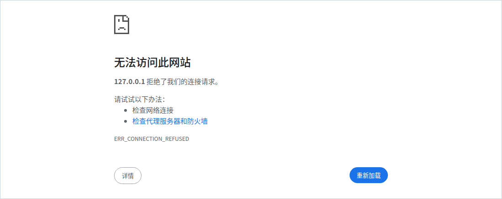

# 第 9 页 · 给浏览器一个入口：nginx 反代 + 一个页面

> 前置：第 0 页备好环境；本页接第 8 页留下的 lab/app.py 与 8000 端口的服务（启动时要加 `--host 0.0.0.0`）。

## 这一页造什么

三样：一个 8 行的 nginx 配置（把 `/api/` 转给 8000）、一个 17 行的页面（输入框 + 结果区，用浏览器自带的 `EventSource` 接第 8 页的流）、一条 `docker run` 把 nginx 跑起来。
页末浏览器打开 `http://127.0.0.1:8081`，点“问一句”，页面上最后停着 `41099.5`：浏览器 → nginx:8081 → uvicorn:8000 → MySQL:3307。
然后拆一刀：删掉 nginx 容器，浏览器打不开，`curl` 直连 8000 照样拿得到答案——入口可以拆，主干还在。

## 猜一猜

动手前写下答案：
浏览器页面里的那 12 条 progress，会像 `curl -N` 那样一条条刷过去，还是等全部算完、页面直接跳到最终结果？
然后删掉 nginx 容器：浏览器打 `8081` 会怎样？终端里直连 `8000` 的 `curl` 又会怎样？

## 动手

1. 先让“容器里的 nginx”够得着你的服务。终端 1 按 Ctrl+C 停掉，把启动命令加一个参数再起：

```bash
backend/.venv/bin/python -m uvicorn lab.app:app --host 0.0.0.0 --port 8000
```

第 3 页那条命令默认只监听 `127.0.0.1`（只有你本机的进程连得上）；nginx 跑在容器里，从 Docker 网卡进来，所以要改成 `0.0.0.0`（意思是所有网卡）。看到 `Uvicorn running on http://0.0.0.0:8000` 就对了。

2. 在仓库根目录新建两个文件。`lab/default.conf`：

```nginx
server {
    listen 80;
    location / { root /usr/share/nginx/html; }
    location /api/ {
        proxy_pass http://host.docker.internal:8000;
        proxy_buffering off;
    }
}
```

`lab/index.html`：

```html
<!doctype html>
<meta charset="utf-8">
<form onsubmit="ask(q.value); return false">
  <input id="q" name="q" value="华北销售额" size="30"> <button>问一句</button>
</form>
<pre id="out"></pre>
<script>
function ask(question) {
  out.textContent = '';
  const es = new EventSource('/api/stream?q=' + encodeURIComponent(question));
  es.onmessage = (e) => {
    const msg = JSON.parse(e.data);
    out.textContent = msg.type === 'result' ? msg.data.rows[0].sales : msg.step;
    if (msg.type === 'result') es.close();
  };
}
</script>
```

3. 新开一个终端，仍在仓库根目录，把 nginx 跑起来：

```bash
docker run -d --name lab-nginx -p 127.0.0.1:8081:80 --add-host host.docker.internal:host-gateway \
  -v "$PWD/lab/default.conf:/etc/nginx/conf.d/default.conf:ro" \
  -v "$PWD/lab/index.html:/usr/share/nginx/html/index.html:ro" \
  "$(grep '^NGINX_IMAGE=' .env.example | cut -d= -f2)"
```

逐项看：`-p 127.0.0.1:8081:80` 把宿主机的 8081 接到容器的 80，并且只开给本机（和第 1、3 页一致）；`--add-host host.docker.internal:host-gateway` 在容器里给宿主机起一个名字（**容器里的 `127.0.0.1` 是容器自己，不是你的电脑**）；两个 `-v` 把配置和页面挂进容器；最后一行不手写 `nginx:alpine`，而是像第 1 页那样从 `.env.example` 的 `NGINX_IMAGE` 读——仓库已经配了国内镜像源，直连 Docker Hub 在国内会断，第 9 页不该例外。命令回来打印一串容器 ID，就是起来了（和第 1 页起 MySQL 时一样）。

4. 打开浏览器，地址栏敲 `http://127.0.0.1:8081`，点“问一句”。刚打开时结果区是空的，点了才开始问。

## 你应该看到

```
41099.5
```

点下去以后，页面上的步骤名会先快速换过 12 次（`recall_column`、`generate_sql`……），1.8 秒左右停在这个数上。




## 对账

- 你猜一条条还是一次给？一条条：点完 0.6 秒左右，页面上正停着 `recall_value` 这样的步骤名；1.8 秒后变成 `41099.5`。浏览器收到的就是第 8 页 `curl -N` 收到的那串字节，nginx 只负责转发。
- `proxy_buffering off` 这一行是保险：nginx 默认会把后端响应先收着，攒一批再给你。真实系统的流要跑好几秒、内容也多得多，被攒起来就变成“等半天、然后一次性出现”，所以仓库里 `docker/nginx.conf` 的 `/api/` 也专门关了它。你这条流只有约 1.2 KB、1.8 秒，两种配置下可能都看不出差别——但配置要按“会出问题”的那天写。
- 拆一刀：把 nginx 删掉，再验一次主干。一条命令做完：

```bash
docker rm -f lab-nginx && curl -sN -G 'http://127.0.0.1:8000/api/stream' --data-urlencode 'q=华北销售额' | grep result
```

终端里先打印 `lab-nginx`（被删掉的容器名），再打出 `data: {"type": "result", "data": {"rows": [{"region_name": "华北", "sales": 41099.5}]}}`。
这时浏览器刷新 `http://127.0.0.1:8081`：`net::ERR_CONNECTION_REFUSED`，打不开。
结论：nginx 和页面只是**入口**。SQL 是你的 Python 拼的，数是 MySQL 算的，流是你的 Python 发的；删掉入口，主干还活着。后半本每拆一层，都先猜“哪一层会死、哪一层不会”，再用 `curl` 验证——这一刀就是模板。
- 页面不是魔法：`index.html` 里那 9 行 JS 只干三件事——把问题拼进 URL、`new EventSource` 收流、把 `rows[0].sales` 写进 `<pre>`。浏览器看到的，就是第 8 页 `curl` 看到的。
- 如果浏览器显示 `502 Bad Gateway`：nginx 活着但到不了后端。先确认第 1 步带了 `--host 0.0.0.0`，再确认 `docker run` 里带了 `--add-host`。
- 如果 `docker run` 报 `unknown flag` 或 `invalid IP address: host-gateway`：`--add-host host.docker.internal:host-gateway` 里的 `host-gateway` 需要 Docker ≥ 20.10；升级 Docker，或把宿主机名换成宿主机的 IP。

## 自己改一下

先把 nginx 起回来：把第 3 步那条 `docker run` 一个字不改重敲一遍，浏览器刷新，页面就回来了——同一份配置能重建同一层。
再在页面输入框里把问题换成 `华东销售额`，按回车：结果变成多少？（第 7 页你刚查过这个问题的 `sales`。）
