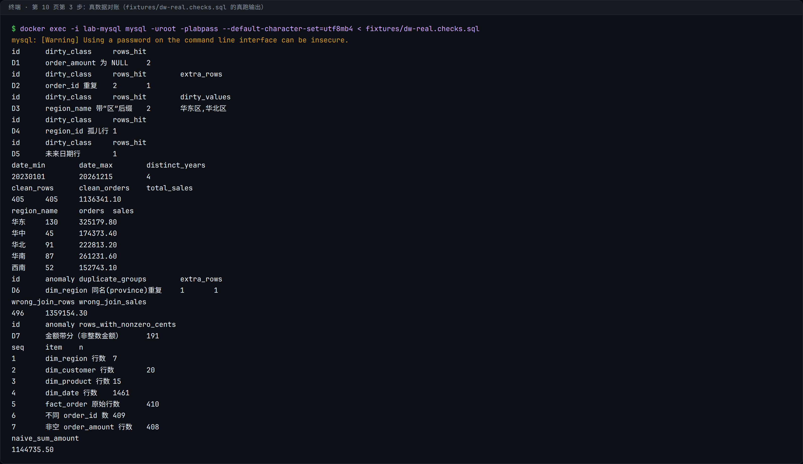
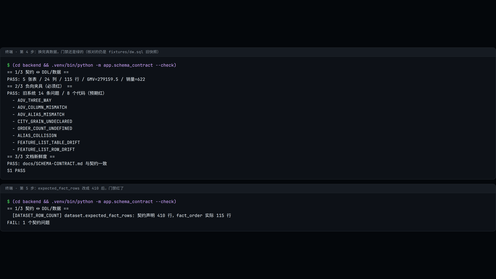

# 第 10 页 · 换真数据：把演示数据换成甲方数据

> 前置：第 0 页备好环境；本页接第 1、2 页的 `lab-mysql`（115 行演示数据），要改的 `contracts/schema.contract.yaml` 在仓库里现成就有。不用启动服务。

## 这一页构建什么

把 `lab-mysql` 里的 115 行演示数据整份换成甲方真数据（410 行），用 `fixtures/dw-real.checks.sql` 数出“不洗直接汇总”比正确口径多算 8,394.40，并撞见一件事：契约门禁（自动校验，过不了就不许发布）`--check` 根本不看库里这份数据。

## 猜一猜

动手前写下答案：

1. 换完数据，`schema_contract --check` 会拦住这个变化（变红）吗？
2. 它到底在核对哪份数据——MySQL 里的 `dw` 库？

## 动手

以下命令都在仓库根目录执行（有 `fixtures/`、`backend/` 的那一层）：命令逐段复制粘贴即可，但**第 5 步要手动打开 `contracts/schema.contract.yaml` 改一行并保存**，不能只靠粘贴走完。

**第 1 步：拍快照（口语常说“备份”；这里只备份文件）。**
```bash
scripts/lab save p10-before
```
**白名单**：`lab` 只跟踪白名单文件（`contracts/`、`compose.yaml`、`lab/`、`backend/app/`、`backend/tests/`、`fixtures/`、`frontend/src/`）——快照含 `lab/`（`lab/app.py`、`lab/db.py` 都能回滚）。

**但不含数据库**：库里那 115 行它记不住，第 2 步换完数据后要靠本页末的拆一刀 3 手动重灌回来。

**命名规则**：名字只能用字母、数字、点、下划线、短横线，且**必须以字母或数字开头**、最多 64 字符；快照只读，同名 save 会被拒绝——复跑本页要换个名字（如 `p10-before-2`）。

**第 2 步：换数据。** 命令和第 2 页灌 `dw.sql` 同款，只换文件（唯一多出的是那句可省略的 `--default-character-set=utf8mb4`）：
```bash
docker exec -i lab-mysql mysql -uroot -plabpass --default-character-set=utf8mb4 < fixtures/dw-real.sql
```
**第二数据集**：`dw-real.sql` 是和 `dw.sql` 同结构、同列名的第二数据集，里面自带 `CREATE DATABASE dw` 和每张表的 `DROP TABLE`，导入后 `dw` 的演示数据被整份替换。

**中文不靠这个 flag**：文件里有 `SET NAMES utf8mb4`，实测去掉 `--default-character-set=utf8mb4` 重灌，`华东区` 入库仍是正确的 UTF-8（HEX `E58D8EE4B89CE58CBA`）；flag 只是让客户端也统一用 UTF-8，可以省略。

**静默导入**：和灌 `dw.sql` 一样，除了密码 `Warning` 一行都不打印，数要从下一步查。

**第 3 步：对账真数据。** 这个文件把 7 类脏数据计数、清洗后对账表、原始装数一次跑完：
```bash
docker exec -i lab-mysql mysql -uroot -plabpass --default-character-set=utf8mb4 < fixtures/dw-real.checks.sql
```

**第 4 步：跑门禁。**
```bash
(cd backend && .venv/bin/python -m app.schema_contract --check)
```
最外层的括号是**子 shell**：只在括号里切到 `backend/`，跑完你人还站在仓库根目录——所以后面的 `scripts/lab reset` 才找得到。

**第 5 步：把契约里的期望值改成真值，再跑一次。** 打开 `contracts/schema.contract.yaml`，顶部 `dataset:` 段的 `expected_fact_rows: 115` 改成 `410`（410 是第 3 步数出来的真行数）；**先 Ctrl+S 保存**，再重跑第 4 步。

**只改 `expected_fact_rows` 这一行，别顺手全改**：同段的 `date_range`、`total_amount`（还有 `total_quantity`）对的是 `fixtures/dw.sql` 那份旧快照，顺手改成“真值”只会多红——实测行数/日期域/总额 3 个字段一起改得到 `FAIL: 3`，不是本步要的 `FAIL: 1`。

**没保存不红**：没保存的话重跑还是绿——红不出来先回去看文件存没存。

## 你应该看到

第 4 步——换完真数据，门禁**还是绿的**，报的数还是演示集那套（节选）：

```text
== 1/3 契约 ↔ DDL/数据 ==
PASS: 5 张表 / 24 列 / 115 行 / GMV=279159.5 / 销量=622
S1 PASS
```

第 5 步——只改契约、没换门禁的数据源，门禁**红了**：

```text
== 1/3 契约 ↔ DDL/数据 ==
  [DATASET_ROW_COUNT] dataset.expected_fact_rows: 契约声明 410 行，fact_order 实际 115 行
FAIL: 1 个契约问题
```

第 3 步的对账关键行（只摘关键行，中间省略的段落见文件本身；列间是 Tab。**每段 SELECT 前先打一行表头**：下面这行 `id dirty_class rows_hit` 就是 D1 的表头，`clean_rows clean_orders total_sales`、`naive_sum_amount` 两行同样是表头，不是数据行）：

```text
id	dirty_class	rows_hit
D1	order_amount 为 NULL	2
D2	order_id 重复	2	1
D3	region_name 带“区”后缀	2	华东区,华北区
D4	region_id 孤儿行	1
D5	未来日期行	1
clean_rows	clean_orders	total_sales
405	405	1136341.10
D6	dim_region 同名(province)重复	1	1
D7	金额带分（非整数金额）	191
5	fact_order 原始行数	410
naive_sum_amount
1144735.50
```




## 对账

- 两个预测都错：**换数据后门禁没红，它也不看 MySQL**。`backend/app/schema_contract.py` 里 `DDL_PATH = REBUILD_ROOT / "fixtures" / "dw.sql"`，`load_ddl()` 把这份仓库文件读进**内存 SQLite** 再核对；文件头也写着“不需要 MySQL / Docker”。
  **第 4 步那一刻**有三份数据在说话：运行库（`dw`，410 行真数据）、门禁快照（`fixtures/dw.sql`，115 行演示数据）、契约期望值（`expected_fact_rows: 115`）。
  门禁只读后两份，所以绿。第 5 步把契约期望值改成 410 只是**探针**：它立刻红（`FAIL: 1`），正好证明门禁不读运行库。
  只换运行库这一份，另外两份还在讲旧故事——**门禁绿，不代表数据真**。
- 真数据差在哪：不洗不筛直接 `SUM(order_amount)`（naive）= `1144735.50`，清洗后 = `1136341.10`，差 **8,394.40**。
  这笔差只由三行脏数据组成，三笔金额在 `fixtures/dw-real.expected.json` 里各带一句可重跑的 SQL：D2 重复订单被同额算两次：+5197.40；D4 孤儿行（`region_id=R099`）连不到地区表：+1798.00；D5 未来单 2026-12-15（对账基准 2026-11-19）：+1399.00。
  5197.40 + 1798.00 + 1399.00 = 8394.40。
- D1（2 行金额为 NULL）不改这个差额：`SUM` 本来就跳过 NULL。但它和其余几类一起决定行数：`410 − 1`（重复多出的 1 行）`− 2`（NULL）`− 1`（未来）`− 1`（孤儿）`= 405`，与第 3 步的 `clean_rows` 对上。
- D3 和 D6 不改 naive 总额，改的是“按地区出数”的口径：`region_name` 里混着 `华东区`/`华北区`，按契约枚举过滤会漏掉这两个区的单；`dim_region` 里北京市有两行，按 `province` 连接会被放大成 `496 行 / 1359154.30`（第 3 步的 `wrong_join` 两行）。
  D7 的 191 行带分金额要求按 `DECIMAL(16,2)` 聚合。**7 类脏数据全在，真数据必须洗过才敢报数。**
- 契约要不要跟着改？要，但只改契约不够：门禁读的 `fixtures/dw.sql` 也得换成真数据，而真数据原始导出件直接冒充 `fixtures/dw.sql` 装不进内存 SQLite——卡在 SQLite 不支持的 `ALTER TABLE fact_order DROP PRIMARY KEY`（`sqlite3.OperationalError: near "PRIMARY": syntax error`，裸 traceback，不是契约报错）；重复 `order_id` 在它后面才 INSERT，根本执行不到。
  **运行库、门禁快照、契约期望值三处必须一起换**；本页正式换的只有运行库，契约只临时改行数当探针（拆一刀 2 会还原），其余两处的统一留到 L3 的“单一数据源”任务。

> **你现在拥有**：一份带 7 类脏数据的真数据集、一条把 8,394.40 差在哪说清楚的对账链，和一条结论——门禁只护它读的那份快照，换数据要换三处。

## 拆一刀

1. 契约现在停在 `expected_fact_rows: 410`，门禁红着。再拆一刀：把 `metrics:` 里 `name: GMV` 那条的 `expected_value: 279159.5` 改成 `1`，保存，重跑 `--check`，红会多一条——契约写错，门禁拦得住（只摘新冒出来的那条）：

```text
  [METRIC_VALUE_MISMATCH] metric.GMV: 公式实际值 279159.5 ≠ 契约期望 1
FAIL: 2 个契约问题
```

2. 还原：`scripts/lab reset p10-before --yes`，末行是 `现在工作区与快照 "p10-before" 完全一致。`；再跑 `--check` 回到 `S1 PASS`。这个绿是**假绿**：门禁又对着 115 行的旧快照说“没问题”。

3. **数据库不跟着还原**：`lab` 只管文件。先数一次 `docker exec lab-mysql mysql -uroot -plabpass -N -B dw -e "SELECT COUNT(*) FROM fact_order;"`——还是 `410`。
   **本页的收尾动作**：① 拆一刀 2 的 `reset` 把契约和文件还原（不做的话下一关第 11 页验收的 `--check` 会红）——必做；② **要回 L1 演示态才需重灌 `fixtures/dw.sql` 回到 115 行**——第 12 页第 1 步会自己重灌 `dw-real`，不重灌也能直接进下一页。
   只是真数据下 `WHERE region_name='华北'` 是 35 行 / 61890.00，不是演示集的 19 行 / 41099.5，留着演示态才对得上。重灌命令：
```bash
docker exec -i lab-mysql mysql -uroot -plabpass < fixtures/dw.sql
```
