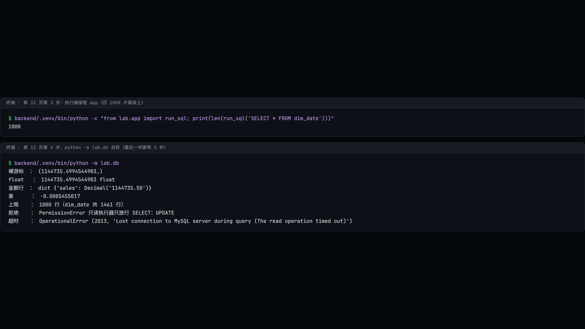

# 第 12 页 · 换真执行器：给临时通道装上四道闸

> 前置：第 0 页备好环境；本页接第 11 页的 `lab/app.py` 和第 10 页的 `fixtures/dw-real.sql`。不用启动服务。

## 这一页构建什么

把第 7 页那条裸 `pymysql` 临时通道换成一个执行器 `lab/db.py`：行是 dict、Decimal 原样交出来、没写 LIMIT 自动补 1000、5 秒不回就断、非 SELECT 拒绝；换上它，`dw-real` 的 410 行带分金额在十进制下 `SUM` 得 `1144735.50`（这仍是第 10 页的 naive 口径，本页只证明 FLOAT→DECIMAL 的类型问题，不代表数据已洗），不再是 `1144735.4994544983`。

## 猜一猜

1. 裸 `SELECT SUM(order_amount) FROM fact_order`（第 10 页的 naive 口径）和十进制值 `1144735.50` 差多少——0、0.0005、还是 5 元？
2. `dim_date` 一共 1461 行。执行器自动补 `LIMIT 1000` 后，`SELECT * FROM dim_date` 回几行——1000 还是 1461？

## 动手

**第 1 步：把真数据灌回库**（命令都在仓库根目录执行：有 `fixtures/`、`backend/` 的那一层）。第 10 页收尾时你重灌回了演示集（115 行），带分金额的 `dw-real` 才看得出漂移，用第 10 页同一条命令：`docker exec -i lab-mysql mysql -uroot -plabpass --default-character-set=utf8mb4 < fixtures/dw-real.sql`

**第 2 步：新建 `lab/db.py`，把下面整段粘进去，Ctrl+S 保存：**

```python
# lab/db.py —— 最小只读执行器：一条 SQL 只过四道闸
import re
from pathlib import Path

import pymysql
import yaml

ROOT = Path(__file__).resolve().parents[1]
POLICY = yaml.safe_load((ROOT / "contracts" / "sql.policy.yaml").read_text(encoding="utf-8"))
LIMIT = POLICY["limits"]["default_limit"]      # 闸 2：上限 1000，从契约读
CONNECT_TIMEOUT_S = POLICY["timeout"]["connect_timeout_s"]        # 闸 3：建连 5s，从契约读
READ_TIMEOUT_S = POLICY["timeout"]["max_execution_time_ms"] / 1000  # 闸 3：读 5s（5000ms），从契约读


def query(sql: str) -> list[dict]:
    if not sql.lstrip().upper().startswith("SELECT"):          # 闸 4：只读
        raise PermissionError(f"只读执行器只放行 SELECT：{sql.split()[0]}")
    if not re.search(r"\bLIMIT\b", sql, re.I):                 # 闸 2：自动补 LIMIT
        sql = sql.rstrip().rstrip(";") + f" LIMIT {LIMIT}"
    conn = pymysql.connect(host="127.0.0.1", port=3307, user="root",
                           password="labpass", database="dw",
                           cursorclass=pymysql.cursors.DictCursor,   # 闸 1：dict 行
                           connect_timeout=CONNECT_TIMEOUT_S, read_timeout=READ_TIMEOUT_S)
    try:
        with conn.cursor() as cur:
            cur.execute(sql)
            return list(cur.fetchall())        # 闸 1：Decimal 原样返回，不转 float
    finally:
        conn.close()


if __name__ == "__main__":
    from decimal import Decimal
    raw = pymysql.connect(host="127.0.0.1", port=3307, user="root",
                          password="labpass", database="dw").cursor()
    raw.execute("SELECT SUM(order_amount) FROM fact_order")
    print("裸游标  ：", raw.fetchone())
    bad = query("SELECT SUM(order_amount) AS sales FROM fact_order")[0]["sales"]
    row = query("SELECT CAST(SUM(CAST(order_amount AS DECIMAL(16,2))) AS DECIMAL(16,2)) AS sales FROM fact_order")[0]
    print("float   ：", repr(bad), type(bad).__name__)
    print("金额行  ：", type(row).__name__, row)
    print("差      ：", Decimal(str(bad)) - row["sales"])
    print("上限    ：", len(query("SELECT * FROM dim_date")), "行（dim_date 共 1461 行）")
    for tag, sql in (("拒绝    ：", "UPDATE fact_order SET order_amount = 0"),
                     ("超时    ：", "SELECT SLEEP(10)")):
        try:
            query(sql)
        except Exception as e:
            print(tag, type(e).__name__, e)
```

**第 3 步：让它接管 app。** 打开 `lab/app.py`：import 区加一行 `from lab import db`；再把第 7 页的 `run_sql`（`def run_sql` 到 `conn.close()` 共 10 行）换成下面两行，改完 Ctrl+S 保存（不保存，下一条验证会当场露馅）。换完立刻从仓库根跑验证，确认 `app.py` 真的用上了执行器：

```python
def run_sql(sql: str) -> list[dict]:
    return db.query(sql)
```

```bash
backend/.venv/bin/python -c "from lab.app import run_sql; print(len(run_sql('SELECT * FROM dim_date')))"
# 回 1000 才算接上：dim_date 共 1461 行，执行器补 LIMIT 1000；旧 run_sql 会回 1461，报 ModuleNotFoundError 说明不在仓库根
```

**第 4 步：跑自检。** 文件末尾的 `if __name__` 把四道闸和你猜的两个数一次打出来（这条整体要等 5 秒多，最后一项是超时，别以为卡住）：

```bash
backend/.venv/bin/python -m lab.db
```

## 你应该看到

```text
裸游标  ： (1144735.4994544983,)
float   ： 1144735.4994544983 float
金额行  ： dict {'sales': Decimal('1144735.50')}
差      ： -0.0005455017
上限    ： 1000 行（dim_date 共 1461 行）
拒绝    ： PermissionError 只读执行器只放行 SELECT：UPDATE
超时    ： OperationalError (2013, 'Lost connection to MySQL server during query (The read operation timed out)')
```



## 对账

- 猜 1：差 **-0.0005455017**，不到一分钱，所以看着像对的。证据在类型和位数：float 印成 `1144735.4994544983`（10 位小数），真实金额只该有 2 位；`DECIMAL` 才是 `1144735.50`。金额要 DECIMAL 两位，SQL 里就得先逐值 `CAST(order_amount AS DECIMAL(16,2))` 再 `SUM`（自检里那条就是）；执行器只负责把它原样交出来。`order_amount` 的物理类型是 `FLOAT`（第 2 页建表就写 FLOAT），二进制浮点存不下 0.01 的整数倍，MySQL 拿 DOUBLE 累加 408 个近似值，末尾就长出 `0.000545...` 的尾巴（尾数随 MySQL 版本可能略有不同，但一定不等于 `1144735.50`，类型也一定是 float）。
- 猜 2：回 **1000** 行。执行器发现 SQL 里没有 `LIMIT`，就在末尾补 `LIMIT 1000`。`fact_order` 只有 410 行，上限在它身上看不出效果，要拿 1461 行的 `dim_date` 验证。
- 返回结构：第 7 页那段 `run_sql` 自己在 `connect()` 里手写 `cursorclass=DictCursor`；默认游标其实回 tuple（自检第一行 `(1144735.4994544983,)`）。执行器把这个参数收进自己的 `connect()`，`rows[0]["sales"]` 从「调用方记得」变成「通道保证」；`/api/query` 和 `/api/stream` 两处调用一行都不用改。
- 四道闸各防什么：**只读**防一条 SQL 把库写坏；**LIMIT** 防全表扫把几十万行拖进内存；**超时**防慢查询把连接占死（自检最后一行要等 5 秒：`SLEEP(10)` 睡到第 5 秒被读超时掐掉；这个 5 秒预算也从契约读——建连读 `timeout.connect_timeout_s: 5`，读超时用 `timeout.max_execution_time_ms: 5000` ÷ 1000 折算；契约里 `timeout.read_timeout_s: 10` 是工业版 socket 兜底，Lab 版不用）；**DECIMAL / dict** 防金额被浮点改掉、行被 tuple 吃掉。工业版 `ReadOnlyExecutor` 还多几样（一句带过）：连库前先用 AST 拒写语句 / 多语句 / UNION；连接只用一个在 `dw` 上只有 SELECT 权限的账号；错误只有一个出口（`code` + `message` + `reason_code`）。

> **你现在拥有**：一条有边界的执行通道——一条 SQL 能不能跑、最多回多少行、跑多久、值是什么类型，四个边界都写在 `lab/db.py` 这一处；第 7 页那条裸连接，从这里变成了系统里的执行层。

## 拆一刀

1. 先拍快照：`scripts/lab save p12-before`（名字只能用字母、数字、点、下划线、短横线，且必须以字母或数字开头；中文会被拒）。`scripts/lab` 的白名单现在含 `lab/`：`lab/db.py`、`lab/app.py` 也进快照，改代码同样能 reset 还原——所以第 2 步改契约不是为了「只能改契约」，而是为了证明**上限来自契约**（改 `lab/db.py` 里写死的 LIMIT 也能过自检，却测不出这个单源）。
2. 打开 `contracts/sql.policy.yaml`，把 `limits:` 下 `# 明细查询默认最多返回多少行` 那行的 `default_limit: 1000` 改成 `100000`。`lab/db.py` 里 `LIMIT = POLICY["limits"]["default_limit"]` 那一行就是从契约这里读上限——改契约这一行、执行器下次起进程就换上限，这才叫「上限来自契约」。**注意本页执行器只读 `default_limit`；`max_limit` 是工业版概念，这里没实现**：别改下面 `max_limit: 1000`，只改它自检还是回 1000 行；而且 `default_limit: 100000` 已经比 `max_limit: 1000` 还大，工业版会当配置错误（默认上限不能超截断上限），本页不读它所以照样跑。Ctrl+S，再跑一次 `backend/.venv/bin/python -m lab.db`（这条同样要等 5 秒多，别以为卡死）：上限这道闸拆掉，1461 行全跑出来，`上限    ： 1461 行（dim_date 共 1461 行）`；其它几行不变，说明只拆了这一道闸。
3. 还原：`scripts/lab reset p12-before --yes`，末行 `现在工作区与快照 "p12-before" 完全一致。`；再跑一次，`上限    ： 1000 行（dim_date 共 1461 行）` 回来。
