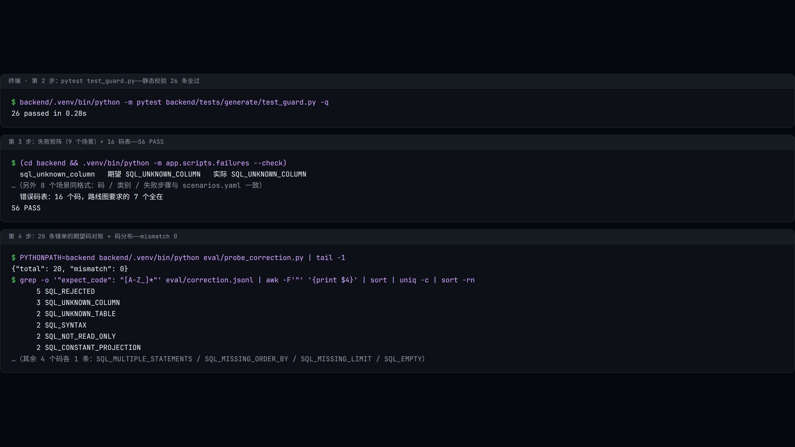

# 第 16 页 · 审校验：错单要在执行前被拦下

> 前置：本页一条服务都不用——`pytest`、失败矩阵、20 条语料全在离线跑，不需要 MySQL/ES/Qdrant、不需要 `.env`、也不需要模型 key。命令都在仓库根目录、同一个终端里整段连续执行。

## 这一页构建什么

校验是**执行前的门**，不是出错后的日志：用 20 条带 `expect_code` 的错单语料 + 16 个错误码 + 9 个场景（6 类失败 + 3 条对照：happy / slow / corrected），审“每条错单到底被哪个码、在哪一步拦下”；再拆掉一条校验规则，看语料从“拦”变“放”。


## 猜一猜

1. 20 条错单语料一共用了几种错误码——16 种（错误码表的总数）、10 种、还是 5 种？
2. 拆掉“列存在”这一条校验，20 条里会漏几条？那条错 SQL 会被真的执行到数据库上吗？

## 动手

**第 1 步：拍快照。** 拆一刀要改校验代码，先留退路（同名快照会被拒，重做本页就换个名字）；回显 `已保存快照 "p16-before"：169 个文件。`（数字因工作区而异）：

```bash
scripts/lab save p16-before
```

**第 2 步：先验规则本身。** 26 条测试 = 静态校验正例 + 每个违规码至少一条负例，秒级：

```bash
backend/.venv/bin/python -m pytest backend/tests/generate/test_guard.py -q
```

**第 3 步：跑失败矩阵 + 16 码表。** 9 个场景各演一遍结局（码/类别/失败步骤要与 `fixtures/failures/scenarios.yaml` 一致）；**不需要 MySQL / LLM**——只替换了模型与数据库，校验是真的；括号是子 shell，跑完你还在仓库根目录：

```bash
(cd backend && .venv/bin/python -m app.scripts.failures --check)
```

**第 4 步：验 20 条语料的期望码，并数一遍码的分布。** `eval/probe_correction.py` 把每条错 SQL 真过一遍校验栈，检查“期望码 = 实际码”；`PYTHONPATH=backend` 只给这条命令临时加找包路径，不改任何文件。第二条管道从 20 行 JSON 里抠出 `expect_code` 再计数：

```bash
PYTHONPATH=backend backend/.venv/bin/python eval/probe_correction.py | tail -1
grep -o '"expect_code": "[A-Z_]*"' eval/correction.jsonl | awk -F'"' '{print $4}' | sort | uniq -c | sort -rn
```

**注意：** `eval/probe_correction.py` 里写的旧用法（`cd backend && .venv/bin/python ../eval/probe_correction.py`）会报 `No module named 'app'`——按上面 `PYTHONPATH=backend ...` 这条跑就是对的，报错不是环境坏了。

## 你应该看到

三条判据的输出（依次是第 2 / 3 / 4 步；块里 `#` 开头的行是标注，不是程序输出）：

```text
# 第 2 步（秒数随机器变，看 passed/failed 就行）
26 passed in 0.41s
# 第 3 步（节选）
  sql_unknown_column   期望 SQL_UNKNOWN_COLUMN   实际 SQL_UNKNOWN_COLUMN
  错误码表：16 个码，路线图要求的 7 个全在
S6 PASS
# 第 4 步（分布实际 10 行，留前 6 行；其余 4 个码各 1 条：SQL_MULTIPLE_STATEMENTS / SQL_MISSING_ORDER_BY / SQL_MISSING_LIMIT / SQL_EMPTY）
{"total": 20, "mismatch": 0}
      5 SQL_REJECTED
      3 SQL_UNKNOWN_COLUMN
      2 SQL_UNKNOWN_TABLE
      2 SQL_SYNTAX
      2 SQL_NOT_READ_ONLY
      2 SQL_CONSTANT_PROJECTION
```



## 对账

- **猜 1：10 种，不是 16。**
    - 16 是 `contracts/errors.yaml` 里错误码的总数；20 条语料只覆盖**校验这一步能发出的** 10 个码——9 个静态校验码 + 1 个策略通道码 `SQL_REJECTED`。
    - 剩下 6 个（`EMPTY_RESULT` / `LLM_REFUSAL` / `TIMEOUT` / `CANCELLED` / `SQL_EXECUTION_ERROR` / `INTERNAL_ERROR`）来自执行后、模型、取消和兜底，
    - 不在“校验拦下来”的名单里，所以本页不拿它们当判据。
- **猜 2：3 条（c01/c02/c07），且错 SQL 不会被执行。**
    - 拆掉列存在校验后，`probe` 从 `mismatch: 0` 变 `3`：这三条的 guard 报告都变成 ok=True（`actual []`）。
    - 但失败矩阵里 `sql_unknown_column` 的结局码不是“执行报错”，而是 `SQL_REJECTED`——第二道关（安全策略的列白名单）接住了它，仍停在执行前。
    - **这一刀红的是“精确码”，不是“执行”**：`SQL_UNKNOWN_COLUMN`（可重试）退化成 `SQL_REJECTED`（不可重试），第 17 页的自动校正闭环连启动的机会都没有。
    - 第二道关也兜不住的规则（如常量投影，策略不查）拆了就会被放行到执行——那是 L4 第 19 页“审策略”的话题，本页不混。
- **为什么“执行前拦”比“执行报错”好：**
    - 执行前，错 SQL 没碰过数据库——
    - 没有慢查询、没有副作用风险，错误信息是契约里的中文码（不是 MySQL 方言），红叉落在 `validate_sql` 步骤，`class` 决定界面画红框/空态/取消，`retryable` 决定要不要自动修一次。
    - 执行报错则要真连库跑一遍，到那时 SQL 已经被“认为合格”，能给的只剩 `SQL_EXECUTION_ERROR`——名字丢了，位置也丢了。
- **错误码是契约，不是文档装饰：** `contracts/errors.yaml` 是唯一事实源；`backend/tests/agent/test_error_alignment.py` 查五张表（错误码表 / `guard.py` 发出的码 / 提示词 / 策略契约 / 执行器）是不是同一批字面量，连“最多校正 1 次”这类参数也不许在代码里再写一遍。加一个码不入表、改名不同步，测试立刻红。
- **20 条语料 + 16 码 = 可复核判据：** 每条语料自带 `expect_code`，`probe` 用真校验栈重跑并给出 `{"total": 20, "mismatch": 0}`——先验尺子，再量东西；9 个场景再验整条流水线的结局（码/类别/失败步骤），`S6 PASS`。换个人重跑，红绿一样。

> **你现在拥有**：一道执行前的门——每条错单都有名字（码）、有位置（失败步骤）、有处置（能不能重试）；判据盯的是“码对不对”，不是“有没有红叉”。

## 拆一刀

1. 打开 `backend/app/generate/guard.py`，找到第 3 条「表与列存在」里的循环（搜 `for column in tree.find_all`），把 `for column in tree.find_all(exp.Column):` 改写成 `for column in []:  # 拆一刀：关掉列存在校验`——**只改 `guard.py` 这一处**，缩进别动；
    - `backend/app/security/policy.py:460` 有一模一样的 `for column in tree.find_all(exp.Column):`，
    - 别用 IDE 全局替换把它也拆了（两处一起拆会把第二道关也关掉，错 SQL 被放行到执行，实验结论就失真了）。

2. 重跑第 2–4 步里的三条判据（`1 failed` 的是 `test_unknown_column_is_rejected`；秒数随机器变，看 passed/failed 就行；下面只留判红的那几行）：

```bash
backend/.venv/bin/python -m pytest backend/tests/generate/test_guard.py -q
(cd backend && .venv/bin/python -m app.scripts.failures --check)
PYTHONPATH=backend backend/.venv/bin/python eval/probe_correction.py | grep -E "FAIL|total"
```

```text
1 failed, 25 passed in 0.32s
FAIL: 1 项不符合预期
  - sql_unknown_column: 错误码不符（期望 SQL_UNKNOWN_COLUMN，实际 SQL_REJECTED）
FAIL c01 expected SQL_UNKNOWN_COLUMN actual []
FAIL c02 expected SQL_UNKNOWN_COLUMN actual []
FAIL c07 expected SQL_UNKNOWN_COLUMN actual []
{"total": 20, "mismatch": 3}
```

三条命令的退出码都是 1：前两条是判据在报红，第三条是 probe 有 3 条 mismatch——都是预期，不是脚本崩了；别用 `set -e` 或遇错即停的 runner，三条都要跑完再看输出。

3. 还原并回绿：

```bash
scripts/lab reset p16-before --yes
(cd backend && .venv/bin/python -m app.scripts.failures --check | tail -1)
PYTHONPATH=backend backend/.venv/bin/python eval/probe_correction.py | tail -1
```

```text
# 第 3 步 reset（节选，末行是；真实输出还有恢复计划、pre-reset-<时间戳> 安全快照、覆盖明细，时间戳每次不同）
已先拍安全快照 "pre-reset-<时间戳>"（恢复前的现场，169 个文件）。
现在工作区与快照 "p16-before" 完全一致。
# 后两条命令各取末行
S6 PASS
{"total": 20, "mismatch": 0}
```

结论：**一条规则 = 一类错单的入口；拆掉它，判据在三处同时红（pytest / 失败矩阵 / 语料），错单却没消失**——只是从“校验步骤的精确码”退化成“第二道关的粗码”。所以审校验要看“码”：红叉会骗人，码不会。
