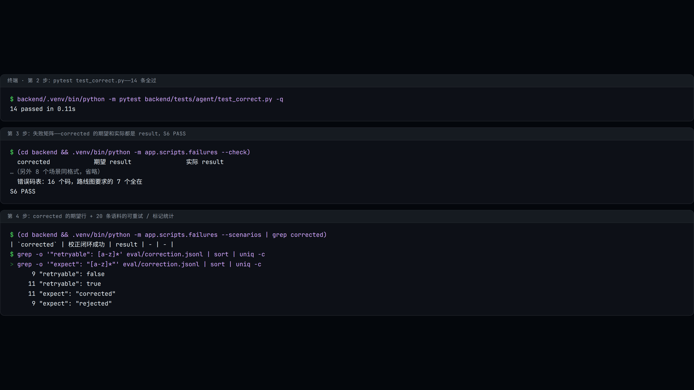
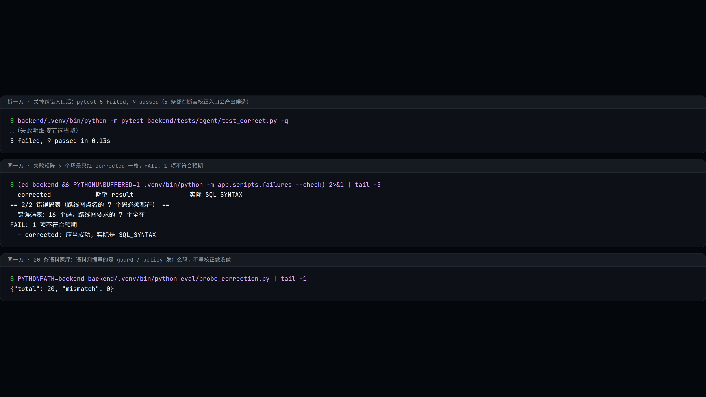

# 第 17 页 · 审纠错：一次重试能修好什么、修不好什么

> 前置：开始前确认第 16 页的拆一刀已用 `scripts/lab reset p16-before --yes` 还原——否则第 2 步会变成 `1 failed, 13 passed`、没有 `S6 PASS`、probe `mismatch: 3`。**可执行自查**：`(cd backend && .venv/bin/python -m app.scripts.failures --check | tail -2)` 应见 `S6 PASS`；不是就先 `scripts/lab reset p16-before --yes` 再往下。本页一条服务都不用——14 条单元测试、9 个失败场景、20 条纠错语料全在离线跑，不需要 MySQL / ES / Qdrant、不需要 `.env`、也不需要模型 key。命令都在仓库根目录、同一个终端里整段连续执行；括号是子 shell，跑完你还在仓库根目录。

## 这一页构建什么

把纠错（`correct_sql`）当成**一次有上限的赌博**来审：只重试 1 次、只对可重试错误生效、改出来的 SQL 必须重新过静态校验与安全策略。本页是 L3（审）的最后一页，考核不是“把页面做完”，而是拆掉纠错后能说清：**哪条判据抓到了、哪条没抓到**。审过的标准也不是“红变绿”，是写下“触发几次、成功几次、失败长什么样”，换个人重跑得到同一组数；以及为什么“纠正成功”不能写进判据——v1 演示没复现（`deliverable/PRD-对照表.md` 第 13 行：触发=true、纠正成功=false）；v2 **已复现**纠正成功态（`deliverable/v2/README-v2.md:172`；证据 `deliverable/v2/evidence/v2-correct-success.sse`、`v2-natural-correct-success.sse`），但触发取决于模型是否生成可重试错误，**不能保证每次复现**。

## 猜一猜

1. 20 条纠错语料里，写着“重试后仍失败”的条目有几条——0 条、9 条、还是 11 条？
2. 真实模型的“纠正成功”能稳定复现吗——判据能写“已修复 / 成功率 100%”，还是只能写“3 次里几次过”？

## 动手

**第 1 步：拍快照。** 拆一刀要改纠错代码，先留退路（同名快照会被拒，重做本页就换个名字；**重做换名后，第 5 步 `reset` 的名字也要一起换**——照抄旧名会回滚掉中间改动，只有 `pre-reset-*` 快照能救）；回显 `已保存快照 "p17-before"：169 个文件。`（数字因工作区而异）：

```bash
scripts/lab save p17-before
```

**第 2 步：先验校正器这一层。** 14 条测试 = 提示词 8 个槽位 + 可重试才进闭环 + 校正成功产出候选、拒答/崩溃/产物不合契约时保留原错误 + 上下文有等价字段时改完能重过校验，秒级：

```bash
backend/.venv/bin/python -m pytest backend/tests/agent/test_correct.py -q
```

**第 3 步：跑失败矩阵。** 9 个场景各演一遍结局；只替换了模型与数据库，上下文、提示词、静态校验、安全策略、纠错闭环都是真代码，所以离线就能跑。`corrected` 是唯一“先红后绿”的场景（第一次校验红 → 校正成功 → 重新校验绿）：

```bash
(cd backend && .venv/bin/python -m app.scripts.failures --check)
```

**第 4 步：看 `corrected` 的期望结局，再数一遍 20 条语料的“可重试/标记”。** 本步 `--scenarios` 的表除了场景 id，还列出名称、期望、类别、失败步骤四列（`corrected` 那行的“期望”是 `result`，不是错误码），但表里没有“重试了几次”这一列——那就是下面要审的空档：

```bash
(cd backend && .venv/bin/python -m app.scripts.failures --scenarios | grep corrected)
grep -o '"retryable": [a-z]*' eval/correction.jsonl | sort | uniq -c
grep -o '"expect": "[a-z]*"' eval/correction.jsonl | sort | uniq -c
```

## 你应该看到

第 2–4 步（块里 `#` 开头是标注，不是程序输出；秒数因机器而异；第 3 步只留 `corrected` 一行 + 汇总；最后四行没有“成功”这一栏——`corrected` 是“可校正”的标记，不是“校正成功”的统计）：

```text
14 passed in 0.11s
# 第 3 步（节选）
  corrected            期望 result               实际 result
== 2/2 错误码表（路线图点名的 7 个码必须都在） ==
  错误码表：16 个码，路线图要求的 7 个全在
S6 PASS
# 第 4 步：corrected 的期望行；20 条的“可重试 / 标记”统计
| `corrected` | 校正闭环成功 | result | - | - |
      9 "retryable": false
     11 "retryable": true
     11 "expect": "corrected"
      9 "expect": "rejected"
```




## 对账

- **猜 1：0 条。** 20 条里 11 条 `retryable: true` + `expect: "corrected"`，9 条 `retryable: false` + `expect: "rejected"`。`rejected` 不是“重试后仍失败”，是**根本不进重试**（策略拒绝 / 多语句 / 写操作 / 空 SQL 这类，重试等于给注入开一次口子）；`corrected` 也只说“这条错单该进校正”，不等于校正会成功。`eval/build_datasets.py` 用 `contracts/errors.yaml` 的 `retryable` 逐条校验这张表（expect 与 retryable 对不上就报错退出）——语料里**一条重试结局都没有**，拿它算“成功率”（11/20 或 11/11）都是假的。
- **猜 2：不能。** `deliverable/PRD-对照表.md` 第 13 行（真实云端模型；v1 视频/SSE 未随仓库分发，仓库里能核对的同类证据在 `deliverable/v2/evidence/`）：validate 红 → correct 真跑 16.31s → 改写后列名仍不在契约，记的是“**触发=true、纠正成功=false**”。`eval/FINDINGS.md` §3.1：同一问题第一次 `error → SQL_UNKNOWN_TABLE`，随后 3 次全成功——4 次里 3 次，不是“修好了”；§2 另一次 8 题 × 3 次采样记的是 5/5——那是 24 次运行里的 5 次机会，不能外推成“成功率 100%”。两个样本结论不一样，说明成功率是抽出来的数，**判据只能写“多次采样（`trials>=3`）+ 成功率 + 失败分类”，不许写“已修复”，分母是“触发校正的次数”，不是全部提问**（`eval/live_probe.py` 的四类：无需校正 / 校正机会 / 校正成功 / 校正失败；它要跑着的服务和模型 key，本页不跑）。
- **一次重试的边界在契约里，不在代码里。** `contracts/errors.yaml` 的 `correction` 段：`max_attempts: 1`、`revalidate: true`、`revalidate_with: [guard, policy]`；`retryable: true` 的只有 6 个码（`SQL_SYNTAX` / `SQL_UNKNOWN_COLUMN` / `SQL_UNKNOWN_TABLE` / `SQL_CONSTANT_PROJECTION` / `SQL_MISSING_ORDER_BY` / `SQL_MISSING_LIMIT`）。`SQL_REJECTED` 不可重试——拿被策略拒掉的 SQL 去问模型“改一下”，等于给注入开重试口子；上一页拆掉列存在校验、`SQL_UNKNOWN_COLUMN` 退化成 `SQL_REJECTED` 之后，纠错连启动的机会都没有。校正改出来的候选 SQL 必须重过两道关，原始 SQL 一直留在 `detail.original_sql`。
- **“降级为拒答”不是失败，是正确结局。** 上下文里没有语义等价的字段时，校正器拒答、原始错误原样上报（`test_corrector_refusal_keeps_the_original_error` 钉的就是“根因没变，错误也不该变”）；把拒答当失败、硬造一个列名，才是事故。

> **你现在拥有**：一次有上限的纠错闭环——次数、重校验、可重试名单全在契约里；以及一条判据：校正成功要按多次采样写，不按单次演示写。

## 拆一刀（L3 级考核）

级考核不看本页做完没有，只看拆完你能说出“哪条判据抓到了、哪条没抓到”。把纠错关掉：打开 `backend/app/agent/correct.py`，找到校正的唯一入口 `def propose_correction`，在 `policy = contract.correction` 这一行后面插 4 行（缩进 4 格）——任何错误都直接返回“校正失败”，有校正器 / 可重试 / 契约允许这三条触发条件全部短路：

```python
    # 拆一刀：关掉校正闭环——任何错误都不再产出候选 SQL
    return CorrectionProposal(
        attempted=False, ok=False, error=error, note="拆一刀：校正已关闭"
    )
```

Ctrl+S 保存，重跑三条判据（输出为节选：pytest 只留汇总行；`PYTHONUNBUFFERED=1` 让管道里的输出顺序和终端一致；秒数会变）：

```bash
backend/.venv/bin/python -m pytest backend/tests/agent/test_correct.py -q
(cd backend && PYTHONUNBUFFERED=1 .venv/bin/python -m app.scripts.failures --check) 2>&1 | tail -5
PYTHONPATH=backend backend/.venv/bin/python eval/probe_correction.py | tail -1
```

```text
5 failed, 9 passed in 0.14s
  corrected            期望 result               实际 SQL_SYNTAX
== 2/2 错误码表（路线图点名的 7 个码必须都在） ==
  错误码表：16 个码，路线图要求的 7 个全在
FAIL: 1 项不符合预期
  - corrected: 应当成功，实际是 SQL_SYNTAX
{"total": 20, "mismatch": 0}
```

这是三件事：`pytest` 5 条红（它们都在断言“校正入口会产出候选 / 把校正器的拒答原因带回来”，入口一短路全红）；失败矩阵 9 个场景**只红 `corrected` 一格**——它是唯一靠“校正成功”才拿得到 `result` 的场景，另外两个可重试失败（`sql_syntax` / `sql_unknown_column`）本来就以原码收尾；`probe` 的 20 条语料**照绿**——它量的是 guard/policy 发什么码，不量校正做没做。级考核要的答案就在这里：**单元判据和失败矩阵抓到了，语料判据没抓到**。

还原并回绿（`reset` 会先拍一张 `pre-reset-…` 安全快照，只贴末行；第 1 步若换过快照名，这里的名字也要同步换）：

```bash
scripts/lab reset p17-before --yes
backend/.venv/bin/python -m pytest backend/tests/agent/test_correct.py -q | tail -1
(cd backend && .venv/bin/python -m app.scripts.failures --check | tail -1)
```

```text
现在工作区与快照 "p17-before" 完全一致。
14 passed in 0.11s
S6 PASS
```

结论：**纠错只负责一件事——把“可重试的失败”捞回来一次；捞回来就是 `corrected` 的 `result`，捞不回来就是最初那个错码。** 所以 L3 四页的判据要合起来看：P14 的检索黄金集、P15 的 10 题基线、P16 的 20 条错单码、P17 的 `corrected` 场景，各量一层，才是“机器靠不靠谱”的答案；而真实模型的成功态只能靠多次采样，单次演示会骗人。
