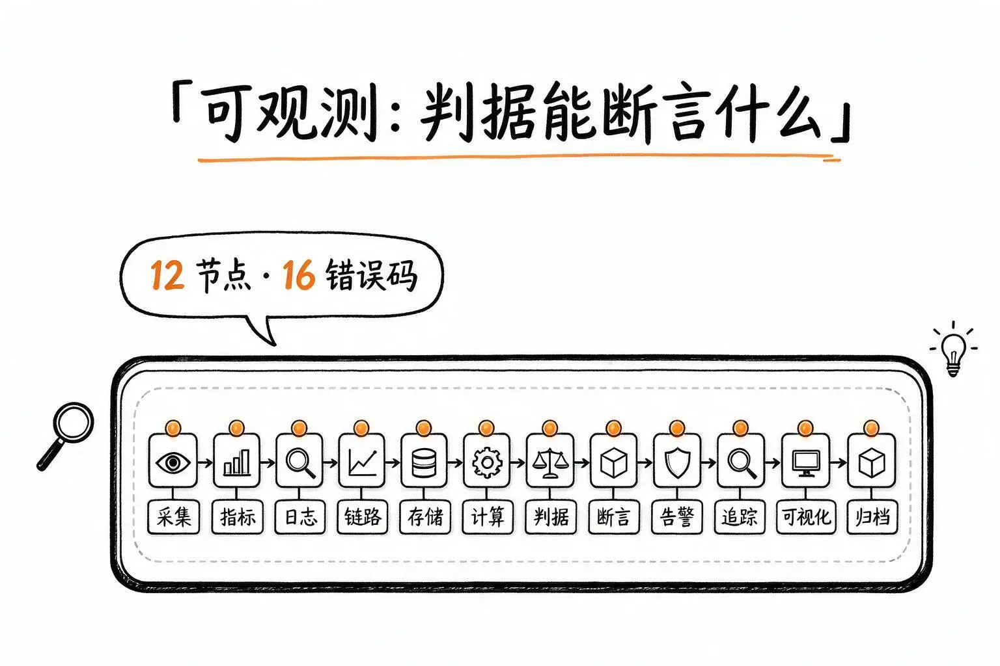

# 第 21 页 · 守可观测：12 条进度 + 14 条夹具能证明什么

> **前置**：L4（守）第四页。第 18–20 页分别守账号、策略、取消；本页守可观测。
>
> **判据全离线**：不启服务、不用 MySQL、`.env`、模型 key、浏览器。
>
> **在哪跑**：命令都在仓库根目录、同一个终端里整段连续执行；括号是子 shell，跑完你还在仓库根目录。
>
> **本页目标**：系统「现在在干什么、错在哪一步」靠哪三样证据说清，以及这些证据不能证明什么。
>
> **承接第 20 页**：先跑 `(cd backend && .venv/bin/python -m app.scripts.record_sse --check)`，看到 PASS 再开始本页（第 20 页的拆一刀没还原时，本页第 2 步只会红 `cancelled.json` 一条，红法与下面那 10 条不同）。

## 这一页构建什么

给一次问数装上**可对账的观测面**，靠三样证据说清「现在在干什么、错在哪一步」：

- **进度**：12 条有名字的进度（`contracts/steps.yaml` 的 12 个节点）。
- **目录端点**：`/api/steps` + `/api/errors`（12 步 / 16 码 / 3 类）。
- **回放夹具**：14 条（9 个场景 + 取消是录制流，4 条手写）。

**做完你拿到三条可重放的判据**：夹具逐字节对账 PASS、夹具每帧合契约 30 passed、前端协议 40 passed。

心智模型：**应用层可观测回答「现在在干什么、错在哪一步」，不回答「慢了吗、谁该报警」。**



## 猜一猜

1. happy 夹具共 24 帧，其中 23 条 `progress` 只覆盖 12 个步骤名。12 个名字里，哪几个**只出现 1 次**、最容易漏？
2. 14 条夹具里，有几条是「用今天的代码重录、逐字节对账」？`--check` 变绿能证明什么、不能证明什么？

## 动手

**第 1 步：拍快照 + 数观测面的两半。** 拆一刀要改 `record_sse.py`，先留退路（同名快照会被拒；文件数因工作区而异）。下面一个脚本把两半都数一遍：目录端点给名字与码，流给实例；不启服务、不联网：

```bash
scripts/lab save p21-before
(cd backend && .venv/bin/python -c "
import json
from fastapi.testclient import TestClient
from app.scenarios.app import create_scenario_app
c = TestClient(create_scenario_app())
s = c.get('/api/steps').json()['steps']; e = c.get('/api/errors').json()
print('/api/steps =', len(s), '条件步骤 =', [x['id'] for x in s if x['conditional']])
print('/api/errors =', len(e['codes']), '类别 =', e['classes'])
for sid in ('happy', 'llm_refusal'):
    steps = [json.loads(f[6:])['step'] for f in json.load(open(f'../fixtures/sse/{sid}.json'))['frames'] if json.loads(f[6:])['type'] == 'progress']
    print(f'{sid}: {len(steps)} 条 progress 帧 / {len(set(steps))} 个步骤名；只出现一次 ' + '/'.join(x for x in dict.fromkeys(steps) if steps.count(x) == 1))
")
```

**第 2 步：对账 14 条夹具。** `record_sse --check` 用今天的代码把 9 个场景 + 取消路径重录，和 `fixtures/sse/` 里的文件逐字节比；4 条手写夹具只与源码常量比。退出码 0 才算过：

```bash
(cd backend && .venv/bin/python -m app.scripts.record_sse --check)
```

**第 3 步：两组协议测试。** 第一条命令验夹具每一帧都合契约（14 条 × 形状 + 帧契约）；第二条验前端解析器与结果渲染。

**前提**：`backend/.venv` 由第 0 页 `make install` 生成；`frontend/node_modules` 缺了就先 `npm ci`（要联网）。

**lock 陷阱**：`frontend/package-lock.json` 不在 `lab` 白名单，若被改就 `git checkout -- frontend/package-lock.json` 还原：

```bash
(cd backend && .venv/bin/python -m pytest tests/frontend/test_sse_fixtures.py -q)
(cd frontend && npm test)
```

**第 4 步（可选）：`make stage7`。** 前提：本机装了 `uv` 且 `backend/.venv` 依赖已同步；不需要 MySQL / 浏览器。6 段门禁（契约新鲜度、夹具对账、`tests/frontend` 45 条、前端 40 条、前端构建、全后端 843 条 = 813 passed + 30 skipped），本机实测约 54 秒，末行 `S7 PASS`；不跑不影响前面判据：

```bash
make stage7
```

**`make stage7` 已 `uv run --frozen`，不会改 `backend/uv.lock`；只有脚本里的裸 `uv run`（`make stage3`、`make stage0-ui`、`make stage6-ui`）或手敲 `uv run` 才会按本机镜像源重写它。**

**它不在白名单**：`lab reset` 回显的“完全一致”只算白名单文件——仅当 `git status` 显示 lock 变脏时再 `git checkout -- backend/uv.lock` 单独还原（口径同第 15 / 19 页）。

## 你应该看到

第 1–3 步（`#` 开头是标注；耗时随机器变；下面是节选）：

```text
# 第 1 步
已保存快照 "p21-before"：169 个文件。
/api/steps = 12 条件步骤 = ['correct_sql']
/api/errors = 16 类别 = ['failure', 'empty', 'cancelled']
happy: 23 条 progress 帧 / 12 个步骤名；只出现一次 correct_sql
llm_refusal: 19 条 progress 帧 / 10 个步骤名；只出现一次 correct_sql
# 第 2 步
S7 SSE RECORD PASS（14 个夹具与真实输出一致）
# 第 3 步
30 passed in 2.93s
     Tests  40 passed (40)
```


## 对账

- **猜 1：`correct_sql`，以及失败路径上根本没出现的步骤。** 正常流里条件步骤只发一条 `status: "skipped"`，没有 running+success——所以 happy 是 23 条 progress 帧（11 个节点各 2 条 + 1 条 skipped），不是 12×2。

  **拒答时更少**：`llm_refusal` 只出现 10 个步骤名，`validate_sql`、`run_sql` 一条都没有。

  **怎么写判据**：判据不能要求「12 个名字每次都出现」，只能要求：出现的名字都在目录里、条件步骤显式 `skipped`、流必有终态。最容易漏的不是跑过的步骤，是**没跑又没人替它说话**的步骤。

- **猜 2：10 条录制、4 条手写。** 第 2 步的 PASS 里两种对账强度不同。

  **10 条录制**（9 场景 + 取消）：与今天的代码逐字节一致。

  **4 条手写**（`pseudo_row`/`unknown_event`/`empty_rows`/`null_column`）：只与源码常量一致，它们证明「前端能处理新后端永远不会产生的流」，合法性由第 3 步的契约测试兜底。

  **红名单**：拆一刀的红名单恰好是那 10 条——绿线覆盖到哪、没覆盖到哪，一眼可见。

- **三件套各管什么。**

  - `progress` 事件说「现在在干什么」（步骤名 + 状态）。
  - `/api/steps` + `/api/errors` 是名字与码的唯一来源（12 步 / 16 码 / 3 类），前端不硬编码。
  - 夹具是「怎么证明没漂移」——冻住一次真实字节流，以后每次改动逐字节对账。

- **稳定量 vs 变动量。**

  - 稳定：步骤名、顺序、状态、事件类型、错误码、错误类别。
  - 变动：`duration_ms`（每次测量都不同）、`request_id`（每次请求新生成）。

  **归一化只有两处**：`record_sse.py` 把 `duration_ms` 固定成 12.5、`request_id` 从 `detail` 删掉。这不是作弊，是把变动量从判据里**切出去**：判据只能断言稳定量，否则今天绿明天红，绿线就没有意义。

- **与运维可观测的边界。** 本仓库能看的只有这些：

  - `/api/health`、`/api/steps`、`/api/errors`；
  - SSE 里的 `duration_ms` / `X-Request-Id`；
  - `docker compose logs`（容器层日志，不是应用的结构化日志）。

  **没有 metrics、没有追踪、没有结构化请求日志、没有告警。** 别把流里的 `duration_ms` 当监控——它只发给浏览器，不落盘不聚合。

  **能回答**「现在在干什么、错在哪一步」；**不能回答**「QPS / 错误率 / P99 / 慢在哪个服务」。运维级观测要另建（请求 ID + 每步耗时 + 错误码计数的最小底座还没建），不在本页。

> **你现在拥有**：一条可被第三方重放的观测判据（14 条夹具 + 30 条契约测试 + 40 条协议测试），和一句可复用的话：**可观测的边界，就是判据能断言什么、不能断言什么。**

### 深入探讨：12 个节点就是一张 LangGraph 图

你刚对账的 12 个节点，在代码里是一张编译出来的图。

**声明**：`contracts/steps.yaml` 声明 12 个节点（`stages` 把它们按 10 步分组，是教学与验收的分组，SSE 仍每节点一条 `progress`）。

**挂节点**：`backend/app/agent/graph.py:428` 的 `StateGraph(AgentState)` 用 `add_node` 逐个挂上（8 个上下文节点 + 生成/校验/校正/执行各一，L430-436）。

**串行主干**：`START → 8 个上下文节点串行 → generate_sql → validate_sql`（L438-442）。

**怎么分支**：`validate_sql` 后面是**条件边**（L444-452）：通过 → `run_sql`、可重试 → `correct_sql`、否则 → `END`。

**回边**：`correct_sql → validate_sql` 是回边（L453），`run_sql → END`（L454）。

| 你前面验的证据 | 图里对应哪块 |
|---|---|
| 第 8 页：12 条 `progress` | 12 个图节点，一条进度对应一个节点 |
| 第 16 页：执行前的守卫 | `validate_sql` 节点里的 guard + policy |
| 第 17 页：一次重试的上限 | `validate_sql` 的条件边 → `correct_sql`，改完从回边再校验 |

**为什么值得看**：图把「节点顺序」和「回边」变成可枚举的结构，测试能直接拿编译后的节点集合对契约（`backend/tests/test_s6_langgraph.py:96` 断言节点数 = 12）——这正是 PRD 说的「LangGraph 多节点工作流」。

**指针**：完整图结构说明见 `design/book/chapters/20-s5-s8.md`；`backend/app/agent/graph.py:428-456`；本页不要求新增截图。

## 拆一刀

打开 `backend/app/scripts/record_sse.py`，找到 `_normalize`（L195）。归一化是 L199–205 一整块：

- progress 分支 L201 `payload["duration_ms"] = FIXED_DURATION_MS`（12.5 在 L39 的常量里）；
- error 分支 L205 `detail.pop("request_id", None)`。

**怎么删**：把这两个分支连同外层的 `if`/`elif` 头一起删掉，函数只剩解析与 `json.dumps`。

**别删错**：只删 L201 / L205 这两行赋值会缩进报错（“录制失败”），不是 10 条红；也别删整个函数。重跑第 2 步（退出码 1）：

```bash
(cd backend && .venv/bin/python -m app.scripts.record_sse --check)
```

```text
FAIL: SSE 夹具与真实输出不同步：
  - happy.json 与今天的真实输出不同步
# 共 10 条：9 个场景 + cancelled；4 条手写一条不红（节选）
  - cancelled.json 与今天的真实输出不同步
请运行：cd backend && uv run python -m app.scripts.record_sse
```

**为什么红**：`happy.json` 里那几帧是 `"duration_ms": 12.5`，今天录出来首个 duration 帧约 3.3、11 个带 duration 的 progress 帧全与 12.5 不同（0 到几十毫秒不等，每次不同）。

**另一处噪音**：`cancelled.json` 的 `detail` 里还多了一个随机 32-hex 的 `request_id`（每次不同，形如 `9d5221…`）。

**别照着提示去重录**：把今天的噪音写死进夹具，明天还会红，判据就废了。用快照还原，再重跑第 2 步：

```bash
scripts/lab reset p21-before --yes
(cd backend && .venv/bin/python -m app.scripts.record_sse --check | tail -1)
```

```text
# 还原（节选；实际还会先打印“已先拍安全快照 pre-reset-…”等 8 行非空输出）
已恢复快照 "p21-before"：
  覆盖 1 个文件（内容不同）
S7 SSE RECORD PASS（14 个夹具与真实输出一致）
```

结论：**归一化不是作弊，它是把稳定量从变动量里切出来的那一刀。** 拆掉它，判据立刻拿今天的耗时和请求 ID 去比昨天的——变红不是系统坏了，是判据开始断言它不该断言的东西。
