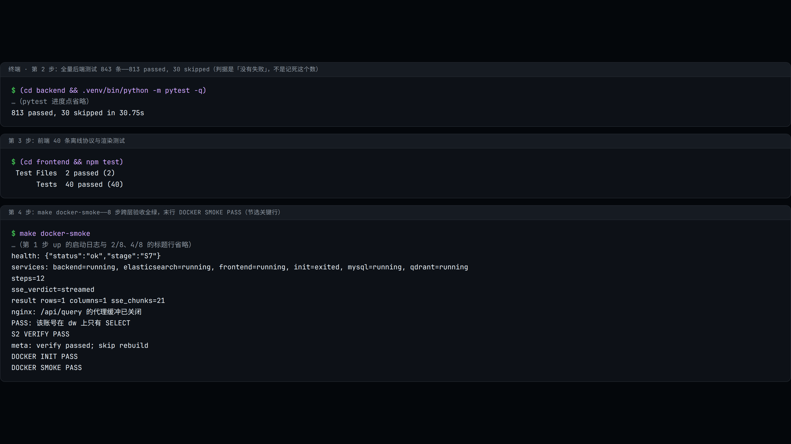
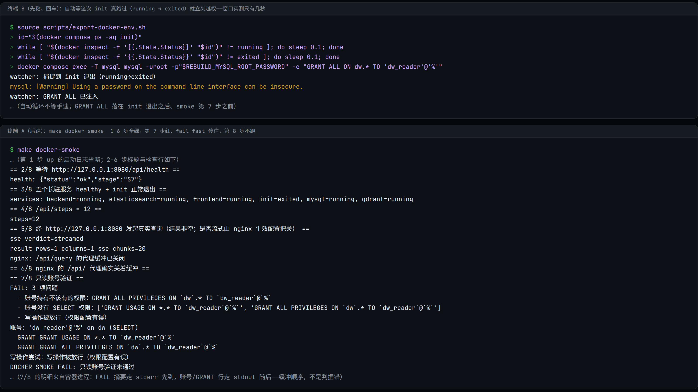

# 第 22 页 · 守回归：一套门禁能不能替你值班

> 前置：L4（守）第五页，也是全书最后一页。前两条判据离线：`backend/.venv` 由第 0 页 `make install` 生成，`frontend/node_modules` 缺了就先 `npm ci`（要联网）。第三条要整栈：Docker 可用、`.env` 已由 `make docker-env` 生成、第 13 页的 `make docker-up` 起过栈（栈停过/机器重启过就先 `make docker-up` 或 `docker compose up -d`，第 13 页起过 ≠ 现在还在跑）；宿主机还要有 `python3`（≥3.8）与 `curl`，smoke 预检要用。除级考核的终端 B 外，命令都在仓库根目录、同一个终端里整段连续执行；终端 B 也先 `cd` 到仓库根目录，否则 `source` 找不到脚本、`id` 为空会空等；括号是子 shell，跑完你还在仓库根目录。

## 这一页构建什么

把 8 步 `docker-smoke`、stage0–7、全量 pytest、前端测试拼成一张**回归网**：每个门禁各一条命令，哪条变红就指出哪一层退化（本页只跑其中 4 条；要连 stage 一起跑就是 `make stage7` 再接 `make docker-smoke`）。做完你拿到一张「每条门禁防哪类退化」的对照表，和一次亲手把网打穿、看它精确变红、再修好的级考核。心智模型：**回归网的价值不在「全绿」，在「红了能定位」。**

## 猜一猜

1. 全量后端测试共 843 条：多少条真的跑、多少条被跳过？跳过的那些，是「不需要栈」，还是「没法离线跑」？
2. 把 `dw_reader` 改成 `GRANT ALL`，再原样跑 `make docker-smoke`：8 步里有几步红？

## 动手

**第 1 步：拍快照。** 本页不改文件，但留一张退路（同名快照会被拒，重做本页换个名字；回显的文件数因工作区而异）：
```bash
scripts/lab save p22-before
```

**第 2 步：全量后端测试。** 843 条，本机约半分钟；末行里不能出现 `failed` / `error`，通过数可以变——判据是「没有失败」，不是记死一个数字：
```bash
(cd backend && .venv/bin/python -m pytest -q)
```

**第 3 步：前端测试。** 40 条离线协议与渲染测试，前提是第 0 页装好的 `frontend/node_modules`：
```bash
(cd frontend && npm test)
```

**第 4 步：一键门禁。** 前提：Docker 可用、`.env` 已生成、第 13 页起的栈在跑（栈停过就先 `docker compose up -d` 或按第 13 页重起；端口被占就先按第 13 页第 3 步改 `.env`）。它自己会 `up` 一次（幂等；首次或镜像被清会重建，约 8 分钟），再 8 步逐条验；任何一步红都立刻停：
```bash
make docker-smoke
```

## 你应该看到

（`#` 开头是标注；秒数、文件数、端口、`sse_chunks` 随机器变；`sse_verdict` 可能是 `streamed` 也可能是 `too-fast`——后者同样算过，见第 13 页）：
```text
# 第 1 步（节选：实际另有「位置」「下一步」两行回显）
已保存快照 "p22-before"：169 个文件。
# 第 2 步
813 passed, 30 skipped in 36.28s
# 第 3 步
      Tests  40 passed (40)
# 第 4 步（节选：1/8 起栈日志省略；从上往下是 2/8 health、3/8 服务表、4/8 步数、5/8 真查询、6/8 nginx、7/8 只读、8/8 对账、init 幂等、通过。5/8 内部与 6/8 都会打 nginx 行，这里只留 6/8 一次）
health: {"status":"ok","stage":"S7"}
services: backend=running, elasticsearch=running, frontend=running, init=exited, mysql=running, qdrant=running
steps=12
sse_verdict=streamed
result rows=1 columns=1 sse_chunks=21
nginx: /api/query 的代理缓冲已关闭
PASS: 该账号在 dw 上只有 SELECT
S2 VERIFY PASS
meta: verify passed; skip rebuild
DOCKER INIT PASS
DOCKER SMOKE PASS
```




## 对账

- **猜 1：843 条里跑 813、跳 30。** 跳的 30 条不是「不需要栈所以跳过」，相反——23 条检索集成测试要真 Elasticsearch / Qdrant / 元知识（`REBUILD_INTEGRATION=1` 才跑），5 条是生成契约对齐的已知形状问题，2 条是拒答题本来就不产 SQL。所以 `30 skipped` 不等于 30 个通过：没起三存储时，检索这一层今天**没有验**；smoke 第 8 步在同样三座存储上只对账元知识，不补这 23 条召回题。
- **8 步各防什么**（一步一条判据，红了就知道看哪儿）：1/8 防「根本起不来」；2/8 防 nginx→backend 入口链断；3/8 防「进程在跑，但从没初始化成功」（只看 running 不够）；4/8 防契约没进镜像、步骤表悄悄少一步；5/8 防「接口通，但查不出数」；6/8 防 SSE 被 nginx 攒成一个整包再发；7/8 防「只读只写在文档里」；8/8 防初始化结果不对、一次性脚本不可重跑。
- **stage0–7 和 smoke 的分工。** stage0–7 是**分层**门禁：一条命令验一层（S0 契约+前端协议、S1 契约↔DDL/数据、S2 元知识、S3 检索、S4 生成、S5 策略、S6 失败矩阵+取消、S7 契约新鲜度+夹具+前端构建），大多离线或只要部分服务，快、能单跑，红了直接指向那一层。smoke 是**端到端**：8 步跨层、要整栈、慢，红了指向一个步骤号。一句话：stage 管「每一层自己对不对」，smoke 管「拼起来还能不能用」。
- **猜 2：0 步。** 先改权限再原样跑，实测 8 步全绿、`DOCKER SMOKE PASS`——因为第 1 步的 `up` 每次都会重跑一次性 init，而 init 每次都 `DROP USER` 后重建 `dw_reader`（第 13 页它就是这么设计的），越权被它修好了。这不是没抓到：它验的是「按配置起一遍之后现在对不对」，不是「历史上有没有人改过权限」——后者要靠第 18 页那条单步判据去查。
- **它不防什么（诚实边界）。** 不防性能退化：仓库没有 S8 性能门禁（README 写「待做」），系统变慢不会红；不防历史越权（下一次 `up` 会被 init 抹掉，见下一段考试）；`skipped` 的检索测试不在离线门禁里。**全绿不是目标，红了能定位才是**：smoke 的步骤号 → stage 的 S 号 → pytest 的测试名，三层都能说出「哪一条判据抓到了」，下一段级考核专门验这一点。

> **你现在拥有**：一张能被别人重放的值班表（8 步 smoke + stage0–7 + 843 条后端测试 + 40 条前端测试），和一句可复用的话：**「门禁不是让我今天看到全绿，是让明天出事时知道该看哪一行。」**

## 拆一刀（L4 级考核）

级考核不看页面做完没有，只看拆完你说不说得清「哪条判据抓到了、哪条没抓到」。L4 拆的是**只读账号**。

**第 1 步：先搞清时机。** smoke 第 1 步的 `up` 每次都会重跑一次性 init，init 每次都重建 `dw_reader`——所以「先越权、再整跑」是 0 步红（猜 2 的答案）。要让第 7 步的牙咬到，越权必须发生在 init 之后、第 7 步之前。

**第 2 步：先起终端 B，粘完、回车，确认它在等，再在终端 A 跑。** 前置：终端 B 也在仓库根目录，`docker compose ps -a` 要能看到 init 容器——栈停过/重启过就先 `docker compose up -d`（或按第 13 页重起）；看不到 init 时 `id` 为空，B 会无限静默空等、A 照样跑，级考核既不红也不报错。窗口实测只有约 3 秒（init 退出 → 第 7 步开始），靠手速会输，让循环替你等；终端 A 只有一条 `make docker-smoke`：
```bash
# 终端 B（仓库根目录，先启动、回车）：每轮重取 id（A 的 up 会重建 init），60 秒等不到就退出
source scripts/export-docker-env.sh
seen=0; end=$((SECONDS+60)); while [ "$SECONDS" -lt "$end" ]; do
  id="$(docker compose ps -aq init 2>/dev/null)"; [ -z "$id" ] && { sleep 0.1; continue; }
  s="$(docker inspect -f '{{.State.Status}}' "$id" 2>/dev/null)"; [ "$s" = running ] && seen=1
  [ "$seen" = 1 ] && [ "$s" = exited ] && { echo "watcher: 捕捉到 init 退出，立刻注入 GRANT ALL"; break; }
  sleep 0.1; done
[ "$seen" = 1 ] || { echo "没等到 init 跑起来（60 秒）：先确认栈已起、A 的 smoke 已开跑（docker compose ps -a），再重跑本步" >&2; exit 1; }
docker compose exec -T mysql mysql -uroot -p"$REBUILD_MYSQL_ROOT_PASSWORD" -e "GRANT ALL ON dw.* TO 'dw_reader'@'%'"
```

**第 3 步：看 A 的输出。** 1–6 步全绿（节选），第 7 步红，脚本 fail-fast 停在这里、第 8 步不跑，并打出 `ps -a` 与各服务日志（省略）。**若 A 8 步全绿，说明 GRANT 落晚了（已在第 7 步之后）或没注入——整次重来，别把全绿当成功**（慢机器可先 `docker compose exec -T mysql true` 预热）：
```text
# 1–6 步（节选）
steps=12
sse_verdict=streamed
result rows=1 columns=1 sse_chunks=22
nginx: /api/query 的代理缓冲已关闭
# 第 7 步（节选；FAIL 摘要走 stderr 先到，账号/GRANT/写操作后到 stdout——缓冲顺序，不是判据错，见第 18 页）
FAIL: 3 项问题
  GRANT GRANT USAGE ON *.* TO `dw_reader`@`%`
  GRANT GRANT ALL PRIVILEGES ON `dw`.* TO `dw_reader`@`%`
写操作尝试：写操作被放行（权限配置有误）
DOCKER SMOKE FAIL: 只读账号验证未通过
```

**第 4 步：验「定位精确」。** 同一个越权状态下，第 8 步的判据单独跑仍是绿的（`docker compose run --rm --no-deps init python -m app.build_meta_knowledge --verify | tail -1` → `S2 VERIFY PASS`）——红的只有第 7 步，不是整片红。

**第 5 步：还原、回 PASS。** 在**终端 B（已 `source` 过）**里跑；新开的终端要先 `source scripts/export-docker-env.sh`，否则会红 `缺少环境变量 REBUILD_DW_RO_PASSWORD`。还原就是第 18 页那句重开账号（权限集合回到 `SELECT`），再整跑一次（回显节选：实际前面还有 4 行 `已执行：…`）：
```bash
(cd backend && .venv/bin/python -m app.scripts.security --provision-ro-account)
make docker-smoke
```
```text
只读账号就绪：'dw_reader'@'%' on dw (SELECT)
PASS: 该账号在 dw 上只有 SELECT
DOCKER SMOKE PASS
```

**答案。** 网有牙（第 7 步抓住越权）、定位精确（只红第 7 步）、边界清楚（跑之前就存在的越权会被 init 修好，归第 18 页的单步判据管）。L4 五页合起来是一句话：**账号、策略、取消、观测、回归，出了事都兜得住，兜不住时也知道红在哪一层。** 全书四层到此收尾：L1 造 10 页 → L2 换 4 页 → L3 审 4 页 → L4 守 5 页。
