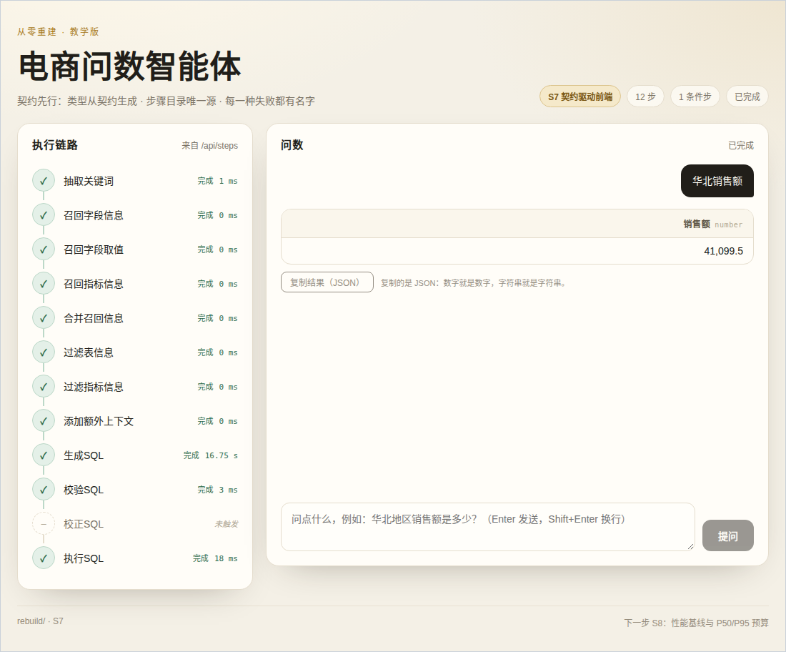
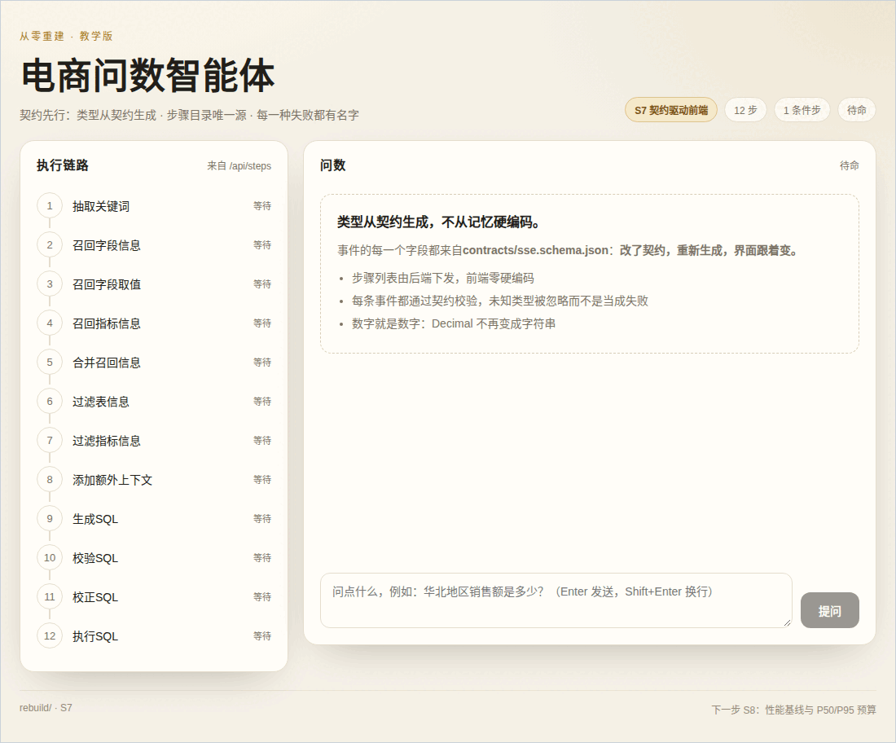

# 第 23 页 · 装前端：从 17 行 HTML 到真前端

> 前置：L5 只一页，接第 13–22 页那套整栈——Docker 可用、`.env` 已由 `make docker-env` 生成、`make docker-up` 起过栈（第 22 页的拆一刀已还原：`make docker-smoke` 回 `DOCKER SMOKE PASS`；镜像已缓存在本地）。本页不改镜像：栈停过/机器重启过就 `docker compose up -d`，不带 `--build`；只有第一次构建或代码真改过才 `make docker-up`（= `up -d --build`，约 8 分钟，第 13 页）。本页不动后端、契约、数据，只换浏览器入口；命令都在仓库根目录、同一终端里整段连续执行，括号是子 shell，跑完你还在仓库根目录。

## 这一页构建什么

不是从零写 React：是把第 9 页那 17 行 HTML 入口，换成 `compose.yaml` 里 `frontend` 服务提供的真前端（React 构建产物）——技术栈事实（`frontend/package.json`）：**React 19**（`react ^19.0.0`）、**Tailwind CSS 4**（`tailwindcss ^4.3.4` + `@tailwindcss/vite`）、Vite 6；页面是聊天式提问 + 结果表格，样式入口 `frontend/src/styles.css`。
契约、SSE 协议、查询链路、`41099.5` 判据全不动——换的只是**体验层**：谁渲染进度、谁画结果表。
规模事实：`frontend/src` 17 个文件、2861 行，其中光是界面（7 个 tsx + `styles.css`）就 1143 行；第 9 页那页是 17 行。

## 猜一猜

动手前写下答案（都允许猜错）：
1. 把第 9 页的 17 行页面一个字不改、直接接到真后端：还能出 `41099.5` 吗？真前端和它是不是两套接口？
2. `(cd frontend && npm test)` 的 40 条测试里，有几条真的打开浏览器？换前端后，第 13 页那 8 步 `docker-smoke` 要不要跟着改？

## 动手

**第 1 步：起整栈。** 已经起着就跳过；起栈、等健康、init 退出 0 的判据全在第 13 页，本页只要求 `docker compose ps` 里五个长驻服务 `healthy`（`frontend` 在）。先判断要不要构建：`docker images | grep shopkeeper` 有两行（`.../backend:local`、`.../frontend:local`）就只起容器、不重建；没有或你刚改过代码，就用 `make docker-up`（它会 `--build`，约 8 分钟，第 13 页）：

```bash
docker compose up -d
```

**第 2 步：用浏览器问一句。** 打开 `http://127.0.0.1:8080`（默认端口；改过 `.env` 的 `FRONTEND_HOST_PORT` 就用你的），输入框填 `华北销售额`，点「提问」。这就是第 9 页那个页面换掉之后的样子：左边步骤轨、右边对话与结果表。

**第 3 步：跑前端自己的判据。** 40 条离线测试（协议解析 + 结果渲染），前提是第 0 页 `make install` 装好了 `frontend/node_modules`：

```bash
(cd frontend && npm test)
```

## 你应该看到

浏览器里 12 条步骤轨来自 `/api/steps`；「生成 SQL」会亮「执行中」约 6 秒，然后结果表出现。表里 `41,099.5` 是千分位写法，数值就是第 7 页那个 `41099.5`；「未触发」那条是条件步骤 `correct_sql`，不是失败。**逐条对**：结果表一个数，步骤轨 12 条（11 条「完成」+ 1 条「未触发」），右上角 badge 是 `12 步` / `1 条件步`、状态 `已完成`；终端末行是 `Duration`，`Tests 40 passed (40)` 是它上面的汇总行（秒数随机器变）：

```text
41,099.5                     # 结果表单元格；数值 = 41099.5
# 步骤轨 12 条：11 条「完成」+ 1 条「未触发」（correct_sql）；badge：12 步 / 1 条件步；状态：已完成
# 终端 (cd frontend && npm test) 汇总行（末行是 Duration）：
     Tests  40 passed (40)
```




## 对账

- **猜 1：不能，而且它们不是两套接口。** 实测把第 9 页页面原样接真后端：浏览器问一句，结果区一直空——页面调的 `GET /api/stream` 回 **404**；真后端的入口是 `POST /api/query`，结果行也从对象 `rows[0].sales` 变成二维数组 `rows[0][0]`（`contracts/sse.schema.json` 规定 `result.data` 只有 `columns` + `rows`）。也就是说，「同一套契约」指 **SSE 事件**：23 条 `progress`（`step` + `status` + `duration_ms`）+ 1 条 `result`（`columns` + `rows`），每条都是 `data: <json>` 加一个空行。入口方法、结果行形状属于**接线**——下一段把接线补上，页面就能接上同一个后端；真前端和 17 行页面只是同一个后端的两个消费者。
- **猜 2：0 条；`docker-smoke` 一行不用改。** 40 条全是 vitest 纯函数测试（`src/lib/sse.test.ts` 26 条 + `src/lib/result.test.ts` 14 条）：切 SSE 帧、按契约校验事件、按列类型渲染结果，不开浏览器、不连后端。`docker-smoke` 的 8 步也只发 API 请求、看容器和 nginx 配置，没有一步打开页面（第 13/22 页）——它的第 3/8 步只要求 `frontend` 容器 `healthy`。所以两层判据各管一头：**`npm test` 管协议与渲染，`docker-smoke` 管部署与 API，谁也替代不了谁。**
- **装修与承重墙。** 承重墙 = 后端查询链路 + SSE 事件契约 + `/api/steps` 步骤目录；装修 = 谁渲染（`<pre>` 里一行一个数，还是 1143 行界面：步骤轨、结果表、失败卡、空态、取消态、响应式）。换装修，`41099.5` 这个数不变。
- **卡住了看这里。**
  - 打 `8080` 连不上：端口被占或改过 `.env`，改用 `FRONTEND_HOST_PORT` 那个端口；**别改 `compose.yaml`**（第 13 页）。
  - 首次 `make docker-up` 约 8 分钟（网络慢更久）：`frontend` 镜像要 `npm ci` + `tsc` + `vite build`，看到 `Container ... Started` 才算完，别中断（第 13 页）。
  - `npm test` 报找不到 `vitest`：`frontend/node_modules` 缺，先 `(cd frontend && npm ci)`（要联网）。
  - 结果不是 `41099.5`：数据库不是 `fixtures/dw.sql` 的演示集——**先确认栈是第 13 页 compose 起的**（`docker compose ps` 五行 healthy），本页的库由 compose 首次 init 灌入；第 10/12 页那个 `lab-mysql` 第 13 页已经删了，按第 10 页收尾重灌没有可灌的库。修法：`make docker-reset`（删数据卷，破坏性、会让你输 yes）→ `make docker-up`（重新 init 灌 `fixtures/dw.sql`，第 13 页）→ 再问一句。
  - 拆一刀回 `502`：新 nginx 没进 compose 网络（用了默认 bridge，或 proxy 写 `host.docker.internal:8100`）——`backend` 只绑宿主机 `127.0.0.1`，容器从外面进不来；按下一段加 `--network`。
  - 拆一刀回 `403`：`p23-html/index.html` 权限太严（`-rw-------`），`chmod 644 p23-html/index.html` 再刷新（第 9 页同款坑）。

> **你现在拥有**：同一套契约的两个入口——17 行页面和真前端都能问出 `41099.5`；「界面有 1143 行」不等于「多了一套接口」。

## 拆一刀

L5 的级考核：把装修换回简陋版，看承重墙倒不倒。

**第 1 步：停真前端。** 默认 8080（改过 `.env` 的 `FRONTEND_HOST_PORT` 就是你的端口）让出来，compose 网络与后端都还在：

```bash
docker compose stop frontend
```

**第 2 步：写回第 9 页的页面，只补接线。** 先 `mkdir -p p23-html`（终端重定向不会自己建目录），再在仓库根目录建 `p23-html/index.html`，内容如下——`form + pre + 事件处理`的骨架没变，只改 3 处接线（注释标出）：入口换成 `POST /api/query`、`EventSource` 换成 `fetch` 读流、结果行取 `rows[0][0]`；渲染那一行还是「收到 progress 显示 step，收到 result 显示数」。接线 2 的读流样板让这页从 17 行长到 29 行——L5 不在 SPEC 的 L1 行数预算（≤25 行片段）内，29 行是为了可读。

```html
<!doctype html>
<meta charset="utf-8">
<form onsubmit="ask(q.value); return false">
  <input id="q" name="q" value="华北销售额" size="30"> <button>问一句</button>
</form>
<pre id="out"></pre>
<script>
function ask(question) {
  out.textContent = '';
  // 接线1：真后端入口是 POST /api/query（第 9 页是 GET /api/stream）
  fetch('/api/query', {method: 'POST', headers: {'Content-Type': 'application/json'},
    body: JSON.stringify({query: question})}).then(async (resp) => {
    // 接线2：EventSource 换成 fetch 读流；帧还是 data: <json> 加空行
    const reader = resp.body.getReader(), decoder = new TextDecoder();
    let buf = '';
    for (;;) {
      const {value, done} = await reader.read(); if (done) break;
      const frames = (buf += decoder.decode(value, {stream: true})).split('\n\n');
      buf = frames.pop();
      for (const frame of frames) {
        const line = frame.split('\n').find((s) => s.startsWith('data: ')); if (!line) continue;
        const msg = JSON.parse(line.slice(6));
        // 接线3：真契约的结果行是二维数组，不是对象 rows[0].sales
        out.textContent = msg.type === 'result' ? msg.data.rows[0][0] : msg.step;
      }
    }
  });
}
</script>
```

**第 3 步：用真前端的镜像起 nginx 占 8080。** 反代配置（`docker/nginx.conf`）和端口沿用镜像里那一套，只把静态页换成刚写的 `index.html`；必须进 compose 网络，`backend` 这个名字才解析得到。网络名是 compose 项目名派生：`compose.yaml` 第 1 行 `name: shopkeeper-rebuild` + `_default` = `shopkeeper-rebuild_default`；若用 `-p` 或 `COMPOSE_PROJECT_NAME` 改过项目名，先 `docker network ls | grep default` 看实际那个。端口：命令里的 `8080` 换成你 `.env` 的 `FRONTEND_HOST_PORT`（默认就是 8080，第 4/5 步同）。`docker run` 失败（端口被占 / 同名容器 `Conflict`）：`docker ps -a --filter name=p23-html` 有残留就先 `docker rm -f p23-html` 再重跑：

```bash
docker run -d --name p23-html --network shopkeeper-rebuild_default -p 127.0.0.1:8080:80 \
  -v "$PWD/p23-html/index.html:/usr/share/nginx/html/index.html:ro" \
  shopkeeper-rebuild/frontend:local
```

**第 4 步：再问一次。** 浏览器打开 `http://127.0.0.1:8080`（强刷），点「问一句」：`<pre>` 里先闪过 `extract_keywords`、`generate_sql` 这些步骤名，约 6 秒后停在 `41099.5`。没有步骤轨、没有结果表——那 1143 行就是用来干这个的。


**第 5 步：还原。** 删掉简陋入口（容器和 `p23-html/` 都删）、把真前端起回来，等它 `healthy` 再刷新 8080：

```bash
docker rm -f p23-html && docker compose up -d frontend && rm -rf p23-html
```

结论：两次结果相同（`41099.5`），契约相同（23 条 `progress` + 1 条 `result`），差的只是「谁负责渲染」。**拆掉体验层，系统照跑。**

> L5 只一页：装修不改变承重墙，所以它不是新造一座城。
