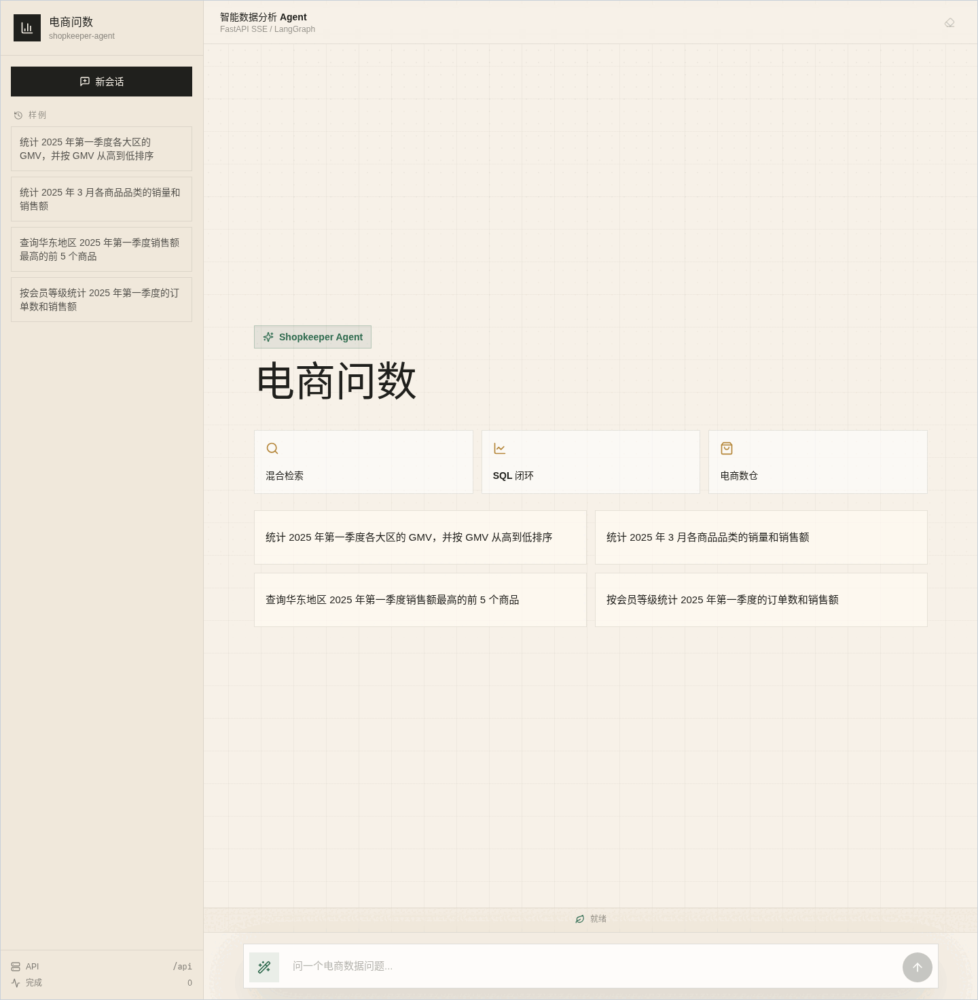

# 第 23 页 · 装体验：从 17 行 HTML 到成熟版前端

> 前置：L5 只一页，接第 13–22 页那套整栈——Docker 可用、`.env` 已由 `make docker-env` 生成、`make docker-up` 起过栈（第 22 页的拆一刀已还原：`make docker-smoke` 回 `DOCKER SMOKE PASS`；镜像已缓存在本地——第 1 步先判断镜像在不在，在就只 `up` 不重建）。本页不动后端、契约、数据，只换浏览器入口：同一个后端并排挂三种装修做对照。命令都在仓库根目录、同一终端里整段连续执行，括号是子 shell，跑完你还在仓库根目录。

## 这一页构建什么

同一套后端、同一份契约、同一条 SSE 流，前面出现过三种「装修」，从简到成熟（本页把第 3 种真跑起来、和第 2 种并排对照：装修只换承载页面的壳，不换承重墙）：

| # | 装修 | 说明 |
|---|---|---|
| 1 | **第 9 页那 17 行 HTML** | `<form>` + `<pre>`，一行一个数——入口原型。 |
| 2 | **`frontend/` 教学版重建前端** | compose 默认的 `frontend` 服务（默认端口 8080），「从零重建 · 教学版」界面、`12 步` 步骤轨，自带 40 条协议测试——它是**脚手架**，把系统结构摆在明面上。 |
| 3 | **成熟版原版 `shopkeeper-agent`** | 交付时的样子（`deliverable/v2/original-frontend/`，React 19 + Tailwind 3.4.17 的构建产物 `dist/`）。 |

## 猜一猜

动手前写下答案（都允许猜错）：① 成熟版和教学版是不是两套接口？把成熟版挂到同一个后端上，后端要不要配一份新的？② 换成成熟版之后，契约（`contracts/`）要不要改？

## 动手

**第 1 步：起整栈。** 栈在跑就跳过（判据见第 13 页：五个长驻服务 `healthy`、`init` 退出 0）。

**先判断镜像在不在**：`docker images | grep shopkeeper` 有 `backend`、`frontend` 两行 → 栈停过只是没起，用 `docker compose up -d`（不重建，秒级）；第一次或代码真改过 → `make docker-up`（= `up -d --build`，约 8 分钟，第 13 页）：

```bash
docker images | grep shopkeeper   # 判断：有 backend、frontend 两行 = 镜像已在本地
docker compose up -d              # 镜像在：只起容器，不重建（秒级）
# 没有这两行 / 改过代码：改用 make docker-up（= up -d --build，约 8 分钟，第 13 页）
```

**第 2 步：起成熟版，占 8088。** 不碰 compose 默认的 8080 教学版，两个界面并排对照。成熟版容器要进 compose 网络，它 `nginx.conf` 里的 `backend:8100` 才解析得到。

**网络名**：`compose.yaml` 第 1 行 `name: shopkeeper-rebuild` + `_default`。若用 `-p` 或 `COMPOSE_PROJECT_NAME` 改过项目名，先 `docker network ls | grep default` 看实际那个再替换。

**镜像**：取你实际生效的 `.env`（`make docker-env` 一定生成 `NGINX_IMAGE` 那行）；只有 `.env` 缺这一行时才回退 `.env.example`（把命令里的 `.env` 换成 `.env.example`）。

**陷阱**：8088 被占或已有同名容器：先 `docker rm -f lab-mature` 再重跑：

```bash
docker run -d --name lab-mature --network shopkeeper-rebuild_default -p 127.0.0.1:8088:80 \
  -v "$PWD/deliverable/v2/original-frontend/dist:/usr/share/nginx/html:ro" \
  -v "$PWD/deliverable/v2/original-frontend/nginx.conf:/etc/nginx/conf.d/default.conf:ro" \
  "$(grep '^NGINX_IMAGE=' .env | cut -d= -f2)"
```

**第 3 步：跑教学版脚手架的测试。** 这条判据测的是 `frontend/` 教学版；成熟版是构建产物 `dist/`，不带这套测试，也别在 `deliverable/v2/original-frontend/` 里跑。在仓库根目录跑（括号是子 shell，跑完还在根目录）：

```bash
(cd frontend && npm test)
```

**第 4 步：对照着问。** 浏览器开 `http://127.0.0.1:8088`（成熟版）和 `http://127.0.0.1:8080`（教学版，默认端口；改过 `.env` 的 `FRONTEND_HOST_PORT` 用你的端口），两边都问「华北销售额」。

## 你应该看到

成熟版（8088）是「电商问数 / shopkeeper-agent」的样子：左侧「样例」4 条、底部聊天输入框；问完出 12 节点流程图（11 个 ✓ + `校正SQL · 未触发`）和「查询结果」表。

**逐条对**：成熟版结果表原样显示 `41099.5`（无千分位）；教学版（8080）同样的问法、同一个数，显示成 `41,099.5`（千分位写法，数值 = 第 7 页那个 `41099.5`）；第 3 步的测试汇总行 `Tests  40 passed (40)`（末行是 `Duration`）：

```text
8088：标题「电商问数」+ 侧栏「样例」+ 底部聊天输入（不是「从零重建」）
8088：结果表 41099.5（无千分位）；12 节点 11 完成 + 1 未触发（校正SQL）
8080（默认端口；改过 .env 的 FRONTEND_HOST_PORT 用你的）：教学版「从零重建 · 教学版」，同一问题同一个数（显示 41,099.5）
npm test：Tests  40 passed (40)（末行是 Duration）
```



## 对账

- **猜 1：不是两套接口，后端一份都不用改。** 成熟版前端只认 `POST /api/query`（`deliverable/v2/original-frontend/src/lib/agentApi.ts`）：同一条 SSE 流、同一套事件（happy 路径 23 条 `progress` + 1 条 `result`）、同一份 `contracts/`。
  它的 `dist/` 里有一层薄适配：把契约的 `{columns, rows}` 渲染成自己的结果表、把 S7 的 step id 映成 12 个中文节点名——换算在浏览器里做，网络上一个字节没变。
- **猜 2：契约不改，但成熟版不请求 `/api/steps`。** 教学版 12 条步骤轨来自 `/api/steps`；成熟版把 12 节点拓扑写死在自己的组件里（`src/components/StepRail.tsx`），后端增删节点时成熟版要改这层映射。
  教学版「看得见结构」（40 条协议测试 + 步骤轨），成熟版是「交付时的样子」。诚实边界：成熟版 `dist/` 是构建产物，本页不要求你从源码改它；它也不带 `npm test` 那 40 条测试。
- **卡住了看这里。**
  - 8088 打不开 / `Conflict`：先看是不是同名容器残留——`docker rm -f lab-mature` 后重跑第 2 步；若是别的进程占着 8088（`ss -tlnp | grep 8088` 有输出），`rm` 没用，把第 2 步 `-p` 里的 8088 换成空端口（如 8089）重跑，浏览器地址同步改。
  - 8088 回 `502`：容器没进 compose 网络（用了默认 bridge），或项目名改过、`shopkeeper-rebuild_default` 不存在——`docker network ls | grep default` 查实际网络名。
  - 8080 连不上：教学版栈没起，或端口改过——按第 13 页查 `FRONTEND_HOST_PORT`；**别改 `compose.yaml`**。
  - 结果不是 `41099.5`：数据库不是 `fixtures/dw.sql` 的演示集——`make docker-reset`（删数据卷、破坏性）→ `make docker-up` 重新 init（第 13 页），再问一句。

## 拆一刀

L5 的级考核：把 8088 的成熟版换成第 9 页的 17 行 HTML，看承重墙倒不倒。**第 1 步：停成熟版。** 容器删掉，整栈与 8080 教学版都不动：

```bash
docker rm -f lab-mature
```

**第 2 步：写回第 9 页的页面，只补接线。** 先 `mkdir -p lab-mature`（终端重定向不会自己建目录），再在仓库根目录建 `lab-mature/index.html`，内容如下。

**改哪 3 处**：`form + pre + 事件处理`骨架没变，只改 3 处接线（注释标出）：入口换成 `POST /api/query`、`EventSource` 换成 `fetch` 读流、结果行取 `rows[0][0]`；渲染那一行还是「收到 progress 显示 step，收到 result 显示数」。

**为什么 29 行**：接线 2 的读流样板让这页从 17 行长到 29 行——L5 不在 SPEC 的 L1 行数预算（≤25 行片段）内，29 行是为了可读。

```html
<!doctype html>
<meta charset="utf-8">
<form onsubmit="ask(q.value); return false">
  <input id="q" name="q" value="华北销售额" size="30"> <button>问一句</button>
</form>
<pre id="out"></pre>
<script>
function ask(question) {
  out.textContent = '';
  // 接线1：真后端入口是 POST /api/query（第 9 页是 GET /api/stream）
  fetch('/api/query', {method: 'POST', headers: {'Content-Type': 'application/json'},
    body: JSON.stringify({query: question})}).then(async (resp) => {
    // 接线2：EventSource 换成 fetch 读流；帧还是 data: <json> 加空行
    const reader = resp.body.getReader(), decoder = new TextDecoder();
    let buf = '';
    for (;;) {
      const {value, done} = await reader.read(); if (done) break;
      const frames = (buf += decoder.decode(value, {stream: true})).split('\n\n');
      buf = frames.pop();
      for (const frame of frames) {
        const line = frame.split('\n').find((s) => s.startsWith('data: ')); if (!line) continue;
        const msg = JSON.parse(line.slice(6));
        // 接线3：真契约的结果行是二维数组，不是对象 rows[0].sales
        out.textContent = msg.type === 'result' ? msg.data.rows[0][0] : msg.step;
      }
    }
  });
}
</script>
```

**第 3 步：用教学版镜像的 nginx 占 8088，挂这个页面。** 反代配置（教学版镜像里的 `docker/nginx.conf`）沿用那一套，只把静态页换成刚写的 `index.html`；网络名同「动手」第 2 步（项目名改过先 `docker network ls | grep default`）：

```bash
docker run -d --name lab-mature --network shopkeeper-rebuild_default -p 127.0.0.1:8088:80 \
  -v "$PWD/lab-mature/index.html:/usr/share/nginx/html/index.html:ro" \
  shopkeeper-rebuild/frontend:local
```

**第 4 步：再问一次。** 浏览器开 `http://127.0.0.1:8088`（强刷），点「问一句」：`<pre>` 里先闪过 `extract_keywords`、`generate_sql` 这些步骤 id，约 6 秒后停在 `41099.5`。没有流程图、没有结果表——那两样就是成熟版 `dist/` 在干的事。


**第 5 步：还原。** 删掉简陋入口（容器和 `lab-mature/` 都删），8080 教学版不受影响；想再看成熟版，按「动手」第 2 步的命令重起 8088：

```bash
docker rm -f lab-mature && rm -rf lab-mature
```

结论：三次装修（17 行 `41099.5` / 教学版 `41,099.5` / 成熟版 `41099.5`）走同一条 `POST /api/query`、同一份契约，差的只是「谁负责渲染」。**拆掉体验层，系统照跑。** L5 只一页：装修不改变承重墙，所以它不是新造一座城。
