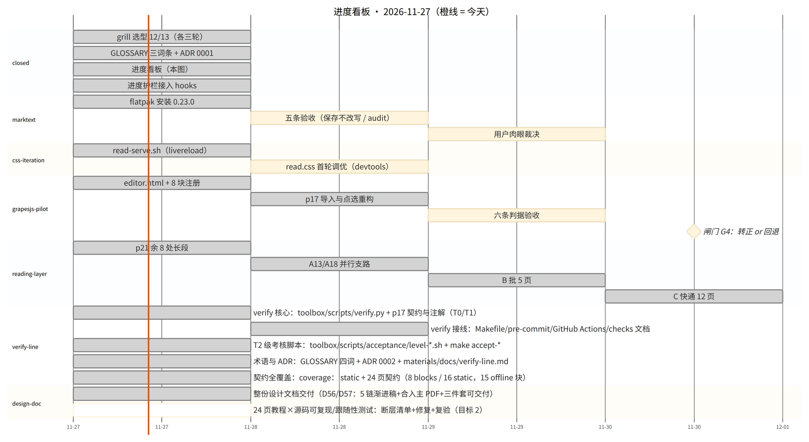
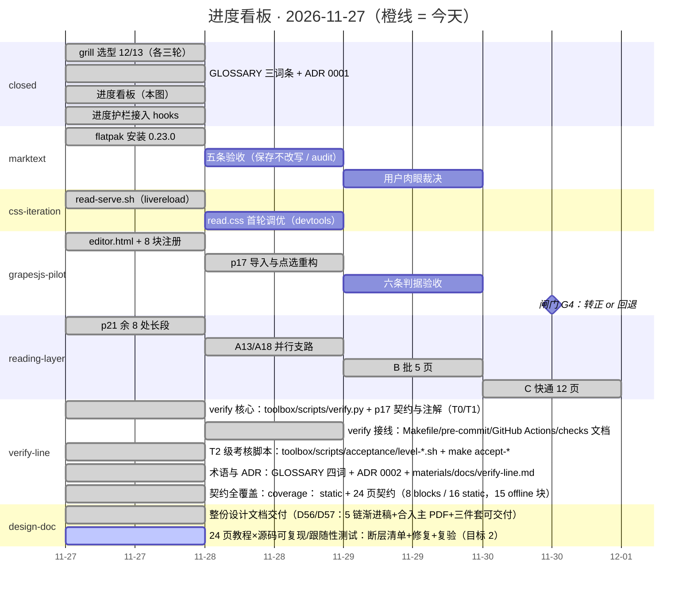

# 14 · 进度看板（甘特）

> 唯一进度看板：真相源是台账 `toolbox/workflows/ledger.yaml`，本图是它的投影；状态变更只经 `toolbox/scripts/task.py`。
> 图由 `python3 toolbox/scripts/task.py render` 从台账生成并渲染（下方 mermaid 是**生成物，勿手改**；本地 mermaid，离线可跑）。
> 看板只管「做到哪／下一步」；规则细节看 11（md 阅读层）/ 12（MarkText）/ 13（HTML 重构轨）。

## 甘特源（改这里 → 重渲染 → 图更新）

## 读图规则

| 标记 | 含义 |
|---|---|
| `done`（灰） | 已收口，有落盘证据 |
| `active`（蓝） | 正在做，同一时间只有 1–2 项 |
| `crit`（红） | 等用户裁决/确认，agent 不代答 |
| 菱形 milestone | 闸门：过则进下一段，不过则回退（Q8 六条判据） |
| 橙竖线 | 今天（todayMarker） |

## 下一步指针（每次更新后改写这一行）

**当前：进度护栏已接入（hooks）；下一步→ MarkText 装完五条验收（后台下载中）与 read-serve.sh（livereload）。**

## 进度怎么保证实时与准确

> ⚠️ 本节以下描述的是**旧机制**（手改甘特 + check_progress），已被任务生命周期台账取代：
> 真相源 `toolbox/workflows/ledger.yaml`、唯一写入口 `toolbox/scripts/task.py`、规格 `toolbox/workflows/task-lifecycle.md`。
> 保留下文仅作决策演进记录。

> 手工进度板的两种失败：**失实时**（图旧于事实）与**假 done**（标了做完但没真做）。
> 解法不靠“记得更新”，靠两条机制：

1. **更新是收尾动作的一部分（治失实时）**：并入 AGENTS 硬规则 3「先落盘后收尾」——
   每个工作项的 DoD 加一条“改甘特对应行 done/active → 重渲 PNG”，不单独做“维护看板”这件事。
   本项目本就按闸门/收尾点推进，所以“实时”= 每个收尾点必更新，不是后台秒级同步。
   （todayMarker 自动跟系统日期，时间轴不需手动维护。）
2. **状态有可核对的证据（治假 done）**：每个标 done 的项必须挂一条机器可验的证据
   （文件存在 / 命令 exit 0 / audit 24/24），由 `toolbox/scripts/check_progress.py` 核对。
   证据对不上就不算 done——把“声明”钉到“现场”（GLOSSARY：声明/现场/身份）。

### 证据表（done 项 → 可核对证据，check_progress.py 读这张表）

| 工项 | 证据（文件 glob 或命令） | 机器判据 |
| - | - | - |
| grill 选型 12/13 | `materials/humen-desicions/12-md-editor.md` `13-html-rebuild.md` | 两文件存在且含“已落定” |
| GLOSSARY 三词条 + ADR | `GLOSSARY.md` 含“复核编辑器”“重构版”；`materials/docs/adr/0001-dual-canon.md` | grep 命中 + 文件存在 |
| 进度看板（本图） | `materials/humen-desicions/progress-gantt.png` 新于本文 mtime | PNG mtime ≥ md mtime |
| 闸门不破 | `python3 tutorial/shots/audit_book.py` | exit 0 且末行 24/24 |

> 待填：MarkText / GrapesJS / read-serve 等 done 后各加一行证据。

用法：`python3 toolbox/scripts/check_progress.py`——任一行证据对不上则退出码 1，列出漂移项。

## 触发方式：hooks，不是守护进程

> 问：check_progress 要做成定时跑的 daemon 还是 hooks？——**hooks**。

状态只在离散点变（收尾、提交），定时轮询不会自变的文件只会空转；且事件驱动才能把漂移
挡在进入历史之前。接入仓库已有的护栏，不新建机制：

1. **pre-commit hook（主）**：给 `.githooks/pre-commit` 加第 4 项——调 `check_progress.py --quick`（跳过内部 audit，
   因 audit 已由第 1 项跑过），守住“改了看板源但忘重渲”不进提交。
2. **`make audit` 聚合**：加为第 5 项，手动全量校核入口。
3. **write-first 纪律**：agent 每个收尾点跑一次（本轮已演示）。

**前置修正（入 hook 前必做）**：现在用 PNG mtime 判新鲜，但 commit/clone 不保留 mtime，
换机器 checkout 会误报。改为**源哈希对账**：`render_progress_gantt.py` 写一个
`progress-gantt.png.meta`（存渲染时 mermaid 源的 sha256），`check_progress.py` 比对现源 sha 与 meta。
这才是 GLOSSARY 的“身份”（是不是同一份），而非“现场时间戳”。

> 待用户确认后：①先做源哈希对账改造；②`make install-hooks` 装 hook（当前 core.hooksPath 未设）；③接入 pre-commit 与 make audit。

### 已接入（2026-11-23）

- ✅ 源哈希对账：`render_progress_gantt.py` 写 `progress-gantt.png.meta`；`check_progress.py` 比对现源 sha（已去掉 mtime 误报）。
- ✅ `make install-hooks` 已跑（core.hooksPath=.githooks）。
- ✅ pre-commit 第 4 项（`check_progress.py --quick`）；`make audit` 第 5 项。
- 实测：`make audit` 5/5 全绿；故意改源不重渲时 `check_progress` 报 DRIFT、退码 1。

**问：commit 确实能触发 check_progress.py，但要是没有 commit 呢？**

**答（已实现）**：主网不是 commit hook，而是 `toolbox/scripts/task.py` chokepoint——每次 `start/done` 都执行
依赖闸与 review 门禁，**与 git 解耦**，不 commit 也拦得住跳步/假 done。pre-commit 的 `task.py check --quick`
只是兜底（揪手改台账/忘重渲）。台账 `toolbox/workflows/ledger.yaml`；旧 `check_progress.py` 已转为转发壳；
完整规格见 `toolbox/workflows/task-lifecycle.md`。