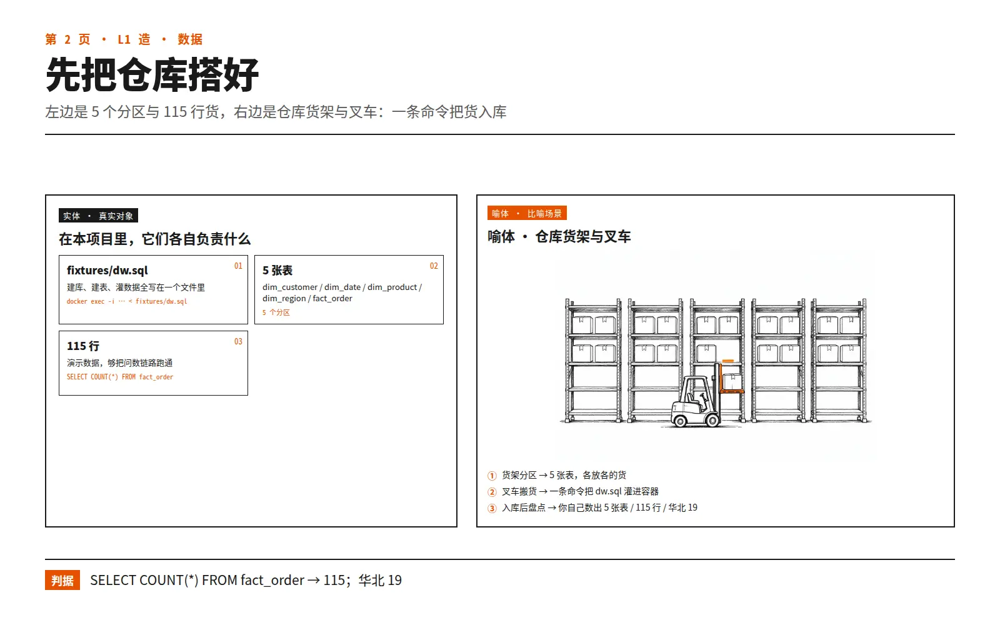
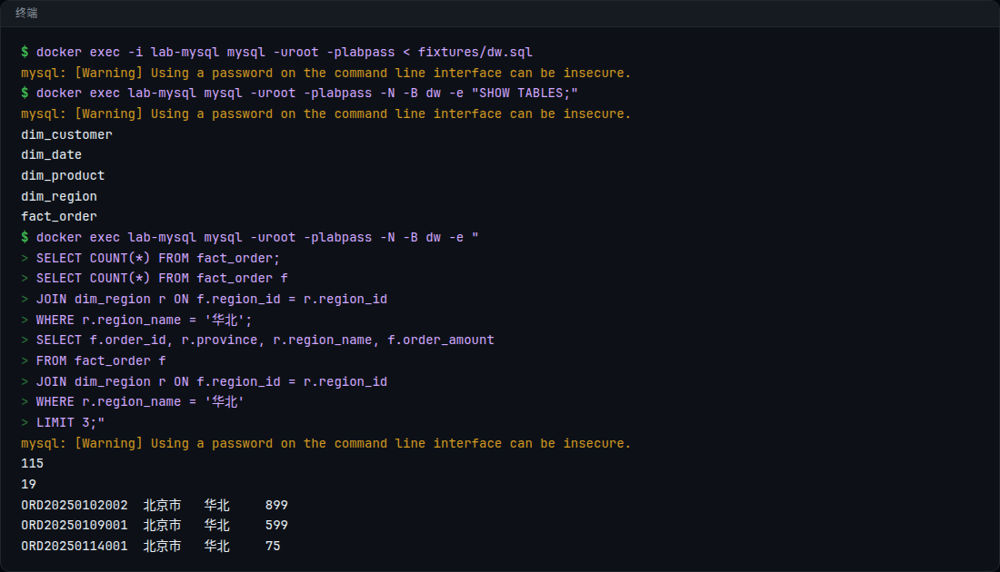

# 第 2 页 · 导入 dw.sql：建表灌数据

> **城市坐标 · P2 仓库分区与入库通道（交付物 ③④）**｜给仓库隔出 5 个分区、把 115 行货入库：从此问一句有货可取。

## 这一页构建什么

把 `system/fixtures/dw.sql` 导入第 1 页那个容器：一条命令把建库、建表、灌数据全做完（口语常说“灌数据”）。页末你自己用 SQL 数出表几张、订单几行、华北几单，才算验收。



## 猜一猜

先写下答案，再动手。

第 1 条命令把 `dw.sql` 里几百行 `CREATE` / `INSERT` 送进 MySQL。终端会**逐条打印**每张表、每行数据，还是**什么都不打印**？导入完再数一次：`SELECT COUNT(*) FROM fact_order` 会回几？（0 / 115 / 其他数字）

## 动手

第 1 页的 `lab-mysql` 要先创建好、正在运行；报 `No such container: lab-mysql` 就回第 1 页重跑。以下命令仍在**仓库根目录**执行（`system/fixtures/dw.sql` 在这里）。

**第 1 条：导入 `dw.sql`。**

```bash
docker exec -i lab-mysql mysql -uroot -plabpass < system/fixtures/dw.sql
```

`-i` 让容器的标准输入保持打开，`< system/fixtures/dw.sql` 是**宿主机** shell 的重定向（第 1 页讲过）：文件内容从你的终端接进容器的 `mysql`，容器里的 `mysql` 把它当脚本逐句执行。**少了 `-i` 会静默失败**：`mysql` 读到空输入，不建表也不报错，退出码还是 0。

**第 2 条：看库里的表。**

```bash
docker exec lab-mysql mysql -uroot -plabpass -N -B dw -e "SHOW TABLES;"
```

`dw` 是库名；`-N -B` 让输出只留表名，方便逐行对。终端里照样会多一行密码 `Warning`，忽略它。

**第 3 条：数行数、看华北订单。** 一条命令里写三条 SQL，按顺序回三段结果。

```bash
docker exec lab-mysql mysql -uroot -plabpass -N -B dw -e "
SELECT COUNT(*) FROM fact_order;
SELECT COUNT(*) FROM fact_order f
JOIN dim_region r ON f.region_id = r.region_id
WHERE r.region_name = '华北';
SELECT f.order_id, r.province, r.region_name, f.order_amount
FROM fact_order f
JOIN dim_region r ON f.region_id = r.region_id
WHERE r.region_name = '华北'
LIMIT 3;"
```

`fact_order` 里只存了 `region_id`，没有“华北”这两个字，第二段 SQL 得 JOIN 到区域表才筛得出来；第三段只取前 3 单，下一段拿它和对账。

## 你应该看到

第 1 条除了那行密码 `Warning`，什么都不打印——`CREATE` / `INSERT` 不回显，**一行业务输出都没有就是成功**。

第 2 条回 5 行表名，按字母序：`dim_customer`、`dim_date`、`dim_product`、`dim_region`、`fact_order`。

第 3 条回 5 行：115 是 `fact_order` 总行数，19 是其中华北的单数，最后三行是华北的前 3 单（列之间是 Tab）：

```text
115
19
ORD20250102002	北京市	华北	899
ORD20250109001	北京市	华北	599
ORD20250114001	北京市	华北	75
```



## 对账

- 猜“会逐条打印”：不对。`mysql` 批量读脚本时不回显执行过程；除密码 `Warning` 外一行输出都没有。所以“没输出”不是没执行，**必须自己查表、数行数**（第 2、3 条）才算验完。
- 猜 0：先看第 1 条是不是漏了 `-i`——那会“成功”退出但什么都没导入；如果文件路径写错，宿主机 shell 会直接报 `No such file or directory`。
- 猜 115：对。这个数由 `system/fixtures/dw.sql` 里 `fact_order` 的 `INSERT` 决定；115 行里华北（`region_id` 为 `R004`）19 单。**115 只是 `fact_order` 单数**；5 张表合计 246 行（`dim_date` 90 等），别拿 115 去对全库行数。
- 5 张表和 `dw` 库不是 MySQL 送的：`dw.sql` 开头 `CREATE DATABASE`，后面 5 段 `CREATE TABLE`；第 2 条列出的表名就来自这 5 段。
- 第 3 条最后三行能出现“华北”两个字，靠的是 `JOIN dim_region r ON f.region_id = r.region_id`：订单里只有编号 `R004`，“华北”是从区域表连过去取到的。JOIN 条件写错，你会看到一行都没有。
- 最后三行只出 3 单，不是华北只有 3 单——`LIMIT 3` 只限制显示；华北一共 19 单，第二段 SQL 已经数过。

> **你现在拥有**：一个装着 5 张表、115 单数据的 `dw` 库；它是后面每次查询要落脚的数据底座。

## 自己改一下

1. 去掉第 2 条里的 `-N`：第一行会多出什么？（参考：表头 `Tables_in_dw`，下面还是 5 行表名。）
2. 把第 3 条第二个 `'华北'` 换成 `'华南'`：数会变成多少？再想想 `dim_region` 里“华南”对应哪个省。（参考：26 单；华南对应广东省（`R001`）。把这句的 `COUNT(*)` 换成 `SUM(f.order_amount)`，华南销售额是 `70202`。）
3. 再跑一遍第 1 条导入，再数一次第 3 条第一句：数会变吗？（参考：还是 `115`——每张表前的 `DROP TABLE IF EXISTS` 会先删旧表，不会翻倍。）
