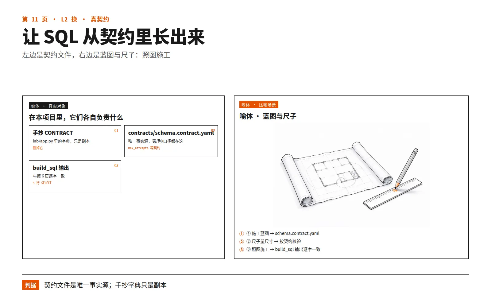
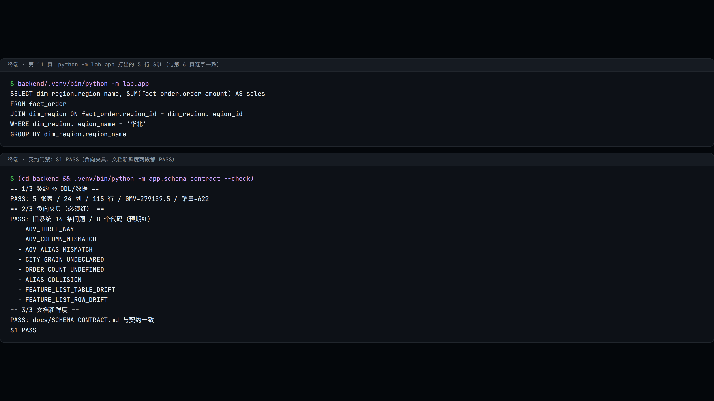

# 第 11 页 · 换真契约：让 SQL 从契约文件长出来

> **城市坐标 · L2 通水电网 · 换计量标准**｜取货单不再手写，改照对方的办事指南（契约文件）长出来。

> 前置：第 0 页备好环境；本页接 L1 留下的 `lab/app.py`（第 8 页那份；L1 = 第 0–9 页盖出来的骨架版）。不用启动服务，也不用连 MySQL。
## 这一页构建什么

把第 6 页手抄进 `lab/app.py` 的 `CONTRACT = {...}` 字典删掉，改成从 `system/contracts/schema.contract.yaml` 加载：手抄字典是**副本**，契约文件是**唯一事实源**。

**行为不变**：`build_sql` 改成按契约的指标别名/公式和地区全集生成 SQL，拼出的 5 行必须和第 6 页逐字一样——换了来源，行为不变。



## 猜一猜

动手前写下答案：删掉手抄字典、改成读契约后，打出来的 5 行 SQL 会变吗？产品说“销售额的口径改了”，你改代码，还是只改契约文件？

## 动手

改 `lab/app.py`，三处。三步都改完按 **Ctrl+S 保存**再跑。

**输出一样看不出没保存**：不保存跑的还是第 8 页的旧代码——但旧代码也打同样的 5 行 SQL，改没改成功由后面「拆一刀」验。

**第 1 步：加两行 import。** 在 `import json / pymysql / time` 这段标准库 import 之后、`from fastapi ...` 之前插两行：`import yaml` 和 `from pathlib import Path`。

**第 2 步：删掉 `CONTRACT = {...}` 整块（9 行），原位置换成加载 + 两个小函数：**

```python
ROOT = Path(__file__).resolve().parents[1]
CONTRACT = yaml.safe_load((ROOT / "contracts" / "schema.contract.yaml")
                          .read_text(encoding="utf-8"))


def _region_values() -> list[str]:
    table = next(t for t in CONTRACT["tables"] if t["name"] == "dim_region")
    column = next(c for c in table["columns"] if c["name"] == "region_name")
    return column["value_domain"]["values"]


def _metric_formula(keyword: str) -> str | None:
    for metric in CONTRACT["metrics"]:
        if keyword in [metric["name"], *metric.get("aliases", [])]:
            return metric["formula"]
```
**`ROOT`**：从 `lab/app.py` 往上两级算出仓库根，所以契约写相对路径、换机器也能读。

**`_region_values()`**：在 `tables` 里找到 `dim_region` 的 `region_name` 列，取 `value_domain.values`。

**`_metric_formula()`**：在 `metrics` 里按 `name` 或 `aliases` 命中就返回 `formula`，都不中返回 `None`（函数不写 `return` 时默认返回它）。

**第 3 步：`build_sql` 改用这两个函数。** 只换前 3 行，`FROM/JOIN/WHERE/GROUP BY` 4 行不动：

```python
    region = next(k for k in keywords if k in _region_values())
    metric = next(k for k in keywords if _metric_formula(k))
    sql = f"""SELECT dim_region.region_name, {_metric_formula(metric)} AS sales
```
在仓库根目录跑这两条（第二条的 `cd system/backend` 不能省：在仓库根跑 `-m app.schema_contract` 会报 `No module named 'app'`）：

```bash
system/backend/.venv/bin/python -m lab.app
(cd system/backend && .venv/bin/python -m app.schema_contract --check)
```

注意第二条外面的括号：`cd system/backend` 在子 shell 里执行，不会把你当前目录带走，跑完你仍停在仓库根目录——后面「拆一刀」的命令照原样敲就行。

## 你应该看到

第一条命令打出的 5 行，和第 6 页逐字一致：

```
SELECT dim_region.region_name, SUM(fact_order.order_amount) AS sales
FROM fact_order
JOIN dim_region ON fact_order.region_id = dim_region.region_id
WHERE dim_region.region_name = '华北'
GROUP BY dim_region.region_name
```
第二条命令绿到底（2/3 的负向夹具“必须红”也是 PASS，8 个代码逐条列出，这里不贴）：

```
== 1/3 契约 ↔ DDL/数据 ==
PASS: 5 张表 / 24 列 / 115 行 / GMV=279159.5 / 销量=622
…（负向夹具、文档新鲜度两段都 PASS）
S1 PASS
```



## 对账

- 你猜 SQL 会变吗？**一字没变**。
    - **证据**：契约里 GMV 的 `formula` 就是 `SUM(fact_order.order_amount)`，`region_name.value_domain.values` 里也有 `华北`——手抄字典抄的本就是契约，换来源只是删掉副本、留下原文。
- `aliases` / `formula` 落在 SQL 哪一段：`build_sql` 拿 `"销售额"` 查 `metrics`，命中 GMV 的 `aliases: [销售额, 成交总额, 订单总额]`，取回 `formula` 填进 `SELECT ... {formula} AS sales` 的公式位。
    - **`"华北"` 落哪**：由 `_region_values()` 在 `value_domain.values` 里查到，填进 `WHERE ... = '{region}'` 的引号里。
- 为什么唯一事实源重要：口径只在 yaml 一处定义。以后改销售额口径，只改 `formula`，`build_sql` 不用动。
    - **漂移**：手抄字典是第二份，改漏一处，两个人就拿两份口径各算各的——这就叫**漂移**。第 6 页那条 SQL 没错，错的是它有两份。

> **你现在拥有**：一条从唯一事实源取口径的生成链——`build_sql` 的指标公式和地区取值不再写死（注意：`extract_keywords` 里的 `REGIONS`/`METRICS` 还是写死的，那是第 5 页的遗留，书内不再换；属于后续演进方向），改口径只改一处；第 12 页会把它真交给数据库。

## 拆一刀

1. 先拍快照：`toolbox/scripts/lab save p11-before`（名字只能用字母、数字、点、下划线、短横线，且必须以字母或数字开头；中文会被拒）。
2. 打开 `system/contracts/schema.contract.yaml`，把 `region_name` 的 `values: [华南, 华东, 西南, 华北, 华中]` 改成 `values: [华南, 华东, 西南, 华中]`，Ctrl+S，再跑 `system/backend/.venv/bin/python -m lab.app`。

**会红什么**：`"华北"` 在契约里查不到了，`next()` 空手而归，抛 `StopIteration`、退出码 1。

**报错原文**（这里只留与定位相关的行；你的终端会多几行 `<frozen runpy>`，路径用 `...` 略去，不影响结论，行号以你的文件为准）：

```
Traceback (most recent call last):
  File ".../lab/app.py", line 48, in build_sql
    region = next(k for k in keywords if k in _region_values())
StopIteration
```
3. 还原：`toolbox/scripts/lab reset p11-before --yes`，末行是 `现在工作区与快照 "p11-before" 完全一致。`；再跑一次 `system/backend/.venv/bin/python -m lab.app`，5 行 SQL 回来，`WHERE dim_region.region_name = '华北'` 还在第 4 行。

**一句结论**：唯一事实源被改坏，程序当着你面报错；没有唯一事实源，改坏一处，另一处替你继续跑——这就是本页要的反面。
